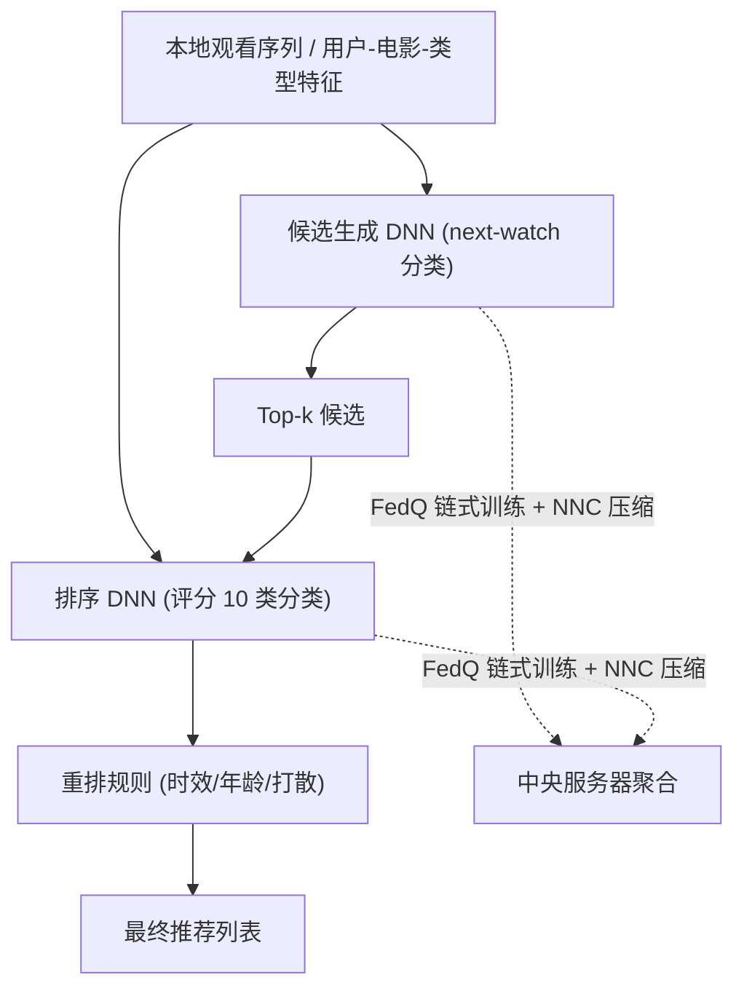

# A Privacy Preserving System for Movie Recommendations Using Federated Learning (基于联邦学习的隐私保护电影推荐系统)

- **会议/期刊**: ACM Transactions on Recommender Systems (TORS), Special Issue on Trustworthy Recommender Systems
- **作者与机构**: David Neumann, Andreas Lutz, Karsten Müller, Wojciech Samek (Fraunhofer HHI / TU Berlin)
- **推荐链路定位**: 召回 (Candidate Generation) + 精排 (Ranking) + 重排 (Re-ranking) 三阶段漏斗
- **研究方向**: 去偏公平、可信隐私与工业架构 / 冷启动与长尾推荐
- **论文原文**: [https://arxiv.org/abs/2303.04689v4](https://arxiv.org/abs/2303.04689v4)
- **开源代码**: 暂未开源

## TL;DR (1分钟核心速览)

针对推荐系统集中收集用户隐私数据、且联邦推荐 (FedRec) 面临客户端数据非独立同分布 (non-i.i.d.) 与本地样本极小导致全局模型难以收敛的双重痛点，本文提出端到端联邦电影推荐系统：以三阶段漏斗架构为骨架，核心创新 FedQ 将客户端串成"队列"链式训练以融合多分布数据、稳定更新，并用 MPEG NNC 标准压缩参数降低通信。在 MovieLens 25M（16.2 万客户端）上，FedQ 的验证 top-100 准确率与 MSE 追平甚至超越集中式非联邦基线，同时通信量压缩至原模型的一小部分。

## Background & Motivation (背景与核心矛盾)

- **主流范式**: 推荐系统普遍采用集中式训练，需将用户交互与画像数据汇聚到服务器；联邦学习 (FedAvg) 则让数据留在本地、仅上传模型更新，是隐私保护的天然方案。
- **前人局限**: (1) FedAvg 在客户端数据 non-i.i.d. 时更新方向冲突、收敛不稳，且 MovieLens 中绝大多数用户仅几十条评分，产生极小噪声更新直接拖垮全局收敛；(2) 仅传梯度/参数仍可被梯度反演攻击重建原始输入，且大模型 (60–120MB) 在数十万客户端下通信开销达 GB 级。
- **核心洞察 (Key Insight)**: 若让多个客户端"接力"训练同一份模型再聚合，等价于让每次上传的更新同时见过更多数据与更多分布，从而在**不泄露任何单客户端来源信息**的前提下同时缓解小样本与 non-i.i.d.。
- **本文切入点**: 用队列链式训练 (FedQ) 替代单轮本地训练，叠加有损量化压缩 (NNC) 作为通信与隐私的双重手段。

## Method (核心方法设计)

### 1. 整体框架 (Overall Architecture)

系统遵循经典三阶段漏斗：候选生成器以用户历史观看序列（one-hot 电影 ID → 64 维 embedding → 平均池化 → 1024-512-256 塔式全连接）做 next-watch 分类，输出全库电影概率分布取 top-$k$；排序器以用户 ID (32d)、电影 ID (128d)、类型 (16d) 及电影年龄/评分年龄为输入，将评分预测重构为 10 类分类问题输出评分分布并排序；重排阶段用人工规则（时效性、年龄限制、随机打散、冷启动物品扶持）兜底。两个模型均在 FedQ 协议下联邦训练，上传前经 NNC 压缩。

### 2. 关键设计拆解 (Key Designs)

1. **FedQ 队列式联邦训练（核心创新）**：痛点在于单客户端本地数据太少且分布偏斜，聚合出的是噪声方向。做法是每轮采样 $N$个客户端后划分为$N/L$条长度为$L$的队列，队首拿全局模型$\boldsymbol{\theta}_{t-1}$，队内第$i$ 个客户端接收前一个客户端的本地模型继续训练，仅队尾模型参与聚合：
$$\boldsymbol{\theta}_t = \sum_{k=1}^{N/L}\frac{s_k}{\sum_{c_i\in C_t}|\mathcal{D}_i|}\boldsymbol{\theta}_t^k,\quad s_k=\sum_{i\in \text{queue}_k}|\mathcal{D}_i|$$
直觉：队尾模型已"见过" $L$个客户端的异质数据，更新更平滑；且任何客户端都不知道自己在队列中的位置与模型来源，隐私性不弱于标准 FL。代价是单轮耗时变为 FedAvg 的$L$倍（$O(L\cdot P\cdot E\cdot \bar{|\mathcal{D}|}/B)$），属于用时间换收敛质量与隐私。

2. **NNC 有损量化压缩（通信 + 隐私双效）**：模型 60–120MB，移动端带宽受限。采用 MPEG-7 Part 17 (DeepCABAC) 标准，对每层自适应选择量化点数后做上下文自适应二进制算术编码，压缩率显著优于加权 Lloyd (13.6×) 与均匀量化 (5.7×)。作者进一步论证：低于 8-bit 的混合精度量化构成参数混淆，可削弱梯度反演攻击（引 Ovi 等 8-bit 量化后 450 轮攻击无泄露的证据），但明确标注此为"猜想，留待未来验证"。

3. **训练目标、负采样与推理效率**：候选生成用 softmax 交叉熵在全库电影上做分类（等价隐式全负采样，无显式负采样策略）；排序器同样用 softmax 交叉熵而非回归（回归会塌缩到均值评分）。推理时候选生成仅需一次前向即得全库分布，避免逐物品打分。

## Experimental Setup & Evaluation Protocol (实验设置与评估协议)

- **数据集与预处理**: MovieLens 25M，未做 5-core 过滤，保留原始长尾分布：

| 数据集 | #Users | #Items | #Interactions | 稀疏度/密度 | 特征/场景说明 |
| :--- | :---: | :---: | :---: | :---: | :--- |
| MovieLens 25M | 162,541 | 59,047 | 25,000,095 | 密度 ≈ 0.26% | 评分 0.5–5.0（步长 0.5）；用户均 153.8 条、电影均 423.4 条，58.8% 电影 <10 条评分 |

- **数据划分与防穿越 (Splitting Strategy)**: 按评分时间戳做**时间序切分**（训练/验证），并专门实验了不同时间顺序对 top-100 验证准确率的影响（图 6），以规避未来信息穿越；候选生成按窗口大小构造观看序列（图 8 调优窗口）。
- **排名评测协议 (Ranking Protocol)**: 采用**验证集 top-100 准确率**（next-watch 命中）与排序器的**验证准确率 + MSE**；未使用全库 Full-Ranking 的 HR/NDCG 标准协议，属该系统论文的评估短板。
- **对比基线与超参设置**: 对比对象为**非联邦集中式基线**（同架构集中训练）、**FedAvg**、**FedQ**，以及 **FedQ + NNC 压缩**三档；embedding 维度经附录实验确定（候选 64，排序用户 32/电影 128/类型 16），隐藏层数亦经消融确定（候选 3 层、排序 1 层）。

## Key Experimental Results (实验关键数据)

### 1. 主实验对比 (Main Results)

原文以训练曲线（图 10–12）而非单表呈现，核心结论归纳如下（数值为最终验证轮次量级）：

| 方法 | 候选生成 top-100 Acc | 排序 Acc | 排序 MSE | 通信开销 | 客户端规模 |
| :--- | :---: | :---: | :---: | :---: | :---: |
| 非联邦集中式基线 | 基准 | 基准 | 基准 | — | 1 |
| FedAvg | 明显低于基线 | 中等 | 偏高 | 1× | 162k |
| **FedQ** | **≈ 或 > 基线** | **≈ 或 > 基线** | **≈ 或 < 基线** | $L$× 单轮时长 | 162k |
| **FedQ + NNC** | **与 FedQ 持平** | **与 FedQ 持平** | **与 FedQ 持平** | **压缩至原模型一小部分** | 162k |

### 2. 消融实验 (Ablation Study)

| 配置 | 候选 top-100 | 排序 Acc / MSE | 结论 |
| :--- | :---: | :---: | :--- |
| FedAvg (基线) | 低 | 中 / 高 | non-i.i.d. + 小样本下收敛差 |
| FedQ (队列长 $L$) | 提升 | 提升 | 链式训练稳定更新 |
| FedQ + 电影年龄/评分年龄特征 | — | 提升 | 额外模态有效（图 9） |
| FedQ + NNC 压缩 | 持平 | 持平 | 压缩几乎无损 |
| 回归 vs. 分类排序目标 | — | 分类显著更优 | 回归塌缩至均值 |

### 3. 关键实验发现 (Key Findings)

1. **FedQ 是性能拐点**：标准 FedAvg 在 16 万异质客户端下仅达中等性能，切换 FedQ 后候选生成与排序器均追平甚至超过集中式基线，证明"链式多分布暴露"确实抵消了小样本噪声更新。
2. **压缩零代价**：NNC 将 60–120MB 参数压至原尺寸的一小部分，验证指标与未压缩 FedQ 基本重合，说明量化误差对推荐精度不敏感，可作为即插即用模块。
3. **特征与目标函数选择影响显著**：加入电影年龄/评分年龄后排序准确率与 MSE 同步改善；而将评分预测从回归改为 10 类分类是排序器可用的前提，回归版本直接塌缩到均值评分。

## Highlights & Limitations (亮点、对比与审稿批判)

- **与代表作对比 (vs. Prior Work)**: 相比 FedRec 中基于聚类 (Jie 等) 或元学习 (Chen 等) 处理 non-i.i.d. 的方案，FedQ 的差异在于能处理**真正极小**的本地数据集（聚类/元学习均不擅长）；相比 FedFast/FedKD 需改造整条 FL 流水线，NNC 是即插即用的熵编码压缩；相比同态加密/差分隐私方案，本文以"早聚合 + 量化混淆"提供更轻量的隐私层。
- **可迁移亮点**: (1) 队列链式训练可迁移到任何客户端样本极少的联邦场景（如跨设备冷启动）；(2) 用有损量化兼作通信压缩与参数混淆，是低成本隐私增强的实用技巧。
- **审稿级局限批判**: (1) 评估仅用验证 top-100 与 MSE，缺少标准全库 HR/NDCG 与采样排序协议，且无显著性检验，横向可比性弱；(2) FedQ 单轮耗时 $L$ 倍、且量化防反演仅为猜想未经攻击实验验证，隐私主张缺乏定量支撑。

## Rating (四维评分)

- **方法创新性 (Novelty)**: ⭐⭐⭐⭐ （FedQ 链式队列训练思路简洁且直击小样本+non-i.i.d. 双痛点，但本质是 FedAvg 的训练调度变体，理论分析仅到复杂度层面）
- **评估协议与实验扎实度 (Protocol & Experiments)**: ⭐⭐⭐ （16 万客户端规模实验难得，但缺标准排名指标、显著性检验与真实攻击实验，评估偏系统验证而非算法对比）
- **写作与数学规范度 (Clarity & Rigor)**: ⭐⭐⭐⭐ （架构、算法伪码与复杂度推导清晰完整，隐私论证部分明确区分"已证"与"猜想"，态度严谨）
- **工业落地与复现价值 (Industrial & Practical Value)**: ⭐⭐⭐⭐ （端到端三阶段系统 + 标准压缩 + 大规模验证，工程参考价值高；但未开源、FedQ 时延代价需线上权衡）

