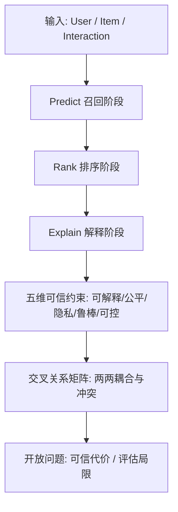

# A Survey on Trustworthy Recommender Systems (可信推荐系统综述)

- **会议/期刊**: ACM Transactions on Recommender Systems (TORS)
- **作者与机构**: Yingqiang Ge, Shuchang Liu, Zuohui Fu, Juntao Tan, Zelong Li, Shuyuan Xu, Yunqi Li, Yikun Xian, Yongfeng Zhang（Rutgers University）
- **推荐链路定位**: 全链路（召回 / 排序 / 解释生成 / 可控交互）
- **研究方向**: 去偏公平、可信隐私与工业架构
- **论文原文**: [论文原文链接](https://arxiv.org/abs/2207.12515v2)
- **开源代码**: 暂未开源

## TL;DR (1分钟核心速览)

本文是首篇将推荐系统"可信性"作为整体来系统梳理的综述，针对现有综述各自为战、缺乏跨视角关联的痛点，提出以**可解释性、公平性、隐私、鲁棒性、可控性**五大维度为骨架的统一框架，并用一张 $5\times5$ 交叉关系矩阵（表 1）刻画两两维度间的耦合与冲突（如"隐私感知的公平""鲁棒的隐私"）。全文覆盖 400+ 篇顶会/顶刊工作，最终落脚于"可信性的代价"与"评估局限"两大开放问题，为 TRS 研究提供全景地图而非单一算法提升。

## Background & Motivation (背景与核心矛盾)

- **主流范式**: 推荐系统长期以**精度**为唯一优化目标，从浅层 CF/MF 到深度 CF/CR 再到 LLM 大模型，工业部署几乎覆盖电商、社交、招聘、医疗等全场景。
- **前人局限**: ① 现有可信综述（可解释 [69,341,438]、公平 [61,90,213]、隐私 [165,362]、鲁棒 [17,91]、可控 [170,171]）各自封闭，**从不讨论维度间耦合**；② 最接近的 Dong [96] 仅覆盖社交/鲁棒/可解释，Mobasher [245] 仅讨论攻击与鲁棒，均未触及内在关系。
- **核心洞察 (Key Insight)**: 可信性是一个**多视角耦合系统**——解释可能泄露隐私（邻居解释暴露好友行为）、公平目标可能被投毒攻击破坏、隐私保护（联邦）反而引入鲁棒性短板。单维度优化会在另一维度制造新风险。
- **本文切入点**: 以"信任 (trust)"的社会学定义为锚（trustor 愿向 trustee 暴露脆弱性），把五大维度组织成一张**交叉关系矩阵**，逐格给出代表性文献，从而把"可信"从并列清单升级为**相互制约的网络**。

## Method (核心方法设计)

### 1. 整体框架 (Overall Architecture)

综述不提出新模型，而是构建一个**"五维 + 交叉"的分析框架**：先在第 3 节给出推荐系统基础（输入 user/item/interaction，输出经 Predict→Rank→Explain 三阶段的个性化列表），再在第 4–8 节分别展开五大维度，每节末尾专设"与其他维度的关系"小节，最终在第 9 节汇总可信性的代价、维度内/间权衡与评估缺陷。核心贡献是表 1 的 $5\times5$ 矩阵：对角线指向各维度章节，非对角线给出跨视角代表作（如"公平×隐私"→ 联邦公平 [226,232,454]）。

### 2. 关键设计拆解 (Key Designs)

1. **五维可信骨架与信任语义锚定**：痛点在于"可信"一词被滥用、缺乏统一语义。作者以社会学信任定义（trustor 自愿向 trustee 暴露脆弱性）为锚，将 trustee 设为推荐系统、trustor 设为用户/生产者/平台/社会，由此推导出五维：不透明→怀疑（可解释）、不公→歧视（公平）、数据滥用→监控感（隐私）、易攻击→不可靠（鲁棒）、被操纵→信息茧房（可控）。这一映射使五维不再是拍脑袋清单，而是**从"信任破裂机制"反推**的必然维度。

2. **跨视角关系矩阵（表 1）**：这是全文最具增量的结构化贡献。对每对维度 $(X,Y)$给出"$X$-aware$Y$"的具体研究问题，例如：**隐私感知的可解释**需在邻居解释中匿名化好友行为 [45,126]；**可解释的公平**因推荐特征海量、致偏特征非显式（不像招聘中的性别/种族），必须自动探测致偏特征 [119,130,448]；**鲁棒的隐私**需抵御成员推断 [371,415,429] 与属性推断 [10,55,424,432] 攻击。矩阵揭示了**维度间既协同又冲突**的本质：公平与隐私可通过联邦学习协同，但联邦的端侧数据又比云端更易被攻击，形成鲁棒性短板。

3. **算法演进三阶段分类与可信性代价**：作者将推荐算法分为**浅层（CF/Content-based）→ 深层（CF 的相似度学习/表征学习 vs. CR 的协同推理）→ 大模型（P5/PETER/PEPLER/M6-Rec 等 PFM）**，并指出 LLM 推荐虽具零样本泛化，却有**个性化弱、虚构物品 [29,361]、算力开销大**三大可信隐患。第 9 节进一步提出"可信性的代价"：公平约束可能牺牲精度、隐私保护（联邦/差分隐私）可能降低个性化质量、可解释生成增加推理延迟——这些**精度-可信权衡**是工业落地的核心障碍。

## Experimental Setup & Evaluation Protocol (实验设置与评估协议)

作为综述，本文**无自建实验**，其"评估协议"体现为对领域评估现状的批判性梳理（第 9.3 节）：

- **评估对象**: 覆盖 IUI/UMAP/CHI/UMUAI/WWW/SIGIR/KDD/RecSys/CIKM/WSDM/ICDM/ICDE/AAAI/IJCAI/ICML/NeurIPS/UAI/TOIS/TORS/TKDE/TIST 等 20+ 顶会顶刊，400+ 篇工作。
- **评估维度**: 各维度指标割裂——可解释用用户满意度/信任度（主观），公平用 DP/EO 等统计指标，隐私用攻击成功率，鲁棒用性能下降幅度，可控用交互反馈质量，**缺乏统一基准**。
- **核心批判**: ① 现有评估多为**离线小规模**，缺真实用户在线 A/B；② 跨维度评估几乎空白（如"公平约束下的鲁棒性"无标准 benchmark）；③ 主观指标（信任、满意度）难量化、难复现。
- **对比基线**: 与 Dong [96]、Mobasher [245] 等前序综述对比，强调本文的**跨视角覆盖**是本质差异。

## Key Experimental Results (实验关键数据)

### 1. 主实验对比 (Main Results)

综述无定量主实验，其"结果"为**覆盖度与结构贡献对比**：

| 综述 | 可解释 | 公平 | 隐私 | 鲁棒 | 可控 | 跨视角关系 |
| :--- | :---: | :---: | :---: | :---: | :---: | :---: |
| Dong et al. [96] | ✓ | ✗ | ✗ | ✓ | ✗ | ✗ |
| Mobasher et al. [245] | ✗ | ✗ | ✗ | ✓ | ✗ | ✗ |
| 单维度综述 [69,61,165,17,170] | 各自单一 | 单一 | 单一 | 单一 | 单一 | ✗ |
| **本文** | **✓** | **✓** | **✓** | **✓** | **✓** | **✓（表 1 矩阵）** |

### 2. 消融实验 (Ablation Study)

综述无消融，但可将其"维度覆盖"视作结构性消融——若移除任一维度，跨视角矩阵将出现整行/整列空缺：

| 移除维度 | 矩阵缺失 | 典型丢失关联 |
| :--- | :--- | :--- |
| w/o 可解释 | 第 4 行/列 | 公平解释、隐私解释、可控解释 |
| w/o 公平 | 第 5 行/列 | 联邦公平、公平鲁棒性 |
| w/o 隐私 | 第 6 行/列 | 隐私感知公平、鲁棒隐私 |
| w/o 鲁棒 | 第 7 行/列 | 可解释鲁棒、可控鲁棒 |
| w/o 可控 | 第 8 行/列 | 可控公平、可控隐私 |

### 3. 关键实验发现 (Key Findings)

1. **维度耦合是常态而非例外**：表 1 中 20 个非对角格全部有文献支撑，说明任意两维都存在实质研究问题，"单维度优化"在真实系统中几乎不可能独立成立。
2. **隐私-公平存在结构性两难**：系统需敏感特征以提升弱势群体公平，但用户因担心被歧视而不愿共享敏感特征 [101,454]，形成"越保护越难公平"的循环，联邦公平 [226,232] 是目前主要破局方向。
3. **LLM 推荐引入新型可信风险**：P5/PETER 等大模型虽泛化强，但虚构物品 [29,361] 与算力开销构成**精度之外的新不可信源**，且现有评估体系尚未覆盖此类风险。

## Highlights & Limitations (亮点、对比与审稿批判)

- **与代表作对比 (vs. Prior Work)**: 相较 Dong [96]（仅社交/鲁棒/可解释）与 Mobasher [245]（仅攻击/鲁棒），本文首次把五维纳入**统一信任语义框架**并给出交叉矩阵；相较单维度综述，其价值不在深度而在**结构性与关联性**。
- **可迁移亮点**: ① "从信任破裂机制反推可信维度"的**问题驱动分类法**可迁移到其他 AI 可信研究；② 跨视角矩阵的**"X-aware Y"命名范式**为交叉研究提供了清晰的选题模板。
- **审稿级局限批判**: ① 作为 2022 年成稿、2024 年更新的综述，对 **LLM4Rec 与生成式推荐**的可信问题覆盖偏浅，仅作展望；② 全文无统一定量基准与在线实验，跨维度权衡停留在**定性论述**，缺乏可操作的量化 trade-off 曲线；③ 五维选择虽有理据，但**责任性 (accountability)、环境可持续性**等维度被排除，边界略显武断。

## Rating (四维评分)

- **方法创新性 (Novelty)**: ⭐⭐⭐⭐ （不提出新算法，但跨视角关系矩阵与信任语义锚定是结构性创新，填补综述空白）
- **评估协议与实验扎实度 (Protocol & Experiments)**: ⭐⭐⭐ （覆盖 400+ 文献扎实，但无自建定量实验与统一基准，跨维度评估仅定性）
- **写作与数学规范度 (Clarity & Rigor)**: ⭐⭐⭐⭐ （五维组织清晰、表 1 矩阵直观，但公式与形式化定义较少，偏概念性叙述）
- **工业落地与复现价值 (Industrial & Practical Value)**: ⭐⭐⭐⭐ （为工业界提供可信推荐全景 checklist 与权衡警示，但无开源代码与可复现 pipeline）

