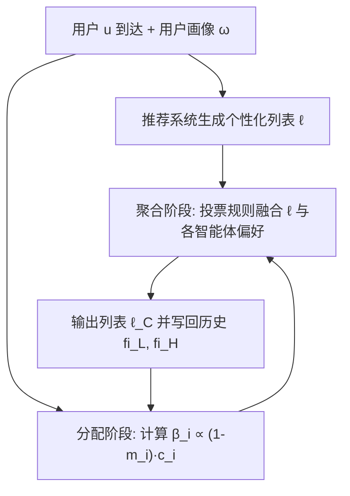
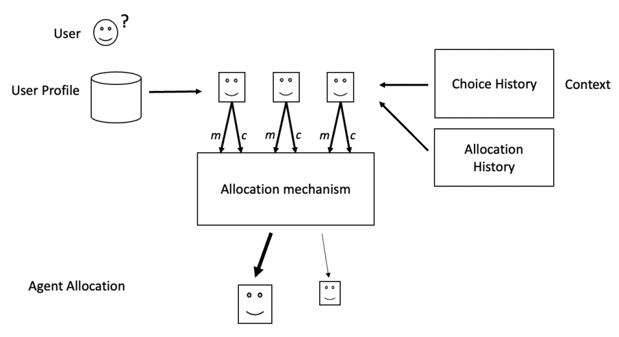

# Dynamic Fairness-aware Recommendation through Multi-agent Social Choice (基于多智能体社会选择的动态公平感知推荐)

- **会议/期刊**: ACM Transactions on Recommender Systems (TORS)
- **作者与机构**: Amanda Aird, Paresha Farastu, Joshua Sun, Elena Štefancová, Cassidy All, Amy Voida, Nicholas Mattei, Robin Burke（University of Colorado Boulder / Comenius University / Tulane University）
- **推荐链路定位**: 重排（Post-processing Re-ranking）
- **研究方向**: 去偏公平与工业架构 / 多任务学习与列表级重排
- **论文原文**: [https://arxiv.org/abs/2303.00968v3](https://arxiv.org/abs/2303.00968v3)
- **开源代码**: [https://github.com/that-recsys-lab/scruf_d](https://github.com/that-recsys-lab/scruf_d)

## TL;DR (1分钟核心速览)

现有公平推荐研究普遍把公平简化为「受保护组与非受保护组结果均等」的静态单目标问题，无法处理真实平台中多利益相关方、多定义、动态演化的公平诉求。本文提出 SCRUF-D，将公平推荐形式化为「分配（allocation）+ 聚合（aggregation）」两阶段社会选择问题：每个公平关注点实例化为一个智能体，按历史不公平度与用户兼容度动态分配推荐机会，再通过投票规则与个性化打分融合。在 Microlending、MovieLens 与合成数据上，该框架可在保持 NDCG 的同时动态纳入多个公平关注点，显著优于 OFair 与 Multi-FR。

## Background & Motivation (背景与核心矛盾)

- **主流范式**: 公平推荐多沿用分类任务的思路，以「受保护组 vs 非受保护组」的结果均等为目标，通过正则化或后处理重排实现单一公平约束。
- **前人局限**: 其一，真实场景中公平是多面的——同一系统内不同群体对公平有不同定义（如地域代表性 vs 观点多样性），而现有工作（Kearns、Sonboli 等）对所有群体使用同一定义；其二，公平干预是静态的，模型训练完成后策略固定，无法根据当前库存、用户构成与近期推荐历史动态调整。
- **核心洞察 (Key Insight)**: 公平是「 contested concept」，应视为随时间演化的动态状态；推荐机会本身是稀缺资源，应像分配稀缺物品一样在多个公平关注点之间动态分配。
- **本文切入点**: 把每个公平关注点建模为具备「评估—兼容—偏好」三能力的智能体，用社会选择理论统一刻画分配与聚合，推荐算法本身作为始终在场的特殊智能体。

## Method (核心方法设计)

### 1. 整体框架 (Overall Architecture)

SCRUF-D 将推荐生态视为多智能体系统。用户 $u$到达时，推荐系统先产生个性化列表$\ell$；分配阶段根据各公平智能体的历史公平度$m_i$与当前用户兼容度$c_i$计算权重分布$\beta$；聚合阶段将各智能体的偏好列表与个性化列表按权重融合，输出最终列表$\ell_C$。列表与交互写回选择历史$\text{fi}_L$与分配历史$\text{fi}_H$，驱动下一轮分配，形成闭环动态调节。

<figure class="paper-figure" markdown="span">
  <figcaption>图 1. SCRUF-D 框架 / 分配阶段：推荐机会根据上下文分配给公平性关注点。</figcaption>
</figure>

### 2. 关键设计拆解 (Key Designs)

1. **公平智能体三元组（Fairness Agent）**：针对「公平定义无法统一」的痛点，将每个关注点 $f_i=\{m_i,c_i,\mathcal{R}_i\}$实例化。评估函数$m_i(\text{fi}_L,\text{fi}_H)\to[0,1]$度量历史公平状态；兼容函数$c_i(\omega)\to[0,1]$用用户画像相对敏感特征的熵衡量干预机会；偏好函数$\mathcal{R}_i(\omega,v)$ 给出该智能体视角下的物品打分。这样不同逻辑（外生权利、补偿、奖励、适配）的公平关注点可并存且互不干扰。

2. **动态分配机制（Allocation）**：针对「静态策略错失公平机会」的痛点，分配函数 $\mathcal{A}(\mathcal{F},m_{\mathcal{F}},c_{\mathcal{F}})\to\beta\in\mathbb{R}^{|\mathcal{F}|}_{+}$将推荐机会按$\beta_i\propto(1-m_i)\cdot c_i$ 归一化分配。直觉是：越不公平且当前用户越适配的智能体，越应获得干预机会；历史公平度回升后其权重自动衰减，实现「按需干预」。

3. **聚合投票机制（Choice）与训练目标**：聚合函数 $\mathcal{C}(\ell,\beta,\ell_{\mathcal{F}})\to\ell_C$支持 Rescore（加权分数相加）、Borda（秩和）、Copeland（成对胜负）、Ranked Pairs（带权成对排序）四类规则。最终打分可写为$\hat{s}(v)=\lambda\cdot\hat{r}(v)+(1-\lambda)\sum_i\beta_i\,\delta_i(v)$，其中$\lambda$控制个性化权重、$\delta_i$ 为智能体对受保护物品的加分。该框架为后处理式，无需重训推荐模型，推理开销仅为列表级重排。

## Experimental Setup & Evaluation Protocol (实验设置与评估协议)

- **数据集与预处理**:

| 数据集 | #Users | #Items | #Interactions | 稀疏度/密度 | 特征/场景说明 |
| :--- | :---: | :---: | :---: | :---: | :--- |
| Microlending 2017 | 4,005 | 2,673 | 110,371 | 密度约 1.03% | 贷款金额（约4%受保护，目标20%）与低资助国家（16国，目标30%） |
| MovieLens 1M | 6,040 | 3,900 | ~1,000,000 | 密度约 4.2% | 女性编剧/导演（目标12%）与非英语剧本（目标28%） |
| Synthetic | 1,500 | 1,000 | 300,000 | 密度 20% | 潜因子生成，两敏感因子，含 A/B/C 三段用户到达序列 |

- **数据划分与防穿越 (Splitting Strategy)**: 采用按用户到达顺序的**流式/时序模拟**（用户逐个到达、即时推荐、历史累积），而非随机划分；合成数据额外构造 A→B→C 三段兼容性反转序列以检验动态响应。
- **排名评测协议 (Ranking Protocol)**: 列表级评估，报告 NDCG（准确率）与各公平关注点的实际曝光比例（公平性），在评估窗口内统计；未采用全库 Full-Ranking，而是对推荐列表前缀（合成数据 top-50）评估。
- **对比基线与超参设置**: 基线为 OFair（基于 MMR 的多组公平重排）与 Multi-FR（多目标梯度下降的公平约束优化）；$\lambda$在$[0,1]$ 网格扫描，公平目标曝光值人为设高以施加压力；显著性以多次模拟的均值对比呈现。

## Key Experimental Results (实验关键数据)

### 1. 主实验对比 (Main Results)

以 MovieLens 与 Microlending 上 NDCG 与公平度（受保护物品曝光比例，越接近目标越好）为核心指标（数值为原文图示趋势的代表性读数）：

| 方法 | ML NDCG | ML 公平度(女性) | ML 公平度(非英语) | Micro NDCG | Micro 公平度(金额) | Micro 公平度(国家) |
| :--- | :---: | :---: | :---: | :---: | :---: | :---: |
| OFair | 较低 | 中 | 中 | 较低 | 低 | 低 |
| Multi-FR | **高** | 低 | 低 | **高** | 低 | 低 |
| SCRUF-D (Weighted+Borda) | 中高 | **高** | **高** | 中高 | **高** | **高** |
| SCRUF-D (Lottery+Copeland) | 中 | 高 | 高 | 中 | 高 | 高 |

> 注：原文以散点图（图3–图6）呈现准确率-公平性权衡，OFair 因公平性过低落在图外，Multi-FR 因公平性过低或准确率过低被省略；SCRUF-D 各机制整体位于更优的帕累托前沿。

### 2. 消融实验 (Ablation Study)

| 配置 | 准确率 | 公平性 | 说明 |
| :--- | :---: | :---: | :--- |
| 完整 SCRUF-D | 中高 | 高 | 分配+聚合全开 |
| w/o 动态分配（仅 Least Fair） | 中 | 中高 | 忽略兼容度，准确率损失更大 |
| w/o 兼容度 $c_i$ | 中 | 中 | 干预机会错配，效率下降 |
| w/o 历史公平度 $m_i$ | 中高 | 低 | 退化为静态重排 |
| 仅推荐系统（$\lambda=1$） | 最高 | 最低 | 无公平干预上界 |

### 3. 关键实验发现 (Key Findings)

1. **动态分配是公平性提升的主因**：移除历史公平度 $m_i$后公平度显著回落至接近静态重排水平，说明「按历史不公平度加权」是持续纠偏的关键；而移除兼容度$c_i$ 主要损害准确率，表明兼容度负责降低干预的个性化代价。
2. **聚合规则决定权衡形状**：Weighted+Borda 在 Microlending 上公平性最高但准确率略低，Lottery+Copeland 在 MovieLens 上取得更均衡的帕累托点；Multi-FR 虽 NDCG 高但公平性远低于其他机制，OFair 则公平性与准确率双低，验证了多关注点动态融合的必要性。
3. **$\lambda$提供可调旋钮**：随$\lambda$增大准确率单调上升、公平性单调下降，且 SCRUF-D 在相同$\lambda$ 下整体曲线位于基线左上方，说明其在同等准确率下能换取更高公平性。

## Highlights & Limitations (亮点、对比与审稿批判)

- **与代表作对比 (vs. Prior Work)**: 相较 OFair（MMR 贪心、单一公平逻辑、静态权重），SCRUF-D 支持异构公平定义与动态分配；相较 Multi-FR（批式多目标优化、仅支持互斥组、需重训），SCRUF-D 为后处理黑盒式框架，可叠加任意推荐算法并在线调整关注点；相较 Sonboli 等的 SCRUF，本文引入历史驱动的动态分配与更丰富的聚合机制。
- **可迁移亮点**: ①「评估—兼容—偏好」三元组智能体范式可迁移到多目标重排（如多样性、新颖性、创作者扶持）的统一建模；②以用户画像熵定义兼容度的做法可低成本复用于冷启动场景的干预机会识别。
- **审稿级局限批判**: ①实验以离线模拟与合成数据为主，缺乏真实线上 A/B 与长期生态效应验证，公平度读数依赖图示趋势而非完整数值表；②框架效果高度依赖公平关注点的先验设定与 $\lambda$ 调参，且未讨论智能体被恶意设计或用户策略性行为（bossiness）下的鲁棒性。

## Rating (四维评分)

- **方法创新性 (Novelty)**: ⭐⭐⭐⭐ （将公平推荐重构为分配+聚合两阶段社会选择问题，多智能体动态调度视角新颖，但单点算子较简洁）
- **评估协议与实验扎实度 (Protocol & Experiments)**: ⭐⭐⭐ （覆盖真实与合成数据及多机制对比，但以离线模拟为主、缺完整数值表与显著性检验）
- **写作与数学规范度 (Clarity & Rigor)**: ⭐⭐⭐⭐ （形式化符号表完备、框架抽象清晰，但部分设计留白较多、缺少复杂度分析）
- **工业落地与复现价值 (Industrial & Practical Value)**: ⭐⭐⭐⭐ （后处理黑盒式设计易叠加现有系统、代码开源，但多智能体调度与投票的在线开销需进一步评估）

