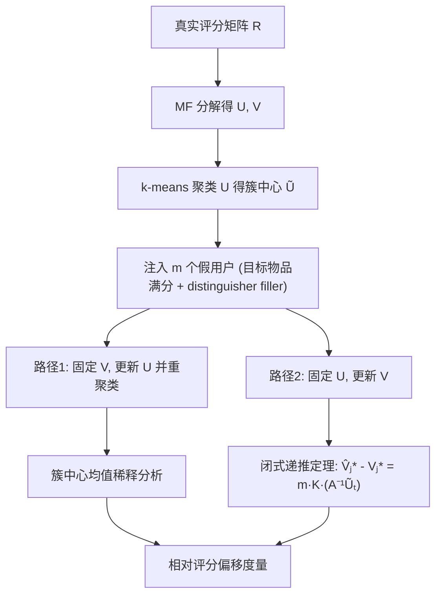

# Evaluating Impact of User-Cluster Targeted Attacks in Matrix Factorisation Recommenders (矩阵分解推荐中用户簇定向投毒攻击的影响评估)

- **会议/期刊**: ACM Transactions on Recommender Systems (TORS)
- **作者与机构**: Sulthana Shams, Douglas Leith（Trinity College Dublin, Ireland）
- **推荐链路定位**: 召回（MF 隐向量召回）
- **研究方向**: 去偏公平、可信隐私与工业架构 / 协同过滤与双塔召回
- **论文原文**: [论文原文链接](https://arxiv.org/abs/2305.04694v2)
- **开源代码**: 暂未开源

## TL;DR (1分钟核心速览)

本文针对 MF 推荐系统中"用户簇定向投毒攻击"缺乏机理分析的问题，提出将攻击效果拆解到用户特征矩阵 $U$与物品特征矩阵$V$上分别研究（固定一方、更新另一方），并给出$V_{j^*}$更新的闭式递推定理。核心发现：攻击主要通过$V$传播至所有簇，且目标物品在**目标簇内**的真实评分数（而非全局评分数）决定其抗攻击性。在 MovieLens-100k 与 Goodreads 稠密子集上，仅需 100 个假用户即可使目标簇预测评分相对偏移达最大可能偏差的显著比例，且$N_t/N_f=0.05$时偏移远大于$N_t/N_f=2.5$。

## Background & Motivation (背景与核心矛盾)

- **主流范式**: 工业界普遍将用户按偏好聚类（如 Netflix 2000 簇、Google FLoC 兴趣组），簇内共享推荐结果；MF 通过 $R\approx U^\top V$学习隐向量，簇级推荐用簇中心$\tilde{U}_g$与$V$ 内积打分。
- **前人局限**: 现有投毒研究（GAN 生成假用户、双层优化、图推荐攻击）多假设攻击者掌握完整模型知识，且只报告全局 Hit-Rate/Prediction Shift，**从未拆解 $U$、$V$ 各自在攻击传播中的角色**；同时默认"评分数多即安全"，未区分评分来自哪个簇。
- **核心洞察 (Key Insight)**: 作者发现固定 $V$更新$U$时，真实用户的$U_i$完全不变，攻击仅通过簇中心均值被稀释；而固定$U$更新$V$时，$V_{j^*}$的更新会经由内积泄漏到**所有簇**——即$V$ 才是攻击传播的主通道。
- **本文切入点**: 用"单步交替更新 + 闭式解 + 分簇评分分布控制"的实验设计，把攻击有效性归因到 $A^{-1}\tilde{U}_t$ 的谱行为与簇内真实评分数。

## Method (核心方法设计)

### 1. 整体框架 (Overall Architecture)

模型先对原始评分矩阵做 MF 分解得 $U,V$，再用 k-means 对$U$的列聚类得到簇中心矩阵$\tilde{U}$，簇级预测为$\tilde{U}_g^\top V$。攻击者注入$m$个假用户：目标物品$j^*$打最高分 5，filler 物品按目标簇的经验均值+小方差高斯采样（选用"distinguisher items"以保证$\ge 90\%$假用户落入目标簇）。随后分别执行两条分析路径——固定$V$更新$U$（再 warm-start k-means 重聚类）与固定$U$更新$V$——观察目标簇预测评分$\tilde{U}_t^\top V_{j^*}$ 的相对变化。

### 2. 关键设计拆解 (Key Designs)

1. **双路径解耦分析（固定一方更新另一方）**：常规 MF 同时更新 $U,V$，无法区分攻击归因。作者分别求解两个最小二乘闭式解：固定$V$时$U_i=(\sum_{j\in\mathcal{V}(i)}V_jV_j^\top+\lambda I)^{-1}\sum_{j}V_jR_{i,j}$，固定$U$时对$V_j$同理。直觉：真实用户$U_i$只依赖其已评物品，假用户不改变这些项，故$U_i$不变——攻击在$U$ 侧只能通过簇中心算术平均被稀释。

2. **目标物品向量更新的闭式递推定理（Theorem 1）**：设 $A^{-1}=(\sum_{i\in\mathcal{U}(j^*)}U_iU_i^\top+\lambda I)^{-1}$，$K=(I+X^\top A^{-1}X)^{-1}(y-X^\top V_{j^*})$，则
$$\hat{V}_{j^*}-V_{j^*}=m\cdot K\cdot\left(A^{-1}\tilde{U}_t\right)$$
逐特征展开为 $\hat{v}_{j^*k}-v_{j^*k}=mK\big(a_{kk}u_{tk}+\sum_{i\neq k}a_{ki}u_{ti}\big)$。由于$A^{-1}$正定，$a_{kk}>0$，对角项始终与$u_{tk}$同号起缩放作用；非对角项可能同号（case 1/2a，等效缩放）或反号（case 2b，方向反转；case 2c，抵消为零）。这解释了为何攻击效果既非简单缩放、又高度依赖$A^{-1}$的非对角结构与$\tilde{U}_t$ 的相关性。

3. **簇内评分数决定抗攻击性（Theorem 2）**：由 Sherman-Morrison-Woodbury 恒等式，每新增一个真实评分用户，$A^{-1}$的对角元单调不增，故$|a_{kk}u_{tk}|$随目标簇内真实评分数$N_t$增大而收缩；且仅当$N$个真实评分**全部来自目标簇**时$\hat{A}^{-1}\tilde{U}_t\to\mathbf{0}$ 才被保证。若评分来自非目标簇，收敛不保证——这直接推出"全局评分数多 ≠ 安全"的反直觉结论。

4. **训练目标、负采样与推理效率**：基础 MF 目标为 $\min_{U,V}\sum_{(i,j)\in\mathcal{O}}(R_{i,j}-U_i^\top V_j)^2+\lambda(\sum_i\|U_i\|^2+\sum_j\|V_j\|^2)$，无负采样（显式评分回归）。攻击侧无需优化求解，仅需簇级均值知识，计算开销可忽略；防御侧作者提出监控$V_{j^*}$相对参考簇$g$的距离漂移$D_{g,\hat{j}^*}$vs$D_{g,j^*}$，若新评分块导致显著偏离则判定为伪造并剔除。

## Experimental Setup & Evaluation Protocol (实验设置与评估协议)

- **数据集与预处理**: Goodreads 取稠密子集（评分数最多的 top 1000 用户 × top 1682 物品）；MovieLens-100k 全量使用。另用合成用户生成器（按簇-物品经验分布采样，保持各簇评分比例）以精确控制目标物品的分簇评分分布，每组结果取 50 次随机生成的平均。

| 数据集 | #Users | #Items | #Interactions | 稀疏度/密度 | 特征/场景说明 |
| :--- | :---: | :---: | :---: | :---: | :--- |
| MovieLens-100k | 943 | 1,682 | 100,000 | 6.30% | 电影 1–5 星显式评分 |
| Goodreads (dense subset) | 1,000 | 1,682 | ~5.9M 原始 / 子集稠密 | 高密度子集 | 图书 1–5 星显式评分 |

- **数据划分与防穿越 (Splitting Strategy)**: 非传统 train/test 划分；采用"攻击前重算 $U,V$作为 baseline，攻击后单步更新对比"的受控前后对照协议，k-means 与$U,V$ 更新均 warm-start 以排除随机初始化噪声。
- **排名评测协议 (Ranking Protocol)**: 不使用 Full-Ranking 或 Sampled Ranking，而采用**相对评分偏移** $\text{Relative Change}_g=\frac{\mu_f(g,i)-\mu_o(g,i)}{|5-\mu_o(g,i)|}$，直接度量攻击对簇级预测的扰动强度（作者论证簇级 top-N 对所有用户相同，Hit-Rate 不适用）。
- **对比基线与超参设置**: 隐维度 $d=10$，簇数$|\mathcal{G}|=4$，每簇 250 用户，假用户数$m=100$；对比对象为不同$n/m$、$N_t/N_f$比例下的攻击强度，以及 NCF(MLP) 与 DMF（深度网络学$U,V$ + 点积输出）两种扩展架构。

## Key Experimental Results (实验关键数据)

### 1. 主实验对比 (Main Results)

原文以趋势图为主，核心定量结论汇总如下（目标簇 2，$d=10$，$|\mathcal{G}|=4$）：

| 攻击配置 | 更新对象 | MovieLens 相对偏移 | Goodreads 相对偏移 | 说明 |
| :--- | :---: | :---: | :---: | :--- |
| $n/m=0.5$（真用户少） | 固定$V$，更新$U$ | **最高** | **最高** | 假用户主导簇中心均值 |
| $n/m=2.5$（真用户多） | 固定$V$，更新$U$ | 显著下降 | 显著下降 | 均值稀释效应 |
| $N_t/N_f=0.05$（簇内真评分极少） | 固定$U$，更新$V$| **最大偏移** | **最大偏移** |$a_{kk}$ 大，case 2a 缩放 |
| $N_t/N_f=2.5$（簇内真评分充足） | 固定$U$，更新$V$| 明显收缩 | 明显收缩 |$a_{kk}$随$N_t$ 单调下降 |
| 非目标簇评分 $N_t/N_f$0.05→2.5 | 固定$U$，更新$V$ | 几乎无下降 | 几乎无下降 | Theorem 2：非目标簇评分不提供保护 |
| $n/m$2.5→10（仅增簇内用户数） | 固定$U$，更新$V$ | 基本不变 | 基本不变 | 用户数≠评分数，无保护作用 |
| NCF(MLP) / DMF 架构 | 更新 $V$ | 跨簇泄漏明显 | — | 结论可迁移至神经架构 |

### 2. 消融实验 (Ablation Study)

| 消融/变体 | 关键观察 | 归因 |
| :--- | :--- | :--- |
| 仅更新 $U$（固定$V$） | 真实用户$U_i$完全不变，仅$\tilde{U}_t$ 微移 | 假用户不改变真实用户已评物品集合 |
| 仅更新 $V$（固定$U$） | 目标簇偏移大，且**泄漏至非目标簇** |$V_{j^*}$ 被所有簇共享 |
| 移除 distinguisher filler（随机 filler） | 假用户入簇率 < 90% | 随机 filler 无法模拟目标簇偏好 |
| 非目标簇评分递增 | 目标簇偏移几乎不降 | $\hat{A}^{-1}\tilde{U}_t$ 不收敛至零 |
| 簇内用户数 $n$递增（评分分布固定） | 偏移基本不变 | 只有评分数$N_t$进入$A^{-1}$ |
| 防御：$V_{j^*}$距离漂移检测 | 假评分块偏离参考距离显著，真评分块贴近 | 真评分约 100 条后$V_{j^*}$ 趋于稳定 |

### 3. 关键实验发现 (Key Findings)

1. **$V$是攻击传播的唯一主通道**：固定$U$更新$V$时，非目标簇 0/1/3 也出现明显正偏移（图 6/8），而固定$V$更新$U$时非目标簇偏移可忽略（图 4）——说明簇级定向攻击在 MF 中天然"失焦"，防御必须优先保护$V$。
2. **簇内真实评分数而非全局评分数决定脆弱性**：$N_t/N_f$从 0.05 增至 2.5 时目标簇偏移大幅下降，但同等增幅若来自非目标簇则偏移几乎不变（图 5 vs 图 7）；表 2a 显示$N_t/N_f=0.05$时 ML 的$k=0,1,4$特征更新量约为 2.5 时的 4 倍，与$a_{kk}$ 单调下降的理论预测吻合。
3. **增加簇内用户数不提供任何保护**：$n/m$从 2.5 增至 10，目标簇偏移几乎持平（图 9），因为$A^{-1}$只累加对$j^*$ 打分的用户；这直接反驳了"簇越大越安全"的直觉，防御应聚焦于为目标物品补充**簇内**评分（如 dummy ratings）。

## Highlights & Limitations (亮点、对比与审稿批判)

- **与代表作对比 (vs. Prior Work)**: 相比 [4] 的 GAN 假用户生成与 [16] 的双层优化社交攻击，本文刻意采用**低知识平均攻击**（仅需簇级均值），却证明其足以精准命中目标簇；相比 [10, 22] 只报告全局 Hit-Rate，本文首次给出 $U/V$ 解耦的闭式机理与"簇内评分数"这一可操作的脆弱性因子。
- **可迁移亮点**: (1) "固定一方更新另一方"的解耦分析范式可直接迁移到 LightGCN/双塔模型的投毒归因；(2) 基于 $V_{j^*}$ 相对参考簇距离漂移的轻量检测器，无需重训练即可在线部署。
- **审稿级局限批判**: (1) 仅分析**单步**更新，虽附录给出收敛情形讨论，但交替迭代至收敛时 $U_i$亦会漂移，理论保证不完整；(2) 实验限于$d=10$、$|\mathcal{G}|=4$、每簇 250 用户的合成受控设定，未在真实工业规模（百万级用户、千级簇）或隐式反馈数据上验证，且相对评分偏移指标与线上业务指标（CTR/留存）的映射关系未建立。

## Rating (四维评分)

- **方法创新性 (Novelty)**: ⭐⭐⭐⭐ （首次将簇定向投毒拆解到 $U/V$双矩阵并给出闭式递推定理，$A^{-1}$ 正定性与 Sherman-Morrison 分析扎实，但攻击策略本身为已知平均攻击的复用）
- **评估协议与实验扎实度 (Protocol & Experiments)**: ⭐⭐⭐ （50 次随机生成取均值+方差、分簇评分分布精确受控是亮点，但缺真实大规模数据与标准 Top-N 指标，仅两数据集且 $d$ 固定）
- **写作与数学规范度 (Clarity & Rigor)**: ⭐⭐⭐⭐ （Theorem 1/2 与 case 1/2a/2b/2c 分类清晰，表 2 逐特征数值与理论预测一一对应；部分引理置于附录，正文符号略密）
- **工业落地与复现价值 (Industrial & Practical Value)**: ⭐⭐⭐ （防御建议"降低 $V$ 更新频率 + 距离漂移检测"工程成本低、易落地，但无开源代码，且合成实验与工业簇级系统的差距需额外验证）

