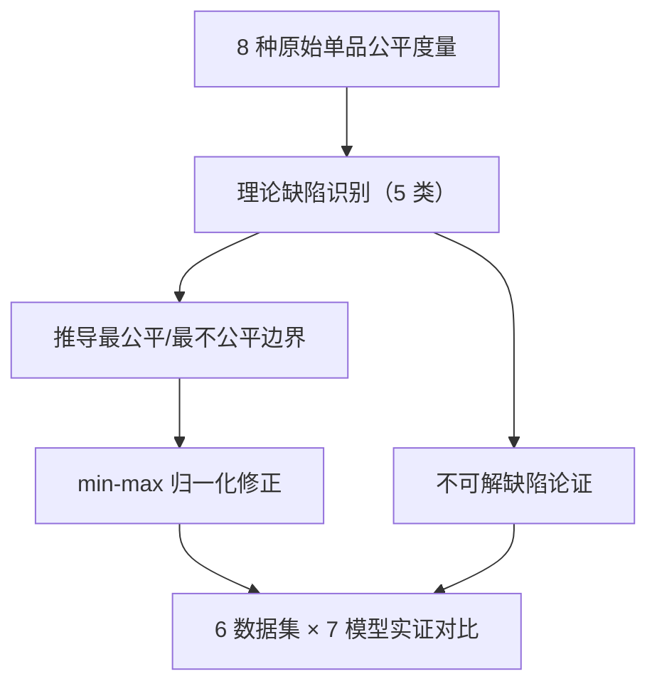

# Evaluation Measures of Individual Item Fairness for Recommender Systems: A Critical Study (推荐系统单品公平性评估度量：一项批判性研究)

- **会议/期刊**: ACM Transactions on Recommender Systems (TORS)
- **作者与机构**: Theresia Veronika Rampisela, Maria Maistro, Tuukka Ruotsalo, Christina Lioma（哥本哈根大学 / LUT 芬兰）
- **推荐链路定位**: 评测与度量（面向召回/精排输出的 top-$k$ 列表评估）
- **研究方向**: 去偏公平、可信隐私与工业架构
- **论文原文**: [论文原文链接](https://arxiv.org/abs/2311.01013v1)
- **开源代码**: [开源代码仓库链接](https://github.com/RUCAIBox/RecSysDatasets)（数据集与实验框架 RecBole）

## TL;DR (1分钟核心速览)

本文是首篇对推荐系统**单品曝光公平度量**的系统性批判研究。作者汇总了 8 种纯曝光型单品公平度量（Jain、QF、Ent、Gini、Gini-w、FSat、VoCD、II-D/AI-D），从理论上识别出 5 类缺陷（不可达性、数量不敏感、未定义、恒公平、表征依赖），并通过**基于理论最公平/最不公平边界的 min-max 归一化**修正了其中 3 类。在 6 个真实数据集、7 个推荐模型、Full-Ranking 协议下，修正后的度量能精确映射到 $[0,1]$端点，而原始 Ent 在所有实验中均因$\log 0$ 返回 NaN。

## Background & Motivation (背景与核心矛盾)

- **主流范式**: 单品公平通常以"曝光"（item 是否进入某用户 top-$k$）为度量对象，学界已提出 Jain、QF、Entropy、Gini、FSat、VoCD、II-D/AI-D 等 8 种纯曝光度量，但多数工作只挑一个度量直接用。
- **前人局限**: 其一，这些度量的理论性质从未被系统分析，绝对分数难以解释（如 Jain 理论范围 $[0,1]$ 但实际永远接近 0）；其二，不同度量基于不同公平概念，分数尺度差异巨大，跨论文结果无法比较。
- **核心洞察 (Key Insight)**: 作者发现度量的理论端点（0 或 1）在真实 top-$k$场景下**根本不可达**——最不公平分数只对应"$k=0$"或"$n=0$"等荒谬场景，而最公平分数受$km \boldsymbol{o}d n$ 整除性制约，导致公平性被系统性高估或低估。
- **本文切入点**: 不提出新推荐模型，而是为每个度量推导**实际可达的最公平/最不公平边界**，用 min-max 归一化把分数重新锚定到真实端点，并给出"何时用哪个度量"的实践指南。

## Method (核心方法设计)

### 1. 整体框架 (Overall Architecture)

论文分三步走：先形式化 8 种度量并统一记号（用户集 $U$、物品集$I$、截断$k$、总槽位$km$、检查函数$e(\cdot)$ 分 uniform/DCG/RBP 三类）；再逐一定理式地识别 5 类理论缺陷并给出反例；最后对可修正的缺陷推导闭式边界并做 min-max 归一化，对不可修正的缺陷论证其不可解性。实验部分用 7 个推荐模型在 6 个数据集上对比原始与修正度量的相关性、端点可达性与排名敏感性。

### 2. 关键设计拆解 (Key Designs)

1. **不可达性（Non-realisability）的边界推导与归一化**：痛点是原始度量的 0/1 端点只对应不可能场景（如 Jain 的 0 需 $k=0$）。作者定义"最不公平 @$k$"为同一组$k$个物品推荐给所有$m$个用户（等价于 Pop 基线），"最公平 @$k$"为$(n-km\boldsymbol{o}d n)$个物品曝光$\lfloor km/n\rfloor$次、其余曝光$\lfloor km/n\rfloor+1$ 次。以 Jain 为例，修正为：

$$ \text{Jain}_{\text{our}} = \frac{\text{Jain}_{\text{ori}} - k/n}{\text{Jain}_{\max} - k/n}, \quad \text{Jain}_{\max} = \frac{(km)^2}{n\left[n\lfloor km/n\rfloor^2 + (km\boldsymbol{o}d n)(2\lfloor km/n\rfloor+1)\right]} $$

   直觉：把"理论端点"替换为"top-$k$ 下真实可达端点"，使分数可解释为"相对最不公平基线的改善比例"。

2. **未定义性（Undefinedness）的修复**：Entropy 原式 $-\sum_{i\in I} p(i)\log p(i)$在存在未被推荐物品时$p(i)=0$导致$\log 0$未定义，实验中**所有模型全部 NaN**。修正为仅对推荐集合$R$求和：$\text{Ent}_{\text{def}} = -\sum_{i\in R} p(i)\log p(i)$，再做归一化。这是全文最直接可用的工程修复。

3. **训练目标、负采样与推理效率**：本文不涉及模型训练，无损失函数与负采样。计算开销集中在归一化边界：Jain/QF/Ent/Gini/FSat 有闭式解，$O(1)$额外开销；Gini-w 仅在$km\le n$ 时有闭式解，否则需解约束优化（不可行）；VoCD/II-D/AI-D 因边界无闭式解，只能通过枚举近似，作者明确标注为不可修正。

## Experimental Setup & Evaluation Protocol (实验设置与评估协议)

- **数据集与预处理**: 6 个公开数据集，统一过滤交互数 $<5$ 的用户/物品：

| 数据集 | #Users | #Items | #Interactions | 稀疏度 | 场景说明 |
| :--- | :---: | :---: | :---: | :---: | :--- |
| Lastfm | 1,859 | 2,823 | 71,355 | 98.64% | 隐式音乐收听 |
| Ml-1m | 6,038 | 3,307 | 835,789 | 95.81% | 显式评分（$\ge3$ 转 1） |
| Book-x | 5,639 | 7,455 | 91,385 | 99.78% | 图书（$\ge6$ 转 1） |
| Amazon-lb | 1,644 | 791 | 16,765 | 98.71% | 亚马逊子类 |
| Amazon-dm | 11,750 | 9,462 | 116,681 | 99.90% | 亚马逊子类 |
| Amazon-is | 6,574 | 3,569 | 45,762 | 99.81% | 亚马逊子类 |

- **数据划分与防穿越**: Lastfm/Book-x 无时间戳，用**用户级随机 80/10/10 划分**；其余用**用户级时间切分**（每用户最后 10% 交互为测试集）。测试时训练/验证集物品被置于列表末尾以防重复推荐。
- **排名评测协议**: **Full-Ranking（全库未交互物品排序）**，明确拒绝采样排序（引用 [21] 指出采样会误导）。公平度量统一 $k=10$；Ent 用$\log$base-$n$；VoCD 取$\alpha=2$（所有物品视为相似）、$\beta=0$；II-D/AI-D 取$\gamma=0.8$。
- **对比基线与超参设置**: 7 个模型——Pop、ItemKNN、SLIM、BPR、NGCF、NeuMF、MultiVAE；batch size 4096，Adam 优化器，BPR/NGCF/NeuMF/MultiVAE 训练 300 epoch、early stopping 10 epoch，以验证集 NDCG@10 选模；相关性用 Kendall's $\tau$并做 Benjamini-Hochberg 多重检验校正（$\alpha=0.05$）。

## Key Experimental Results (实验关键数据)

### 1. 主实验对比 (Main Results)

Lastfm 上相关性最优 BPR 与公平性最优 MultiVAE 的对比（$k=10$，↑越高越好，↓越低越好）：

| 度量 | Pop | ItemKNN | SLIM | BPR | NGCF | NeuMF | MultiVAE |
| :--- | :---: | :---: | :---: | :---: | :---: | :---: | :---: |
| ↑ NDCG | 0.0633 | 0.2072 | 0.1832 | **0.2234** | 0.2192 | 0.1982 | 0.2194 |
| ↑ Jain$_{\text{ori}}$ | 0.0054 | 0.0505 | 0.0290 | 0.0805 | 0.0866 | 0.0968 | **0.1340** |
| ↑ Jain$_{\text{our}}$ | 0.0018 | 0.0474 | 0.0257 | 0.0777 | 0.0838 | 0.0941 | **0.1317** |
| ↑ QF$_{\text{ori}}$ | 0.0096 | 0.4325 | 0.1456 | 0.4283 | 0.3992 | 0.4630 | **0.6833** |
| ↑ Ent$_{\text{ori}}$ | nan | nan | nan | nan | nan | nan | nan |
| ↑ Ent$_{\text{our}}$ | 0.0964 | 0.5953 | 0.4399 | 0.6562 | 0.6610 | 0.6866 | **0.7635** |
| ↓ Gini$_{\text{ori}}$ | 0.9951 | 0.9084 | 0.9683 | 0.8848 | 0.8851 | 0.8649 | **0.7806** |
| ↓ Gini-w$_{\text{ori}}$ | 0.9960 | 0.9158 | 0.9723 | 0.8952 | 0.8969 | 0.8797 | **0.7940** |
| ↓ VoCD$_{\text{ori}}$ | 0.6691 | 0.6091 | 0.7044 | 0.6408 | 0.6566 | 0.6415 | **0.5985** |
| ↓ II-D$_{\text{ori}}$ | 0.00097 | 0.00097 | 0.00097 | 0.00097 | 0.00097 | 0.00097 | 0.00097 |
| ↓ AI-D$_{\text{ori}}$ | 0.00067 | 0.00006 | 0.00011 | 0.00004 | 0.00003 | 0.00003 | **0.00002** |

Ml-1m 上趋势一致：BPR 的 NDCG 最高（0.0781），MultiVAE 的 Jain/QF/Ent 最高（0.0653/0.4859/0.6527），Ent$_{\text{ori}}$ 同样全 NaN。

### 2. 消融实验 (Ablation Study)

本文无模型消融，等价实验为**原始 vs. 修正度量**的端点可达性对比（MostFair/MostUnfair 构造器，$k\in\{1,2,3,5,10,15,20\}$）：

| 度量 | 原始可达最公平端点 | 修正后可达最公平端点 | 原始可达最不公平端点 | 修正后可达最不公平端点 |
| :--- | :---: | :---: | :---: | :---: |
| Jain | ✗（受 $km\boldsymbol{o}d n$制约） | ✓ | ✗（需$k=0$） | ✓（Repeatable） |
| QF | ✗ | ✓ | ✗（需 $\lvert R\rvert=0$） | ✓ |
| Ent | ✗（NaN） | ✓ | ✗（需 $n=0$） | ✓ |
| Gini / Gini-w | ✗ | ✓ / 部分（$k=1$ 时） | ✗（需单物品占满） | ✓ |
| FSat | ✗ | ✓ | ✗ | 部分（$k=1$ 时恒为 1） |
| VoCD / II-D / AI-D | ✗ | 不可修正 | ✗ | 不可修正 |

### 3. 关键实验发现 (Key Findings)

1. **原始 Ent 完全不可用**：6 个数据集 × 7 个模型全部返回 NaN，因为总有物品未被推荐导致 $\log 0$；修正版 Ent$_{\text{our}}$在 Lastfm 上给出$[0.096, 0.763]$ 的完整区分度，这是本文最立竿见影的贡献。
2. **II-D 在单轮推荐下退化为常数**：Lastfm 上所有 7 个模型的 II-D 均为 0.00097，Ml-1m 上均为 0.000828——因固定 $km$ 槽位使曝光值集合与计数恒定，该度量在标准单轮评测中**毫无区分力**，作者建议仅在多轮推荐场景使用。
3. **修正不改变模型排序但改变可解释性**：修正度量与原始度量的 Kendall's $\tau$恒为 1（归一化是单调变换），但原始 Jain 分数（$\sim0.1$）与 QF 分数（$\sim0.7$）看似"天差地别"，实际高度相关（Lastfm 上$\tau=0.71$，BH 校正后显著），说明绝对分数误读风险远大于排序误读风险。

## Highlights & Limitations (亮点、对比与审稿批判)

- **与代表作对比 (vs. Prior Work)**: 相比 [33, 45] 的群组公平综述，本文首次聚焦**单品公平度量**并给出形式化缺陷证明；相比 [41] 仅汇总度量，本文额外提供闭式边界与修正公式；相比 [32] 经验性发现 FSat 恒公平，本文给出形式化定义并证明其不可解。
- **可迁移亮点**: ①"用 Pop 基线作为最不公平锚点"的归一化思路可直接迁移到任何有界公平度量的跨论文比较；②"仅对推荐集合求和"的 Entropy 修复是低成本工程补丁，建议所有使用 Ent 的工业评测直接采纳。
- **审稿级局限批判**: ① VoCD/II-D/AI-D 的边界无闭式解，修正方案缺失，导致 8 个度量中仍有 3 个停留在"仅诊断不治疗"状态；② 实验仅覆盖 7 个传统模型，未涉及图神经网络或 LLM 推荐器，且 $k$最大仅到 20，对工业级$k=100+$ 长列表场景的外推性存疑；③ 归一化假设"任意物品可推荐给任意用户"，在 Nonrepeatable 设置下修正度量仍会偏离端点。

## Rating (四维评分)

- **方法创新性 (Novelty)**: ⭐⭐⭐⭐ （首个单品公平度量的系统性理论批判，5 类缺陷中 3 类为本文首次形式化，边界推导严谨但本质是"度量修正"而非新方法）
- **评估协议与实验扎实度 (Protocol & Experiments)**: ⭐⭐⭐⭐⭐ （6 数据集 × 7 模型 × Full-Ranking + BH 多重检验校正 + MostFair/MostUnfair 构造器验证端点，协议严谨度在评测类论文中属上乘）
- **写作与数学规范度 (Clarity & Rigor)**: ⭐⭐⭐⭐ （8 个度量的边界公式全部给出闭式推导并附附录证明，符号统一；但 52 页篇幅中大量重复性表格可压缩）
- **工业落地与复现价值 (Industrial & Practical Value)**: ⭐⭐⭐⭐ （Ent 修复与 Jain/QF/Gini 归一化可直接落地，代码基于 RecBole 易复现；但 VoCD/II-D/AI-D 的不可修正性削弱了完整工具箱价值）

