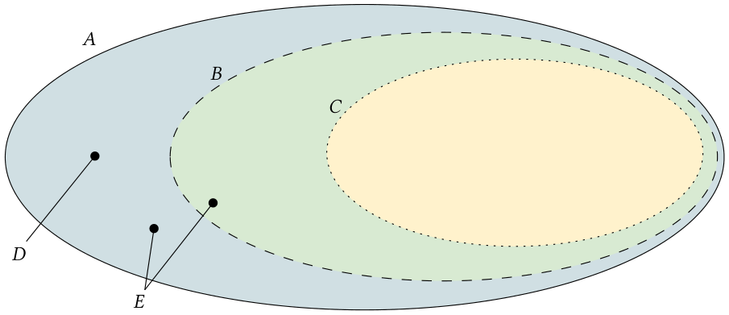
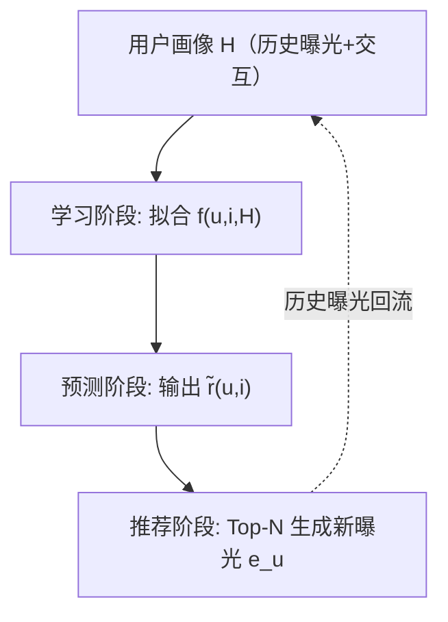
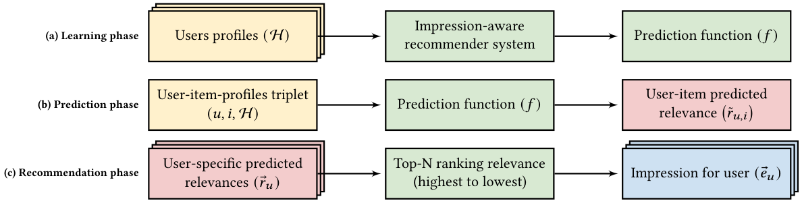

# Impression-Aware Recommender Systems (曝光感知推荐系统)

- **会议/期刊**: ACM Transactions on Recommender Systems (TORS)
- **作者与机构**: Fernando B. Pérez Maurera, Maurizio Ferrari Dacrema, Paolo Cremonesi (Politecnico di Milano / ContentWise)；Pablo Castells (UAM / Amazon)
- **推荐链路定位**: 端到端 / 重排 / 召回（覆盖全链路，以曝光信号贯穿训练与预测）
- **研究方向**: 去偏公平、可信隐私与工业架构 / CTR 预估与特征交叉
- **论文原文**: [论文原文链接](https://arxiv.org/abs/2308.07857v2)
- **开源代码**: 暂未开源

## TL;DR (1分钟核心速览)

传统协同过滤仅用交互建模偏好，忽略了"物品是否被曝光"这一关键信号，导致假阴性噪声与流行度偏差。本文是首篇曝光感知推荐系统（IARS）系统性综述：提出统一理论框架（事件四元组、三阶段流程），论证 IARS 与上下文感知推荐（CARS）的本质不等价，并构建模型中心/数据中心/信号中心三维分类体系，对 43 篇顶会论文、公开数据集与评估协议进行归档，指出 63.6% 工作直接"假设"未交互曝光为负信号、65.9% 仅用全局曝光等系统性盲区。

## Background & Motivation (背景与核心矛盾)

- **主流范式**: 协同过滤（CF）仅以交互（购买、评分）为监督信号，将全部未交互物品统一视为负样本（missing-as-negative）。
- **前人局限**: ① 无法区分"曝光但未点击"（真实负反馈）与"从未曝光"（未知），造成假阴性污染；② 曝光频次、屏上位置、重复曝光疲劳等信号被完全丢弃，加剧流行度偏差与过滤气泡。
- **核心洞察 (Key Insight)**: 曝光数据将物品目录切分为四个粒度层级（图 1）：目录 $A$、曝光$B$、交互$C$、非曝光$D=A-B$、非交互$E=A-C$，使"未交互"可进一步细分为"曝光未交互"与"未曝光"，从而精细化用户偏好建模。
- **本文切入点**: 以形式化框架统一分散术语（impression/exposure/slate/past recommendation），并给出可操作的分类学与评估指南。

<figure class="paper-figure" markdown="span">
  <figcaption>图 1. 推荐系统中使用曝光的物品分类。目录为所有物品（实线）。曝光为已展示物品（虚线）。交互为已展示且已交互物品（点线）。非曝光为未展示物品（𝐷= 𝐴−𝐵，即实线与虚线之间）。非交互为未交互物品（𝐸= 𝐴−𝐶，即实线与点线之间）。</figcaption>
</figure>

## Method (核心方法设计)

### 1. 整体框架 (Overall Architecture)

本文将任意 IARS 抽象为三阶段闭环：**学习**（用用户画像集合 $\mathcal{H}$拟合预测函数$f$）→ **预测**（对任意$(u,i,\mathcal{H})$输出相关性$\tilde{r}_{u,i}$）→ **推荐**（按$\tilde{r}$降序取 Top-$N$生成新曝光$\mathbf{e}_u$）。关键约束在于：新曝光只能由推荐阶段产生，因此学习与预测阶段仅能使用**历史曝光**，这构成 IARS 与 CARS 的根本分野。

<figure class="paper-figure" markdown="span">
  <figcaption>图 3. 任意给定 IARS 向给定用户生成推荐的三个阶段。(a) 展示第一阶段（学习），IARS 使用用户画像集合（H）创建预测函数（𝑓）。(b) 展示第二阶段（预测），IARS 使用 𝑓 预测任意给定用户-物品-画像三元组的相关性分数（˜𝑟𝑢,𝑖）。(c) 展示第三阶段（推荐），IARS 根据预测的相关性分数选择最相关的 N 个物品，向给定用户（𝑢）生成曝光（推荐列表）。</figcaption>
</figure>

### 2. 关键设计拆解 (Key Designs)

1. **事件四元组与范式边界（理论框架）**：为区分 IARS 与 CARS，本文将事件定义为 $\mathbf{p}=(u,i,\tilde{r}_{u,i},\mathbf{e}_{u,i})$，其中$\mathbf{e}_{u,i}$为曝光物品向量；而 CARS 的第四元为上下文特征向量$\mathbf{c}_{u,i}$。核心差异在预测函数签名：IARS 为$f(u,i,\mathcal{H})$，CARS 为$f(u,i,\mathcal{H},\mathbf{c}^*_{u,i})$——CARS 的上下文在预测时即时计算，而 IARS 的曝光在预测时尚未生成，二者无法双射投影，故 IARS 是 CF-SI 下与 CARS 并列的**独立范式**（图 4）。

2. **三维分类体系（Taxonomy）**：① **模型中心**（互斥）：启发式/统计/机器学习/深度学习/强化学习，其中深度学习占 38.6%、RL 占 22.7%；② **数据中心**（可多重归属）：Features（从曝光算统计特征，22.7%）、Learn（曝光直接作输入，41.0%）、Sample（从目录采样含曝光物品，4.5%）；③ **信号中心**：Assume（直接假定未交互曝光的极性，63.6%）vs. Learn（学习其极性，25.0%）。该体系首次将"如何处理未交互曝光"提升为一等公民。

3. **代表性算子归纳（跨论文提炼）**：软频次上限（IDF）以折扣因子调制相关性 $\tilde{r}_{u,i}=\hat{r}_{u,i}\cdot d_{u,i}$，$d_{u,i}$由距上次曝光天数、曝光次数、屏上位置线性聚合；硬频次上限（cycling）用展示分$\tilde{p}_{u,i}=\lfloor n^e_{u,i}/3\rfloor$优先推低曝光物品；疲劳建模采用分段线性$fatigue(n^e_{u,i})$，低曝光物品天然低疲劳，从而**结构性扶持长尾**。

## Experimental Setup & Evaluation Protocol (实验设置与评估协议)

- **文献筛选协议**: 检索 ACM DL、IEEE Xplore、ScienceDirect、SpringerLink、Google Scholar 五大引擎，查询式 `recommender system AND (impression OR exposure OR slate OR past recommendation OR previous recommendation)`；限定 CORE 2021 A*/A 会议与 Scimago Q1 期刊；1351 篇去重 → 352 篇初筛 → 人工核验后保留 **43 篇**（图 2 显示 2019 年后发文陡增，KDD/SIGIR/RecSys 为主阵地）。
- **数据集分类**: 按曝光类型分为 contextual（含曝光-交互关联）与 global（仅曝光集合）两类公开数据集；综述明确指出多数公开数据集缺失屏上位置与曝光时序，制约重排类研究复现。
- **评估协议批判**: 综述不提供统一主实验表（作者明言跨论文评估策略异构、公平比较超出范围），转而给出**按研究目标分层的评估指南**：CTR 类目标须以曝光为分母（而非全库），排序类目标须区分 Full-Ranking 与 Sampled Ranking 并报告曝光分布偏移；强调必须报告"曝光未交互"的采样比例，否则指标不可比。
- **对比基线**: 无统一基线；按模型中心五类分别归纳代表工作（如 GLMix、LambdaMART、MMoE 重排、MAB 探索）。

## Key Experimental Results (实验关键数据)

### 1. 文献分布统计（替代主实验表）

| 分类维度 | 类别 | 篇数 | 占比 |
| :--- | :--- | :---: | :---: |
| 模型中心 | 深度学习 | 17 | **38.6%** |
| 模型中心 | 强化学习 | 10 | 22.7% |
| 模型中心 | 启发式 / 统计 | 5 / 5 | 11.4% / 11.4% |
| 数据中心 | Learn（曝光作输入） | 18 | **41.0%** |
| 数据中心 | Features / 二者兼有 | 10 / 11 | 22.7% / 25.0% |
| 信号中心 | Assume（假定极性） | 28 | **63.6%** |
| 信号中心 | Learn（学习极性） | 11 | 25.0% |
| 曝光类型 | 全局 / 上下文 | 29 / 14 | 65.9% / 31.8% |
| 推荐器类型 | 端到端 / 重排 / 插件 | 30 / 7 / 4 | 68.2% / 15.9% / 9.1% |

### 2. 消融式证据（代表性论文内部对照）

| 工作 | 移除/加入的曝光信号 | 效果 |
| :--- | :--- | :--- |
| Ma et al. (LambdaMART) | 移除 17 维曝光特征 | 排序质量显著下降 |
| Ma et al. | 仅保留同物品疲劳 + 时序特征 | 贡献最大相对提升 |
| Aharon et al. (MF) | 移除曝光频次偏置 $w$ | CTR 预估退化 |
| Wu et al. (疲劳模型) | 移除分段疲劳函数 | 流行度偏差回升 |

### 3. 关键实验发现 (Key Findings)

1. **信号极性被过度简化**：63.6% 的工作直接把"曝光未交互"当负样本，仅 25.0% 真正学习其极性；而 Ma et al. 的消融显示同物品疲劳与时序曝光特征贡献最大，说明"未交互"内部蕴含强异质信号，粗暴二值化损失信息。
2. **上下文曝光严重欠用**：仅 31.8% 使用 contextual impressions（含曝光-交互关联），65.9% 停留在全局曝光计数，导致重排与位置偏差建模缺乏数据基础。
3. **范式割裂阻碍复现**：数据中心仅 4.5% 采用 Sample 策略、模型中心 6.8% 未描述方法细节，加之评估协议异构，跨论文性能无法公平对比，这是该领域当前最大的方法论短板。

## Highlights & Limitations (亮点、对比与审稿批判)

- **与代表作对比 (vs. Prior Work)**: 相较既有 CTR 综述（聚焦非个性化广告点击率）与上下文感知综述（Ricci/Burke 体系），本文首次将"曝光"从附属特征提升为**定义范式的核心数据源**，并用事件四元组严格证明 IARS ≠ CARS；相较零散的曝光利用论文（Lee 的 IDF、Zhao 的 cycling），本文提供了统一坐标系。
- **可迁移亮点**: ① 事件四元组 + 三阶段约束可直接用于判定新模型是否"真曝光感知"；② 信号中心分类学（Assume vs. Learn）可迁移至任何含"展示未点击"日志的场景（信息流、搜索、广告）作负样本策略审计。
- **审稿级局限批判**: ① 作为综述无原创实验，43 篇样本量偏小且筛选依赖人工判读，可能遗漏工业界未公开工作；② 未量化比较各方法在统一协议下的性能，读者难以判断"学习极性"相对"假定极性"的实际收益幅度；③ 对曝光位置偏差的因果去偏方法讨论较浅，缺乏与因果推断文献的对接。

## Rating (四维评分)

- **方法创新性 (Novelty)**: ⭐⭐⭐⭐ （首提 IARS 范式并以事件四元组严格论证其与 CARS 的不等价性，理论贡献扎实，但属框架性而非算法性创新）
- **评估协议与实验扎实度 (Protocol & Experiments)**: ⭐⭐⭐ （文献筛选流程规范、分类统计完整，但无统一基准实验，评估指南停留在原则层面）
- **写作与数学规范度 (Clarity & Rigor)**: ⭐⭐⭐⭐ （符号体系自洽、三阶段图示清晰、分类学互斥性界定明确，44 页篇幅略显冗长）
- **工业落地与复现价值 (Industrial & Practical Value)**: ⭐⭐⭐⭐ （频次上限、疲劳建模、曝光特征工程等工业技巧归纳极具实操价值，但无开源代码与可复现基准）

