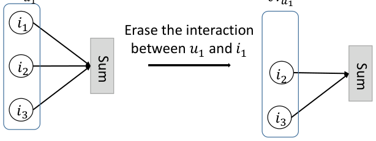
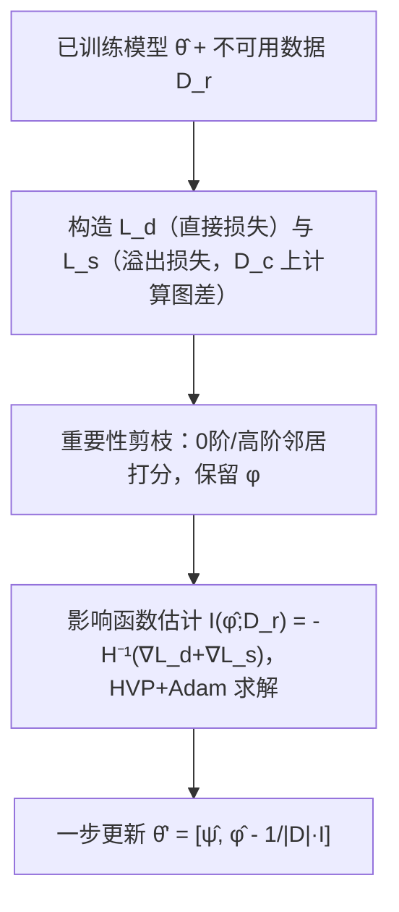

# Recommendation Unlearning via Influence Function (基于影响函数的推荐遗忘)

- **会议/期刊**: ACM Transactions on Recommender Systems (TORS)
- **作者与机构**: Yang Zhang, Zhiyu Hu, Yimeng Bai, Jiancan Wu, Qifan Wang (Meta), Fuli Feng — 中国科学技术大学、Meta Platforms
- **推荐链路定位**: 模型更新层（训练后遗忘 / 参数修正，不涉及在线打分链路改造）
- **研究方向**: 去偏公平、可信隐私与工业架构 / 图神经网络推荐
- **论文原文**: [https://arxiv.org/abs/2307.02147v4](https://arxiv.org/abs/2307.02147v4)
- **开源代码**: [https://github.com/baiyimeng/IFRU](https://github.com/baiyimeng/IFRU)

## TL;DR (1分钟核心速览)

针对"用户请求删除历史行为"的推荐遗忘任务，现有全量重训代价高、部分重训（RecEraser/SISA）损伤性能。本文提出 IFRU：用影响函数估计删除不可用数据 $\mathcal{D}_r$对模型参数的改变量，并**首次把图卷积计算图的改变（溢出影响）也写成损失形式纳入估计**，再配合重要性剪枝把 Hessian 规模从$p$压到$p'$。在 Amazon/BookCrossing 上以攻击数据为遗忘对象，IFRU 的遗忘完整度系数达 88%–103%，耗时 0.016s（MF）/0.6s（LightGCN），较重训加速 250 倍以上。

## Background & Motivation (背景与核心矛盾)

- **主流范式**: 推荐遗忘通过"删数据后重训"实现——全量重训（Retrain）天然彻底但代价高；部分重训（RecEraser 分片、SISA 随机分片、FRU 梯度近似）试图加速。
- **前人局限**: ① 部分重训需改动模型/训练架构或做梯度近似，必然带来性能损伤（非 harmless）；② 分片类方法仅在不可用数据"局部聚集"时有效，而真实请求中 $\mathcal{D}_r$ 随机散布于所有分片，加速失效甚至慢于重训。
- **核心洞察 (Key Insight)**: 影响函数（influence function）可在不重训的前提下一步估计"删数据导致的参数变化"。但经典影响函数只刻画 $\mathcal{D}_r$对**优化损失**的直接影响，忽略了推荐模型（如 LightGCN）中$\mathcal{D}_r$还改变了**其余数据的计算图**——删一条边会改变邻域聚合的归一化系数$\frac{1}{\sqrt{|\mathcal{N}_u||\mathcal{N}_i|}}$，从而间接影响所有相关节点的表示。
- **本文切入点**: 把计算图变化也表达成损失差 $\mathcal{L}_s$，使"溢出影响"与直接影响一样可被影响函数度量，从而逼近重训模型。

<figure class="paper-figure" markdown="span">
  <figcaption>图 2. LightGCN 中删除一条交互前后的邻域聚合过程。N𝑢1 表示用户 𝑢1 交互过的物品集合。</figcaption>
</figure>

## Method (核心方法设计)

### 1. 整体框架 (Overall Architecture)

给定已训练参数 $\hat{\theta}$与不可用数据$\mathcal{D}_r$，IFRU 先构造两个损失差：直接损失$\mathcal{L}_d$（$\mathcal{D}_r$自身的训练损失）与溢出损失$\mathcal{L}_s$（计算图受影响的剩余数据$\mathcal{D}_c$上"删前/删后"预测损失之差）。二者合并进目标函数后，用影响函数求参数改变量$\Delta$，一步更新$\hat{\theta}'=\hat{\theta}-\frac{1}{|\mathcal{D}|}\mathcal{I}(\hat{\theta};\mathcal{D}_r)$。为降低 Hessian 规模，先用重要性分数剪枝保留受影响的用户/物品嵌入$\phi$，仅对$\phi$ 估计影响；Hessian 逆通过 HVP + Adam 迭代求解，无需显式构造矩阵。

### 2. 关键设计拆解 (Key Designs)

1. **溢出影响建模（Spillover Influence）**：痛点在于经典影响函数只算 $\mathcal{I}_d=-\mathbf{H}^{-1}\nabla_\theta\mathcal{L}_d$，而 LightGCN 删边后剩余交互的聚合结果也变了。作者把删数据后的目标重写为$\arg\min_\theta \frac{|\mathcal{D}|}{|\mathcal{D}_{-r}|}[\mathcal{L}(\theta,\mathcal{D})-\frac{1}{|\mathcal{D}|}\mathcal{L}_d(\theta;\mathcal{D}_r)-\frac{1}{|\mathcal{D}|}\mathcal{L}_s(\theta;\mathcal{D}_r)]$，其中$\mathcal{L}_s=\sum_{(u,i)\in\mathcal{D}_c}[\ell(f_\theta(u,i;\mathcal{D}),y)-\ell(f_\theta(u,i;\mathcal{D}_{-r}),y)]$。于是总影响为
$$\mathcal{I}(\hat{\theta};\mathcal{D}_r)=-\mathbf{H}_{\hat{\theta}}^{-1}\nabla_\theta\mathcal{L}_d(\hat{\theta};\mathcal{D}_r)-\mathbf{H}_{\hat{\theta}}^{-1}\nabla_\theta\mathcal{L}_s(\hat{\theta};\mathcal{D}_r).$$
直觉：$\mathcal{L}_s$把"图结构变化"翻译成"损失变化"，使原本不可微的拓扑扰动进入影响函数的可计算框架。MF 无计算图依赖，$\mathcal{D}_c=\varnothing$，退化为纯直接影响；LightGCN（1 层）下$\mathcal{D}_c$为与$\mathcal{D}_r$ 中节点有交互的剩余样本。

2. **重要性剪枝（Importance-based Pruning）**：CF 模型参数量 $p$主要来自用户/物品嵌入，直接算$\mathcal{O}(np)$仍慢。作者定义 0 阶重要性$s_v^0=\sum_{(u,i)\in\mathcal{D}_r,v\in\{u,i\}}\frac{1}{|\mathcal{N}_v|}$（每条交互对嵌入的贡献均等），高阶邻居按$s_{v'}^k \mathrel{+}= s_v^{k-1}\cdot\frac{1}{|\mathcal{N}_{v'}|}$传播，按比例$(a_0,a_1)$保留 top 节点，得到$\phi$，固定其余参数$\psi=\hat{\psi}$后仅估计$\mathcal{I}(\hat{\phi};\mathcal{D}_r)$，复杂度从$\mathcal{O}(np)$降至$\mathcal{O}(n'p')$。

3. **训练目标、负采样与推理效率**：总损失即上述重写目标，骨干用 BCE（可扩展至 BPR），无额外负采样设计。影响求解改写为二次优化 $\mathcal{I}=\arg\min_t \frac{1}{2}t^\top\mathbf{H}_{\hat{\theta}}t-t^\top t^*$，$t^*=-\nabla_\theta\mathcal{L}_d-\nabla_\theta\mathcal{L}_s$，用 HVP$\mathbf{H}_{\hat{\theta}}t=\nabla_\theta(\nabla_\theta\mathcal{L}^\top t)$避免显式 Hessian，Adam 数步收敛，复杂度近$\mathcal{O}(np)$。推理阶段零开销——遗忘只是离线一次参数修正。

## Experimental Setup & Evaluation Protocol (实验设置与评估协议)

- **数据集与预处理**:

| 数据集 | #Users | #Items | #Interactions | 密度 | 说明 |
| :--- | :---: | :---: | :---: | :---: | :--- |
| Amazon | 4,201,696 | 476,001 | 7,824,481 | 0.0003% | Electronics 子集，评分>4 记正，5-core |
| BookCrossing | 105,283 | 340,556 | 1,149,780 | 0.003% | 图书评分>6 记正，5-core |

- **数据划分与防穿越**: 按交互随机 `6:2:2` 划分 train/valid/test（非时间切分）。
- **排名评测协议**: 采用 **AUC 二分类排序指标**而非 Top-N 全库排序：$AUC_0$（全测试集）、$AUC_1$（用户或物品属于$\mathcal{V}(\mathcal{D}_r)$的样本）、$AUC_2$（两者均属于$\mathcal{V}(\mathcal{D}_r)$），后两者度量局部遗忘效果。
- **遗忘评估技巧**: 不删干净数据（性能下降可能由随机因素造成），而是**随机选子集翻转标签构造攻击数据**作为 $\mathcal{D}_r$，删之应带来性能上升；用"完整度系数 = 本方法提升 / Retrain 提升"量化彻底性。
- **对比基线与超参**: Retrain、RecEraser（10 分片）、SISA（10 分片）、SCIF（影响函数但无溢出）；骨干 MF 与 LightGCN，嵌入维度 $\{32,48,64\}$，$\mathcal{D}_r$比例 MF 2% / LightGCN 1%，剪枝$(a_0,a_1)$ 默认 MF (1.0,1.0)、LightGCN (1.0,0.6)。

## Key Experimental Results (实验关键数据)

### 1. 主实验对比 (Main Results)

| 骨干/数据集 | 方法 | $AUC_0$|$AUC_1$|$AUC_2$ |
| :--- | :--- | :---: | :---: | :---: |
| MF / Amazon | Original | 0.6192 | 0.6314 | 0.6359 |
| | Retrain | 0.6266 | 0.6416 | 0.6674 |
| | SISA | 0.5447 | 0.5572 | 0.5553 |
| | RecEraser | 0.5885 | 0.6015 | 0.6146 |
| | SCIF | 0.6239 | 0.6375 | 0.6654 |
| | **IFRU** | **0.6263** | **0.6403** | 0.6608 |
| LightGCN / Amazon | Retrain | 0.6524 | 0.6708 | 0.6857 |
| | SCIF | 0.6516 | 0.6682 | 0.6859 |
| | **IFRU** | **0.6524** | 0.6706 | **0.6888** |
| MF / BookCrossing | Retrain | 0.7382 | 0.7458 | 0.7536 |
| | SCIF | 0.7380 | 0.7453 | 0.7523 |
| | **IFRU** | **0.7384** | **0.7458** | 0.7513 |
| LightGCN / BookCrossing | Retrain | **0.6632** | **0.6753** | **0.6989** |
| | RecEraser | 0.7091 | 0.7252 | 0.7062 |
| | **IFRU** | 0.6628 | 0.6744 | 0.6933 |

完整度系数：BookCrossing 上 MF 平均 97%、LightGCN 88%；Amazon 上 MF 88%、LightGCN 103%（$AUC_0$ 单项均接近 98%–99%）。

### 2. 消融实验 (Ablation Study)

| 变体 | 设置 | 关键结果 |
| :--- | :--- | :--- |
| IFRU w/o spillover | LightGCN，去掉 $\mathcal{L}_s$ | 完整度系数显著低于完整版，BookCrossing 上差距尤大（图 6） |
| IFRU w/o HVP | 显式构造 Hessian | 精度不变（0.7384/0.7458），耗时 51s vs 0.014s（MF）；LightGCN 520s vs 0.7s，且默认剪枝下 OOM |
| 剪枝比例扫描 | $(a_0,a_1)$从 (1.0,1.0) 到 (0.2,0.0) | 剪掉 ≥5/6 参数前$AUC_0$ 几乎不变，耗时单调下降 |

### 3. 关键实验发现 (Key Findings)

1. **溢出影响是完整遗忘的必要条件**：LightGCN 上去掉 $\mathcal{L}_s$ 后完整度系数明显下滑（BookCrossing 尤甚），说明仅建模直接损失不足以逼近重训模型，图结构扰动必须显式补偿。
2. **效率优势与 $\mathcal{D}_r$规模/分布无关**：$\mathcal{D}_r$ 比例从 0.025% 扫到 8%，IFRU 耗时稳定在 0.016s（MF）/0.6s（LightGCN），而 Retrain 需 12–180s、RecEraser 需 65–616s；RecEraser 因随机散布数据落入全部分片而失去加速意义。
3. **剪枝几乎无损**：剪掉至少 5/6 参数前 $AUC_0$波动极小，说明重要性打分准确识别了"受$\mathcal{D}_r$ 影响小"的嵌入；HVP 在精度完全一致前提下把耗时降低 3 个数量级（51s→0.014s）。

## Highlights & Limitations (亮点、对比与审稿批判)

- **与代表作对比 (vs. Prior Work)**: 与 RecEraser/SISA 的本质区别是**不改模型与训练架构**（纯后处理），因而天然 harmless；与 SCIF 的区别是 SCIF 只算直接影响且用均值标签替换而非真删，本文补上溢出影响并真正移除数据信号。
- **可迁移亮点**: ① "把不可微的结构扰动写成损失差再套影响函数"这一思路可迁移到任何图/序列结构依赖的遗忘场景；② 重要性剪枝按"交互贡献均分 + 邻居衰减传播"打分，可作为通用参数子集选择策略。
- **审稿级局限批判**: ① 依赖强凸/近似凸假设与 $o(1/|\mathcal{D}|)$截断，$|\mathcal{D}|$ 不够大或模型高度非凸时完整度无理论保证；② 评测用 AUC 二分类 + 攻击数据构造，未覆盖 Top-N 排序、序列模型与 LLM 级大参数模型（作者自认未来工作），且 LightGCN 仅实例化 1 层卷积。

## Rating (四维评分)

- **方法创新性 (Novelty)**: ⭐⭐⭐⭐ （首次将计算图溢出影响纳入影响函数框架，问题建模有理论增量）
- **评估协议与实验扎实度 (Protocol & Experiments)**: ⭐⭐⭐⭐ （攻击数据构造 + 完整度系数设计巧妙，双骨干双数据集充分，但缺 Top-N 与时间切分）
- **写作与数学规范度 (Clarity & Rigor)**: ⭐⭐⭐⭐ （影响函数推导链条清晰，$\mathcal{L}_d/\mathcal{L}_s$ 分解严谨，复杂度分析到位）
- **工业落地与复现价值 (Industrial & Practical Value)**: ⭐⭐⭐⭐⭐ （开源完整，250 倍以上加速且零推理开销，直接契合 GDPR 删除请求的实时响应需求）

