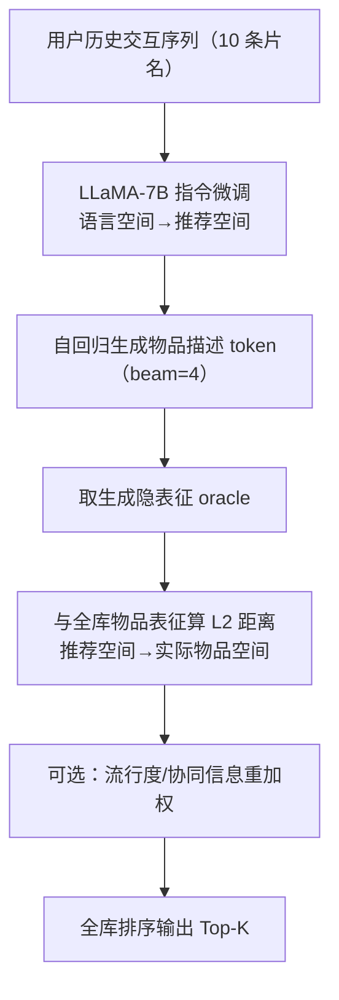

# A Bi-Step Grounding Paradigm for Large Language Models in Recommendation Systems (面向推荐系统的大语言模型两步接地范式)

- **会议/期刊**: ACM Transactions on Recommender Systems (TORS)
- **作者与机构**: Keqin Bao, Jizhi Zhang, Wenjie Wang, Yang Zhang, Zhengyi Yang, Yancheng Luo, Chong Chen, Fuli Feng, Qi Tian（中国科学技术大学、新加坡国立大学、华为）
- **推荐链路定位**: 端到端生成式（生成式召回 + 全库排序）
- **研究方向**: 大语言模型推荐 / 生成式推荐
- **论文原文**: [论文原文链接](https://arxiv.org/abs/2308.08434v2)
- **开源代码**: [开源代码仓库链接](https://github.com/SAI990323/Grounding4Rec)

## TL;DR (1分钟核心速览)

现有 LLM4Rec 工作（TALLRec、InstructRec）普遍在**受限候选集**（CTR 二分类或负采样排序）上评估，无法反映 LLM 的真实全库排序能力。本文提出 BIGRec 两步接地范式：第一步用指令微调把 LLM 从"语言空间"约束到"推荐空间"（生成物品语义描述），第二步用生成 token 的隐表征与真实物品表征的 L2 距离把"推荐空间"锚定到"实际物品空间"，并可在该步无缝注入流行度/协同统计信息。在 MovieLens-10M 与 Amazon-Game 上采用 **Full-Ranking 全库排序**协议，仅用 1024 条训练样本即相对最优基线取得 NDCG@1 提升 **654% / 952%**，多数指标追平甚至超越全量数据训练的传统模型。

## Background & Motivation (背景与核心矛盾)

- **主流范式**: LLM4Rec 主流做法是推荐数据指令微调（TALLRec、InstructRec），或让 LLM 产出物品表征再喂给 SASRec 类 ID 模型（如 LMRec）；评估则多用 CTR 点击预测或 1:1 负采样排序。
- **前人局限**: 其一，**评估协议失真**——负采样排序已被证明与真实全库性能相关性差，无法衡量 LLM 的全局排序能力；其二，**生成与真实物品空间脱节**——LLM 生成的是自由文本，可能产出"《卧虎藏龙（四川话版）》"这类现实中不存在的假设物品，无法直接作为推荐结果。
- **核心洞察 (Key Insight)**: LLM 的强语义先验使其在**极少样本**下就能建立有效推荐，但也正因语义先验过强，它**难以从训练数据中吸收流行度、协同过滤等统计信息**——这解释了"加数据收益递减"的反常现象。
- **本文切入点**: 将推荐拆成"语言空间 → 推荐空间 → 实际物品空间"两级接地，第一级用生成式微调保留 LLM 的生成/理解能力，第二级用表征距离检索把生成结果落回真实物品，并在此步自由注入统计信息。

## Method (核心方法设计)

### 1. 整体框架 (Overall Architecture)

BIGRec 以 LLaMA-7B 为骨干，先在 Alpaca self-instruct 数据上做通用指令微调，再用推荐指令数据（输入用户最近 10 条交互片名，输出下一个物品的完整标题）做推荐域微调，完成第一级接地。推理时模型自回归生成 beam 内的物品描述 token 序列，取其隐表征作为"oracle 向量"，与全库物品表征计算 L2 距离完成第二级接地排序；该距离可被流行度因子或协同模型打分重加权。整个流程既保留了生成式的灵活性，又通过表征检索保证了输出必为真实物品，且全库排序只需一次前向 + 一次向量检索。

<figure class="paper-figure" markdown="span">
  <figcaption>图 1. BIGRec 范式示意图。第一步将语言空间对齐到推荐空间，使模型能够生成包含真实物品和假设物品的潜在物品 token 序列。第二步将推荐空间对齐到真实物品空间，为用户提供真实世界物品的建议。在第二步中，可以方便地引入统计信息（如流行度和协同信息）以获得更好的推荐。</figcaption>
</figure>

### 2. 关键设计拆解 (Key Designs)

1. **第一级接地：生成式推荐域指令微调**：痛点是 LLM 预训练阶段缺乏推荐知识，直接 ICL 效果差且受输入长度限制。本文用"给定用户看过的十部电影，推荐一部新电影"的统一指令模板做监督微调，把输出分布从开放语言空间压缩到物品描述子空间。关键在于**保持生成式接口不变**（而非改造成分类头），从而与预训练目标一致，使 LLM 的语义先验得以保留——这正是 1024 样本即可奏效的根本原因。

2. **第二级接地：表征 L2 距离锚定 + 统计信息注入**：痛点是生成文本可能不对应真实物品。本文取生成序列的隐表征 $\text{oracle}$与物品$i$的表征$\text{emb}_i$计算$D_i = \|\text{emb}_i - \text{oracle}\|_2$并排序。为注入流行度，先归一化距离$\hat{D}_i$，再以逆流行度重加权：

$$\tilde{D}_i = \hat{D}_i \,(1 + P_i)^{\gamma}, \quad P_i = \frac{C_i - \min_j C_j}{\max_j C_j - \min_j C_j}$$

其中 $C_i = N_i / \sum_{j \in \mathcal{I}} N_j$为训练集交互频率。流行物品获得更小距离、更高排名；$\gamma$控制注入强度。协同信息则以传统 CF 模型（DROS）的预测分替换$P_i$ 同式注入。直觉是：语义相似度负责"找对方向"，统计信息负责"校准热度先验"，二者互补。

3. **训练目标、负采样与推理效率**：训练为标准的自回归下一 token 交叉熵 $\mathcal{L} = -\sum_t \log p_\theta(y_t \mid y_{<t}, x)$，**无需任何负采样**（这是相对 ID 类模型的结构性优势）。推理采用 beam size = 4（图 2(b) 显示 beam 增大带来 GPU 显存与时间近线性增长，故取 4 折中），第二级接地为一次全库向量距离计算，开销远低于逐候选打分。

## Experimental Setup & Evaluation Protocol (实验设置与评估协议)

- **数据集与预处理**:

| 数据集 | #Users | #Items | #Interactions | 稀疏度/密度 | 特征/场景说明 |
| :--- | :---: | :---: | :---: | :---: | :--- |
| Movie (MovieLens-10M) | ~69.9k | 10,682 | 10,000,054 | 密度较高 | 流行度偏置显著，头部物品主导 |
| Game (Amazon 5-core) | ~31.0k | 17,408 | 496,315 | 稀疏 | 流行度分布更均衡，偏置较弱 |

- **数据划分与防穿越 (Splitting Strategy)**: 按交互时间戳切为 **10 个时段**，再以 **8:1:1 比例划分**训练/验证/测试，保证测试交互严格晚于训练交互，杜绝信息泄漏；因 LLM 推理成本限制，验证与测试各随机采样 5,000 条交互。
- **排名评测协议 (Ranking Protocol)**: 严格采用无偏 **Full-Ranking（全库未交互物品排序）**，指标为 HR@K 与 NDCG@K（K ∈ {1,3,5,10,20}），这是本文相对 TALLRec 类工作的核心协议升级。
- **对比基线与超参设置**: 传统序列模型 GRU4Rec / Caser / SASRec / DROS（SOTA），LLM 类 P5、GPT4Rec-LLaMA（LoRA 微调）；传统模型 embedding 维 $d=64$、dropout 0.1、BCE 损失 + 均匀负采样；LLM 类学习率$1e{-}4$、AdamW、Alpaca 设定；结果取 3 个随机种子均值。

## Key Experimental Results (实验关键数据)

### 1. 主实验对比 (Main Results)

**少样本设定（各模型均仅 1024 训练样本）**：

| 数据集 | 模型 | NDCG@1 | NDCG@5 | NDCG@20 | HR@10 | HR@20 |
| :--- | :--- | :---: | :---: | :---: | :---: | :---: |
| Movie | SASRec | 0.0023 | 0.0062 | 0.0117 | 0.0161 | 0.0301 |
| Movie | DROS | 0.0022 | 0.0052 | 0.0112 | 0.0173 | 0.0297 |
| Movie | P5 | 0.0014 | 0.0036 | 0.0069 | 0.0107 | 0.0176 |
| Movie | GPT4Rec-LLaMA | 0.0016 | 0.0024 | 0.0035 | 0.0044 | 0.0074 |
| Movie | **BIGRec (1024)** | **0.0176** | **0.0230** | **0.0283** | **0.0366** | **0.0471** |
| Movie | Improv. | +654.29% | +273.70% | +142.55% | +111.97% | +56.55% |
| Game | SASRec | 0.0009 | 0.0015 | 0.0025 | 0.0037 | 0.0057 |
| Game | DROS | 0.0006 | 0.0013 | 0.0022 | 0.0027 | 0.0052 |
| Game | GPT4Rec-LLaMA | 0.0000 | 0.0000 | 0.0001 | 0.0002 | 0.0002 |
| Game | **BIGRec (1024)** | **0.0133** | **0.0189** | **0.0248** | **0.0329** | **0.0457** |
| Game | Improv. | +952.63% | +888.19% | +613.76% | +586.11% | +397.10% |

**对比全量数据训练基线（Movie 全量约 700 万序列，Game 约 12 万）**：Movie 上 BIGRec(1024) 的 NDCG@1 (0.0176) 远超全量 DROS (0.0087)，但 NDCG@20 (0.0283) 低于 DROS (0.0493)；Game 上 BIGRec(1024) 的 NDCG@1 (0.0133) 略低于全量 DROS (0.0156)，而 BIGRec(full) 全面反超（NDCG@1 0.0221 vs 0.0156，HR@20 0.0490 vs 0.0500 基本持平）。

### 2. 消融实验 (Ablation Study)

| 配置 | Movie NDCG@1 | Movie NDCG@20 | Game NDCG@1 | Game NDCG@20 |
| :--- | :---: | :---: | :---: | :---: |
| BIGRec (0)（未训练，仅语义接地） | 0.0020 | 0.0095 | 0.0020 | 0.0073 |
| BIGRec (1024) | 0.0176 | 0.0283 | 0.0133 | 0.0248 |
| BIGRec (full) | — | — | 0.0221 | 0.0319 |
| BIGRec (1024) + 流行度注入 | 0.0176 | ↑（K 越大增益越明显） | — | — |
| BIGRec (1024) + 协同信息 (DROS) | 0.0176 | 0.0562 | 0.0133 | 0.0338 |
| BIGRec (full) + 协同信息 (DROS) | — | — | 0.0221 | 0.0375 |
| 多域联合训练 (Multi) | 与单域 (Single) 基本持平 | 同左 | 同左 | 同左 |

### 3. 关键实验发现 (Key Findings)

1. **语义先验 > 统计拟合，少样本碾压**：仅 1024 样本的 BIGRec 在 Movie 上 NDCG@1 达 0.0176，是同等样本 SASRec (0.0023) 的 7.6 倍，甚至超过用 700 万序列训练的 DROS (0.0087) 一倍——说明 LLM 预训练语义知识可直接替代大量协同信号，且优势集中在**列表头部**（K 越小提升越大，NDCG@1 提升 654% 而 NDCG@20 仅 142%）。
2. **数据规模边际收益递减，暴露 LLM 统计盲区**：Game 上从 1024 扩到全量，BIGRec 的 NDCG@1 从 0.0133 升至 0.0221（+66%），而 SASRec 类模型随数据增长的相对提升曲线陡峭得多；作者归因为 LLM 过度依赖语义先验而"主动忽略"流行度/协同统计量，这直接催生了第二级接地的统计注入设计。
3. **统计信息注入验证互补假设**：Movie 上注入流行度后 NDCG@K 与 HR@K 全面提升（K 越大增益越显著）；Game 上 BIGRec(1024) 融合 DROS 协同分后 NDCG@20 从 0.0248 升至 0.0338（+36%），且**融合增益显著大于把协同信息注入传统模型**（图 6），证明 BIGRec 与 CF 模型依赖的是互补信息源。此外多域联合训练不掉点，说明单一 LLM 可同时接地到多个物品空间。

## Highlights & Limitations (亮点、对比与审稿批判)

- **与代表作对比 (vs. Prior Work)**: 相比 TALLRec/InstructRec 的 CTR 或负采样评估，本文首次在 **Full-Ranking** 下系统检验 LLM 排序能力；相比 GPT4Rec 用 BM25 做接地，本文用 LLM 自身隐表征做 L2 检索，避免了短标题场景下 BM25 的低频词噪声问题（Game 上 GPT4Rec-LLaMA 几乎全线为 0）；相比 P5 的 T5 多任务模板，本文保留 decoder-only 生成接口并显式解耦"生成"与"落地"两步。
- **可迁移亮点**: ①"生成语义 token → 表征近邻检索"的两级范式可无缝迁移到任何需要保证输出合法性的生成式召回场景（如语义 ID 生成推荐）；②在检索阶段用 $(1+P_i)^\gamma$ 逆流行度重加权距离，是一种极轻量的后处理去偏/热度校准技巧，几乎零额外开销。
- **审稿级局限批判**: ①第二级接地仅用 L2 距离 + 单向量表征，方法"crude"，且 beam=4 的生成 + 全库距离计算在工业级千万物品规模下延迟仍不可忽视（图 2(b) 显示 beam 增大显存与时间近线性上升）；②Movie 全量训练因算力被省略，且测试集仅采样 5,000 条，统计功效与结论外推性受限；③$\gamma$ 需在 0–100 范围细搜，跨数据集敏感度高，缺乏自适应设定。

## Rating (四维评分)

- **方法创新性 (Novelty)**: ⭐⭐⭐⭐ （"语言→推荐→物品"两级接地的空间视角清晰且具解释力，但第二级 L2 检索本身较朴素）
- **评估协议与实验扎实度 (Protocol & Experiments)**: ⭐⭐⭐⭐ （Full-Ranking 协议 + 时间切分防穿越是亮点，RQ1–RQ4 层层递进，但测试集采样 5,000 条与 Movie 全量缺失略削弱说服力）
- **写作与数学规范度 (Clarity & Rigor)**: ⭐⭐⭐⭐ （空间定义与公式推导简洁自洽，统计注入公式完整，但部分实现细节如 oracle 表征的具体抽取层未充分说明）
- **工业落地与复现价值 (Industrial & Practical Value)**: ⭐⭐⭐⭐ （代码开源、1024 样本即可用的低成本特性极具吸引力，但 LLM 推理延迟与全库检索开销仍是线上部署的主要瓶颈）

