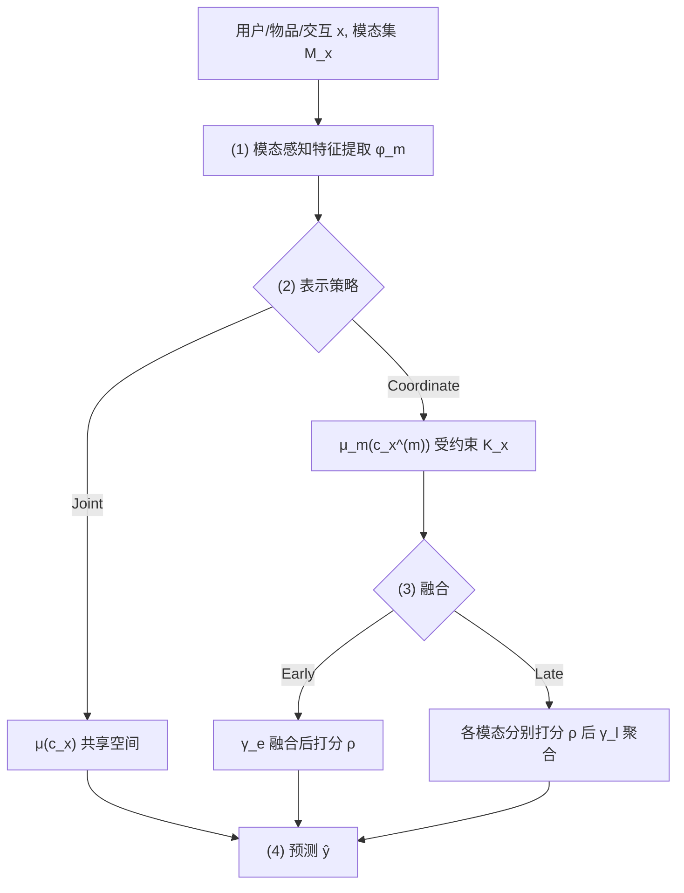
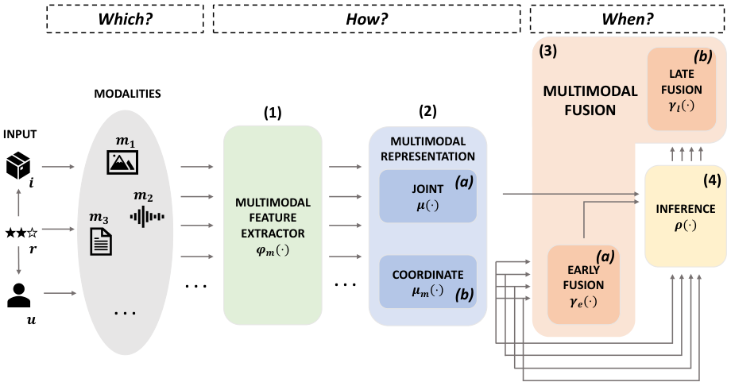

# Formalizing Multimedia Recommendation through Multimodal Deep Learning (通过多模态深度学习形式化多媒体推荐)

- **会议/期刊**: ACM Transactions on Recommender Systems (TORS), KT4Rec 特刊
- **作者与机构**: Daniele Malitesta (Paris-Saclay/Inria)、Giandomenico Cornacchia (IBM Research Europe)、Claudio Pomo、Felice Antonio Merra (Amazon Science)、Tommaso Di Noia、Eugenio Di Sciascio (Politecnico di Bari)
- **推荐链路定位**: 召回（Top-K 排序建模）
- **研究方向**: 多模态推荐 / 基准评测与形式化
- **论文原文**: [论文原文链接](https://arxiv.org/abs/2309.05273v2)
- **开源代码**: [开源代码仓库链接](https://github.com/sisinflab/Formal-MultiMod-Rec)

## TL;DR (1分钟核心速览)

多媒体推荐领域长期缺乏统一的形式化 Schema：各方法在"选哪些模态、怎么处理特征、何时融合"上各自为政，导致增益来源难以归因。本文借鉴多模态深度学习五步流水线，提出以 **Which / How / When** 三问组织的通用形式化框架（含特征提取 $\varphi_m$、联合/坐标表示$\mu$/$\mu_m$、早/晚融合$\gamma_e$/$\gamma_l$ 的完整公式），并将 6 个多模态 SOTA 与 4 个经典模型统一复现于 Elliot。在 5 个 Amazon 数据集、80:20 hold-out 协议下，LATTICE/BM3/FREEDOM 在精度上领先，但超越精度指标（EFD/Gini/APLT/iCov）上经典模型常居次优，揭示"精度—多样性"权衡。

## Background & Motivation (背景与核心矛盾)

- **主流范式**: 多媒体推荐（微视频、时尚、音乐、美食）普遍借用多模态深度学习技术，将视觉/文本/音频特征注入协同过滤或图网络。
- **前人局限**: 其一，43 篇近八年工作在三项设计选择上几乎不收敛——模态组合、特征提取（HFE vs. TFE 预训练/端到端）、表示（Joint vs. Coordinate）与融合（Early vs. Late）随意搭配，无法判断哪一环节贡献最大；其二，评测几乎只看 Recall/nDCG，忽视新颖性、多样性与流行度偏差。
- **核心洞察 (Key Insight)**: 多模态深度学习已有公认五步流水线（representation / translation / alignment / fusion / co-learning），而推荐领域缺少对应物；且文献中 **Joint 表示与 Early/Late 融合从不同时出现**，说明融合应被视为 Coordinate 表示之后的"可选"步骤。
- **本文切入点**: 用一套数学形式化 Schema 把三问映射到流水线，并以统一框架复现来实证检验各设计选择的真实收益。

## Method (核心方法设计)

### 1. 整体框架 (Overall Architecture)

模型输入为用户 $u\in\mathcal{U}$、物品$i\in\mathcal{I}$、交互$r\in\mathcal{R}$，记$x\in\mathcal{X}$为一般输入，其可用模态集$\mathcal{M}_x\subseteq\mathcal{M}=\{v,t,a\}$。流水线为：先按模态做特征提取，再选择联合或坐标表示，坐标表示下可选早融合或晚融合，最后进入打分函数$\rho(\cdot)$并以$\mathcal{L}=\mathcal{L}_{rec}+\alpha\mathcal{L}_{reg}$优化。整体可写为对扩展参数集$\hat{\boldsymbol{\Theta}}=[\boldsymbol{\Theta}_\rho,\boldsymbol{\Theta}_\varphi,\boldsymbol{\Theta}_\mu,\boldsymbol{\Theta}_\gamma]$ 的后验最大化。

<figure class="paper-figure" markdown="span">
  <figcaption>图 1. 我们用于多媒体推荐的多模态方案。经过 (1) 模态感知特征提取后，提取的特征既可以直接表示到唯一的潜在空间 (2a)，也可以投影到每个模态不同的潜在空间 (2b)。在前一种情况下，多模态表示用于产生预测 (4)；在后一种情况下，所有模态都必须经过融合阶段 (3)。在早期融合 (3a) 中，我们产生用于预测的最终表示 (4)。否则，我们首先为每个模态产生不同的预测 (4)，并且</figcaption>
</figure>

### 2. 关键设计拆解 (Key Designs)

1. **Which + How：模态感知特征提取与两种表示（Joint / Coordinate）**：痛点在于像素/波形无法直接入模，且模态间关系无统一定义。本文定义 $\bar{c}_x^{(m)}=\varphi_m(c_x^{(m)}),\ \forall m\in\mathcal{M}_x$，随后分叉：联合表示$\tilde{c}_x=\mu(\bar{\mathbf{c}}_x)$投影到共享空间；坐标表示$\tilde{c}_x^{(m)}=\mu_m(\bar{c}_x^{(m)})\ \text{subject to}\ \mathcal{K}_x,\ |\mathcal{K}_x|\ge 0$，为每模态保留独立空间并允许施加相似度约束。直觉：坐标表示保留模态特异性贡献，天然支撑可解释性；联合表示则以信息压缩换取简洁。

2. **When：早融合与晚融合的形式化区分**：文献长期混淆"联合表示"与"早融合"。本文明确融合仅在坐标表示后发生：早融合先聚合再打分 $\tilde{c}_x=\gamma_e(\tilde{\mathbf{c}}_x),\ \hat{y}=\rho(\tilde{c}_x)$；晚融合先逐模态打分再聚合$\hat{y}^{(m)}=\rho(\tilde{c}_x^{(m)}),\ \hat{y}=\gamma_l(\hat{\mathbf{y}})$。该划分使"融合发生在打分前/后"成为可检验的独立变量，而非与表示策略纠缠。

3. **训练目标与四例映射验证**：总目标为 $\hat{\boldsymbol{\Theta}}=\arg\max_{\boldsymbol{\Theta}}\ prob(\boldsymbol{\Theta}|\mathcal{X})$，损失$\mathcal{L}=\mathcal{L}_{rec}(\boldsymbol{\Theta},\hat{y},y)+\alpha\mathcal{L}_{reg}(\boldsymbol{\Theta})$。作者将 MMGCN（坐标+加法早融合+BPR）、Wang et al. 美食（坐标+拼接早融合+交叉熵）、Han et al. 穿搭（联合表示+对比损失，文本仅入损失）、Oramas 音乐（坐标+MLP 早融合+余弦损失）四例逐项代入 Schema，验证其覆盖力。推理为标准内积 Top-K，无额外解码开销。

## Experimental Setup & Evaluation Protocol (实验设置与评估协议)

- **数据集与预处理**: 5 个 Amazon 品类，均做 `5-core` 过滤；视觉为公开 4096 维图像嵌入，文本按 LATTICE 方式拼接标题/描述/类目/品牌后用 sentence transformers 得 1024 维。

| 数据集 | #Users | #Items | #Interactions | 稀疏度 | 场景说明 |
| :--- | :---: | :---: | :---: | :---: | :--- |
| Office | 4,905 | 2,420 | 53,258 | 99.55% | 办公用品 |
| Toys | 19,412 | 11,924 | 167,597 | 99.93% | 玩具游戏 |
| Beauty | 22,363 | 12,101 | 198,502 | 99.93% | 美妆 |
| Sports | 35,598 | 18,357 | 296,337 | 99.95% | 运动户外 |
| Clothing | 39,387 | 23,033 | 278,677 | 99.97% | 服饰鞋饰 |

- **数据划分与防穿越**: 采用 `80:20 hold-out`（每用户 80% 训练 / 20% 测试），并从测试集再切 50% 作验证集选超参，按验证集 Recall@20 选最优 epoch（上限 200）。
- **排名评测协议**: 全库 `Full-Ranking`（对全部未交互物品排序），报告 top@10 与 top@20；精度用 Recall、nDCG，超越精度用 EFD（新颖性）、Gini（多样性）、APLT（长尾占比/流行度偏差）、iCov（覆盖率）。
- **对比基线与超参**: 经典 BPR/NGCF/LightGCN/SGL 与多模态 VBPR/MMGCN/GRCN/LATTICE/BM3/FREEDOM；统一 $d=64$、batch 1024、200 epoch，仅网格搜索学习率（5 档）与正则系数（2 档）共 10 组，其余沿用原论文最优值以保证公平。

## Key Experimental Results (实验关键数据)

### 1. 主实验对比 (Main Results)

下表摘取 top@20 的 Recall 与两项超越精度指标（完整表见原文 Table 6）：

| 数据集 | 模型 | Recall@20 | EFD@20 | iCov@20 |
| :--- | :--- | :---: | :---: | :---: |
| Toys | BPR | 0.0906 | 0.1345 | 92.12% |
| Toys | SGL | 0.1061 | 0.1681 | 88.77% |
| Toys | VBPR | 0.1006 | 0.1527 | 92.82% |
| Toys | LATTICE | 0.1165 | 0.1665 | 86.58% |
| Toys | **FREEDOM** | **0.1249** | **0.1820** | 78.42% |
| Beauty | LightGCN | 0.1141 | 0.1647 | 65.74% |
| Beauty | VBPR | 0.1102 | 0.1700 | 91.41% |
| Beauty | LATTICE | 0.1259 | 0.1830 | 81.60% |
| Beauty | **FREEDOM** | **0.1286** | **0.1868** | 72.96% |
| Sports | LightGCN | 0.0839 | 0.1081 | 49.49% |
| Sports | SGL | 0.0788 | 0.1122 | 58.65% |
| Office | LightGCN | **0.1237** | **0.1740** | 86.70% |
| Office | BM3 | 0.1081 | 0.1550 | 91.55% |
| Office | GRCN | 0.0667 | 0.1051 | **99.79%** |

FREEDOM 相对最强经典基线 SGL 在 Toys/Beauty 的 Recall@20 上分别提升约 **17.7%** 与 **12.4%**；但在 Office 上经典 LightGCN 反而最优（0.1237 vs. BM3 0.1081），说明多模态增益并非普适。

### 2. 消融实验 (Ablation Study)

以 BPR 为骨架，比较无多模态、纯视觉（即原始 VBPR）、纯文本、视觉+文本三种输入设置（原文 Table 7）：

| 输入设置 | Recall@20 | APLT@20 | iCov@20 | 结论 |
| :--- | :---: | :---: | :---: | :--- |
| 无多模态 (BPR) | 较低 | 常为最优/次优 | 常为最优/次优 | 精度弱、多样性好 |
| 纯视觉 (VBPR) | 提升 | 下降 | 下降 | 视觉主导精度 |
| 纯文本 | 提升 | 下降 | 下降 | 文本补充语义 |
| 视觉+文本 | 最高 | 最低 | 最低 | 精度—多样性权衡最尖锐 |

### 3. 关键实验发现 (Key Findings)

1. **浅层模型被低估**：VBPR 作为最"浅"的多模态方法，在几乎所有数据集上稳居精度前三（如 Beauty Recall@20=0.1102，逼近 LATTICE 的 0.1259），说明文献中"越深越好"的叙事部分源于超参搜索不充分。
2. **精度冠军≠多样性冠军**：LATTICE/BM3/FREEDOM 精度领先，但在 EFD/Gini/APLT/iCov 上常被经典模型反超；GRCN 是唯一在精度与超越精度间取得较稳折衷的多模态方法（如 Office iCov@20 达 99.79%）。
3. **多模态注入是双刃剑**：加入视觉/文本特征普遍提升 Recall@20，却系统性压低 APLT 与 iCov，即模型更倾向推荐头部热门物品，验证了多模态信号放大流行度偏差的风险。

## Highlights & Limitations (亮点、对比与审稿批判)

- **与代表作对比 (vs. Prior Work)**: 相较同期的多模态推荐综述（如 Zhou 等），本文的差异在于：(i) 严格对齐多模态深度学习五步流水线并给出逐步数学形式化；(ii) 首次在 Elliot 中做兼顾精度与超越精度的大规模统一复现；(iii) 明确区分"联合表示"与"早融合"这一长期混淆点。
- **可迁移亮点**: ① "融合仅在坐标表示后发生"的判定规则可直接用于审阅新模型的结构归类；② 将 EFD/Gini/APLT/iCov 纳入标准评测清单，可低成本暴露多模态模型的流行度偏差。
- **审稿级局限批判**: ① 文本模态统一用 sentence transformers 重抽取，与部分原论文的文本处理不一致，可能低估或高估个别基线；② 仅覆盖 Amazon 电商五品类，缺少微视频/音乐等音频模态场景的实证，Schema 中 audio 分支未被基准检验；③ 超参仅搜索学习率与正则，深层模型（MMGCN/GRCN）在其原设定外的表现可能未达最优。

## Rating (四维评分)

- **方法创新性 (Novelty)**: ⭐⭐⭐⭐ （非新模型而是新 Schema，三问映射与融合/表示解耦的判定规则具有领域规范价值）
- **评估协议与实验扎实度 (Protocol & Experiments)**: ⭐⭐⭐⭐ （5 数据集、10 模型、Full-Ranking、精度+四项超越精度指标齐全，但文本特征重抽取与超参搜索范围略窄）
- **写作与数学规范度 (Clarity & Rigor)**: ⭐⭐⭐⭐⭐ （每步均有公式与四例逐项代入验证，符号体系自洽，Algorithm 1 给出完整流程）
- **工业落地与复现价值 (Industrial & Practical Value)**: ⭐⭐⭐⭐ （代码与配置全开源并集成 Elliot，可直接作为多模态推荐选型与评测基线，唯缺线上/规模性开销分析）

