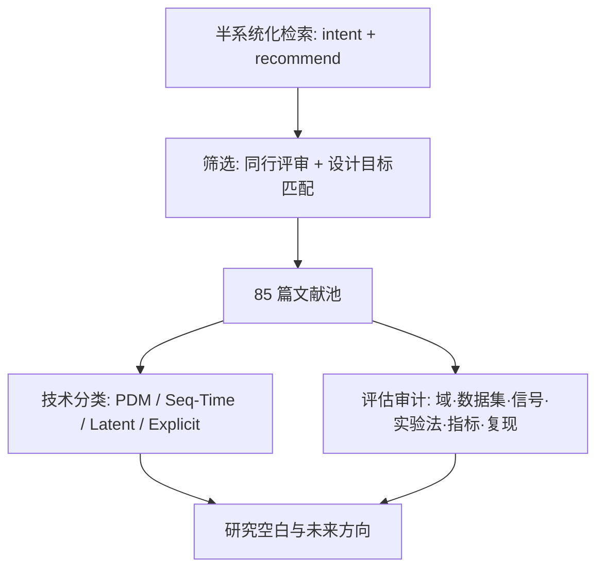
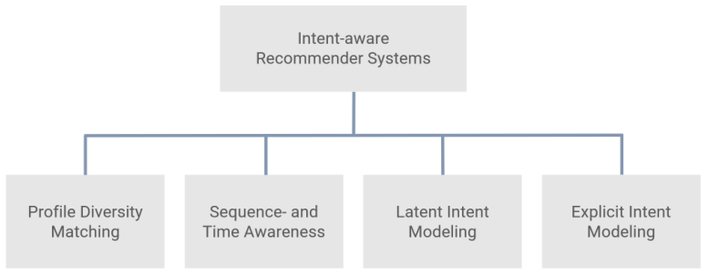

# A Survey on Intent-aware Recommender Systems (意图感知推荐系统综述)

- **会议/期刊**: ACM Transactions on Recommender Systems (TORS)
- **作者与机构**: Dietmar Jannach (University of Klagenfurt), Markus Zanker (Free University of Bozen-Bolzano / University of Klagenfurt)
- **推荐链路定位**: 召回 / 重排（覆盖候选生成与列表重排两类落地形态）
- **研究方向**: 序列与会话推荐 / 对话推荐与智能体仿真
- **论文原文**: [https://arxiv.org/abs/2406.16350v3](https://arxiv.org/abs/2406.16350v3)
- **开源代码**: 暂未开源（综述类论文，无代码仓库）

## TL;DR (1分钟核心速览)

本文针对"用户每次访问服务的动机随访问甚至会话内动态漂移、传统全历史偏好建模无法匹配当下意图"这一核心痛点，对 85 篇同行评审文献做半系统化综述，提出 **Profile Diversity Matching / Sequence- & Time-Aware / Latent Intent Modeling / Explicit Intent Modeling** 四类技术分类体系，并给出 IARS 的包容性定义（"捕获用户当下动机与目标"）。评估实践分析揭示：绝大多数工作仅做离线实验、以精度为唯一主指标、仅 28% 提供代码仓库，据此指出多信号融合、显式意图与人类在环评估三大未来方向。

## Background & Motivation (背景与核心矛盾)

- **主流范式**: 传统 CF 与早期序列模型把用户全部历史偏好压缩为静态表征，推荐结果反映的是"长期兴趣的并集"；实践中 Netflix/Amazon 用多列表（"继续观看""发现新片"）隐式分流不同意图。
- **前人局限**: ① 序列/会话模型默认"最近交互即意图"，但最近点击可能只是噪声或探索行为，无法区分"找替代品"与"找互补品"；② 隐意图模型（解耦表征）虽能建模多意图，但潜变量语义不可解释、无法验证是否对应真实用户目标。
- **核心洞察 (Key Insight)**: 工业界实证（Spotify 百万级问卷、电商 ERIC 系统三个月 A/B）表明意图可预测且与满意度强相关，但学术界对"意图"的定义高度分裂——有的等同于兴趣类别，有的等同于最近交互，缺乏统一判据。
- **本文切入点**: 以"设计目标"而非"技术实现"定义 IARS，将意图严格限定为**短期/即时动机**，从而把纯统计的 next-item 推荐（如 Amazon "买了又买"）排除在外，并据此建立四类技术谱系。

## Method (核心方法设计)

### 1. 整体框架 (Overall Architecture)

本文是综述而非新模型，其"方法"即分类学与评估审计流程：先以 Google Scholar + 数字图书馆检索 "intent/intention + recommend" 并做雪球式引文扩展，仅保留同行评审论文，剔除"购买倾向预测"等非推荐类工作，最终得 85 篇；随后沿**技术路线**（四类）、**应用域/数据集/输入信号**、**实验方法**（离线/用户研究/线上 A/B）、**评估指标**、**可复现性**五个维度逐篇人工标注，最后归纳研究空白。

<figure class="paper-figure" markdown="span">
  <figcaption>图1. 技术方法概览</figcaption>
</figure>

### 2. 关键设计拆解 (Key Designs)

1. **四类技术谱系（分类学贡献）**：痛点在于文献对"意图"用法混乱 $\to$ 本文按"意图如何被获取"切分：**PDM** 用元数据/子画像做贪心重排以覆盖多意图（Vargas 的 intent-oriented diversification 把用户画像类比为检索 query，用 aspect-oriented 画像 + 贪心重排最大化覆盖）；**Seq/Time-Aware** 以最近交互为意图代理（NARM/STAMP 用 attention 聚焦会话主意图，ASLM 用 RNN 分离长期偏好层与短期意图层）；**Latent Intent** 用解耦表征或多意图 embedding（MacridVAE 宏微观解耦、DGCF 意图感知图传播、MIND 胶囊多兴趣）；**Explicit Intent** 预定义域内意图集（音乐 7 类听歌意图、电商 4 类购物意图、时尚 match/substitute）。直觉：意图获取的"显式程度"决定了可解释性与跨域可迁移性的权衡。
2. **IARS 的包容性定义（概念贡献）**：前人定义或过窄（仅多样性）或过宽（任何序列模型都算）$\to$ 本文以目的论定义"旨在捕获并支持用户当下动机与目标的推荐系统"，并明确排除三类近邻：上下文感知（外部情境 vs 内部动机）、对话推荐中的 micro-intent（对话行为意图 vs 使用动机）、购买倾向预测（propensity 而非匹配）。该判据使分类具备可操作性。
3. **评估实践审计与复现性量化**：对 75 篇含离线实验的论文统计，仅 21 篇（28%）给出代码链接；多数工作未说明 SOTA 基线调参过程、跨模型共用同一 embedding 维度；线上验证仅 5 篇（ERIC、MIND、Atten-Mixer、Google 意图序列模型、提醒式推荐），且部分 A/B 仅持续 2–3 周、目标 KPI 未披露。

## Experimental Setup & Evaluation Protocol (实验设置与评估协议)

本文无自有实验，以下为其对**被综述文献评估实践**的审计结论。

- **数据集分布**: MovieLens 与 Amazon Review 系列使用最广；电商序列数据集（TMall、Taobao、YOOCHOOSE、Diginetica）次之；专有数据集常见于工业工作；另有 30 个仅出现 1–2 次的长尾数据集。

| 维度 | 统计结论 | 说明 |
| :--- | :---: | :--- |
| 应用域 | 电商主导 | 区别于早期以电影为主的推荐综述 |
| 场景 | 序列/会话为主 | 其次是 sequence-agnostic top-N、bundle/package、slate |
| 输入信号 | >30 篇仅用交互序列 | 约半数引入 item 元数据（类别最常见，作为意图代理） |
| 多类型交互 | 仅约 6 篇 | 多数只用单一行为（如点击） |
| 实验方法 | 离线压倒性主导 | 线上 A/B 仅 5 篇，用户研究仅 1 篇 RCT |
| 主指标 | 精度第一、多样性第二 | 少量用 CTR、停留时长、enjoyment、novelty、entropy |
| 可复现性 | 28% 提供代码 | 基线调参普遍未报告 |

- **数据划分与防穿越**: 综述未统一规范；被审文献多沿用各自领域的 Leave-One-Out 或时间切分，缺乏跨工作一致性，本身即为空白之一。
- **排名评测协议**: 以离线全库或采样排序为主，缺少对意图匹配质量的专门协议（如按意图分桶的命中率），这是本文指出的关键评估缺口。
- **对比基线与超参**: 指出普遍存在"基线未调参""统一 embedding 维度"问题，可能高估复杂神经架构的真实增益。

## Key Experimental Results (实验关键数据)

### 1. 线上/用户研究实证汇总（本文核心"结果表"）

| 工作 | 场景 | 意图建模方式 | 评估形式 | 关键结果 |
| :--- | :--- | :--- | :--- | :--- |
| Shi et al. (ERIC) | 中国电商 | 4 类显式购物意图 + 策略切换 | 3 个月线上 A/B | CTR、购买率、停留时长显著且持续提升 |
| Li et al. (MIND) | TMall 首页 | 胶囊网络多兴趣 | 1 周线上 A/B | CTR 优于两个无意向基线；**7 个潜意图最优** |
| Zhang et al. (Atten-Mixer) | 高流量站点 | 意图序列混合 | 1 周线上 A/B | top 业务指标 **+1.5%**（叠加于调优后 SR-GNN） |
| Google 团队 | 十亿级用户站点 | 意图感知序列模型 | 3 周线上 A/B | enjoyment **+0.7%**，主题多样性 **+0.1%** |
| Jannach et al. | 电子 Gadget 电商 | "提醒继续上次会话"意图 | 3 个月线上 A/B | 外链点击数大幅高于热门推荐与 BPR |
| Yang et al. | 播客 App | 显式收听志向 | 99 人 4 周 RCT | 收听行为与订阅显著提升，满意度上升 |
| Mehrotra et al. (Spotify) | 音乐首页 | 6 类显式访问意图 | 300 万用户 App 内问卷（>10 万回复） | 意图分布可测，且意图调节交互信号与满意度的关系 |

### 2. 技术路线对比（定性"消融"）

| 路线 | 意图获取 | 可解释性 | 跨域迁移 | 代表工作 |
| :--- | :--- | :---: | :---: | :--- |
| Profile Diversity Matching | 元数据/子画像覆盖 | 中 | 强 | Vargas, Kaya & Bridge, Octopus |
| Sequence/Time-Aware | 最近交互代理 | 弱 | 强 | NARM, STAMP, ASLM, 元学习解耦方案 |
| Latent Intent | 潜变量/解耦表征 | 弱 | 强 | MacridVAE, DGCF, DisenHAN, MIND |
| Explicit Intent | 域内预定义意图集 | 强 | 弱 | ERIC, Spotify 意图研究, 时尚 match/substitute |

### 3. 关键实验发现 (Key Findings)

1. **潜意图数量存在甜点区**：多数解耦/多兴趣工作在 $k=4\sim12$时最优，TMall 线上 A/B 进一步定位到$k=7$，说明意图数并非越多越好，过多会稀释每个意图的表征密度。
2. **线上增益量级远小于离线报告**：Google 三周 A/B 的 enjoyment 仅 +0.7%、多样性 +0.1%，Atten-Mixer 仅 +1.5%，提示离线精度提升与真实用户价值之间存在显著折损，纯离线精度导向的评估会系统性高估进展。
3. **"提醒继续会话"这类低成本显式意图收益极高**：Jannach 的三个月 A/B 显示其外链点击显著超过热门推荐与 BPR，说明并非所有意图都需要复杂潜变量建模，域内显式意图的工程性价比被低估。

## Highlights & Limitations (亮点、对比与审稿批判)

- **与代表作对比 (vs. Prior Work)**: 相较 Rafique et al. 从智慧城市与传感设备视角谈 IARS，本文聚焦算法与评估方法论；相较 Kofler et al. 的多媒体检索意图综述，本文把"why 维度"迁移到推荐并给出可操作判据；相较常规序列推荐综述（Quadrana、Wang 等），本文的核心增量是把"意图"从"最近交互"中剥离出来作为独立设计目标。
- **可迁移亮点**: ① 用"设计目标而非技术实现"做分类判据，可直接迁移到多模态、生成式推荐等概念泛滥领域的综述写作；② 按意图分桶评估（intent-stratified evaluation）的思路可落地为线上分层指标看板。
- **审稿级局限批判**: ① 检索为半系统化而非 Kitchenham 严格流程，85 篇的覆盖完整性依赖雪球扩展，可能遗漏非英文或工业内部工作；② 全文无定量元分析（如效应量汇总），四类路线的优劣仅停留在定性对比，且对 2024 年后兴起的 LLM 意图推断工作覆盖不足。

## Rating (四维评分)

- **方法创新性 (Novelty)**: ⭐⭐⭐⭐ （分类学与目的论定义具原创性，但无新算法，创新体现在概念框架而非技术）
- **评估协议与实验扎实度 (Protocol & Experiments)**: ⭐⭐⭐ （评估审计维度全面、线上案例汇总有价值，但检索非严格系统化、缺定量元分析）
- **写作与数学规范度 (Clarity & Rigor)**: ⭐⭐⭐⭐ （术语辨析与四类路线边界清晰，几乎无公式，符号负担极低）
- **工业落地与复现价值 (Industrial & Practical Value)**: ⭐⭐⭐⭐ （线上 A/B 实证汇总与 28% 复现率警示对工业与研究社区均有直接指导意义）

