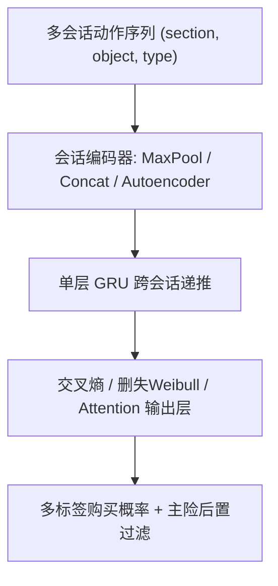
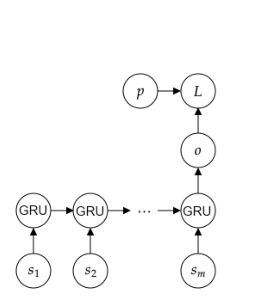

# Recommending Target Actions Outside Sessions in the Data-poor Insurance Domain (数据稀缺保险域中会话外目标行为推荐)

- **会议/期刊**: ACM Transactions on Recommender Systems (TORS)，RecSys 2022 会议论文的扩展版
- **作者与机构**: Simone Borg Bruun, Christina Lioma, Maria Maistro（哥本哈根大学计算机系）
- **推荐链路定位**: 召回（会话级候选打分）
- **研究方向**: 序列与会话推荐 / 冷启动与长尾推荐
- **论文原文**: [https://arxiv.org/abs/2403.00368v1](https://arxiv.org/abs/2403.00368v1)
- **开源代码**: [https://github.com/simonebbruun/cross-sessions_RS](https://github.com/simonebbruun/cross-sessions_RS)

## TL;DR (1分钟核心速览)

保险域是典型的"数据稀缺 + 物品极少（仅 16 个）+ 购买发生在会话之外（多为电话成交）"场景，传统 session-based 模型"预测会话内下一交互"的假设直接失效。本文提出跨会话 RNN 模型族：以多会话、多类型动作（section/object/type 三元组）为输入，预测会话结束后的购买目标，并给出三种会话编码（Max-Pooling Encode / Concat / Autoencoder）× 三种损失架构（交叉熵 / 删失 Weibull / Attention）的组合。在 44K 用户真实保险数据上，Full-Ranking 协议下最优模型 HR@3 达 0.8385，较最强基线 SKNN_EB 相对提升 3.11%，MRR@3 提升 4.90%。

## Background & Motivation (背景与核心矛盾)

- **主流范式**: 会话推荐以 GRU4REC、NARM、SKNN 为代表，核心任务是"给定当前会话内动作序列，预测会话内下一个交互物品"；保险推荐则多依赖人口统计学特征做聚类/贝叶斯网络/关联规则。
- **前人局限**: 其一，item-to-item 与 STAN 等方法**强制要求目标行为发生在会话内**，而保险购买 75% 通过电话完成，会话内根本观测不到购买信号；其二，人口统计模型假设**同人群内偏好动态同质**，无法刻画个体偏好漂移，且完全丢弃了会话行为序列。
- **核心洞察 (Key Insight)**: 用户购买前往往经历**多次会话**（均值 2.18 次），且会话中大量动作（如查看理赔、修改职业信息）**并不直接关联物品**，但这些"非物品动作"恰恰是购买意图的强信号——这是传统 session-based 模型系统性丢弃的信息。
- **本文切入点**: 把"单会话内下一交互预测"改写为"多会话序列 → 会话外购买目标的多标签预测"，并用删失生存分析处理"何时购买未知"的时序不确定性。

## Method (核心方法设计)

### 1. 整体框架 (Overall Architecture)

模型以 GRU4REC 为骨架，做三处改造：输入从"单会话物品序列"扩展为"用户最近 $m$个会话的动作序列"；动作从物品 ID 扩展为三元组$a_{ij}=(c_{ij},b_{ij},d_{ij})$（动作所在板块、动作对象、动作类型）；输出从"每步下一交互"改为"末步之后各物品的购买概率向量"。会话先经编码器压成向量$s_i$，再逐会话送入单层 GRU 递推隐状态，末步输出经 sigmoid 得到多标签购买概率；训练时可选交叉熵、删失 Weibull 或注意力三种架构，推理时按分数降序并施加"附加险需先有主险"的后置过滤。

<figure class="paper-figure" markdown="span">
  <figcaption>图 2. 跨会话编码的架构。</figcaption>
</figure>

### 2. 关键设计拆解 (Key Designs)

1. **跨会话 Max-Pooling 编码（Cross-sessions Encode）**：痛点在于会话长度不一且动作稀疏，逐动作建模噪声大。做法是对会话内所有动作的二值向量取逐元素最大：$s_i=\max_{\text{element}}(a_{i1},\dots,a_{in})$，再送入 GRU 递推$h_i=(1-z_i)\cdot h_{i-1}+z_i\cdot\hat{h}_i$。直觉是"会话内出现过即算数"，把变长会话压成定长意图指纹，同时保留会话间的顺序依赖；实验证明该编码优于拼接与自编码器，说明**动作顺序在保险域是噪声大于信号**。

2. **删失 Weibull 损失（Censored Weibull Loss）**：痛点在于训练期末用户尚未购买全部物品，真实"购买时间"被右删失，直接用交叉熵无法利用"何时买"的信息。做法是让 RNN 每步输出 Weibull 分布参数 $(\alpha_{i,k},\beta_{i,k})=(\exp(o^1_{i,k}),\sigma(o^2_{i,k}))$，以负对数似然为损失：$\mathcal{L}_i=-\sum_k u_{i,k}\log P(Y_{i,k}=y_{i,k})+(1-u_{i,k})\log P(Y_{i,k}>y_{i,k})$，其中$u_{i,k}$ 为删失指示变量。直觉是：未购买不等于不买，只是"还没到时间"，生存分析把这种"未来才发生"的监督信号也纳入训练；推理时以 Weibull 中位时间取负作为排序分。

3. **训练目标、负采样与推理效率**：交叉熵版本采用多标签 BCE（因用户可同时购买多件）：$\mathcal{L}=-\sum_{k=1}^{K}p_k\log\hat{p}_k+(1-p_k)\log(1-\hat{p}_k)$，**无需负采样**（$K=16$极小，全物品 softmax 式打分即可）；注意力版本用 Bahdanau 注意力$\lambda_i=\exp(e_i)/\sum_i\exp(e_i)$、$c=\sum_i\lambda_i h_i$ 加权隐状态。推理开销极低（单层 GRU + 16 维输出），但作者也承认该设计在物品数达十万级的域需改为采样输出。

## Experimental Setup & Evaluation Protocol (实验设置与评估协议)

- **数据集与预处理**: 单一公开保险数据集（2018-10 至 2020-09 网站日志），过滤规则为：移除频率 < 0.1% 的物品与动作、去除连续重复动作、丢弃 < 3 动作的会话、截断至 30 动作（95 分位）、按 10 天阈值丢弃跨任务会话、每用户保留最近 7 个会话（95 分位）。

| 数据集 | #Users | #Items | #Interactions | 稀疏度/密度 | 特征/场景说明 |
| :--- | :---: | :---: | :---: | :---: | :--- |
| Insurance | 44,434 | 16 | 53,757 购买 / 117,163 会话 / 1,256,156 动作 | 人均 1.21 次购买、2.18 会话/购买 | 4 板块 × 3 对象类 × 4 动作类型；含人口统计与保单组合 |

- **数据划分与防穿越 (Splitting Strategy)**: 按购买事件时间切分，**最新 10% 购买事件及其关联历史会话作测试集**，其余 90% 训练；并剔除训练集中与测试集共享历史会话的购买事件（仅删 54/48,381 条），有效防止会话穿越。
- **排名评测协议 (Ranking Protocol)**: 无偏 **Full-Ranking（全库 16 物品排序）**，施加"附加险需先购主险"的后置过滤（不满足则置最低分）；主指标 HR@3 / Precision@3 / Recall@3 / MRR@3 / MAP@3（$k=3$因 UI 最多展示 3 条），并报告$k=1..5$曲线；显著性用 McNemar 检验（HR）与单因素 ANOVA（其余指标），$\alpha=0.05$ 并做多重比较校正。
- **对比基线与超参设置**: 基线含 Random、Popular、SVD、Demographic（FFN）、GRU4REC、GRU4REC Concat、SKNN_E、SKNN_EB；GRU 单元数 64–256、batch 16–128、dropout 0.2–0.4，网格搜索于验证集（同样取最新 10% 购买）。

## Key Experimental Results (实验关键数据)

### 1. 主实验对比 (Main Results)

| 模型 | HR@3 | Precision@3 | Recall@3 | MRR@3 | MAP@3 |
| :--- | :---: | :---: | :---: | :---: | :---: |
| Popular | 0.6217 | 0.2145 | 0.5855 | 0.4764 | 0.4540 |
| SVD | 0.6646 | 0.2372 | 0.6327 | 0.4997 | 0.4829 |
| Demographic | 0.7392 | 0.2649 | 0.7095 | 0.5620 | 0.5446 |
| GRU4REC | 0.6479 | 0.2313 | 0.6208 | 0.5443 | 0.5264 |
| GRU4REC Concat | 0.6616 | 0.2365 | 0.6362 | 0.5620 | 0.5453 |
| SKNN_E | 0.8106 | 0.2914 | 0.7848 | 0.6740 | 0.6567 |
| SKNN_EB（最强基线） | 0.8132 | 0.2922 | 0.7872 | 0.6785 | 0.6610 |
| Cross-sessions Encode | 0.8380 (3.04%) | 0.3030 (3.67%) | 0.8145 (3.46%) | 0.7093 (4.53%) | 0.6923 (4.73%) |
| Cross-sessions Auto | 0.8356 (2.74%) | 0.3024 (3.48%) | 0.8128 (3.24%) | 0.7085 (4.41%) | 0.6920 (4.69%) |
| **Encode + Attention** | **0.8385 (3.11%)** | 0.3026 (3.56%) | **0.8141 (3.41%)** | **0.7118 (4.90%)** | **0.6941 (5.00%)** |
| Encode + Weibull | 0.8378 (3.02%) | 0.3013 (3.10%) | 0.8120 (3.15%) | 0.7039 (3.74%) | 0.6852 (3.66%) |
| Encode + Attention + 人口统计 | 0.8514 (4.69%) | 0.3093 (5.83%) | 0.8284 (5.23%) | 0.7301 (7.59%) | 0.7134 (7.93%) |

### 2. 消融实验 (Ablation Study)

以 Cross-sessions Encode（交叉熵）为基准，逐类移除动作（相对变化）：

| 移除的动作类别 | HR@3 | MRR@3 | MAP@3 |
| :--- | :---: | :---: | :---: |
| 全部动作（完整模型） | 0.8380 | 0.7093 | 0.6923 |
| w/o object = Items | 0.7379 (-11.94%) | 0.5720 (-19.36%) | 0.5548 (-19.86%) |
| w/o section = E-commerce | 0.7526 (-10.19%) | 0.5951 (-16.09%) | 0.5764 (-16.74%) |
| w/o object = Services | 0.8032 (-4.15%) | 0.6639 (-6.40%) | 0.6465 (-6.61%) |
| w/o section = Personal account | 0.8067 (-3.73%) | 0.6604 (-6.89%) | 0.6438 (-7.00%) |
| w/o type = Start | 0.8162 (-2.60%) | 0.6771 (-4.55%) | 0.6592 (-4.77%) |
| w/o type = Complete | 0.8317 (-0.75%) | 0.7036 (-0.80%) | 0.6861 (-0.89%) |

### 3. 关键实验发现 (Key Findings)

1. **会话信号强于长期偏好，但"预测下一交互"是错误目标**：SKNN_EB（0.8132）远超 SVD（0.6646）与 Demographic（0.7392），说明会话是保险推荐的最强信号；但 GRU4REC（0.6479）甚至不如 Popular（0.6217 附近），证明照搬"会话内下一交互预测"在会话外购买场景下完全失效——这正是本文任务重定义的价值所在。
2. **会话编码方式与损失函数存在"末步趋同、早期分化"现象**：Max-Pooling 编码优于 Concat（0.8380 vs 0.8265）与 Autoencoder，说明动作顺序是噪声；Weibull 损失在末步与交叉熵持平（0.8378 vs 0.8380），但在**序列早期步骤显著更优**（图 11），更适合真实在线"用户刚进站即推荐"的冷启动时刻。
3. **非物品动作贡献不可忽视，且模型基本公平**：移除 Items 对象导致 MAP 暴跌 19.86%，但移除 Services（频次是 Items 的两倍）也损失 6.61%，移除 E-commerce 板块损失 16.74%——证明"看理赔、改职业信息"等非购买动作携带真实意图；公平性上，各模型在性别、收入维度无显著组间差异，但所有会话模型对 60 岁以上用户性能显著偏低（GRU4REC 尤甚），提示老年用户会话行为更难建模。

## Highlights & Limitations (亮点、对比与审稿批判)

- **与代表作对比 (vs. Prior Work)**: 相较 GRU4REC/NARM 等"会话内下一交互"范式，本文首次将目标行为显式移出会话，并引入多类型非物品动作；相较 Qazi 等人口统计模型，本文用个体会话序列替代人群同质假设，且二者混合后 MRR@3 再提升至 0.7301（+7.59%）；相较 Bi 等的跨域迁移方案，本文无需源域重叠用户，纯靠目标域多会话自监督。
- **可迁移亮点**: ①"删失 Weibull 损失 + 中位时间取负排序"可直接迁移到订阅续费、复购周期预测等右删失场景；②"非物品行为动作作为意图特征"的思路可迁移到电商浏览路径、金融 App 行为序列建模。
- **审稿级局限批判**: ①物品仅 16 个，输出层全库打分可行，但作者自认在十万级物品域需引入负采样，扩展性未验证；②数据划分按购买事件时间切分而非严格全局时间戳，且人口统计特征为**地理区域聚合均值**而非个体真实值，公平性结论的粒度存疑；③Weibull 损失仅在早期步骤占优、末步无增益，收益场景偏窄，且未做线上 A/B 验证。

## Rating (四维评分)

- **方法创新性 (Novelty)**: ⭐⭐⭐ （任务重定义"会话外目标预测"有洞察，但模型骨架仍是 GRU4REC + 常规生存损失组合，算子层面增量有限）
- **评估协议与实验扎实度 (Protocol & Experiments)**: ⭐⭐⭐⭐ （Full-Ranking + 防穿越切分 + McNemar/ANOVA 显著性 + 动作级消融 + 公平性分桶，协议规范；扣分在单数据集与聚合人口特征）
- **写作与数学规范度 (Clarity & Rigor)**: ⭐⭐⭐⭐ （三种编码 × 三种损失的组合表述清晰，Weibull 删失似然推导完整，超参与阈值估计过程透明）
- **工业落地与复现价值 (Industrial & Practical Value)**: ⭐⭐⭐⭐ （代码与数据全开源，单层 GRU 推理开销极低，10 天会话阈值用 EM 拟合 GMM 自动估计，工程可复制性强）

