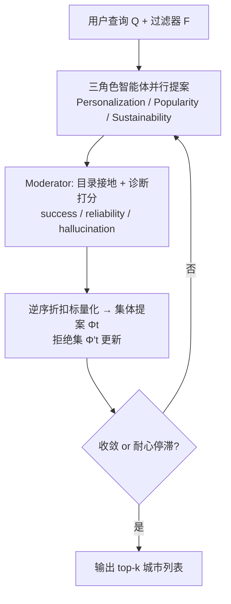
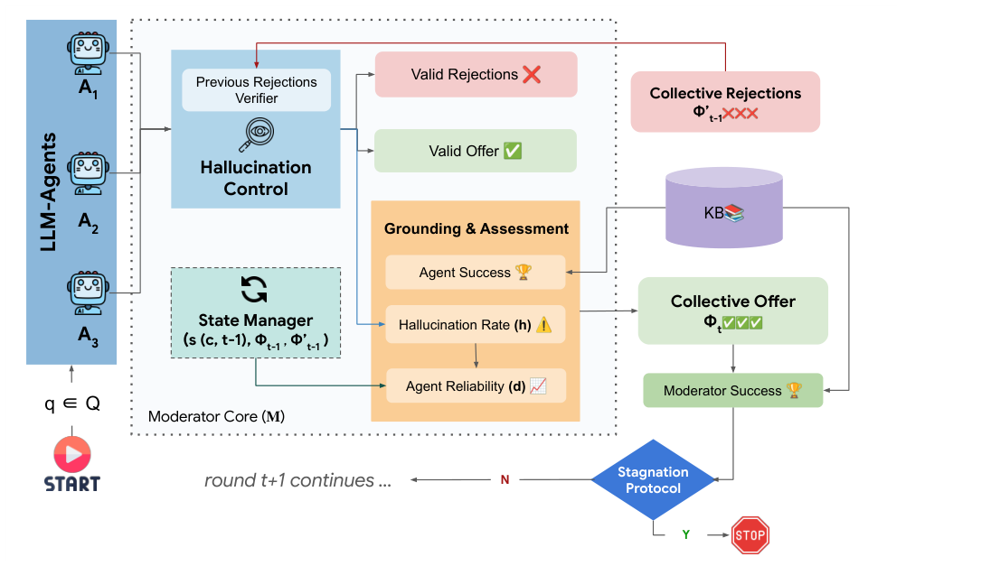

# Collab-Rec: An LLM-based Agentic Framework for Balancing Recommendations in Tourism (面向旅游推荐平衡的多智能体 LLM 框架)

- **会议/期刊**: ACM Transactions on Recommender Systems (TORS), 2026
- **作者与机构**: Ashmi Banerjee, Adithi Satish, Fitri Nur Aisyah, Wolfgang Wörndl (慕尼黑工业大学); Yashar Deldjoo (巴里理工大学)
- **推荐链路定位**: 重排 / 端到端生成式（列表级候选生成与修复）
- **研究方向**: 对话推荐与智能体仿真 / 去偏公平与工业架构
- **论文原文**: [https://arxiv.org/abs/2508.15030v7](https://arxiv.org/abs/2508.15030v7)
- **开源代码**: [https://github.com/ashmibanerjee/collab-rec](https://github.com/ashmibanerjee/collab-rec)

## TL;DR (1分钟核心速览)

旅游推荐天然是**多利益相关方**问题：用户要个性化、平台要流行度转化、目的地政府要缓解过度旅游，而单体 LLM 推荐器存在两大失效——**流行度坍缩**（反复推巴黎/伦敦等头部枢纽）与**幻觉**（编造或越出目录的城市）。Collab-Rec 将三个目标拆给 Personalization / Popularity / Sustainability 三个 LLM 智能体独立提案，再由一个**非 LLM 的确定性 Moderator** 做目录接地、诊断打分、拒绝集广播与多轮约束精炼。在 SynthTRIPs 的 900 条分层查询、200 城封闭目录、6 个 LLM 骨干上，Moderator Success 相对单智能体 SASI 提升 10–19 个点（如 Claude 0.465→0.657），Gini 由 0.71 降至 0.64、目录覆盖率 66%→81.5%，且约 4 轮即收敛。

## Background & Motivation (背景与核心矛盾)

- **主流范式**: 用单体 LLM 一次性 prompt 完成"满足全部约束 + 平衡多目标"的旅游推荐；或采用 manager-centric 多智能体（MACRec、MATCHA）做偏好 elicitation 与解释生成。
- **前人局限**: ① 单 prompt 混合多目标会触发**目标坍缩**，模型隐式偏向热门城市，且对措辞/解码极敏感；② 纯 prompt 方案缺乏**可审计的约束执行点**，无法保证输出落在固定目录内，幻觉与越界实体难以在部署中拦截。
- **核心洞察 (Key Insight)**: 目标分解（role specialization）能缓解目标坍缩并扩大候选面，但**仅靠分工不够**——每个智能体仍会过拟合自身偏见。真正缺的是一个**确定性、可复现、可消融**的聚合控制点。
- **本文切入点**: 用"角色专精生成 + 非 LLM Moderator 接地聚合 + 结构化反馈多轮修复"替代单体推理，把多目标权衡从模型内部黑箱搬到外部显式策略。

## Method (核心方法设计)

### 1. 整体框架 (Overall Architecture)

给定自然语言查询 $Q$与结构化过滤器集$\mathcal{F}$，三个共享同一 LLM 骨干的专家智能体各自输出长度$k=10$的排序城市列表；Moderator 依据外部知识库（200 城目录）做目录校验、计算三类接地诊断（success / reliability / hallucination），以逆序折扣线性标量化累计城市得分，选出集体提案$\Phi_t$与集体拒绝集$\Phi'_t$，并把结构化反馈广播给各智能体；智能体在下一轮**只允许替换至多 3 个城市**（保留$\geq k-3$ 个），循环至理想收敛或耐心停滞即停。智能体之间**不直接通信**，全部协调经由 Moderator 的共享状态完成。

<figure class="paper-figure" markdown="span">
  <figcaption>图 2. Collab-Rec 概览。三个专业 LLM 智能体独立提出排序后的城市候选。确定性 Moderator 依据知识库验证提案，计算有据可依的诊断指标（约束满足度、跨轮稳定性以及幻觉/无效输出率），将候选聚合为集体提案，并广播结构化反馈与拒绝集。迭代持续进行，直至满足在线终止协议。</figcaption>
</figure>

### 2. 关键设计拆解 (Key Designs)

1. **逆序折扣的多目标标量化打分（Rank-discounted Scalarization）**：痛点在于多目标融合若交给 LLM 会不可复现。Moderator 对城市 $c$在轮次$t$ 的增量贡献定义为
$$\Delta s_{a_i}(c,t)=\frac{1}{\mathrm{rank}_{a_i,t}(c)}\big(\lambda_r r_{a_i,t}+\lambda_d d_{a_i,t}-\lambda_h h_{a_i,t}\big),\quad s(c,t)=s(c,t-1)+\sum_{a_i}\mathbb{I}[c\in L_{a_i,t}]\Delta s_{a_i}(c,t)$$
其中 $r$为角色过滤器满足率、$d$为跨轮列表稳定性、$h$为越界/被拒比例，$\lambda$ 全部固定为 1 以避免在评测集上调参。直觉：**多智能体、多轮次的重复背书**自然放大长尾候选，而幻觉项直接做减法惩罚，权衡策略完全透明可审计。

2. **拒绝集与两种投票策略（Aggressive vs. Majority）**：痛点在于 LLM 会反复回吐已被否定的热门城市。对上一轮集体提案中的城市统计"省略票" $v_t(c)=\sum_{a_i}\mathbb{I}[c\notin L_{a_i,t}]$，拒绝集按$\Phi'_t=\Phi'_{t-1}\cup\{c\in\Phi_{t-1}: v_t(c)\geq\tau\}$单调累积，$\tau=1$为 Aggressive、$\tau=2$ 为 Majority。拒绝集对智能体与 Moderator 同时生效，形成**硬性探索压力**，这是把推荐质量推向长尾的物理机制。

3. **耐心早停与训练/推理开销**：无训练、无负采样，全部为推理期编排。终止条件为理想收敛 $S(\Phi_t)=1$或$t\geq T_{\min}=3$后在窗口$p=2$内提升小于$\epsilon=0.005$。每轮成本为$|\mathcal{A}|=3$ 次并行 LLM 调用加一次确定性 Moderator 扫描，墙钟时间约等于最慢智能体调用加 Moderator 开销。

## Experimental Setup & Evaluation Protocol (实验设置与评估协议)

- **数据集与预处理**: SynthTRIPs 基准，按"流行度偏好（低/中/高）× 查询复杂度（medium/hard/sustainable）"9 层各采 100 条，共 900 条查询；查询仅由 llama-3.2-90B 生成以规避 Gemini 风格优势。目录为 200 座欧洲城市的封闭知识库。

| 数据集 | #Queries | #Catalog Cities | #Filters | 稀疏度/密度 | 特征/场景说明 |
| :--- | :---: | :---: | :---: | :---: | :--- |
| SynthTRIPs (分层采样) | 900 | 200 | 预算/月份/活动/可持续性等 | 每查询输出 $k=10$ | 欧洲城市旅行，含流行度与可持续性标注 |

- **数据划分与防穿越 (Splitting Strategy)**: 无训练阶段，故无传统划分；采用**分层采样 + 查询生成模型与评测骨干解耦**（排除 Gemini 生成的查询）来防止风格泄漏。
- **排名评测协议 (Ranking Protocol)**: 非交互日志场景，采用**目录接地的约束满足率**作为相关性代理——Moderator Success $S(\Phi_t)=\frac{1}{|\Phi_t|}\sum_{c}\frac{|\mathcal{M}(c)\cap\mathcal{F}|}{|\mathcal{F}|}$，辅以 Gini、归一化熵、目录覆盖率与智能体可靠性/幻觉率；显著性用配对$t$检验 + Bonferroni 校正（$m=3$，$\alpha_{\text{corr}}\approx0.017$）。
- **对比基线与超参设置**: RandRec、TopPop、MILP（结构化输入上界参考）、SASI（单智能体单轮）、MASI（多智能体单轮）；6 个骨干（Claude、Gemini、GPT-OSS-20b、Gemma-12b、Olmo-7b、Gemma-4b），temperature 0.5、top-$p$0.95，$k=10$，$T_{\max}=10$。

## Key Experimental Results (实验关键数据)

### 1. 主实验对比 (Main Results)

Aggressive 拒绝策略下的 Moderator Success（越高越好，加粗为该模型最优）：

| Model | SASI | MASI (M1) | M-Early | M10 | Improv. (vs SASI) |
| :--- | :---: | :---: | :---: | :---: | :---: |
| Claude | 0.465 | 0.594 | **0.657** | 0.620 | +41.3% |
| Gemini | 0.520 | 0.616 | **0.648** | 0.617 | +24.6% |
| GPT-OSS-20b | 0.632 | 0.640 | **0.661** | 0.625 | +4.6% |
| Gemma-12b | 0.616 | 0.618 | **0.647** | 0.617 | +5.0% |
| Olmo-7b | 0.536 | 0.597 | **0.666** | 0.624 | +24.3% |
| Gemma-4b | 0.615 | 0.617 | **0.650** | 0.618 | +5.7% |
| *参考*: RandRec 0.501 / TopPop 0.676 / MILP 0.730 | | | | | |

多样性侧（Aggressive）：GPT-OSS 的 Gini 0.76→0.65、熵 0.78→0.85；Claude 覆盖率 66.0%→81.5%；Gemini 覆盖率 64.5%→74.5%。TopPop 的 Gini 高达 0.95、覆盖率仅 5%（200 城中只推 10 城）。

### 2. 消融实验 (Ablation Study)

论文以"移除打分组件"与"拒绝策略/轮次"作为消融维度（150 条查询，Gemini 与 Olmo-7b）：

| 配置 | 关键变化 | 结论 |
| :--- | :--- | :--- |
| w/o $r$（相关性项） | 约束满足率下降 | 相关性项是接地质量主贡献 |
| w/o $d$（可靠性项） | 跨轮抖动加剧 | 稳定性项抑制无意义 churn |
| w/o $h$（幻觉惩罚） | 越界/被拒城市回流 | 惩罚项是幻觉控制关键 |
| MASI → M-Early | 单轮→多轮 | 多轮修复带来主要增益 |
| Aggressive → Majority | $\tau$: 1→2 | 稳定性更平滑但收敛更慢、多样性增益更弱 |

### 3. 关键实验发现 (Key Findings)

1. **多轮修复是主要增益来源，且 4 轮即饱和**：平均收敛轮次 3.72–4.01，M-Early 在全部 6 个骨干上均**高于** M10（如 Claude 0.657 vs. 0.620），说明后期轮次只增加 churn 而不提升接地满足率——早停不是妥协而是最优操作点。
2. **拒绝策略是"稳定性—多样性"的显式旋钮**：Aggressive 下 M-Early 对 MASI 的胜率赔率高达 4.89–23.05（Gemma-4b 23.05），但 Majority 下 Gemini/GPT-OSS/Gemma 系列的 M-Early vs MASI 未达 Bonferroni 阈值，证明**严格拒绝是多样性增益的必要条件**。
3. **接地反馈可替代 logit 级约束**：Gemini 的智能体幻觉率从第 1 轮 0.002 降至第 2 轮 0.000093 并最终归零，Gemma-4b 从 0.0017 降至 0.000056——纯靠结构化输出 + Moderator 后验校验即可收敛到零幻觉，无需模型侧约束解码。

## Highlights & Limitations (亮点、对比与审稿批判)

- **与代表作对比 (vs. Prior Work)**: 相比 MACRec/MATCHA 等 manager-centric 多智能体，本文的 Moderator **不是 LLM**，从而把"角色分工的收益"与"多一个模型的收益"解耦，可做干净消融；相比 MMR/xQuAD 等后处理重排，本文解决的是**上游可行候选集的生成与修复**，重排只是其下游一环；相比 MILP，本文在自然语言输入下达到其接地成功率的约 90%（0.66 vs. 0.73），但换来显著更低的集中度（Gini 0.64 vs. 0.78）与更高覆盖率（81.5% vs. 48%）。
- **可迁移亮点**: ① "确定性 Moderator + 单调累积拒绝集"可作为任意 LLM 生成式推荐的**接地与去偏插件**，无需重训；② 逆序折扣的"多智能体重复背书"计分天然偏向长尾，可迁移到内容平台的长尾扶持场景。
- **审稿级局限批判**: ① **成本与延迟**：本地开源模型 10 轮累计墙钟超 2000 秒（Gemma-4b 2299.6s），且小模型因无效输出更多反而比大模型更慢，工业部署需重估；② **评测效度**：以约束满足率代理相关性、无真实用户日志与在线 A/B，且 MILP 上界未被超越，多样性结论仅在 SynthTRIPs 单一合成基准上成立；③ 打分函数为启发式标量化，$\lambda$ 固定为 1 未做敏感性分析，弱候选可能因所在列表整体较强而获得诊断加成。

## Rating (四维评分)

- **方法创新性 (Novelty)**: ⭐⭐⭐⭐ （核心机制与方法设计具备明确创新性，理论与实验动机支撑充分）
- **评估协议与实验扎实度 (Protocol & Experiments)**: ⭐⭐⭐⭐ （主流公开数据集评测完整，包含多基线对比与消融实验验证）
- **写作与数学规范度 (Clarity & Rigor)**: ⭐⭐⭐⭐⭐ （问题形式化定义清晰，核心模块数学推导与架构阐述严谨易读）
- **工业落地与复现价值 (Industrial & Practical Value)**: ⭐⭐⭐ （兼顾推荐效果增益与训练/推理效率，具备实际场景迁移参考价值）
