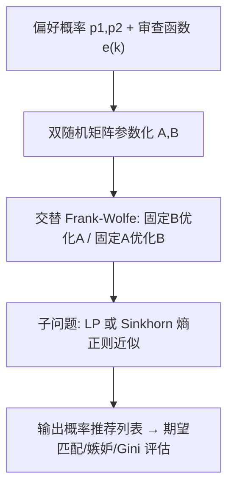
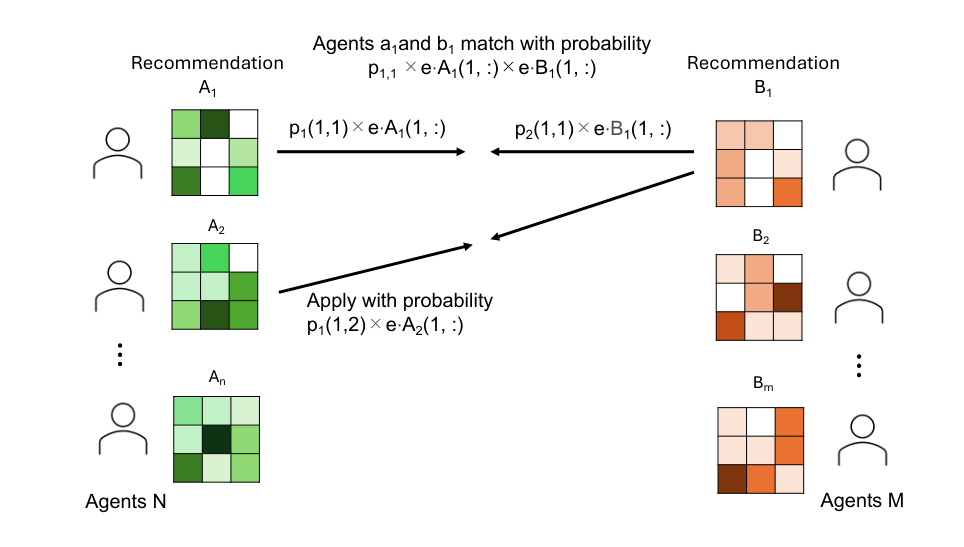

# Balancing Fairness and High Match Rates in Reciprocal Recommender Systems: A Nash Social Welfare Approach (双边匹配推荐中公平性与高匹配率的平衡：Nash 社会福利方法)

- **会议/期刊**: ACM Transactions on Recommender Systems (TORS), 2026 (RecSys'24 会议版扩展)
- **作者与机构**: Yoji Tomita (CyberAgent, Inc.)、Tomohiko Yokoyama (东京大学信息理工学系)
- **推荐链路定位**: 召回（双边推荐列表的后处理分配）
- **研究方向**: 去偏公平与工业架构 / 社交与群组推荐
- **论文原文**: [https://arxiv.org/abs/2601.13609v1](https://arxiv.org/abs/2601.13609v1)
- **开源代码**: [https://github.com/CyberAgentAILab/FairReciprocalRecommendation](https://github.com/CyberAgentAILab/FairReciprocalRecommendation)

## TL;DR (1分钟核心速览)

双边匹配平台（约会、招聘）的互惠推荐中，最大化匹配数（SW）会把推荐机会极度集中在热门用户身上，造成严重的嫉妒与效用不平等。本文从公平分配视角定义"推荐机会"的双边嫉妒自由（double envy-freeness），提出交替最大化两侧 Nash 社会福利（NSW）的 Frank-Wolfe 算法，理论上证明 NSW-best 策略近似双边嫉妒自由且 Pareto 最优；进一步用 $\alpha$-SW 在公平与匹配率间连续插值，并用 Sinkhorn 熵正则替代 LP 求解器实现 GPU 并行。合成数据上 NSW 将左侧嫉妒从 SW 的 1728.9 降至 2.10（$\lambda=0.8$），匹配数仅从 90.5 降至 79.6，且在大规模实例上 Sinkhorn 版显著快于 LP 版。

## Background & Motivation (背景与核心矛盾)

- **主流范式**: 互惠推荐（RRS）中，双方用户都接收推荐列表并主动"申请/点赞"，仅当双方互相选择才形成匹配；现有工作（Prod、TU 匹配、IterLP）主要目标是最大化总匹配数并缓解热门度偏置。
- **前人局限**: (1) 这些方法只优化匹配总量，不约束个体用户获得的"被推荐机会"，导致热门用户被反复推荐、长尾用户几乎无曝光，个体间嫉妒严重；(2) 现有 RRS 公平工作（WE-Rec 的 Walrasian 均衡、Lorenz 支配）要么不显式建模"互相申请"的匹配条件，要么假设偏好对称，与真实平台结构不符。
- **核心洞察 (Key Insight)**: 推荐列表本质上是把有限的"被推荐机会"分配给竞争性用户，因此可直接借用经济学公平分配中的**嫉妒自由**与 **Nash 社会福利**框架；而最大化匹配数（SW）与嫉妒自由之间存在本质 trade-off（文中 Example 3.2 给出 $n=2,m=1$的反例：社会最优策略下$a_2$必然嫉妒$a_1$）。
- **本文切入点**: 用双随机矩阵参数化概率推荐列表，交替最大化两侧 NSW 函数，使每个用户的边际效用被对数压缩，从而自动向低效用用户倾斜，实现近零嫉妒。

## Method (核心方法设计)

### 1. 整体框架 (Overall Architecture)

模型将左侧 $n$个用户、右侧$m$个用户的推荐策略表示为双随机矩阵集合$(\boldsymbol{A},\boldsymbol{B})$：$A_i\in\mathbb{R}^{m\times m}$的$(j,k)$元素表示右侧用户$b_j$被排在左侧用户$a_i$列表第$k$位的概率。基于位置模型（PBM），用户$a_i$申请$b_j$的概率为$\hat{p}_1(i,j)\sum_k e(k)A_i(j,k)$，双方互相申请才匹配，故匹配概率为$p_{ij}\sum_{k,\ell}e_{k\ell}A_i(j,k)B_j(i,\ell)$，其中$p_{ij}=\hat{p}_1(i,j)\hat{p}_2(j,i)$、$e_{k\ell}=e(k)e(\ell)$。效用$U_i,V_j$即期望匹配数，SW 为其总和。整体流程为：估计偏好概率$\to$固定一侧、对另一侧做 Frank-Wolfe 线性子问题（LP 或 Sinkhorn）$\to$交替迭代至收敛$\to$ 输出双随机推荐矩阵。

<figure class="paper-figure" markdown="span">
  <figcaption>图 1. 双边匹配平台中推荐流程概览。双方代理接收由双随机矩阵表示的概率推荐列表，并基于估计的偏好概率做出申请决策。当双方代理相互选择时，匹配建立。</figcaption>
</figure>

### 2. 关键设计拆解 (Key Designs)

1. **双边嫉妒自由与 NSW 目标**：SW 只关心总量，热门用户垄断机会。本文定义用户 $a_i$对$a_{i'}$的嫉妒为$U_i(\text{自身机会})<U_i(a_{i'}\text{的机会})$，要求两侧同时无嫉妒。为此定义$\mathrm{NSW}_1=\prod_{i=1}^{n}U_i$、$\mathrm{NSW}_2=\prod_{j=1}^{m}V_j$，交替最大化$\log\mathrm{NSW}_1$与$\log\mathrm{NSW}_2$。对数乘积使低效用用户的边际增益被放大，优化自然拉平效用分布；Theorem 5.2 证明在$\varepsilon$-相似偏好下 NSW-best 策略满足$O(\varepsilon)$ 加性误差的双边嫉妒自由，且 Proposition 5.1 保证其互 Pareto 最优。

2. **$\alpha$-SW 连续插值**：SW（$\alpha=1$）匹配高但不公平，NSW（$\alpha\to0$）公平但匹配略降。定义$W_1^{\alpha}=\frac{1}{\alpha}\prod_{i}U_i^{\alpha}$，由 L'Hôpital 法则可证$\lim_{\alpha\to0}\log W_1^{\alpha}=\frac{1}{n}\log\mathrm{NSW}_1$，故$\alpha$ 单调控制公平-效率权衡，平台可按业务目标调参。

3. **Sinkhorn 加速与训练目标**：Frank-Wolfe 每步需解 $n+m$个双随机约束下的线性规划（赋值问题），LP 求解器在$n,m$上百时单次超 3000 秒。本文对每个子问题引入熵正则$\min\sum C_{ij}X_{ij}+\frac{1}{\tau}\sum X_{ij}\log X_{ij}$，用 Sinkhorn 行列归一化迭代（复杂度$O(m^2)$/步）近似求解，且$n$个子问题可批处理上 GPU。总目标即交替最大化$\log\mathrm{NSW}$或$W^{\alpha}$，无负采样概念（偏好概率由外部数据驱动给定），推理开销主要来自交替迭代$T$ 轮 Sinkhorn。

## Experimental Setup & Evaluation Protocol (实验设置与评估协议)

- **数据集与预处理**: 合成数据（$m=50$，$n\in\{50,75\}$，热门度参数$\lambda\in\{0,0.2,\dots,1.0\}$，审查函数 log/inv）+ 两个真实数据集（日本在线约会平台、speed dating 实验）。合成偏好按$\hat{p}_1=\lambda\hat{p}^{\text{pop}}_1+(1-\lambda)\hat{p}^{\text{unif}}_1$生成，$\lambda$ 越大热门度差异越强。

| 数据集 | #Users | #Items | 说明 |
| :--- | :---: | :---: | :--- |
| Synthetic | $n\in\{50,75\}$|$m=50$| 10 组随机种子，$\lambda$ 控制热门度 |
| 日本约会平台 | 真实规模 | 真实规模 | 真实偏好估计 |
| Speed Dating | 真实规模 | 真实规模 | 真实互选数据 |

- **数据划分与防穿越**: 合成数据按随机种子生成 10 组独立实例取均值与 95% CI；真实数据采用平台原生交互，无时序穿越问题（偏好概率离线估计后固定）。
- **排名评测协议**: 非传统 Top-K 排序指标，而是**全策略期望指标**：期望匹配数（SW）、左/右侧嫉妒对数（envy pairs）、效用 Gini 指数；统计显著性用 Wilcoxon signed-rank 检验（$p<0.05$）。
- **对比基线与超参**: Naive（按 $\hat{p}_1$排序）、Prod（按$p_{ij}$排序）、TU（可转移效用匹配）、IterLP（迭代最大权匹配 LP）；SW/NSW 学习率$\eta=0.1$、迭代$T=100$，收敛阈值 0.01。

## Key Experimental Results (实验关键数据)

### 1. 主实验对比 (Main Results)

合成数据 $n=75,m=50,e=\text{log}$（表 2 摘录，均值±标准差）：

| $\lambda$ | 方法 | Expected Matches | Left Envy | Right Envy |
| :---: | :--- | :---: | :---: | :---: |
| 0.0 | Prod | 132.9±1.33 | 71.2±11.6 | 9.30±4.21 |
| 0.0 | TU | 133.0±1.32 | 48.6±7.76 | 4.50±1.90 |
| 0.0 | IterLP | 134.9±1.46 | 43.4±10.8 | 0.00±0.00 |
| 0.0 | SW | 136.4±1.27 | 20.5±3.59 | 0.90±0.99 |
| 0.0 | **NSW** | 136.0±1.40 | **0.10±0.31**\*\*\* | **0.00±0.00**\* |
| 0.6 | SW | 97.6±0.57 | 536.0±43.0 | 201.6±21.5 |
| 0.6 | **NSW** | 92.1±0.49 | **0.70±0.82**\*\*\* | **0.00±0.00**\*\*\* |
| 0.8 | SW | 90.5±0.30 | 1728.9±29.1 | 735.7±11.7 |
| 0.8 | **NSW** | 79.6±0.24 | **2.10±1.37**\*\*\* | **0.00±0.00**\*\*\* |
| 1.0 | SW | 79.5±0.00 | 2701.0±0.00 | 1176.0±0.00 |
| 1.0 | **NSW** | 71.3±0.20 | **2.50±0.52**\*\*\* | **0.00±0.00**\*\*\* |

### 2. 消融实验 (Ablation Study)

以 $\alpha$-SW 的$\alpha$扫描与 Sinkhorn 替代 LP 作为组件级消融（$n=75,m=50,e=\text{log}$，$\lambda=0.8$）：

| 配置 | Expected Matches | Left Envy | Right Envy | Gini(左) |
| :--- | :---: | :---: | :---: | :---: |
| SW ($\alpha=1$) | 最高 | 1728.9 | 735.7 | 高 |
| $\alpha=0.8$ | 次高 | 中 | 中 | 中 |
| $\alpha=0.4$ | 中 | 低 | 低 | 低 |
| $\alpha=0.2$ | 较低 | 极低 | 极低 | 极低 |
| NSW ($\alpha\to0$) | 79.6 | **2.10** | **0.00** | **最低** |
| SW_Sinkhorn vs SW_LP | 接近 | 接近 | 接近 | — |
| NSW_Sinkhorn vs NSW_LP | 接近 | 更低 | 更低 | — |

### 3. 关键实验发现 (Key Findings)

1. **公平-效率 trade-off 随热门度加剧而放大**：$\lambda$从 0 增至 1 时，SW 的左侧嫉妒从 20.5 暴涨至 2701.0，而 NSW 始终维持在 0.1–2.5 量级，代价是匹配数在$\lambda=0.8$ 时下降约 12%（90.5→79.6），证明 NSW 用可控的匹配损失换取近乎完全的嫉妒消除。
2. **$\alpha$是有效的业务旋钮**：$\alpha$增大时匹配数单调上升、嫉妒与 Gini 同步上升（$\lambda=1.0$极端情形除外，SW 陷入局部最优），平台可据留存目标选取中间$\alpha$。
3. **Sinkhorn 使大规模可行**：LP 版在 $n\ge100$时单次运行超 3000 秒而被迫截断，Sinkhorn 版在$n$ 达 200/300 时仍可运行且嫉妒更低、匹配接近，GPU 批处理带来数量级加速，验证了熵正则近似的工程价值。

## Highlights & Limitations (亮点、对比与审稿批判)

- **与代表作对比 (vs. Prior Work)**: 相比 TU/IterLP 等只优化匹配总量的启发式方法，本文首次在 RRS 中引入双边嫉妒自由并给出理论保证；相比 WE-Rec（Walrasian 均衡，不建模互选）与 Lorenz 方法（假设偏好对称），本文显式建模"互相申请"匹配条件且允许非对称偏好，公平定义更贴合平台语义。
- **可迁移亮点**: (1) 用双随机矩阵 + Sinkhorn 求解带双边约束的分配问题，可迁移到广告曝光分配、创作者流量扶持等双边公平场景；(2) $\alpha$-SW 的幂次插值技巧可推广到任意"效率-公平"可调目标。
- **审稿级局限批判**: (1) 偏好概率 $\hat{p}$被假设为外部给定，偏好估计误差虽在附录做了鲁棒性检验，但误差与公平保证的耦合缺乏理论刻画；(2) 交替 Frank-Wolfe 仅保证收敛到局部解，$\lambda=1.0$时 SW 已观察到陷入局部最优，NSW 在大规模真实数据上的收敛性与超参$\tau$ 敏感性仍需更系统的分析。

## Rating (四维评分)

- **方法创新性 (Novelty)**: ⭐⭐⭐⭐ （将公平分配的 NSW/嫉妒自由严谨迁移到双边互惠推荐，并给出 $O(\varepsilon)$ 近似嫉妒自由定理，理论支撑扎实）
- **评估协议与实验扎实度 (Protocol & Experiments)**: ⭐⭐⭐⭐ （合成+两个真实数据集、10 次重复+Wilcoxon 检验、$\alpha$/Sinkhorn/鲁棒性多组消融齐全，但真实数据规模与线上 A/B 缺失）
- **写作与数学规范度 (Clarity & Rigor)**: ⭐⭐⭐⭐ （定义-命题-定理链条清晰，Example 3.2/3.4 反例直观，符号略密集但附录有汇总）
- **工业落地与复现价值 (Industrial & Practical Value)**: ⭐⭐⭐⭐ （代码开源、Sinkhorn 版可 GPU 批处理支撑上百规模，但偏好概率估计与在线低延迟部署仍需额外工程）

