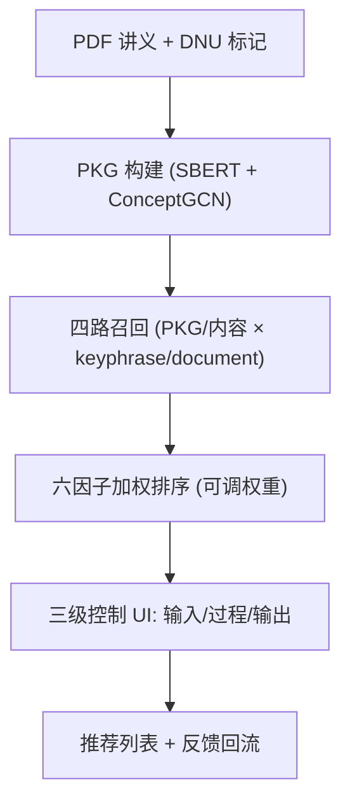

# Investigating the Effects of Different Levels of User Control in an Interactive Educational Recommender System (交互式教育推荐系统中不同用户控制水平的影响研究)

- **会议/期刊**: TORS (ACM Transactions on Recommender Systems)
- **作者与机构**: Qurat Ul Ain, Mohamed Amine Chatti, William Kana Tsoplefack, Rawaa Alatrash, Shoeb Joarder — 杜伊斯堡-埃森大学社会计算组
- **推荐链路定位**: 重排（排序因子权重可调）+ 交互式召回（PKG/内容双路召回）
- **研究方向**: 去偏公平、可信隐私与工业架构 / 对话推荐与智能体仿真
- **论文原文**: [https://arxiv.org/abs/2605.01400v1](https://arxiv.org/abs/2605.01400v1)
- **开源代码**: 暂未开源

## TL;DR (1分钟核心速览)

教育推荐系统（ERS）普遍缺乏用户控制，且"控制水平高低如何影响用户感知"缺乏实证。本文在 MOOC 平台 CourseMapper 中构建了覆盖输入（用户画像）、过程（算法与排序权重）、输出（反馈/排序/收藏）三级控制的交互式 ERS，并开展 N=184 的四组被试间实验（basic/input/process/output）。结果显示：仅"输入控制"即可显著提升感知控制感（ANOVA $p=.033$，$\eta^2=.047$，Input vs. Output 事后检验 $p_{adj}=.030$），而透明度、信任、满意度、感知质量在各组间无显著差异，但通过 SEM 呈现强互联结构。

## Background & Motivation (背景与核心矛盾)

- **主流范式**: 传统 ERS 以算法精度为中心（协同过滤、内容相似度、知识图谱增强），界面仅支持 like/dislike 式弱反馈；交互式推荐（IntRS）在电商/娱乐领域已证明控制能提升体验，但教育域几乎空白。
- **前人局限**: ①现有 ERS 的控制选项碎片化，多局限于输入（搜索/筛选）或输出（评分），极少覆盖推荐过程，更无统一框架同时覆盖输入-过程-输出三级；②已有 IntRS 研究多单独考察某一推荐目标（信任或满意度），从未在同一实验中同时测量透明度、信任、满意度、感知质量四者及其相互关系。
- **核心洞察 (Key Insight)**: 用户画像（输入）是推荐流程的"地基"——直接编辑画像比调节下游算法参数或排序结果更能让用户感到"系统真正反映我的学习需求"；而额外控制层更多是"强化既有印象"而非"建立印象"。
- **本文切入点**: 以 CourseMapper 的 PKG（个人知识图谱）+ DNU（未理解概念）标记为天然输入控制入口，系统化设计三级控制 UI，并用混合方法（定量 ANOVA/SEM + 定性主题分析）量化各控制层对五类推荐目标的差异化影响。

## Method (核心方法设计)

### 1. 整体框架 (Overall Architecture)

系统以学习者的 Personal Knowledge Graph (PKG) 为核心：学习者在 PDF 讲义上点击 DNU 按钮，系统抽取幻灯片 top-5 主概念（MC）构成幻灯片级 KG，学习者标记 U/DNU 后写入 PKG；节点用 SBERT 编码维基文本、经 ConceptGCN 聚合邻居增强表征。推荐阶段提供四种算法（PKG-based / 内容-based × keyphrase / document 变体），通过 YouTube/Wikipedia API 取候选、SBERT 余弦相似度排序；排序层融合 6 个因子（YouTube 播放量、点赞、创建日期、相似度、CourseMapper 收藏数、用户评分），权重由 102 人问卷的直接赋权 + 曼哈顿归一化确定。三级控制分别作用于画像编辑、算法/排序权重调节、结果反馈与重排。

### 2. 关键设计拆解 (Key Designs)

1. **输入控制（画像可编辑）**：痛点在于传统系统由行为隐式推断偏好、用户无法纠偏。本文让用户选择 DNU 范围（当前幻灯片/全部/手动搜索）、用滑块调节概念权重 $w_c$、用复选框增删概念，使学习者模型 $\mathbf{u}=\sum_{c\in \text{DNU}} w_c \cdot \text{SBERT}(c)$ 可被显式操控。直觉：画像即"推荐的地基"，直接改写地基比调下游参数更直观。
2. **过程控制（算法 + 排序双通道）**：用户可用单选按钮在四种召回算法间切换，并用滑块调节排序因子权重 $\{w_{\text{views}}, w_{\text{rating}}, w_{\text{likes}}, w_{\text{sim}}, w_{\text{date}}, w_{\text{saves}}\}$，进度条实时反馈权重变化对排名的影响。直觉：把"黑箱排序"变为"可拨动的仪表盘"，降低理解成本。
3. **输出控制与训练/推理开销**：提供 Helpful/Not Helpful 按钮并联动选择"该视频帮我理解了哪些 DNU 概念"（细粒度反馈）、按相似度/日期/播放量排序、收藏。系统无离线训练环节，推理为 SBERT 编码 + 余弦检索 + 加权排序，单次推荐开销为 $O(|\text{candidates}| \cdot d)$，在线可实时响应滑块调整。

## Experimental Setup & Evaluation Protocol (实验设置与评估协议)

- **数据集与被试**: 非传统离线数据集，而是 Prolific 招募的 **N=184** 被试（101 男/83 女，均值 31.66 岁，英/美为主），随机分入 4 组各 46 人；功效分析要求每组 45 人（power=0.80, $\alpha$=0.05）。16 份因未通过注意力检查/截图验证被剔除（初始 200 人）。

| 条件 | N | 控制内容 | 课程分布 |
| :--- | :---: | :--- | :--- |
| Basic Control | 46 | 仅 DNU 标记生成推荐 | Food & Nutrition 97 / Python 49 / English 38（全体） |
| Input Control | 46 | 画像概念增删 + 权重滑块 | 同上 |
| Process Control | 46 | 算法选择 + 排序权重滑块 | 同上 |
| Output Control | 46 | 反馈/排序/收藏 | 同上 |

- **数据划分与防穿越**: 无训练/测试划分；采用**被试间设计（between-subjects）**，每人仅接触一种控制条件，避免学习效应污染。
- **评测协议**: 5 点 Likert 量表（信任为 7 点），各构念 Cronbach's $\alpha$ 介于 .87–.96；统计采用 one-way ANOVA + Tukey HSD 事后检验 + Pearson 相关 + SEM 路径分析；定性部分用演绎主题分析（Kuckartz 编码者内一致性校验）。
- **对比基线与超参**: 以 Basic Control 为基线，对比 Input/Process/Output 三种增量控制；无模型超参，显著性阈值 $p<.05$。

## Key Experimental Results (实验关键数据)

### 1. 主实验对比 (Main Results)

各条件描述统计（Mean±SD）与 ANOVA 结果：

| 因变量 (DV) | Basic | Input | Process | Output | $F$ | $p$ | $\eta^2$ |
| :--- | :---: | :---: | :---: | :---: | :---: | :---: | :---: |
| **Perceived Control** | 3.13±0.98 | **3.51±0.89** | 3.35±0.95 | 2.96±0.97 | 2.980 | **0.033** | 0.047 |
| Transparency | 3.51±0.93 | **3.74±1.10** | 3.56±1.05 | 3.68±1.02 | 0.759 | 0.518 | 0.012 |
| Trust | 4.84±1.21 | **4.97±1.32** | 4.89±1.50 | 4.72±1.27 | 0.090 | 0.965 | 0.002 |
| Satisfaction | 3.61±0.71 | **3.81±0.79** | 3.65±0.98 | 3.56±0.92 | 0.711 | 0.547 | 0.012 |
| Perceived Quality | 3.64±0.84 | **3.83±0.98** | 3.64±1.00 | 3.63±0.85 | 0.535 | 0.659 | 0.009 |

Tukey HSD 事后检验（Perceived Control）：Input vs. Output 均值差 $-0.549$，$p_{adj}=0.030$（显著）；其余五对比较均 $p_{adj}>0.05$（ns）。

### 2. 消融实验 (Ablation Study)

本文为人类被试实验，等价"消融"为逐层剥离控制组件（以 Basic 为无增量控制基线）：

| 配置 | Perceived Control | Transparency | Trust | Satisfaction | Quality |
| :--- | :---: | :---: | :---: | :---: | :---: |
| Basic（无增量控制） | 3.13 | 3.51 | 4.84 | 3.61 | 3.64 |
| + Input 控制 | **3.51** | **3.74** | **4.97** | **3.81** | **3.83** |
| + Process 控制 | 3.35 | 3.56 | 4.89 | 3.65 | 3.64 |
| + Output 控制 | 2.96 | 3.68 | 4.72 | 3.56 | 3.63 |

### 3. 关键实验发现 (Key Findings)

1. **输入控制是唯一显著驱动感知控制感的层级**：ANOVA 仅在 Perceived Control 上显著（$p=.033$），且 Input 组均值 3.51 高出 Output 组 2.96 达 0.55 分（$p_{adj}=.030$）；定性数据佐证——Input 组 98%（45/46）报告有控制感，而 Basic 组仅 76%、Output 组 72%，且 Output 组 45% 的用户反而渴望获得输入层控制，解释了该显著差异的来源。
2. **"输入控制足以建立正面印象，额外控制只是强化"**：Input 组在全部五个 DV 上均取得最高均值（如满意度 3.81 vs. Basic 3.61、感知质量 3.83 vs. 3.64），但除感知控制外均未达显著，说明 Basic 条件中"DNU 标记"已提供最低限度的控制感基础，额外控制层的边际增益有限。
3. **四类推荐目标高度互联但受控层级差异化影响**：SEM 路径模型（图 8）显示透明度→信任→满意度→感知质量存在显著标准化路径系数，而不同控制层通过不同路径施加影响——这解释了为何单看 ANOVA 不显著、但结构方程仍能刻画控制的间接作用，提示未来 ERS 评估不能仅依赖单指标 ANOVA。

## Highlights, Limitations & Rating (亮点、对比与审稿评价)

- **与代表作对比 (vs. Prior Work)**: 相较 Jin et al. [44,46]（仅考察认知负荷与接受度、控制层级为高/中/低粗粒度）与 Harambam et al. [38]（新闻域焦点小组、无定量目标测量），本文首次在教育域同时实现输入-过程-输出三级控制，并在同一实验中联合测量感知控制、透明度、信任、满意度、感知质量五目标；相较 Ooge et al. [73]、Jung et al. [48] 等仅覆盖单层控制的 ERS，本文的控制覆盖面与评估维度均更完整。
- **可迁移亮点**: ①"排序因子权重滑块 + 实时进度条反馈"可直接迁移到电商/内容推荐的用户可控重排模块；②"Helpful 按钮联动选择具体被解决的概念"提供了细粒度反馈信号的设计范式，可转化为推荐系统的显式负反馈/正反馈标注来源。
- **审稿级局限批判**: ①**生态效度不足**：Prolific 被试在 30 分钟内完成单次任务，缺乏真实学习场景下的长期使用与学习成效（learning outcome）测量，无法回答"控制是否真的提升学习效果"；②**统计功效偏弱**：除感知控制外所有 DV 的 $\eta^2 \le 0.012$，N=46/组 对中小效应量的检测力有限，且多重比较未做全局 FDR 校正，结论稳健性存疑；③系统无离线训练、推荐质量依赖 SBERT 与外部 API，未与任何算法基线做精度对比。
- **四维评分**: 创新性 ⭐⭐⭐⭐ | 实验扎实度 ⭐⭐⭐ | 方法清晰度 ⭐⭐⭐⭐ | 落地价值 ⭐⭐⭐⭐

