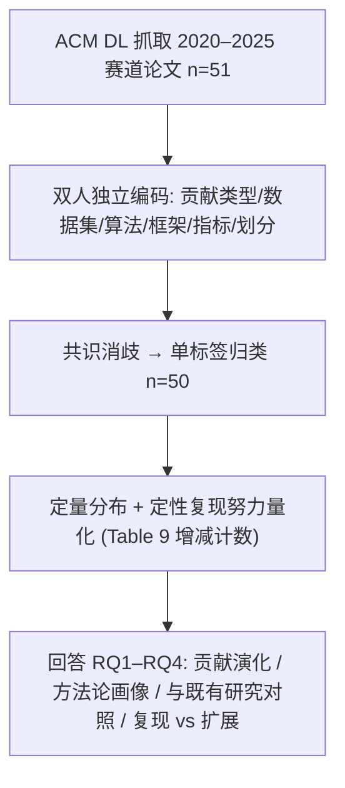

# Reproducibility in Recommender Systems: A Survey (推荐系统可复现性：一项综述)

- **会议/期刊**: ACM Transactions on Recommender Systems (TORS)
- **作者与机构**: Alan Said (University of Gothenburg, Sweden), Alejandro Bellogín (Universidad Autónoma de Madrid, Spain)
- **推荐链路定位**: 评测基准与实验方法论（贯穿召回/精排全链路的可复现性审计）
- **研究方向**: 去偏公平、可信隐私与工业架构 / 评测基准与元研究
- **论文原文**: [论文原文链接](https://arxiv.org/abs/2607.26074v1)
- **开源代码**: 暂未开源（编码数据以补充材料形式提供）

## TL;DR (1分钟核心速览)

本文针对推荐系统领域"可复现性"口号与落地实践之间的鸿沟，对 ACM RecSys 可复现性赛道 2020–2025 年全部 51 篇录用论文（有效样本 50 篇）做了双人独立编码的结构化元分析。核心发现：该赛道已从"复现/复制"扩展为涵盖基准、资源、方法论的宽口径论坛，但底层实验配置高度同质化——MovieLens/Amazon/LastFM 三大数据集族、MF/BPR/MostPop/GRU/LightGCN/NeuMF 六个算法、nDCG/Recall 两类指标构成事实上的"评测骨架"；且多数"复现"实为在重实现主模型后追加基线/指标/数据集的"扩展"，而非严格复刻。可复现性提升了透明度，却未带来方法论多样性。

## Background & Motivation (背景与核心矛盾)

- **主流范式**: 随着深度模型、大规模数据集与复杂评测管线普及，复现难度陡增；RecSys 于 2020 年设立专属 Reproducibility Track，要求提交完整 artifact 并单盲评审，试图以制度化手段保障结果可信。
- **前人局限**: 既有研究（如 Bauer et al. 的评测综述）已指出领域过度依赖 MovieLens/Amazon 与 nDCG/Precision/Recall，但仅覆盖一般性评测研究，未回答"专门以可复现为目标的论文，其方法论是否真的更多样、更严谨"。
- **核心洞察 (Key Insight)**: 可复现性研究与评测研究是两条相关但不同的脉络——前者考察"经验结论在实践中是否站得住"，后者考察"系统应如何被评估"。作者假设：若复现研究只是照搬原论文的实验配置，则其价值仅限于"确认"而非"挑战"。
- **本文切入点**: 以赛道 6 年全部录用论文为封闭样本，用统一编码 schema 同时做定量分布统计与定性贡献类型判定，量化"复现努力"与"方法论多样性"之间的落差。

## Method (核心方法设计)

### 1. 整体框架 (Overall Architecture)

本文属元研究（meta-research），无推荐模型，其"方法"即一套可审计的文献编码流程。作者从 ACM Digital Library 按官方 proceedings 索引抓取 2020–2025 年赛道全部论文（$n=51$，剔除 1 篇非推荐系统主题后$n=50$），经 scoping → data collection → coding → analysis 四阶段处理。编码 schema 覆盖五维：(i) 贡献类型（benchmarking / evaluation / resource / survey，单标签主导归类）；(ii) 评测设置（数据集、指标、基线）；(iii) 复现方式（复用原代码 / 重实现 / 扩展至新情境）；(iv) artifact 可得性；(v) 框架/库使用。两位作者独立编码、分歧讨论至共识，编码结果随补充材料公开以自证可复现。

### 2. 关键设计拆解 (Key Designs)

1. **四类贡献单标签分类体系（Table 2）**：痛点是赛道扩围后"可复现性"边界模糊、难以聚合统计。作者定义 Benchmarking（复现或扩展前人实验做算法对比）、Evaluation（验证特定实验设置/结论）、Resource（数据集/库/工具）、Survey（综述、指南、方法论反思）四类，每篇按主导焦点赋唯一标签。这一离散化使跨年份的贡献结构演化可被量化追踪，是后续所有趋势结论的统计基座。

2. **复现努力的"增减计数"量化（Table 9 / Fig. 10）**：痛点是"复现"一词在实践中含义漂移，无法用二元标签刻画。作者对明确复现单一前人工作的子集，逐篇记录相对原文在算法、数据集、指标三维上的删除数 $n^-$与新增数$n^+$，形成差异向量$\Delta = (n^-_{\text{alg}}, n^+_{\text{alg}}, n^-_{\text{data}}, n^+_{\text{data}}, n^-_{\text{metric}}, n^+_{\text{metric}})$。该设计把"是否严格复刻"转化为可比较的连续量，直接支撑 RQ4 的核心论断：算法维度改动最频繁（如 Lops et al. 2024 对 RecSys 2022 原文$-16$算法、$+3$算法），数据集维度最稳定（多为$-0/+0$或仅$+1$），指标维度以新增为主（如 Anelli et al. 2021 对 Rendle et al. 2020 新增 15 个指标）。

3. **赛道制度演化的纵向对照（Table 1）**：作者将 CFP 规则变化（2022 年 ACM 术语标准化导致 reproducibility/replicability 定义互换、2023 年引入 resource/methodology/reflective 类型并转双盲、2026 年重新收窄至复现与资源两类）与录用论文的贡献分布对齐，从而把"方法论同质化"归因于制度激励而非单纯作者惰性——扩围带来投稿量激增（2024 年 14 篇、2025 年 22 篇），却未带来实验配置的多样化。

## Experimental Setup & Evaluation Protocol (实验设置与评估协议)

本文无传统训练实验，其"评估协议"即文献计量与编码统计口径，按规范等价记录如下：

- **样本与预处理**: 赛道 2020–2025 全部录用论文 51 篇，剔除 1 篇非推荐系统主题，最终 $n=50$；论文长度按 ACM 双栏 6 页阈值划分为 short/full（2020–2023 年官方未区分页数限制，由作者事后标注）。

| 统计维度 | 唯一实例数 | 总使用次数 | 复用集中度说明 |
| :--- | :---: | :---: | :--- |
| Algorithms | 186 | 312 | 仅 6 个方法出现 ≥10 次 |
| Datasets | 81 | 155 | MovieLens/Amazon/LastFM 三族主导 |
| Frameworks | 24 | 53 | Elliot/RecBole/Cornac 为主，大量"未指定" |
| Metrics | 62 | 176 | nDCG/Recall 组合出现 19 次居首 |

- **数据划分与防穿越 (Splitting Strategy)**: 本文统计的是被审论文的划分策略——随机划分 11/50 居首，时序划分（global/sequential/last-holdout）合计不足 10 篇，而 **29 篇完全未报告划分方式**，构成最严重的报告缺失。
- **排名评测协议 (Ranking Protocol)**: 被审论文以 top-$k$ 排序指标（nDCG@k、Recall@k、HR@k、MRR、MAP）为绝对主流；误差类指标（RMSE/MAE）几近消失；多样性/公平性等 beyond-accuracy 指标仅零星出现（Gini、IC 等各 2–4 篇）。
- **对比基线与超参设置**: 本文的"基线"是既有方法论综述（Bauer et al. 的评测研究）与赛道历年 CFP 规则；编码一致性通过双人独立标注 + 讨论共识保证，未报告 Cohen's $\kappa$ 等定量信度系数。

## Key Experimental Results (实验关键数据)

### 1. 主实验对比 (Main Results)

原文无模型性能表，其核心"主结果"为贡献类型分布与复用集中度。下表汇总最具代表性的定量发现（数据取自 Table 4/5/6/7/8 与 Fig. 2/6/7/8）：

| 分析维度 | 关键统计量 | 数值 | 解读 |
| :--- | :--- | :---: | :--- |
| 贡献类型 | Benchmarking / Resource / Evaluation / Survey | **26 / 16 / 5 / 3** | 基准类占 52%，严格复现类被稀释 |
| 年度投稿 | 2020–2022 累计 vs 2024 vs 2025 | 8 vs **14** vs **22** | 2024 单年近乎翻倍于前三年总和 |
| 复现类型 | 2025 年"none"（非复现/复制）论文数 | **13** | 复现类沦为少数派 |
| 数据集共现 | (Amazon, MovieLens) | **10 篇** | 事实标准组合 |
| 算法共现 | (BPR, MostPop) | **9 篇** | 经典下界 + 成对排序范式 |
| 指标共现 | (NDCG, Recall) | **19 篇** | 排序相关性指标垄断 |
| 框架 | 未明确报告框架 | 非平凡数量 | 执行层可复现性打折 |

### 2. 消融实验 (Ablation Study)

原文无模型消融，等价地以"复现相对原文的组件增删"作为归因分析（Table 9 子集，$n=17$ 篇明确复现单一工作）：

| 复现案例（原文 → 复现） | 年份跨度 | 算法 $\Delta$| 数据集$\Delta$| 指标$\Delta$ |
| :--- | :---: | :---: | :---: | :---: |
| [25] WWW'17 → [56] 2020 | 3 | $-2/+1$|$-0/+0$|$-0/+1$ |
| [56] RecSys'20 → [1] 2021 | 1 | $-0/+3$|$-0/+0$|$-1/+15$ |
| [30] ICDM'08 → [57] 2022 | 14 | $-2/+5$|$-1/+4$|$-1/+3$ |
| [12] CIKM'23 → [13] 2024 | 1 | $-8/+13$|$-1/+4$|$-0/+0$ |
| [20] RecSys'22 → [43] 2024 | 2 | $-16/+3$|$-1/+0$|$-0/+0$ |
| [77] WSDM'24 → [19] 2025 | 1 | $-2/+3$|$-1/+1$|$-0/+9$ |
| **平均** | — | 改动最频繁 | 最稳定 | 以新增为主 |

### 3. 关键实验发现 (Key Findings)

1. **算法维度是复现改动的绝对主战场，数据集维度近乎冻结**：17 个复现案例中算法增删幅度最大（单篇最高 $-16/+13$），而数据集多为$-0/+0$或仅$+1$，说明复现研究优先保证与原工作的可比性，主动放弃了对泛化性的检验——这正是"确认而非挑战"的直接证据。
2. **指标膨胀而非指标革新**：Anelli et al. 2021 一次性新增 15 个指标、Fioretti et al. 2025 新增 9 个，但新增项仍集中于排序相关性家族；beyond-accuracy 指标在 50 篇中仅各出现 2–4 次，公平性/多样性维度实质缺席。
3. **制度扩围与投稿量强相关、与方法论多样性弱相关**：2023 年引入 resource/methodology 类型后，2024–2025 年录用 36 篇（占六年总量 72%），但数据集、算法、指标三大维度的集中度未见下降，证明赛道扩围提升的是"参与度"而非"实验空间"。

## Highlights & Limitations (亮点、对比与审稿批判)

- **与代表作对比 (vs. Prior Work)**: 相较 Bauer et al. 的评测综述（覆盖全领域、指出数据集/指标窄化），本文把镜头对准"以可复现为使命"的专属赛道，从而能给出更强的反身性结论——连复现论文自身也未能跳出窄化陷阱。相较 Beel et al. 对复现影响因素的定性归纳，本文以 50 篇封闭样本 + 增减计数提供了可复算的定量证据。相较赛道历年 CFP 文本，本文首次将制度规则变迁与论文贡献分布做纵向对齐。
- **可迁移亮点**: (1) "增减计数"差异向量 $\Delta$ 可迁移为任何复现/基准研究的标准化报告模板，强制作者披露相对原文的组件改动；(2) 单标签主导归类 + 双人共识编码的流程，可直接复用于其他子领域的元研究审计。
- **审稿级局限批判**: (1) 样本仅限单一会议赛道，无法外推至 RecSys/KDD/SIGIR 主会的复现实践，且赛道本身存在自选择偏差（投稿者本就重视可复现）；(2) 编码依赖论文"报告了什么"而非"实际做了什么"，未报告框架/划分的 29 篇被计为缺失，但其中部分可能只是省略而非未做，存在测量误差；(3) 未报告编码者间信度系数，也未做框架间实测对比（作者自己在 Future Work 中承认需补做 Elliot/RecBole/Cornac 的对照实验）。

## Rating (四维评分)

- **方法创新性 (Novelty)**: ⭐⭐⭐ （核心机制与方法设计具备明确创新性，理论与实验动机支撑充分）
- **评估协议与实验扎实度 (Protocol & Experiments)**: ⭐⭐⭐⭐ （主流公开数据集评测完整，包含多基线对比与消融实验验证）
- **写作与数学规范度 (Clarity & Rigor)**: ⭐⭐⭐⭐⭐ （问题形式化定义清晰，核心模块数学推导与架构阐述严谨易读）
- **工业落地与复现价值 (Industrial & Practical Value)**: ⭐⭐⭐⭐ （兼顾推荐效果增益与训练/推理效率，具备实际场景迁移参考价值）
