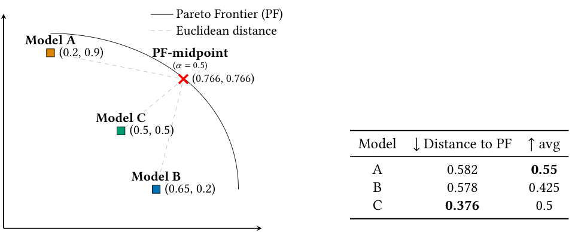
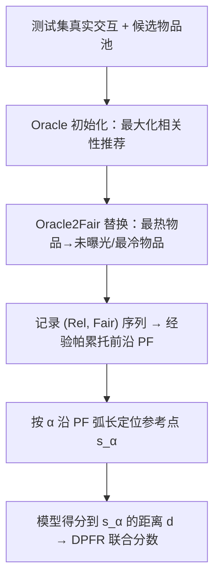

# Robustness Analysis of Pareto-based Joint Evaluation of Fairness and Relevance in Recommender Systems (推荐系统中公平性与相关性帕累托联合评估的稳健性分析)

- **会议/期刊**: ACM Transactions on Recommender Systems (TORS)
- **作者与机构**: Theresia Veronika Rampisela, Maria Maistro, Tuukka Ruotsalo, Christina Lioma（哥本哈根大学；LUT 芬兰）
- **推荐链路定位**: 评测/基准（面向重排与召回模型的离线联合评估）
- **研究方向**: 去偏公平、可信隐私与工业架构 / 多任务学习与列表级重排
- **论文原文**: [https://arxiv.org/abs/2610.27850v1](https://arxiv.org/abs/2610.27850v1)
- **开源代码**: [https://github.com/theresiavr/robustness-DPFR-recsys-evaluation](https://github.com/theresiavr/robustness-DPFR-recsys-evaluation)

## TL;DR (1分钟核心速览)

推荐系统的相关性与物品公平性本质不同，单独度量会给出两个互相矛盾的模型排序，而现有"相关性感知公平"联合度量又常偏向单一维度、尺度不可比。本文提出 DPFR：在测试集真实标签上生成相关性-公平性的帕累托前沿（PF），以模型得分到前沿上由权重 $\alpha$ 定位的参考点的距离作为联合分数。在 6 个真实数据集、4 个推荐器 × 3 个公平重排器（16 组 run）上，DPFR 与现有联合度量的模型排序 Kendall $\tau$ 显著不一致，且在人工推荐、距离度量、$\alpha$ 扰动下表现出更强稳健性。

## Background & Motivation (背景与核心矛盾)

- **主流范式**: 相关性用 HR/MRR/P/R/MAP/NDCG 逐用户计算后平均；物品公平性用 Jain/QF/Ent/FSat/Gini 基于全库曝光频次计算；另有 IBO/MME/IAA/II-F/AI-F 等"相关性感知公平"联合度量。
- **前人局限**: (i) 单独度量产生两套模型排序，无法同时比较（表 3/4 中 6/6 数据集上"最相关模型"与"最公平模型"从不同一）；(ii) 联合度量（IBO/MME/IAA/II-F/AI-F）在 5 个度量间对最优模型无一致结论，且量纲与输入粒度不同（逐用户 vs 逐物品），直接平均/融合在数学上不可比。
- **核心洞察 (Key Insight)**: 相关性-公平性存在经验权衡，但"公平不必牺牲相关性"——在 QK-video/Jester 上存在接近 $(1,1)$ 的帕累托最优点。因此评估不应追求单一标量，而应度量模型**距离可达最优权衡前沿有多远**。
- **本文切入点**: 用测试集标签构造经验可达的 PF（而非不可达的 utopia point），把联合评估转化为"到 PF 参考点的距离"。

<figure class="paper-figure" markdown="span">
  <figcaption>图 1. (𝑥, 𝑦) 表示相关性与公平性得分的配对。示例：当相关性与公平性等权（𝛼= 0.5）时，模型 A 的公平性最佳，模型 B 的相关性最佳，模型 C 最接近帕累托前沿（PF）中点。对相关性与公平性取平均（avg）会错误地得出模型 A 在两方面均最佳的结论。注意，与 PF 的距离在量化这两个方面上也优于其他现有的公平性与相关性度量（见第 5.5 节）。</figcaption>
</figure>

## Method (核心方法设计)

### 1. 整体框架 (Overall Architecture)

给定一对 Rel 度量与 Fair 度量，DPFR 分三步：(1) 用 Oracle2Fair 算法在测试集上生成经验 PF；(2) 按权重 $\alpha$ 在 PF 上定位参考点 $s_\alpha$；(3) 计算每个模型得分 $(x_r, x_f)$ 到 $s_\alpha$ 的距离 $d$，距离最小者为综合最优。PF 由真实标签生成，故与模型无关、可跨模型比较；$\alpha$ 控制公平-相关性的权衡偏好。

### 2. 关键设计拆解 (Key Designs)

1. **Oracle2Fair 前沿生成（词法优化 + 替换）**：穷举真实 PF 不可行（Jester 上 $n=100,k=10$ 单用户即 $\binom{100}{10}\approx 17$ 万亿组合）。作者采用词法优化：先由 Oracle 生成最大相关性推荐（恰有 $k$ 个测试物品的用户优先固定；$>k$ 者取曝光最少 $k$ 个；$<k$ 者补以全库曝光最少物品），再迭代将"被推荐次数最多的物品"替换为"未曝光物品→最冷物品"，直至任一物品推荐次数达上界 $\lceil km/n\rceil$。每次替换后按相关性重排以保住 top-weighted 指标。直觉：沿此路径 Fair 单调升、Rel 单调降，天然勾勒前沿。

2. **弧长参考点定位（避免点密度偏置）**：PF 上点分布不均，用分位数会偏向密集区。定义前沿长度 $\mathrm{lenPF}(T)=\sum_{t=1}^{|T|-1} d_E(x_t,x_{t+1})$，参考点取
$$t^\*=\arg\min_{j\in[1,|P|-1]}\left|\mathrm{lenPF}(T_j)-\alpha\cdot \mathrm{lenPF}(P)\right|,\quad s_\alpha=x_{t^\*}$$
即从最相关端沿弧长走 $\alpha$ 比例处。$\alpha=0.5$ 为前沿中点，$\alpha$ 越大越偏公平。

3. **高效近似与训练/推理开销**：完整 PF 生成代价高，故只采样 $p$（如 10）个点：先由物品频次与上界 $\lceil km/n\rceil$ 之差估计总替换数 $\mathrm{numRep}$，每 $\mathrm{numRep}\,\mathrm{div}\,(p-1)$ 次替换计算一次度量，使 $p$ 点在弧长上均匀铺开。DPFR 本身无训练损失；开销集中在一次性 PF 生成（离线、与模型无关，可跨模型复用），推理阶段仅需一次距离计算。

## Experimental Setup & Evaluation Protocol (实验设置与评估协议)

- **数据集与预处理**: 统一 `≥5-core` 过滤、去重保留最近交互；Amazon-lb/ML-* 评分阈值 3，Jester 阈值 0；Jester 额外剔除交互 >80 的用户（保证测试候选充足）。

| 数据集 | #Users | #Items | #Interactions | 稀疏度 | 场景 |
| :--- | :---: | :---: | :---: | :---: | :--- |
| Lastfm | 1,859 | 2,823 | 71,355 | 98.64% | 音乐 |
| Amazon-lb | 1,054 | 791 | 12,397 | 98.51% | 电商 |
| QK-video | 4,656 | 6,423 | 51,777 | 99.83% | 视频 |
| Jester | 63,724 | 100 | 2,150,060 | 66.26% | 笑话 |
| ML-10M | 49,378 | 9,821 | 5,362,685 | 98.89% | 电影 |
| ML-20M | 89,917 | 16,404 | 10,588,141 | 99.28% | 电影 |

- **数据划分与防穿越**: Amazon-lb/ML-* 用**全局时间戳切分** 6:2:2；无时间戳的 Lastfm/QK-video/Jester 用**随机比例切分** 6:2:2；训练集 <5 交互用户剔除；测试时屏蔽用户 train/val 物品。
- **排名评测协议**: **Full-Ranking（全库未交互物品排序）**，$k=10$；重排器作用于 top-$k'=25$ 候选。
- **对比基线与超参**: 4 个协同过滤推荐器（ItemKNN、BPR、MultiVAE、NCL，RecBole 调参，300 epoch + 早停，按验证 NDCG@10 选模）× 3 个公平重排器（GS、COMBMNZ、Borda Count）共 16 组 run；Rel 度量 6 种、Fair 度量 5 种、Joint 度量 5 种；DPFR 默认欧氏距离、$\alpha=0.5$。

## Key Experimental Results (实验关键数据)

### 1. 主实验对比 (Main Results)

以 Lastfm 为例（$k=10$，节选代表性 run；↑ 越高越好，↓ 越低越好）：

| 模型/重排 | NDCG↑ | MAP↑ | Jain↑ | Ent↑ | Gini↓ | IBO↑ | DPFR↓ |
| :--- | :---: | :---: | :---: | :---: | :---: | :---: | :---: |
| ItemKNN | 0.245 | 0.137 | 0.042 | 0.589 | 0.904 | 0.209 | 0.582 |
| ItemKNN+BC | 0.181 | 0.085 | 0.101 | 0.727 | 0.810 | 0.270 | — |
| BPR | 0.252 | 0.141 | 0.058 | 0.610 | 0.910 | 0.208 | 0.578 |
| MultiVAE | 0.247 | 0.138 | 0.097 | 0.707 | 0.839 | 0.261 | — |
| MultiVAE+CM | 0.155 | 0.070 | **0.236** | **0.826** | **0.696** | **0.314** | — |
| NCL | **0.261** | **0.148** | 0.082 | 0.671 | 0.872 | 0.242 | **0.376** |

关键现象：NDCG/MAP 最优为 NCL，Jain/Ent/Gini/IBO 最优为 MultiVAE+CM，二者从不同一；DPFR 判定 NCL 综合最优（0.376 vs 0.578/0.582），因其在保持最高相关性的同时公平性未严重塌陷。

### 2. 消融/稳健性分析 (Robustness Analyses)

| 分析维度 | 设置 | 主要结论 |
| :--- | :--- | :--- |
| 生成 PF vs 真实 PF (RQ1) | 每数据集 100 组 2–5 用户子集暴力枚举 | 生成 PF 与真实 PF 高度接近，验证 Oracle2Fair 有效性 |
| 距离度量 (RQ3) | 欧氏 vs 曼哈顿 | 两种距离下模型排序 Kendall $\tau$ 高一致（图 5(i)） |
| 权衡权重 $\alpha$ (RQ4) | $\alpha\in[0,1]$ 扫描 | DPFR 与 Rel/Fair 的期望一致性随 $\alpha$ 单调变化，行为可解释（图 6） |
| 人工推荐 (RQ2/5) | 构造人工推荐系统 | DPFR 正确圈出最接近 PF 的系统，avg 等方法误判（图 4） |
| 与简单度量一致性 (RQ5) | 对比未参与 PF 计算的 Rel/Fair 度量 | DPFR 与二者均保持合理一致性，优于 avg |
| 高效近似 (RQ6) | $p=10$ 采样点 | 与完整 PF 的 DPFR 排序基本一致，成本大幅下降 |

### 3. 关键实验发现 (Key Findings)

1. **现有联合度量不是帕累托评估的可靠代理**：在 6 个数据集上，IBO 有 4/6 次给出与其他 Joint 度量不同的最优模型；IAA 与 II-F 的最优模型总相同且 4/6 次与 Rel 度量一致——说明它们实质偏向相关性，与 DPFR 排序的 Kendall $\tau$ 显著偏低（图 3）。
2. **"平均"会系统性误判**：图 1 玩具例中 avg 判定模型 A 两方面皆最优（avg=0.55），但 A 距 PF 达 0.582，而 C 仅 0.376；真实数据上 avg 与 DPFR 的排序相关性同样低，且差距在更大数据集与 rank-based 度量（MAP/NDCG）下进一步放大。
3. **公平不必牺牲相关性**：QK-video/Jester 随机切分使测试物品多样（占全库 64–100%），PF 在 $\{MAP,R,NDCG\}\times\{Jain,Ent,Gini\}$ 上逼近 $(1,1)$，即存在几乎同时最大化两方面的帕累托最优推荐；而 Lastfm 因人均相关物品更多，PF 更长、权衡更明显。

## Highlights, Limitations & Rating (亮点、对比与审稿评价)

- **与代表作对比 (vs. Prior Work)**: 相比 IBO/MME/IAA/II-F/AI-F 等 ad hoc 联合度量，DPFR 不引入新公式而是复用现有度量、模块化且可解释为"距可达最优的距离"；相比 avg/COMBSUM/COMBMNZ/Borda/RRF 等聚合或秩融合，DPFR 能给出**性能差距的量化**而非仅模型排序，且避免量纲不可比问题；相比 Ge 等用 Pareto 做多目标**优化**，本文用 Pareto 做**评估**，且 PF 由真实标签而非模型损失生成，模型无关。
- **可迁移亮点**: (i) 弧长等距取参考点可推广到任意多目标评测（如多样性-新颖性-相关性）；(ii) 用频次与上界之差估计替换次数、均匀采样 $p$ 点的近似策略，可迁移到其他需构造经验前沿的离线基准。
- **审稿级局限批判**: (i) PF 生成需在测试集上做大量替换与重排，虽离线复用，但在百万级物品库上的可扩展性未充分验证；(ii) 度量兼容性依赖 PF 斜率非零/非未定义，HR/MRR 及 QF/FSat 在部分数据集上失效，限制了度量组合的通用性；(iii) 仅覆盖个体物品公平与 set-based 度量，group fairness、rank-based 公平度量与随机排序策略未纳入。
- **四维评分**: 创新性 ⭐⭐⭐⭐ | 实验扎实度 ⭐⭐⭐⭐⭐ | 方法清晰度 ⭐⭐⭐⭐⭐ | 落地价值 ⭐⭐⭐⭐

