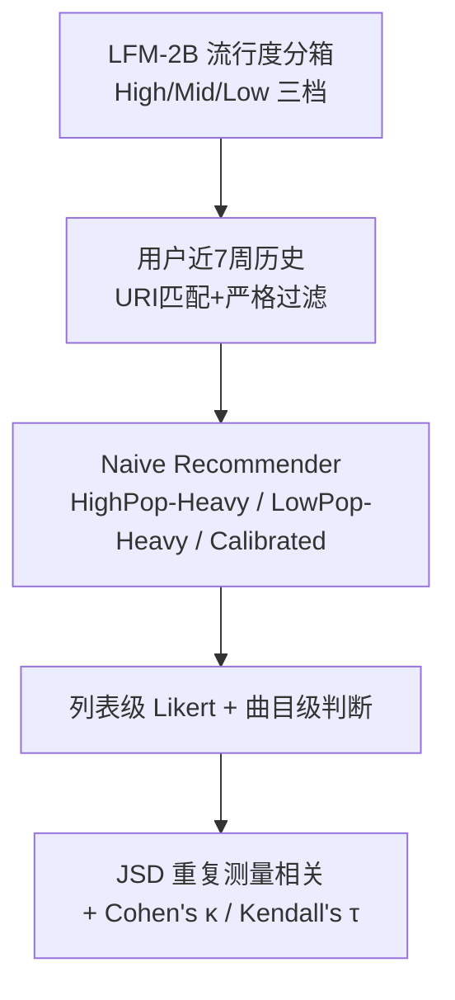

# Robustness and User-Perceived Value of Popularity Calibration in Music Recommendation: A User Study (音乐推荐中流行度校准的鲁棒性与用户感知价值：一项用户研究)

- **会议/期刊**: ACM Transactions on Recommender Systems (TORS), 2026
- **作者与机构**: Oleg Lesota, Gustavo Escobedo, Markus Schedl (JKU Linz)；Bruce Ferwerda (Jönköping University)；Simone Kopeinik, Dominik Kowald (Know-Center / Uni Graz)；Elisabeth Lex (TU Graz)
- **推荐链路定位**: 重排 / 列表级评估（离线指标的用户侧效度检验）
- **研究方向**: 去偏公平与工业架构 / 冷启动与长尾推荐
- **论文原文**: [arXiv:2608.05402v1](https://arxiv.org/abs/2608.05402v1)
- **开源代码**: 暂未开源

## TL;DR (1分钟核心速览)

本文质疑"流行度校准 = 用户中心指标"这一默认假设：用 60 名 Last.fm 活跃用户的近期收听历史构造 HighPop-Heavy / LowPop-Heavy / Calibrated 三类 10 曲列表，做受控用户实验。结果：用户能显著区分三类列表的流行度构成（$H.Pop.tr$ 4.81 vs 2.89 vs 1.59），但**并不偏好校准列表**（列表喜爱度 4.51/4.46/4.26，Friedman 不显著）；JSD 与感知流行度的相关性仅在 HighPop-Heavy vs Calibrated 子集内强（$r\approx0.51\text{–}0.55$），混入 LowPop-Heavy 后骤降至 $r\approx0.15\text{–}0.28$；计算流行度标签与用户判断仅弱一致（$\kappa=0.21$，$\tau=0.36$）。

## Background & Motivation (背景与核心矛盾)

- **主流范式**: Abdollahpouri 等提出的流行度校准以用户历史的三档（High/Mid/Low）流行度分布为目标，用 JSD 度量列表与历史的分布偏移，被广泛当作"用户中心"的去偏指标与重排目标。
- **前人局限**: ①校准几乎全在离线指标上评估，隐含假设"用户偏好与自身历史分布匹配的列表"，但 Alves 等发现用户未必感知校准的公平性；②Lesota 等虽发现 JSD 与感知相关，但**物品熟悉度**与**历史不完整**两个现实条件对相关性的调节作用未被系统检验。
- **核心洞察 (Key Insight)**: 校准指标的目标分布本身是"数据构造物"——依赖流行度分箱方式、历史时间窗、目录匹配率；若计算标签与用户主观流行度判断不一致，则"计算上校准"不等于"感知上校准"。
- **本文切入点**: 用**受控 naive recommender**（从用户近期历史中按预设流行度构成抽曲）替代真实推荐算法，剥离熟悉度与算法偏差混淆，直接检验"感知差异—偏好—指标鲁棒性—标签一致性"四问。

## Method (核心方法设计)

### 1. 整体框架 (Overall Architecture)

研究分四步闭环：①用 LFM-2B（Last.fm scrobbles，2005–2020）经 Spotify URI 宽松匹配 + 严格元数据校验，按"累计流行度质量 20%/60%/20%"切分 HighPop/MidPop/LowPop 三档，得约 340 万曲目；②对每位被试拉取近 7 周最多 4000 条 scrobble，仅保留可匹配曲目；③naive recommender 生成 6 张个性化列表（2×HighPop-Heavy、2×LowPop-Heavy、2×Calibrated，各 10 曲，顺序随机）；④被试做列表级 5 点 Likert 与曲目级三分类判断，再与离线 JSD 做重复测量相关分析。

### 2. 关键设计拆解 (Key Designs)

1. **受控 Naive Recommender（剥离算法混淆）**：真实推荐算法天然偏向热门，导致 LowPop-Heavy 列表难以生成、且曲目多来自全库造成低熟悉度。本文改为**从用户近期历史内按预设构成抽样**：LowPop-Heavy 取尽可能多 LowPop（不足 10 补 MidPop），HighPop-Heavy 对称，Calibrated 则先算历史三档比例再按比例抽样近似为 10 曲离散列表。直觉：把"流行度构成"变成唯一自变量，熟悉度作为受控常量（三条件下平均已知曲目均 >8/10）。

2. **JSD 校准度量与分箱**：沿用三档离散分布上的 Jensen–Shannon 散度，
$$\mathrm{JSD}(H_u,R_u)=\tfrac12\sum_{c}H_u(c)\log_2\frac{2H_u(c)}{H_u(c)+R_u(c)}+\tfrac12\sum_{c}R_u(c)\log_2\frac{2R_u(c)}{H_u(c)+R_u(c)}$$
其中 $H_u,R_u$ 分别为用户历史与列表在 $c\in\{\text{High},\text{Mid},\text{Low}\}$ 上的占比。关键性质：JSD **对称且只度量偏移幅度、不编码方向**——这正是后文"混入 LowPop-Heavy 后相关性崩塌"的根因。

3. **统计协议与鲁棒性扫描**：Friedman 检验 + Wilcoxon 符号秩两两比较，Bonferroni 校正 $\alpha=0.05/36$；JSD–感知相关性用**重复测量相关** $r_{rm}$，并在两个维度上做敏感性扫描：熟悉度阈值（每列表至少知 5 曲 vs 8 曲）× 匹配历史量阈值（≥60 / ≥90 / ≥120 条）。

## Experimental Setup & Evaluation Protocol (实验设置与评估协议)

- **数据集与预处理**: 流行度标签来自 LFM-2B，经 Spotify URI 匹配与严格 artist/title 校验后保留约 3.4M 曲目；被试侧数据为 Last.fm API 拉取的近 7 周收听事件。

| 数据集 | #Users | #Items | #Interactions | 稀疏度/密度 | 特征/场景说明 |
| :--- | :---: | :---: | :---: | :---: | :--- |
| LFM-2B（标签源） | — | ~3.4M tracks | 2005–2020 scrobbles | — | 三档流行度按累计质量 20/60/20 切分 |
| 用户研究样本 | 60（招募 80，剔除 <10min 者） | 每人 6×10 曲 | 每人 ≤4000 条近期 scrobble | — | 美国 Prolific 活跃 Last.fm 用户，均龄 31.4 |

- **数据划分与防穿越 (Splitting Strategy)**: 非传统训练/测试划分；采用**时间窗约束**——所有展示曲目须为被试参与前 ≤8 周内听过的曲目，杜绝"未听过却被要求判断流行度"的穿越式提问。
- **排名评测协议 (Ranking Protocol)**: 无 ranking 指标；核心为**主观评测协议**——列表级 5 点 Likert（Know/Like/Pop./Taste/Unpop.），曲目级 Know(是/否)、Like(dislike/neutral/like)、Pop.(less/average/more)，且 Like 与 Pop. 仅在"已知"曲目上追问，避免不熟悉噪声。
- **对比基线与超参设置**: 无算法基线，对比对象为三类列表条件本身；显著性 Bonferroni $\alpha=0.05/36$；一致性用 Cohen's $\kappa$ 与 Kendall's $\tau$。

## Key Experimental Results (实验关键数据)

### 1. 主实验对比 (Main Results)

三类列表的平均感知指标（曲目计数 /10 与 Likert-5；上标 $h/c/l$ 表示与对应列表类型差异显著）：

| 列表类型 | $Like_{tr}$ | $H.Pop._{tr}$ | $L.Pop._{tr}$ | $Know_{tr}$ | $Like_l$ | $Pop._l$ | $Unpop._l$ | $Know_l$ | $Taste_l$ |
| :--- | :---: | :---: | :---: | :---: | :---: | :---: | :---: | :---: | :---: |
| HighPop-Heavy | **7.96**$^l$ | **4.81**$^{cl}$ | 1.40$^{cl}$ | **9.12**$^{cl}$ | **4.51** | **4.15**$^{cl}$ | 2.06$^{cl}$ | **4.87**$^l$ | 3.83 |
| Calibrated | 7.48 | 2.89$^{hl}$ | 2.60$^{hl}$ | 8.57$^h$ | 4.46 | 3.32$^{hl}$ | 2.87$^{hl}$ | 4.71 | **3.87** |
| LowPop-Heavy | 7.05$^h$ | 1.59$^{hc}$ | **3.80**$^{hc}$ | 8.47$^h$ | 4.26 | 2.41$^{hc}$ | **3.50**$^{hc}$ | 4.62$^h$ | 3.54 |
| Friedman $\chi^2(2)$ | 20.78* | 89.75* | 55.03* | 16.17* | 8.51 | 90.60* | 71.38* | 14.19* | 4.98 |

JSD–感知流行度重复测量相关（全列表 vs 仅 HighPop-Heavy+Calibrated）：

| 设置 | 熟悉度阈值 | 历史阈值 | 列表数 | $r_{rm}(Pop._l)$ | $r_{rm}(Unpop._l)$ |
| :--- | :---: | :---: | :---: | :---: | :---: |
| 全列表 | ≥5 | 60+ | 345 | 0.151 | −0.168 |
| 全列表 | ≥8 | 120+ | 162 | 0.280 | −0.211 |
| 仅 High+Calib | ≥5 | 60+ | 235 | **0.526** | **−0.495** |
| 仅 High+Calib | ≥8 | 120+ | 111 | **0.523** | −0.402 |

### 2. 消融实验 (Ablation Study)

本文无模型组件消融，其"消融"体现为对分析条件的逐层剥离：

| 剥离条件 | 关键指标变化 | 说明 |
| :--- | :--- | :--- |
| 移除 LowPop-Heavy 列表 | $r_{rm}(Pop._l)$ 0.151→0.526（≥5 阈值） | 方向性缺失是相关性弱的主因 |
| 熟悉度阈值 5→8 | 全列表 $r$ 0.151→0.218（60+ 历史） | 熟悉度提升使感知更可靠 |
| 历史阈值 60→120 | 全列表 $r$ 0.151→0.186；High+Calib 几乎不变 | 历史量仅在多方向混合时起作用 |
| 计算标签 vs 用户标签 | $\kappa=0.21$，$\tau=0.36$ | 中档匹配率仅 24% |

### 3. 关键实验发现 (Key Findings)

1. **感知到 ≠ 偏好**：$Pop._l$ 的 Friedman $\chi^2=90.60$（$p<0.001$）证明用户清晰区分三类列表，但 $Like_l$（$\chi^2=8.51$）与 $Taste_l$（$\chi^2=4.98$）均不显著——校准列表的喜爱度 4.46 与 HighPop-Heavy 的 4.51 几乎无差，说明"匹配历史分布"并非用户价值的主要来源。
2. **JSD 的方向盲区是相关性崩塌的根因**：仅比较 HighPop-Heavy 与 Calibrated 时 $r$ 高达 0.51–0.55，一旦纳入 LowPop-Heavy 便跌至 0.15–0.28。因为 JSD 对称，无法区分"偏主流"与"偏小众"两种偏移，而用户对二者的感知截然不同（$H.Pop._{tr}$ 4.81 vs 1.59）。
3. **计算流行度标签的构念效度不足**：$\kappa=0.21$ 的弱一致中，LowPop 与 HighPop 判断匹配率分别为 62%/58%，而 MidPop 仅 24%——用户能识别极端热门/冷门，却难以稳定归类中档，而中档恰是校准分箱中占比最大、对 JSD 贡献最敏感的部分。

## Highlights, Limitations & Rating (亮点、对比与审稿评价)

- **与代表作对比 (vs. Prior Work)**: 相比 Abdollahpouri 等的离线校准框架，本文首次系统检验其"用户中心"前提；相比 Lesota 等的前作（发现 JSD 与感知相关），本文进一步揭示该相关**高度条件依赖**（列表构成、熟悉度、历史量）；相比 Alves 等的公平性感知研究，本文聚焦流行度维度并给出方向性缺失这一可操作的指标缺陷诊断。
- **可迁移亮点**: ①"从用户自身历史内抽样构造受控列表"是检验任何列表级指标构念效度的通用实验范式，可迁移至多样性、新颖性、公平性指标的用户侧验证；②建议在 JSD 之外补充**有向校准指标**（如带符号的流行度偏移量），对工业去偏重排的监控面板设计有直接参考价值。
- **审稿级局限批判**: ①naive recommender 从近期已听曲目抽样，熟悉度被刻意拉高（三条件均 >8/10 已知），可能系统性压低了校准的感知价值，结论对"发现型"推荐场景的外推性存疑；②样本仅 60 人、单一文化区域（美国）与单一平台（Last.fm），且流行度标签依赖特定数据集与时间窗，换数据集/换分箱策略后 $\kappa$ 与 $r_{rm}$ 的数值稳定性未验证。
- **四维评分**: 创新性 ⭐⭐⭐⭐ | 实验扎实度 ⭐⭐⭐⭐ | 方法清晰度 ⭐⭐⭐⭐⭐ | 落地价值 ⭐⭐⭐⭐

