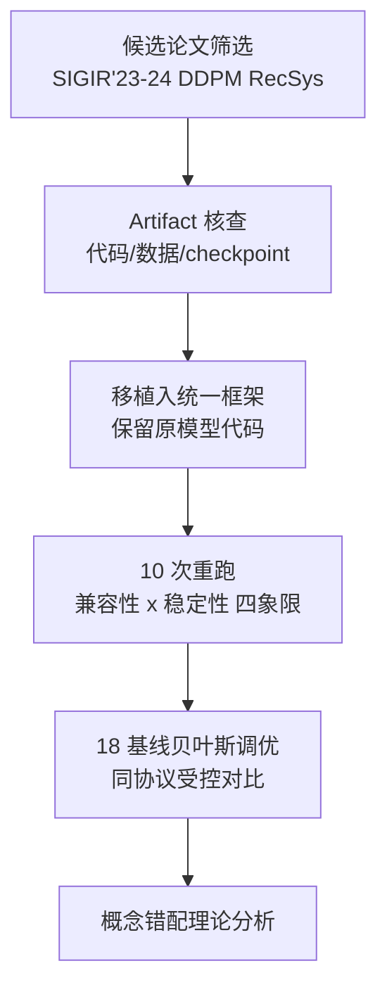
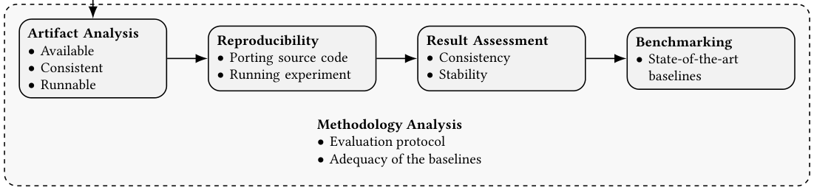

# Diffusion Recommender Models and the Illusion of Progress: A Concerning Study of Reproducibility and a Conceptual Mismatch (扩散推荐模型与进步的幻觉：一项关于可复现性与概念错配的警示研究)

- **会议/期刊**: ACM Transactions on Recommender Systems (TORS) 2026
- **作者与机构**: Michael Benigni, Maurizio Ferrari Dacrema (Politecnico di Milano); Dietmar Jannach (University of Klagenfurt)
- **推荐链路定位**: 召回 / top-n 排序（离线评测方法论研究）
- **研究方向**: 生成式推荐与离散语义ID / 去偏公平与工业评测
- **论文原文**: [论文原文链接](https://arxiv.org/abs/2505.09364v3)
- **开源代码**: [开源代码仓库链接](https://github.com/remaplab/TORS26_Reproducibility-DDPMs)

## TL;DR (1分钟核心速览)

本文针对"扩散推荐模型 (DDPM-based RecSys) 年年刷新 SOTA"这一现象，系统复现了 SIGIR'23–24 的 4 篇论文共 9 个 DDPM 推荐模型（DiffRec/CF-Diff/GiffCF/DDRM）。在作者原始 artifact + 原始评测协议下，仅 **25%** 报告结果可完全复现；部分模型多次运行波动高达 **18%**。作者进一步用 18 个经贝叶斯调优的基线（含 ItemKNN、EASE$^R$、iALS）在相同协议下对比，发现**调优后的简单基线一致反超扩散模型原文报告值**，并从理论上指出 DDPM 的"生成多样性"目标与 top-n 离线评测"确定性排序"奖励之间的根本错配。

## Background & Motivation (背景与核心矛盾)

- **主流范式**: DDPM 在图像生成取得 SOTA 后被迅速移植到协同过滤，DiffRec 将用户交互画像视为"被噪声污染的观测"，用前向加噪 + 反向去噪建模用户偏好分布，后续 CF-Diff/GiffCF/DDRM 通过图引导、画像引导、双流嵌入扩散不断刷新指标。
- **前人局限**: ① 复现研究（Ferrari Dacrema 2019、Anelli 2022、Rendle 2020/2024）反复证明"新模型打不过调优后的 iALS/BPR/EASE$^R$"，但该问题在扩散方向是否延续未知；② 所有被分析论文均未论证"为图像生成设计的 DDPM 假设"为何适配交互稀疏、二值、确定性排序的 top-n 任务。
- **核心洞察 (Key Insight)**: 扩散模型的本质优势是**建模多峰分布并采样多样本**，而 top-n 离线评测（Recall/NDCG@K）奖励的是**单一确定性排序列表**——两者目标天然冲突；实证上被分析模型均通过强引导 (guidance) 把生成自由度压到极小，退化为"带噪声的确定性打分器"。
- **本文切入点**: 不做新模型，而是以"复现 + 受控基准 + 概念批判"三位一体的审计式研究，量化"进步幻觉"。

## Method (核心方法设计)

### 1. 整体框架 (Overall Architecture)

研究流程分五阶段：候选论文筛选（SIGIR'24 Diffusion in RecSys session + SIGIR'23 DiffRec）→ artifact 可用性与一致性核查（代码可运行、数据划分可复现）→ 将原始实现**原封不动**移植进作者自研统一评测框架（仅替换 early-stopping 与评测逻辑）→ 每配置重跑 10 次评估可复现性 → 在原文协议约束下引入 18 个跨家族强基线做贝叶斯调优对比。总计训练约 580 个模型、含调优共 10,282 次训练，累计算力 1.87 年。

<figure class="paper-figure" markdown="span">
  <figcaption>图1. 我们分析工作流程的主要阶段。</figcaption>
</figure>

### 2. 关键设计拆解 (Key Designs)

1. **双维度可复现性判定准则（兼容性 × 稳定性）**：固定阈值（如 2%）在生成模型高方差下失效。作者改为：重跑 10 次得 $\mu,\sigma$，若原文报告值落入$[\mu-\sigma,\mu+\sigma]$则"兼容"；若$\sigma/\mu > 2\%$ 则"不稳定"。四象限中仅"兼容+稳定"算完全复现。直觉：把"随机性"从"错误"中剥离，避免高方差模型靠运气落入区间。
2. **受控基准的下界论证（Lower-Bound Benchmarking）**：不追求"证明扩散模型永远不行"（不可证），而是论证"原文实验未在 SOTA 条件下进行"。在原文数据集/划分/指标约束下，对 18 个基线用 Scikit-Optimize 贝叶斯搜索 50 组配置（16 随机初始化，单配置上限 3 天，总预算 14 天），若调优基线已超原文报告值，则原文"超越 SOTA"的 claim 不成立。
3. **训练目标与评测协议对齐**：沿用原文协议——仅用训练集训练（**不在 train+valid 上重训**），验证时过滤训练交互、测试时过滤训练+验证交互；指标为 Recall/NDCG@{10,20}，按用户平均。此"非标准"协议被刻意保留以保证可比性，但也构成对原文方法论的审计对象之一。

## Experimental Setup & Evaluation Protocol (实验设置与评估协议)

- **数据集与预处理**: 沿用各原文数据集（MovieLens-1M、Yelp、Amazon-Books 等），评分 $\geq 4$ 二值化为 1；DiffRec 额外构造 "natural noise"（低分交互注入训练/验证）与 "random noise"（随机交互注入）两种噪声版本。

| 数据集 | 过滤/预处理 | 划分方式 | 噪声变体 | 说明 |
| :--- | :---: | :---: | :---: | :--- |
| MovieLens-1M | rating $\geq 4$ 二值化 | 原文称 7:1:2（实测约 7:2:1） | clean / natural / random | 共享 split 与声明不符 |
| Yelp | 同上 | 同上 | clean / natural / random | natural noise 存在 <0.004% 跨集重叠 |
| Amazon-Books | 同上 | 同上 | clean / natural / random | random noise split 未共享，无法复现 |

- **数据划分与防穿越**: 按时间排序后切分 train/valid/test；**测试时同时过滤训练与验证交互**（原文做法，作者指出验证交互从未参与训练、过滤理由存疑，疑似简化任务）。
- **排名评测协议**: 原文未明确全库排序细节，作者在统一框架内按原文候选集执行；指标 Recall/NDCG@{10,20}，逐用户计算后平均（仅统计测试集有交互的用户）。
- **对比基线与超参**: 主文报告 9 个基线（TopPop、UserKNN、ItemKNN、RP$^3\beta$、GF-CF、EASE$^R$、SLIM、MF-BPR、iALS、MultVAE），附录共 18 个；贝叶斯调优 50 组配置，搜索空间沿用 Ferrari Dacrema 等设定；EASE$^R$ 因内存超 64GB 偶有缺失。

## Key Experimental Results (实验关键数据)

### 1. 主实验对比 (Main Results)

以 DiffRec 在 Amazon-Books (clean) 上的代表性结果为例（NDCG@10，原文报告 vs. 复现 vs. 调优基线）：

| 模型 | 原文报告 | 本文复现 ($\mu\pm\sigma$) | 可复现判定 | 备注 |
| :--- | :---: | :---: | :---: | :--- |
| DiffRec | 0.0335 级 | 兼容区间内 | ✅ 兼容+稳定 | 少数完全复现配置之一 |
| DiffRec (ML-1M clean) | 0.0901 | **0.0856** $\pm$ 0.0015 | ❌ 系统性偏低 | 不兼容 |
| DiffRec (Yelp natural) | 0.0309 | **0.0313** $\pm$ 0.0001 | ❌ 系统性偏高 | 仅 Recall@20 可复现 |
| GiffCF | — | 运行间波动达 **18%** | ⚠️ 不稳定 | 单次报告值不可信 |
| **ItemKNN (调优)** | 未作基线 | **超越多数 DDPM 原文值** | — | 简单邻域法反超 |
| **EASE$^R$ (调优)** | 未作基线 | **超越多数 DDPM 原文值** | — | 闭式解线性模型反超 |
| **iALS (调优)** | 部分作弱基线 | **≥ 对应 DDPM 模型** | — | 2008 年老方法仍具竞争力 |

> 全局统计：64 个可判定配置中，仅 **26/64 (≈25%)** 落入"兼容+稳定"象限；23/64 系统性不兼容但稳定，8/64 既不兼容也不稳定。**所有 4 篇论文均至少存在 1 个基线 ≥ 其提出的 DDPM 模型**。

### 2. 消融/审计维度分解 (Audit Breakdown)

| 审计维度 | DiffRec | CF-Diff | GiffCF | DDRM |
| :--- | :---: | :---: | :---: | :---: |
| Artifact 完整 | 部分（缺 random split、基线代码） | 部分（guidance 实现不全） | 部分 | 部分 |
| 数据划分与声明一致 | ❌ (7:1:2 vs 7:2:1) | 存疑 | 存疑 | 存疑 |
| 基线调优透明度 | 低（范围窄、默认值多） | 低 | 低 | 低 |
| 完全可复现比例 | 低 | 低 | 低 | 低 |
| 生成自由度 | 无引导（最"纯"） | 图跳数引导 | 画像引导 | 双流互引导 |

### 3. 关键实验发现 (Key Findings)

1. **"进步"主要来自弱基线而非架构**：在原文协议下，调优后的 ItemKNN/EASE$^R$/iALS 一致达到或超过 DDPM 模型原文报告值，说明原文的提升幅度很大程度上是"未调优基线"制造的幻觉，而非扩散建模的真实增益。
2. **生成模型的高方差使单点报告失去意义**：GiffCF 运行间波动达 18%，而所有原文均只报告单一数值、无方差估计；在此条件下任何"小幅超越"（常见 1–3%）在统计上不可区分。
3. **概念错配的实证印证**：被分析模型均以强引导把 DDPM 的采样自由度压至极小（除 DiffRec 外全部依赖 guidance），"生成能力被约束到最低限度"——即模型实际退化为例行打分器，却承担了扩散框架的全部训练与推理开销，性价比存疑。

## Highlights & Limitations (亮点、对比与审稿批判)

- **与代表作对比 (vs. Prior Work)**: 相较 Ferrari Dacrema 2019（审计神经协同过滤）与 Anelli 2022（统一框架横评），本文首次将审计矛头指向**扩散生成式推荐**这一最新热点，并额外贡献了"生成目标 vs. 排序评测"的概念层批判，超越纯数值复现；相较 Dacrema 等的"重训所有模型"路线，本文采用"原 artifact 移植 + 原文协议保留"路线，更贴近"可复现性"本义。
- **可迁移亮点**: ① "兼容性 × 稳定性"双维复现判定可直接用于任何高方差生成式推荐（扩散/LLM 采样）的评测规范；② "调优基线作为 claim 下界"的审计范式可迁移至生成式检索、语义 ID 推荐等新方向。
- **审稿级局限批判**: ① 受算力约束，基线调优预算（14 天/模型）与原文模型调优预算不对等，"基线反超"结论严格说是"下界证据"而非"严格占优证明"；② 概念批判以定性论证为主，未给出"何种改造能让 DDPM 真正适配 top-n"的建设性方案，对领域推进的正面指引有限；③ 仅覆盖 4 篇 SIGIR 论文，样本代表性受会议/年份限制。

## Rating (四维评分)

- **方法创新性 (Novelty)**: ⭐⭐⭐⭐ （审计式研究本身非新范式，但"兼容性×稳定性"判定与生成-排序目标错配的概念批判具原创洞察）
- **评估协议与实验扎实度 (Protocol & Experiments)**: ⭐⭐⭐⭐⭐ （580 模型/10,282 次训练/1.87 年算力，18 基线贝叶斯调优，10 次重跑方差估计，审计维度完整）
- **写作与数学规范度 (Clarity & Rigor)**: ⭐⭐⭐⭐ （DDPM 背景推导清晰、四象限判定严谨；概念批判部分偏论述性，量化支撑略弱）
- **工业落地与复现价值 (Industrial & Practical Value)**: ⭐⭐⭐⭐⭐ （代码与全部实验开源，直接警示工业界勿盲信扩散推荐 SOTA，对评测规范建设有立竿见影的实践价值）

