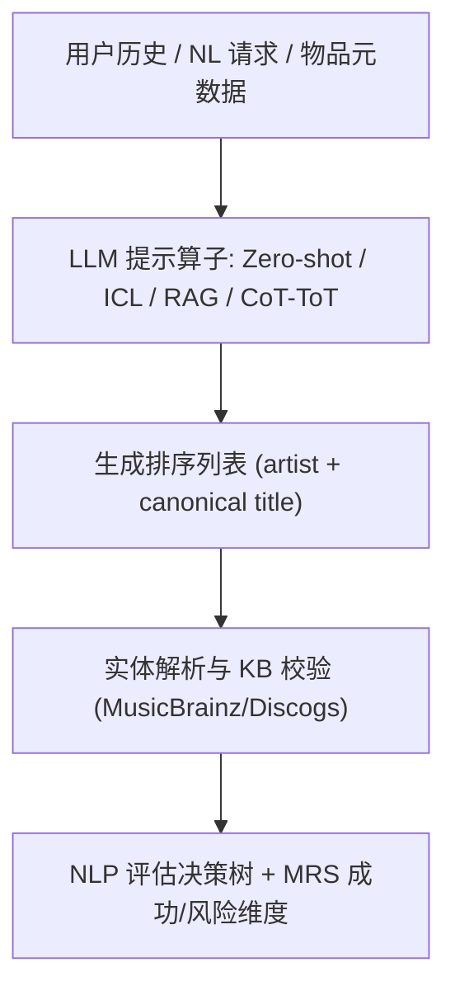

# Music Recommendation with Large Language Models: Challenges, Opportunities, and Evaluation (大语言模型驱动的音乐推荐：挑战、机遇与评估)

- **会议/期刊**: ACM Transactions on Recommender Systems (TORS)
- **作者与机构**: Elena V. Epure, Bruno Sguerra, Manuel Moussallam (Deezer Research / Idiap)；Yashar Deldjoo (Politecnico di Bari)；Markus Schedl (JKU Linz)
- **推荐链路定位**: 端到端生成式（LLM 直接生成排序列表）+ 评估方法论
- **研究方向**: 大语言模型推荐 / 去偏公平与工业评测
- **论文原文**: [arXiv:2511.16478v3](https://arxiv.org/abs/2511.16478v3)
- **开源代码**: 暂未开源

## TL;DR (1分钟核心速览)

本文是一篇 **survey + position paper**：指出音乐推荐长期被"信息检索式准确率"范式绑架，而 LLM 的生成式本质（非排序、幻觉、知识截断、非确定性、训练数据不透明）使传统 train/test 协议与 Accuracy/NDCG 指标失效。作者围绕**用户建模、物品建模、自然语言请求**三条主线综述 LLM 的介入方式（零样本 / ICL / RAG / CoT-ToT），并借用 NLP 评估体系构建"参考/无参考 × 人工/自动"决策树，最终给出面向 MRS 的**成功维度 + 风险诊断**操作框架。全文无实验表格，贡献在于评估范式的重构。

## Background & Motivation (背景与核心矛盾)

- **主流范式**: MRS 沿用 RS 的 IR 框架，把"什么是好推荐"简化为"能否准确预测用户将消费什么"，以离线矩阵补全、序列续接等子任务的 Accuracy 为进步标尺。
- **前人局限**: ① 音乐消费是**情境化、情感化、功能性**的（学习/健身/情绪调节），同一用户在不同意图下需求截然不同，历史消费无法刻画瞬时意图；② 音乐元数据（genre/mood）**主观、跨文化、定义不一致**，反馈几乎全为隐式（播放、跳过、30 秒阈值），无单一 ground truth。
- **核心洞察 (Key Insight)**: LLM 是生成模型，不计算相似度也不排序，因此标准准确率指标"测非所测"；同时黑盒模型大概率已见过公开评测集，train/test 隔离名存实亡。
- **本文切入点**: 不提出新模型，而是**把评估本身当作研究对象**——用 NLP 的生成评估工具箱 + 音乐领域特有风险维度，重建 MRS 评测语言。

## Method (核心方法设计)

### 1. 整体框架 (Overall Architecture)

论文以"LLM 介入 MRS 的三个接触面"组织综述，再以"评估"收束：用户侧用 LLM 将交互历史摘要为**可读可编辑的 NL 偏好画像**（profile-as-text）；物品侧让 LLM 充当标注器、信息抽取器与摘要/描述生成器；请求侧把推荐形式化为 $f: X \to Y$ 的文本生成任务，通过零样本、ICL、RAG、CoT/ToT 四种提示算子把开放词汇的用户意图映射到目录实体。评估层则先给出 NLP 决策树，再落到 MRS 的成功/风险双维框架。

### 2. 关键设计拆解 (Key Designs)

1. **NL 用户画像作为可编辑的个性化载体**：隐式向量不可解释、冷启动无表征、转向新兴趣需大量交互。本文主张用 LLM 将消费记录 + 元数据拼接为 prompt 并摘要为简洁画像，再与物品元数据投影到共享隐空间或直接交给第二个 LLM 推荐。其价值在于**无需改权重即可纠偏**（taste card），但作者亦警示：静态单一画像无法覆盖音乐的情境多面性，需多画像/会话推断 persona。

2. **四种提示算子的能力—风险谱系**：零样本把推荐转为开放词汇语言理解，擅长长尾与探索，但依赖参数知识，对**新发曲目**极易幻觉；ICL 用个人或协同邻域种子实现免训练即时个性化，风险是种子若取自时间尾部会放大近因噪声、单语种子会放大语言/地域偏置；RAG 以非参数检索保证目录新鲜度与事实落地，但受 token 预算与多版本（remaster/live）歧义制约；CoT/ToT 提供可审计的多约束推理（BPM 区间、调性过渡、能量曲线），但可能生成"听起来合理"的虚构 micro-genre 推理链。

3. **评估形式化与决策树**：将任务统一为学习 $P_\theta(y|x)$，评估分为参考型$M(y^*, y)$（精确匹配：NER/KB linking 用 P/R/F1；近似匹配：BLEU/ROUGE/BERTScore/BLEURT）与无参考型（Prism-src、COMET-QE、GPTScore 等直接比对输入$x$）以及判断型（人工或 LLM-as-Judge 评流畅性、连贯性、事实性、多样性）。决策路径为：有 ground-truth？→ 输出空间是否良定义？→ 是否判断式评估？三层分支决定指标族。

## Experimental Setup & Evaluation Protocol (实验设置与评估协议)

- **数据集与预处理**: 本文为立场/综述论文，**未开展新实验、未报告数据集统计**。其讨论的数据形态为工业级流媒体目录（千万级曲目、长尾、持续新增），并指出歌词因版权不可共享，构成可复现研究的结构性障碍。
- **数据划分与防穿越 (Splitting Strategy)**: 作者明确批判传统划分在 LLM 场景下失效——黑盒模型预训练语料可能已覆盖常用公开 RS 数据集，**train/test 隔离不可验证**，需转向基于时间戳的目录新鲜度检验与实体解析准确率检验。
- **排名评测协议 (Ranking Protocol)**: 主张超越 Full-Ranking / Sampled Ranking 的 Accuracy 之争，补充**接地准确率（grounding accuracy）、实体解析召回、目录曝光均衡度、列表级转移连贯性**等诊断指标；对生成式输出，需区分"生成文本质量"与"映射回目录后的排序质量"两段评估。
- **对比基线与超参设置**: 无。论文以定性对比替代定量对比，将零样本/ICL/RAG/CoT 视为四种可组合的提示配置而非竞争基线。

## Key Experimental Results (实验关键数据)

### 1. 主实验对比 (Main Results)

本文**不含主实验表格**。其"对比"以定性矩阵形式呈现，下表为作者对四种提示算子的归纳（非数值结果）：

| 提示算子 | 个性化来源 | 目录新鲜度 | 主要风险 | 适用场景 |
| :--- | :--- | :---: | :--- | :--- |
| Zero-shot | 无 / NL 画像 | 低（参数知识截断） | 流行度偏置、幻觉 | 冷启动、探索、长尾流派 |
| Few-shot ICL | 个人历史 / 协同邻域种子 | 中 | 近因噪声、单语偏置、顺序敏感 | 会话推荐、兴趣快速漂移 |
| RAG | 画像 + 检索文档 | 高（索引外置） | token 开销、版本歧义 | 新发曲目、事实约束查询 |
| CoT / ToT | 画像 + 推理脚手架 | 中 | 虚构流派、冗长无效推理 | 多约束播放列表生成 |

### 2. 消融实验 (Ablation Study)

无消融实验。作者以"移除接地机制"的思想实验替代：零样本在无 RAG、无后校验时幻觉率最高；ICL 在种子打乱/丢弃/改写扰动下顺序敏感性暴露；RAG 在检索文档超预算截断后退化为参数知识依赖。

### 3. 关键实验发现 (Key Findings)

1. **评估错配是核心矛盾而非次要问题**：生成式模型不产生相似度分数，NDCG/Recall 度量的是"映射回目录后的排序"，与用户实际获得的文本体验之间存在不可忽略的语义鸿沟。
2. **目录新鲜度决定架构选择**：由于新曲持续涌入而参数知识静态，凡涉及新发内容的场景必须引入 RAG 或外部 KB 校验，否则系统性偏向老歌与热门曲，直接损害发现性这一音乐推荐的核心价值。
3. **音乐领域的三重不可迁移性**：文本稀疏（歌词版权受限）、描述主观（"party music" 因人而异）、实体歧义（曲名与常用词重叠、同名艺人）使得通用 LLM 推荐方法无法直接套用，必须叠加实体解析与领域接地。

## Highlights & Limitations (亮点、对比与审稿批判)

- **与代表作对比 (vs. Prior Work)**: 相较于以协同过滤嵌入为核心的经典 MRS 综述，本文不讨论表征学习细节而聚焦**评估认识论**；相较于通用 LLM4Rec 综述（如基于指令微调/提示的推荐综述），本文的增量在于把 NLP 生成评估体系（reference-free、LLM-as-Judge）系统移植到音乐场景，并显式引入幻觉、知识截断等生成式失效模式作为一等评估对象。
- **可迁移亮点**: ① "profile-as-text + 可编辑 taste card" 的免训练个性化范式可迁移至任何冷启动严重的推荐场景；② 三层评估决策树（是否有 ground-truth → 输出空间是否良定义 → 是否判断式）可直接作为 LLM 推荐系统论文的评测自查清单。
- **审稿级局限批判**: ① **缺乏实证支撑**——所有关于幻觉率、偏置放大、ICL 顺序敏感性的论断均引自他文，未提供统一的受控对比实验，削弱了框架的说服力；② **框架可操作性不足**——成功/风险维度停留在概念层，未给出可计算的复合指标或阈值，工业团队难以直接落地为 A/B 指标；③ 对 LLM-as-Judge 自身的偏置（位置偏置、自我偏好）讨论偏薄。

## Rating (四维评分)

- **方法创新性 (Novelty)**: ⭐⭐⭐ （不提出新模型，但"评估范式重构 + 音乐领域三重不可迁移性"的框架化梳理具有观点价值）
- **评估协议与实验扎实度 (Protocol & Experiments)**: ⭐⭐ （无自建实验、无数据集统计、无显著性检验，全部论据为文献转述）
- **写作与数学规范度 (Clarity & Rigor)**: ⭐⭐⭐⭐ （三接触面 + 评估决策树的结构清晰，形式化 $f: X \to Y$与$M(y^*,y)$ 定义规范，54 页篇幅略显冗长）
- **工业落地与复现价值 (Industrial & Practical Value)**: ⭐⭐⭐ （Deezer 工业视角的 RAG 延迟/token 成本、目录新鲜度讨论实用，但无开源代码与可执行基准）

