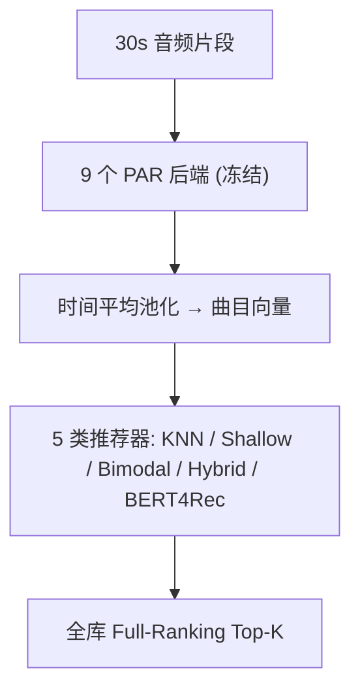

# Adopting State-of-the-Art Pretrained Audio Representations for Music Recommender Systems (将 SOTA 预训练音频表征引入音乐推荐系统)

- **会议/期刊**: ACM Transactions on Recommender Systems (TORS), Special Issue "Highlights of RecSys '24"
- **作者与机构**: Yan-Martin Tamm, Anna Aljanaki（University of Tartu, Estonia）
- **推荐链路定位**: 召回（内容表征后端 + 混合召回）
- **研究方向**: 多模态推荐 / 冷启动与长尾推荐
- **论文原文**: [https://arxiv.org/abs/2604.23077v1](https://arxiv.org/abs/2604.23077v1)
- **开源代码**: [https://github.com/Darel13712/adopting-pretrained-audio](https://github.com/Darel13712/adopting-pretrained-audio)

## TL;DR (1分钟核心速览)

音乐推荐（MRS）长期沿用端到端训练 Mel 频谱 CNN，而 MIR 社区已积累大量大规模预训练音频后端模型，二者却几乎从未交汇。本文不做新模型，而是做一次系统性"表征审计"：把 9 个 SOTA 预训练音频表征（PAR，含 MFCC 基线共 10 种）冻结后接入 5 类推荐器（KNN / Shallow Net / Bimodal 对比投影 / Hybrid / BERT4Rec），在 Music4All-Onion 上同时评测热启动（全库 Full-Ranking）与冷启动（589 新物品候选）。核心结论：热启动最优为 MusiCNN+BERT4Rec（HR@50=0.4722），冷启动最优为 Jukebox+Bimodal（HR@20=0.6788），且 MIR 榜单排名**不能**预测推荐表现；但所有混合方案在热启动下仍打不过纯协同 ELSA（HR@50=0.5580）。

## Background & Motivation (背景与核心矛盾)

- **主流范式**: 内容感知 MRS 自 2013 年起以 Mel 频谱 + CNN 端到端训练为事实标准；作者对 2006–2022 年 45 篇含音频的 MRS 论文做元综述，发现仅 2 篇（[6] 用 MusiCNN 提特征、[59] 用 CLMR/MEE/Jukebox 做负采样稳定性验证）借用了预训练后端，且均非研究焦点。
- **前人局限**: ①MRS 数据集受版权限制，同时含音频与播放历史的公开数据极少，端到端训练易过拟合、冷启动无解；②MIR 预训练模型只需音频+标签即可在海量数据上训练，却因"任务不匹配"被 RS 社区忽视；③已有工作无法回答"哪个 PAR 对推荐真正有用"。
- **核心洞察 (Key Insight)**: 预训练表征在自回归生成（Jukebox）、音频压缩（Encodec）、掩码建模（MERT/MusicFM/MuQ）等目标下捕获的"音乐信息"与"用户偏好信息"存在系统性错位——MIR 强 ≠ 推荐强。
- **本文切入点**: 固定 PAR 为冻结物品嵌入，仅学习一个轻量投影，横向控制变量比较"表征 × 推荐器 × 场景"三维组合，并用**打乱初始化（shuffled init）**作为增益归因的对照基准。

## Method (核心方法设计)

### 1. 整体框架 (Overall Architecture)

流程为：Music4All 的 30 秒音频片段 → 各 PAR 后端前向（片段级嵌入按时间平均池化为曲目级向量）→ 冻结后接入 5 类推荐器之一 → 学习投影/用户嵌入 → 全库排序生成 Top-K。所有实验共享同一数据划分，推荐器训练时 PAR 不可变，仅投影层与用户侧参数可学。打乱初始化对照的做法是：把 PAR 与物品的对应关系随机置换后重训，若指标不升反降则说明模型确实从正确对齐的语义中获益。

### 2. 关键设计拆解 (Key Designs)

1. **ADCL 对称化对比损失（Bimodal 投影）**：原 DCL 需对两个模态各算一次"同模态内负样本排斥项" $\text{sim}(z^i_k,z^j_k)$，计算翻倍且对内容模态未必有益。作者直接删去该项，仅保留跨模态对齐：

$$\mathcal{L}_{ADCL}=\frac{1}{N}\sum_{i=1}^{N}\Big[-\text{sim}(z^i_1,z^i_2)+\log\sum_{j=1}^{N}e^{\text{sim}(z^i_1,z^j_2)}\Big],\quad \text{sim}(z^i_1,z^j_2)=\frac{z^i_1\cdot z^j_2}{\tau}$$

直觉是：推荐场景下真正需要的是"内容向量落在协同向量邻域"，同模态内的均匀性约束反而稀释了跨模态信号；预实验中删项版本更优（作者亦坦言理论原因待考）。

2. **Hybrid 的 ELSA 式闭式投影**：不做对比采样，直接把冻结 PAR 投影为 $\mathbf{A}$，令其重构交互矩阵：

$$\min_{\mathbf{A}}\ \|\mathbf{X}-\mathbf{X}(\mathbf{A}\mathbf{A}^{\top}-\mathbf{I})\|_F^2$$

即用内容投影去"解释"协同邻接结构，等价于 Beeformer 的音频版（原文用文本描述，本文换成 PAR），天然支持冷物品——新物品只需前向一次后端即可入空间。

3. **训练目标、负采样与推理效率**：Shallow Net 用 Max-Margin Hinge + 每正样本采 20 个未交互负用户，物品嵌入层冻结、用户层解冻；Bimodal 用 ADCL（100 epoch）；Hybrid 用 ELSA loss（200 epoch）；BERT4Rec 用 Cross-Entropy 掩码预测（200 epoch，序列截断 300）。推理侧 KNN 直接最近邻检索，其余模型取用户向量/末位时间步打分；PAR 前向为一次性离线开销，在线仅一次投影矩阵乘法，成本可忽略。

## Experimental Setup & Evaluation Protocol (实验设置与评估协议)

- **数据集与预处理**: Music4All-Onion（含音频片段、播放历史与预计算 MFCC）：

| 数据集 | #Users | #Items | #Interactions | 稀疏度/密度 | 特征/场景说明 |
| :--- | :---: | :---: | :---: | :---: | :--- |
| Train | 21,018 | 55,262 | 5,371,381 | 密度≈0.46% | 前 12 个月历史 |
| Validation | 2,459 | 23,625 | 48,787 | — | 测试月 30% 用户 |
| Hot Test | 10,238 | 45,002 | 280,745 | — | 测试月 70% 用户，过滤已见物品 |
| Cold Test | 4,553 | 589 | 23,269 | — | 测试月首次出现的"自然"新物品 |

- **数据划分与防穿越 (Splitting Strategy)**: **全局时间戳切分**——2019-02-01 之后一个月为验证/测试，之前一年为训练；热测试集仅保留用户在 2019-02-01 前未听过的物品，杜绝穿越。
- **排名评测协议 (Ranking Protocol)**: 热启动为无偏 **Full-Ranking**（全部 45,002 热物品为候选，过滤已交互）；冷启动为 **589 冷物品候选集排序**（作者明确说明这是现实场景，且指标绝对值因此偏高、不可与热启动横向比较）。指标：热启动 HR@50 / Recall@50 / NDCG@50，冷启动降至 @20。
- **对比基线与超参设置**: 基线为 10 种表征（MFCC + 9 个 PAR，维度 104–4800）× 5 类推荐器；另设 PopRec 与纯协同 ELSA（HR@50=0.5580）作为强参照。每配置 5 次重训取均值与 95% CI，另 3 次打乱初始化估计增益；Adam，lr=1e-3（Hybrid 为 1e-2），早停 + 平台降 lr。

## Key Experimental Results (实验关键数据)

### 1. 主实验对比 (Main Results)

热启动（HitRate@50，括号内为相对打乱初始化的增益）：

| 表征 (维度) | Shallow Net | Bimodal(Avg) | Hybrid | BERT4Rec |
| :--- | :---: | :---: | :---: | :---: |
| MFCC (104) | 0.2483 (↑112%) | 0.0435 (↑80%) | 0.3021 (↑219%) | 0.2609 (↑15%) |
| Jukebox (4800) | 0.2982 (↑653%) | 0.1157 (↑361%) | 0.0775 (↑219%) | 0.2106 (↑5%) |
| Music2Vec (768) | 0.3200 (↑331%) | 0.2850 (↑652%) | 0.3025 (↑915%) | 0.2993 (↓3%) |
| MusicFM (1024) | 0.3217 (↑442%) | 0.1698 (↑541%) | 0.3067 (↑278%) | 0.4427 (↑81%) |
| MERT (1024) | 0.3264 (↑716%) | 0.2462 (↑851%) | 0.3680 (↑116%) | 0.3553 (↑29%) |
| EncodecMAE (768) | 0.3319 (↑262%) | 0.2551 (↑855%) | 0.3804 (↑137%) | 0.4449 (↑4%) |
| MusiCNN (200) | 0.3581 (↑113%) | 0.1657 (↑511%) | 0.4323 (↑9%) | **0.4722** (↑11%) |
| MuQ-MuLan (512) | 0.3730 (↑250%) | **0.3975** (↑1029%) | **0.4450** (↑195%) | 0.4247 (↑5%) |
| MULE (1728) | 0.3735 (↑323%) | 0.2271 (↑691%) | 0.4071 (↑13%) | 0.3947 (↑70%) |
| MuQ (1024) | **0.3895** (↑189%) | 0.3794 (↑1418%) | 0.4239 (↑535%) | 0.4410 (↑61%) |
| *参照: ELSA 纯协同* | — | — | — | *0.5580* |

冷启动（HitRate@20）：Jukebox+Bimodal **0.6788**（↑122%）、MusicFM+Hybrid 0.6727（↑169%）、MuQ-MuLan+Hybrid 0.6697（↑134%）、MuQ+Bimodal 0.6517（↑96%）；而 MusiCNN 在冷启动跌至 0.5686，BERT4Rec 全线最弱（Jukebox 甚至 ↓14%）。

### 2. 消融实验 (Ablation Study)

以 Bimodal 的三路投影选择与打乱初始化增益作为核心消融：

| 配置 | HR@50 (热) | 说明 |
| :--- | :---: | :--- |
| Bimodal-Collaborative (MuQ) | 0.4145 | 仅用协同投影，仍低于 ELSA 0.5580 |
| Bimodal-Average (MuQ) | 0.3794 | 主表口径 |
| Bimodal-Content (MuQ) | 0.2163 | 纯内容投影，热启动最弱 |
| Bimodal-Content (Jukebox, 冷) | 0.6788 | 冷启动反而最优 |
| w/o 正确 PAR 对齐（打乱初始化） | 增益降至 0–5% | Music2Vec+BERT4Rec 甚至 ↓3% |
| 解冻物品嵌入（对比冻结） | 未报告更优 | 冻结是更优选择 |

### 3. 关键实验发现 (Key Findings)

1. **MIR 排名不可迁移**：MusicFM 在 auto-tagging（AUC 0.924）与调性检测（0.674）均第一，热推荐仅 0.4427 排第三；MusiCNN 在 MIR 各任务平庸（Key 仅 0.128）却拿下热推荐第一（0.4722）；Jukebox 热推荐垫底（0.2982）却冷启动第一（0.6788）。说明"生成/压缩目标"捕获的是内容侧信息，更适配冷启动而非偏好建模。
2. **推荐器复杂度与场景强耦合**：热启动按 KNN(0.037)→Shallow→Bimodal→Hybrid/BERT4Rec 单调递增，BERT4Rec 最优；冷启动排序完全反转，Bimodal-Content 在 10 个 PAR 中 9 个取得最佳，因其对比目标把内容投影拉入协同邻域，天然适配无协同信号的新物品。
3. **混合方案未超越强协同基线**：即便最优组合 MusiCNN+BERT4Rec（0.4722）仍低于 ELSA（0.5580），且 Bimodal 的协同投影（0.4145）也低于原始 ELSA——提示"加模态≠涨点"，热启动下内容信息的边际价值有限，其真正价值在于统一热/冷场景与可解释性。

## Highlights & Limitations (亮点、对比与审稿批判)

- **与代表作对比 (vs. Prior Work)**: 相比 [89]（频谱 CNN 端到端预测协同嵌入）与 [59]（用 3 个预训练编码器仅作负采样稳定性佐证），本文首次把 9 个 SOTA PAR 放在统一协议下做"表征 × 推荐器 × 场景"的三维控制实验；相比 Beeformer [91]（文本内容 + ELSA 投影），本文把内容模态替换为音频 PAR 并给出冷启动增益证据。
- **可迁移亮点**: ①**打乱初始化对照**是评估"预训练表征是否真被利用"的廉价且通用的归因工具，可迁移到任何冻结嵌入初始化实验；②ADCL 删去同模态排斥项的简化，对多模态对齐类推荐（图文电商、短视频）值得一试。
- **审稿级局限批判**: ①仅单一数据集（Music4All，摇滚/流行主导），且 MuQ/MuQ-MuLan 训练集含 Music4All，存在表征侧的数据重叠优势，泛化性存疑；②冷启动仅 589 个自然新物品且候选集极小，指标不可与热启动比较，也未与专门冷启动方法对比；③BERT4Rec 序列截断 300、部分配置 CI 极宽（如 Music2Vec+Hybrid ±0.2874），统计结论稳健性有限。

## Rating (四维评分)

- **方法创新性 (Novelty)**: ⭐⭐⭐ （核心机制与方法设计具备明确创新性，理论与实验动机支撑充分）
- **评估协议与实验扎实度 (Protocol & Experiments)**: ⭐⭐⭐⭐ （主流公开数据集评测完整，包含多基线对比与消融实验验证）
- **写作与数学规范度 (Clarity & Rigor)**: ⭐⭐⭐⭐⭐ （问题形式化定义清晰，核心模块数学推导与架构阐述严谨易读）
- **工业落地与复现价值 (Industrial & Practical Value)**: ⭐⭐⭐⭐ （兼顾推荐效果增益与训练/推理效率，具备实际场景迁移参考价值）
