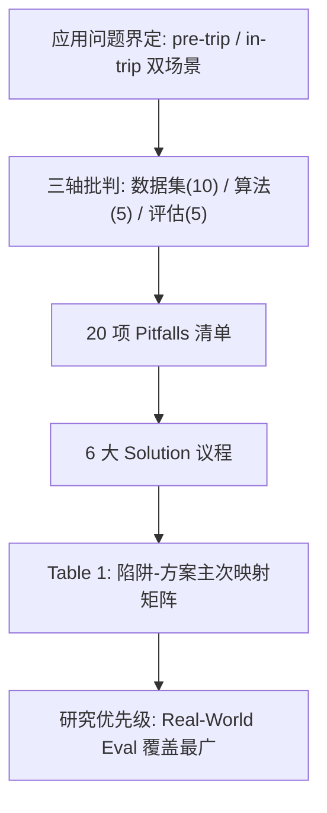

# Point of Interest Recommendation: Pitfalls and Viable Solutions (兴趣点推荐的陷阱与可行解法)

- **会议/期刊**: ACM Transactions on Recommender Systems (TORS) 2026
- **作者与机构**: Alejandro Bellogín (UAM, 西班牙)、Linus W. Dietz (KCL, 英国)、Francesco Ricci (自由博尔扎诺大学, 意大利)、Pablo Sánchez (Comillas 宗座大学 IIT, 西班牙)
- **推荐链路定位**: 全链路（数据采集 → 算法设计 → 离线/在线评估），非单一模块
- **研究方向**: 时空轨迹与 POI 本地生活推荐 / 去偏公平与可信推荐
- **论文原文**: [https://arxiv.org/abs/2507.13725v1](https://arxiv.org/abs/2507.13725v1)
- **开源代码**: 暂未开源（本文为反思/立场论文，无模型实现）

## TL;DR (1分钟核心速览)

本文是一篇**反思型立场论文 (reflection paper)**，而非提出新模型的算法论文。作者指出 POI 推荐虽论文众多，却因 LBSN 数据陈旧稀疏（Foursquare/Gowalla 密度低至 0.003%/0.005%，比 MovieLens20M 的 0.5% 低两个数量级）、算法过度追求 accuracy 且忽视多利益相关方、评估协议缺乏标准化，导致真实落地受阻。论文系统归纳 **20 项陷阱**（数据集 10 项、算法 5 项、评估 5 项），并提出 **6 大研究方向**（多利益相关方设计、上下文感知、数据采集、可信性设计、新型交互、真实世界评估），最后用一张「陷阱-方案」主/次映射表（Table 1）给出可操作的改进路线。核心价值在于为 POI 推荐社区提供**研究议程与最佳实践清单**，而非可复现的数值提升。

## Background & Motivation (背景与核心矛盾)

- **主流范式**: 以 Foursquare/Gowalla/Yelp 等 LBSN 签到数据为训练源，用矩阵分解、GNN、LLM 增强或强化学习做 next-POI 预测，以 Precision/Recall/nDCG 离线排序指标衡量。
- **前人局限一（数据）**: 公开 LBSN 数据集多采集于十年前，POI 已关闭/迁移，且**疫情后无新公开数据集**；签到为自愿行为导致 MNAR 偏差，敏感场所（夜店、医疗）系统性缺失。
- **前人局限二（算法与评估）**: 算法形式化的问题定义与真实旅游决策不匹配（忽略行中实时重规划、群体动态、天气/拥挤度），且 310 篇 POI 论文中仅 13 篇公开代码，可复现性极差。
- **核心洞察 (Key Insight)**: POI 推荐是**高风险 (high-stakes)** 决策——用户投入真实时间与金钱，推荐错误代价远高于音乐/视频；因此"准确率"不足以刻画系统价值，必须引入多利益相关方效用、可持续性与可信性。
- **本文切入点**: 不做增量模型，而是沿「数据—算法—评估」三轴做批判性盘点，并把每个陷阱映射到具体解决方案，形成研究议程。

## Method (核心方法设计)

### 1. 整体框架 (Overall Architecture)

本文无神经网络结构，其"方法"是一套**结构化批判框架**：先界定应用问题（行前规划 pre-trip vs. 行中规划 in-trip，后者受 POI 上下文、用户上下文、外部上下文三类实时因素驱动），再沿数据、算法、评估三轴逐条列出 20 项陷阱，最后提出 6 项解决方案并用 Table 1 建立「陷阱 × 方案」的主（✔✔）/次（✓）映射矩阵，据此排出研究优先级。

### 2. 关键设计拆解 (Key Designs)

1. **陷阱分类学（Pitfall Taxonomy）**：作者将 20 项陷阱按来源分为四组——LBSN 数据 7 项（P1–P7）、用户研究数据 3 项（P8–P10）、算法 5 项（P11–P15）、评估 5 项（P16–P20）。其中最具杀伤力的是 **P3 稀疏性**（密度 0.003% vs. MovieLens 0.5%）与 **P4 MNAR 偏差**（缺失非随机，取决于用户隐私顾虑与平台设计），二者共同使"在不可靠数据上优化 accuracy"（P11）成为伪命题。
2. **多利益相关方与可持续性视角**：论文强调 POI 推荐是 DMO、本地商户、居民、游客多方目标冲突的场景，需通过平衡参数 $\lambda$在用户效用与去中心化曝光间折中，形式化上可写为$\max \; (1-\lambda)\,U_{\text{user}} + \lambda\,U_{\text{provider}}$，其中$U_{\text{provider}}$ 惩罚热门 POI 的过度集中（对应 P13 流行度偏差与 P14 多利益相关方缺失）。
3. **陷阱-方案映射与优先级**：Table 1 显示 **Solution 6（真实世界评估/Living Lab）** 是 6 项陷阱的主解、7 项陷阱的次解，覆盖最广；Solution 2（上下文感知）是唯一不触及任何评估类陷阱的方案，说明上下文建模无法替代评估体系改革。作者据此主张：数据采集改进（Solution 3）虽主要针对数据类陷阱，但会间接缓解 P13 流行度偏差——因为"若数据更真实丰富，算法设计本身就会不同"。

## Experimental Setup & Evaluation Protocol (实验设置与评估协议)

本文为立场论文，**无自建实验**，但其核心贡献恰是对社区评估协议的批判性盘点，故此处记录其"元评估"结论：

- **数据集现状**: 主流 LBSN 数据集（Foursquare、Gowalla、Yelp）密度极低（0.003%–0.005%），远低于 Netflix（>1.5%）与 MovieLens20M（0.5%）；Flickr/YFCC100M 类照片数据存在时间戳与坐标粒度误差；YJMob100K 提供 10 万用户 90 天匿名移动轨迹，是潜在替代源。
- **数据划分与防穿越**: 论文批评现有工作划分方式不统一（随机 vs. 时间、按用户 vs. 全局），易造成数据泄漏（P19），呼吁明确报告划分策略。
- **排名评测协议**: 主流为离线 Precision/Recall/nDCG/Hit Ratio@K，部分工作引入考虑访问顺序的 pairs-F1；论文指出这些指标无法反映探索性、多样性、信任与多利益相关方效用（P16、P19）。
- **对比基线与超参**: 无统一基线；论文统计 2011–2020 年 310 篇 POI 论文中仅 13 篇提供代码（约 4.2%），可复现性严重不足（P20）。

## Key Experimental Results (实验关键数据)

### 1. 主实验对比 (Main Results)

本文无性能主实验表。其"主结果"为 **Table 1 陷阱-方案映射矩阵**的统计汇总，摘录关键计数如下：

| 解决方案 | 作为主解(✔✔)的陷阱数 | 作为次解(✓)的陷阱数 | 覆盖陷阱类别 |
| :--- | :---: | :---: | :--- |
| S1 多利益相关方设计 | 3 (P4, P14, P18) | 5 | 数据/算法/评估 |
| S2 上下文感知 | 3 (P2, P12, P13) | 2 | 仅数据/算法 |
| S3 数据采集 | 4 (P3, P6, P9, P10) | 3 | 数据/算法/评估 |
| S4 可信性设计 | 2 (P15, P16) | 4 | 数据/算法/评估 |
| S5 新型交互 | 1 (P5) | 6 | 数据/算法/评估 |
| **S6 真实世界评估** | **6** | **7** | 数据/算法/评估 |

### 2. 消融实验 (Ablation Study)

无模型消融。可视为"消融"的是论文对**单一方案充分性**的反证分析：

| 假设 | 论文反证结论 |
| :--- | :--- |
| 仅靠上下文感知可解决 POI 推荐问题 | 否，S2 不覆盖任何评估类陷阱（P16–P20） |
| 仅靠更好算法可提升真实效用 | 否，P11 指出在不可靠数据上优化 accuracy 本身失效 |
| 仅靠数据采集可消除流行度偏差 | 部分，P13 根源在数据，但需 S1+S3 协同 |
| 仅靠离线指标可评估系统 | 否，P16/P17 要求信任、可用性、多样性维度 |

### 3. 关键实验发现 (Key Findings)

1. **真实世界评估是最高杠杆点**：S6 作为主解覆盖 6 项陷阱、次解覆盖 7 项，是唯一同时触及数据、算法、评估三类的方案，作者据此将其列为社区最紧迫改进方向。
2. **数据缺陷会反向塑造算法设计**：论文明确指出 P13 流行度偏差"根植于可用数据集的性质"，若数据更真实丰富，算法设计本身就会不同——这意味着纯算法层面的去偏是治标。
3. **可复现性危机量化触目**：310 篇论文仅 13 篇开源（4.2%），且即便开源也常缺预处理细节，使跨论文数值比较基本不可信，这直接削弱了 P19 所批评的"不一致评估策略"的可修复性。

## Highlights & Limitations (亮点、对比与审稿批判)

- **与代表作对比 (vs. Prior Work)**: 相较于 Sánchez & Bellogín 此前的 POI 综述（偏文献计量与分类），本文的增量在于**把批判转化为可执行的方案映射矩阵**；相较于通用推荐去偏综述（如 Chen et al. 的公平性综述），本文的独特性在于将**旅游可持续性与 DMO 政策目标**纳入推荐目标函数，而非仅讨论用户侧公平。
- **可迁移亮点**: (1) 「陷阱-方案主/次映射矩阵」这一组织形式可直接迁移到任何成熟子领域的批判性综述写作；(2) 将 MNAR 偏差与平台交互机制（签到自愿性、隐私自审查）挂钩的分析框架，可迁移至电商评论、社交推荐的数据偏差诊断。
- **审稿级局限批判**: (1) 全文无任何定量实验或原型验证，6 大方案均为方向性倡议，缺乏可操作的基准或最小可行系统示范，落地指导性偏弱；(2) 20 项陷阱的选取依赖作者经验与文献阅读，未说明系统综述方法（如 PRISMA 流程、检索式与纳入排除标准），存在选择性偏差风险；(3) 对 LLM4Rec 在 POI 场景的讨论仅停留在"可缓解幻觉"层面，未深入其推理延迟与位置隐私风险。

## Rating (四维评分)

- **方法创新性 (Novelty)**: ⭐⭐⭐ （无新算法，但「陷阱-方案映射矩阵」的组织范式与多利益相关方目标形式化具有议程设定价值）
- **评估协议与实验扎实度 (Protocol & Experiments)**: ⭐⭐ （无自建实验与统计检验，陷阱选取缺系统综述方法学，但引用的稀疏度/开源率等量化证据扎实）
- **写作与数学规范度 (Clarity & Rigor)**: ⭐⭐⭐⭐ （三轴结构清晰、20 项陷阱编号可追溯、Table 1 映射直观；数学形式化极少，属立场论文合理取舍）
- **工业落地与复现价值 (Industrial & Practical Value)**: ⭐⭐⭐ （对 DMO 与旅游平台的产品设计有直接指导意义，Living Lab 与合成数据建议可操作；但无代码、无基准，短期难以直接复现验证）

