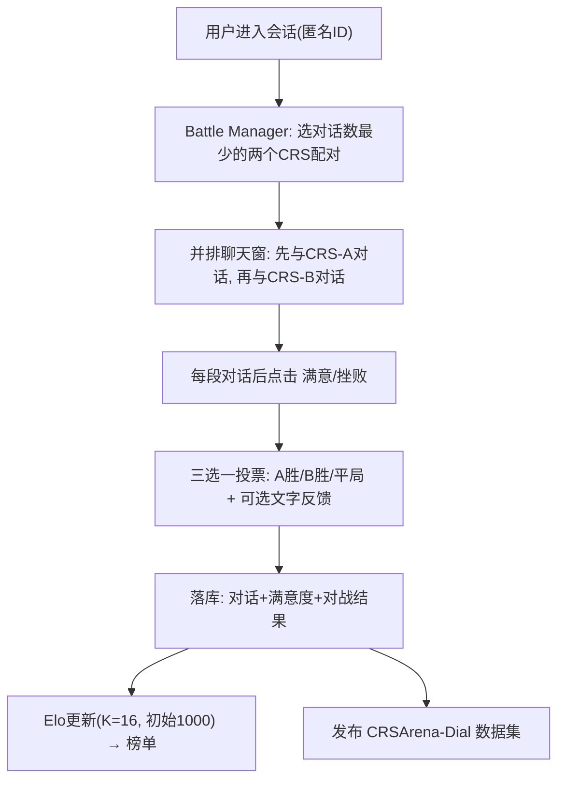

# CRS Arena: Crowdsourced Benchmarking of Conversational Recommender Systems (对话推荐系统的众包对战式基准评测)

- **会议/期刊**: WSDM 2025 (Demo/Resource Track, 4 页短文)
- **作者与机构**: Nolwenn Bernard, Krisztian Balog (University of Stavanger)；Hideaki Joko, Faegheh Hasibi (Radboud University)
- **推荐链路定位**: 端到端对话式推荐系统的**评测环节**（不涉及召回/精排建模，而是构建人评基准与榜单）
- **研究方向**: 对话推荐与智能体仿真 / 去偏公平与工业评测基准
- **论文原文**: [https://arxiv.org/abs/2412.10514v1](https://arxiv.org/abs/2412.10514v1)
- **开源代码**: [https://github.com/iai-group/crsarena-dial](https://github.com/iai-group/crsarena-dial)

## TL;DR (1分钟核心速览)

对话推荐系统（CRS）长期依赖离线指标（如 R@10）或静态语料上的单点评分，既忽视交互本质，又难以横向比较。本文提出 CRS Arena：用户依次与两个匿名 CRS 对话、逐轮给出满意/挫败反馈，最后投票胜负或平局，用 Elo 评级生成榜单。在开放与封闭两种众包环境下收集 474 段真实对话、185 次对战判决，发现两环境 Elo 排名高度相关（$\rho=0.700$），而 Elo 与离线 R@10 呈**负相关**（$\rho=-0.238$），且最佳系统满意度仅约 52%。

## Background & Motivation (背景与核心矛盾)

- **主流范式**: CRS 评测以离线计算指标（推荐召回、回复流畅度）与基于静态对话语料的用户研究为主，工具链如 CRSLab、iEvaLM 提供计算评测，INFACT、CRS-Que 提供用户研究框架。
- **前人局限**: 其一，多数工具包缺乏可交互界面（CRSLab 五个系统中仅一个提供 UI），真实用户难以直接上手；其二，用户研究普遍采用评分量表做**单点（pointwise）打分**，主观性强、跨评估者一致性差，且只考察系统某一侧面而非整体体验。
- **核心洞察 (Key Insight)**: 相对（成对）比较比单点评分更易执行、评估者间一致性更高；而 LLM 领域的 Chatbot Arena 已证明"匿名对战 + Elo"能以众包方式产出可信榜单。CRS 与 LLM 的差异在于：对话彼此独立（无法共享同一 prompt）、且需在每段对话后采集任务成败的显式反馈。
- **本文切入点**: 将 Arena 范式迁移到 CRS，构建可插拔、可公开访问的对战平台，并用开放/封闭两种众包环境验证其排名稳健性。

## Method (核心方法设计)

### 1. 整体框架 (Overall Architecture)

平台以 Streamlit 实现并部署于 HuggingFace Hub，用户进入会话即获匿名 ID。Battle Manager 从 9 个已接入 CRS 中选出**记录对话数最少**的两个（并列时随机）配对，前端并排呈现两个聊天窗口；用户先与系统 A 完整对话、再与系统 B 对话，每段对话结束前必须点击"满意/挫败"按钮（结束后不可回退），随后在"胜/负/平"三选一中投票，并可补充文字反馈。所有对话、逐段满意度与对战结果落库，用于 Elo 更新与数据集发布。系统侧通过继承 iEvaLM 的 CRS 基类、仅实现"给定用户话语生成回复"一个方法即可接入，新系统接入成本极低。

### 2. 关键设计拆解 (Key Designs)

1. **匿名成对对战协议（Pairwise Battle Protocol）**：针对单点评分跨评估者不一致的痛点，将评测转化为相对判断。用户对两个匿名系统各完成一段独立对话后给出胜负/平局判决，第 $i$个系统的新 Elo 为$R_i' = R_i + K\,(S_i - \mathbb{E}[S_i])$，其中$S_i\in\{0,0.5,1\}$为实际得分，$\mathbb{E}[S_i]=1/(1+10^{(R_j-R_i)/400})$为期望胜率，$K=16$、初始$R=1000$。相对判断降低了认知负担，Elo 则把稀疏对战聚合成全局可比标量。
2. **双通道反馈采集（Battle Outcome + Per-Conversation Satisfaction）**：仅靠胜负信号过于稀疏（474 段对话仅 185 次判决），因此在每段对话结束前强制采集"满意/挫败"二元标签，形成与对战结果互补的第一方反馈。该设计使满意度可与 Elo 做交叉验证（实测 Spearman $\rho=0.917$），也为失败归因（不理解请求、重复回复、信息缺失、延迟）提供原始素材。
3. **训练目标、负采样与推理效率**：本文无模型训练，故无损失函数与负采样；核心"计算开销"在于 Elo 在线更新（$O(1)$/场）与平台推理延迟。平台仅 2 CPU 核 / 16 GB 内存，部分模型（尤其 LLM 类）响应延迟明显，作者明确指出延迟本身会污染用户体验评分——这是该评测范式必须正视的系统性偏差。

## Experimental Setup & Evaluation Protocol (实验设置与评估协议)

- **数据集与预处理**: 本文产出而非消费数据集，故无 5-core 过滤；两环境统计如下：

| 环境 | #Conversations | #Votes | 采集条件 | 说明 |
| :--- | :---: | :---: | :---: | :--- |
| Open（公开） | 254 | 81 | 公开访问约 10 天 | 不做任何质量过滤，保留原始噪声 |
| Closed（封闭） | 220 | 104 | Prolific 英语国家工人，通过率 100%、历史提交 ≥1000，约 7 小时 | 强制每系统 ≥5 轮交互，单场约 9 分钟、成本约 £1.33 |
| 合计 CRSArena-Dial | 474 | 185 | — | 9 个 CRS，对话数分布较均匀 |

- **数据划分与防穿越 (Splitting Strategy)**: 不适用（无监督学习任务）；但需注意开放环境数据为**自然流入**、封闭环境为**限时集中采集**，二者非同一时间窗，跨环境比较存在人群与时段混杂。
- **排名评测协议 (Ranking Protocol)**: 采用**成对偏好 + Elo 全序排名**，而非 Full-Ranking 或 Sampled Ranking；同时以逐对话满意度（% sat.）作为辅助点式指标，并用 Spearman/Pearson 相关检验排名一致性。
- **对比基线与超参设置**: 9 个系统 = {KBRD, BARCOR, UniCRS, ChatGPT, CRB-CRS} × {OpenDialKG, ReDial} 知识源组合（CRB-CRS 仅 ReDial）；Elo 超参 $K=16$、初始 1000；外部参照为 Wang et al. 报告的离线 R@10。

## Key Experimental Results (实验关键数据)

### 1. 主实验对比 (Main Results)

下表摘取 9 个系统中 6 个代表性系统的合并（Closed & Open）Elo、满意度与离线 R@10：

| CRS | Elo (合并) | % sat. | R@10 (排名) |
| :--- | :---: | :---: | :---: |
| **ChatGPT_OpenDialKG** | **1102 (1)** | **52.3** | 0.539 (1) |
| **ChatGPT_ReDial** | **1102 (1)** | 45.3 | 0.174 (6) |
| BARCOR_ReDial | 1077 (3) | 29.8 | 0.170 (7) |
| KBRD_ReDial | 994 (4) | 8.1 | 0.169 (8) |
| BARCOR_OpenDialKG | 988 (5) | 14.5 | 0.453 (3) |
| UniCRS_OpenDialKG | 937 (7) | 4.8 | 0.513 (2) |
| KBRD_OpenDialKG | 920 (9) | 1.7 | 0.423 (4) |

关键相关性：Elo 与满意度 $\rho=0.917$（强正相关）；Elo 与 R@10$\rho=-0.238$（**负相关**）；开放 vs. 封闭环境 Elo 的$r=0.763$、$\rho=0.700$，满意度的$r=0.843$、$\rho=0.726$。

### 2. 消融实验 (Ablation Study)

本文为资源/平台论文，无组件消融，其"消融"等价物是**环境与人群的稳健性对照**：

| 对照维度 | Open | Closed | 一致性 |
| :--- | :---: | :---: | :---: |
| #Utterances / dialogue | 8.13 | 11.15 | 封闭略长（强制 ≥5 轮所致） |
| #Words / utterance | 11.01 | 11.59 | 高度接近 |
| Diversity (Distinct-2) | 0.527 | 0.538 | 高度接近 |
| Elo 排名相关 | — | — | Pearson $r=0.763$/ Spearman$\rho=0.700$ |
| 满意度相关 | — | — | Pearson $r=0.843$/ Spearman$\rho=0.726$ |

### 3. 关键实验发现 (Key Findings)

1. **离线召回无法代理用户体验**：R@10 排名第 2 的 UniCRS_OpenDialKG（0.513）在 Elo 上仅列第 7（937）、满意度 4.8%；而 R@10 仅 0.174 的 ChatGPT_ReDial 却与榜首并列 1102。$\rho=-0.238$ 说明"推荐得准"与"用户聊得爽"是两条近乎正交的轴，单一离线指标会系统性误导模型选型。
2. **天花板极低，交互质量是主要瓶颈**：即便最优系统也只在约一半对话中令用户满意（52.3%），KBRD_OpenDialKG 低至 1.7%；作者归因于不理解请求导致无关推荐、回复重复、信息缺失与延迟，说明当前 CRS 的失败主要发生在**语言理解与对话管理**而非推荐打分环节。
3. **众包环境可替代且更可扩展**：开放与封闭两套人群在 Elo（$\rho=0.700$）与满意度（$\rho=0.726$）上排名高度一致，对话长度/词数/多样性三项统计几乎重合，证明约 7 小时、单场 £1.33 的封闭众包即可快速产出与公开环境同序的榜单，为新系统上线提供了低成本快评通道。

## Highlights & Limitations (亮点、对比与审稿批判)

- **与代表作对比 (vs. Prior Work)**: 相比 CRSLab / iEvaLM 等**计算评测**工具，本文提供真实用户可交互的 UI 与第一方反馈；相比 INFACT / CRS-Que 等**用户研究**框架，本文用成对比较替代评分量表，规避了跨评估者一致性问题；相比 Chatbot Arena，本文的关键差异在于对话彼此独立（不能共享 prompt）且额外采集任务成败的显式满意度，因而不能直接复用其 Bradley-Terry 式同 prompt 假设。
- **可迁移亮点**: ①"最少对战数优先"的配对策略是一种轻量负载均衡，可直接迁移到任何多模型 A/B 对战平台以保证比较图的连通性与均匀性；②用"Elo vs. 离线指标"的秩相关作为**评测效度诊断工具**，可推广到召回/精排榜单的离线-在线一致性审计。
- **审稿级局限批判**: 其一，规模与统计功效不足——仅 185 次判决支撑 9 个系统排名，Elo 置信区间未报告，且 $K=16$ 与初始 1000 的敏感性未做分析，榜单只能称"preliminary"；其二，平台部署在 2 核 CPU 上导致部分 LLM 系统高延迟，而延迟会直接压低满意度评分，构成**与系统质量无关的混杂偏差**，同时开放环境无质量过滤、封闭环境存在工人为收益最大化而敷衍交互的风险，二者都会污染偏好信号。

## Rating (四维评分)

- **方法创新性 (Novelty)**: ⭐⭐⭐ （将 Arena 范式首次系统迁移到 CRS 并针对"对话独立 + 任务成败反馈"做适配，思路清晰但属范式移植而非算法创新）
- **评估协议与实验扎实度 (Protocol & Experiments)**: ⭐⭐⭐ （双环境交叉验证与 Elo–满意度–R@10 三重相关性分析颇具说服力，但 185 次判决、无置信区间与超参敏感性分析使结论强度受限）
- **写作与数学规范度 (Clarity & Rigor)**: ⭐⭐⭐⭐ （4 页短文结构紧凑，Elo 公式与相关性系数交代明确，平台组件与 UI 流程描述清楚，仅缺 Elo 不确定性的形式化讨论）
- **工业落地与复现价值 (Industrial & Practical Value)**: ⭐⭐⭐⭐⭐ （平台公开可访问、代码与 474 段对话数据集全开源、新系统仅需实现一个方法即可接入，对 CRS 社区具有直接可用的基准价值）

