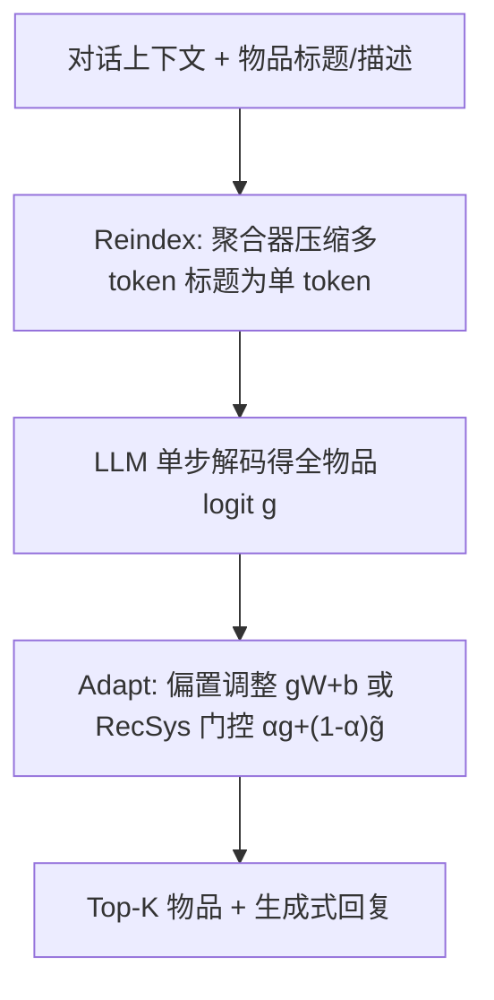

# Reindex-Then-Adapt: Improving Large Language Models for Conversational Recommendation (先重索引再适配：提升大语言模型对话推荐能力)

- **会议/期刊**: WSDM 2025
- **作者与机构**: Zhankui He, Zhouhang Xie, Harald Steck, Dawen Liang, Rahul Jha, Nathan Kallus, Julian McAuley (UC San Diego / Netflix / Cornell)
- **推荐链路定位**: 端到端生成式（对话推荐场景的召回+排序）
- **研究方向**: 对话推荐与智能体仿真 / 生成式推荐与离散语义 ID
- **论文原文**: [论文原文链接](https://arxiv.org/abs/2405.12119v1)
- **开源代码**: [FastChat](https://github.com/lm-sys/FastChat)（仅对话模板依赖，RTA 主体未开源）

## TL;DR (1分钟核心速览)

LLM 做对话推荐时把电影标题当作多 token 自回归生成，导致无法像传统 RecSys 那样拿到全物品 logit 向量、无法对齐目标平台快速变化的流行度分布。本文提出 RTA：先把多 token 标题"挤压"成单 token（Reindex），再对单 token logit 做偏置调整或与传统 RecSys 门控融合（Adapt）。在 INSPIRED/ReDIAL/Reddit-V1.5 三个数据集上，Llama2-7b 的 H@10 相对提升 59.37%，超越全部开源基线。

## Background & Motivation (背景与核心矛盾)

- **主流范式**: 以 LLM-as-CRS（He et al., 2023）为代表，用零样本提示让 LLM 直接生成 top-K 电影标题列表；LLM 被视作可微搜索索引（DSI）模型，预训练语料已完成 L2I（内容→标题）与 L2R（对话→标题）任务。
- **前人局限**: (1) **静态错位**——LLM 参数中的流行度来自大规模语料，与目标平台不一致（《黑暗骑士》在 ReDIAL 热门但 LLM 不认，《黑豹》反之）；(2) **动态错位**——Reddit-Movie 上物品月相对流行度随时间剧烈漂移，静态 LLM 即便微调也追不上。
- **核心洞察 (Key Insight)**: 多 token 标题使"对全部物品打分"退化为"自回归生成若干标题"，既拿不到完整 logit 向量，也无法施加传统 RecSys 的分布控制手段；而单 token 化后，一次解码即可得到全物品分布。
- **本文切入点**: 把 LLM 当 DSI 模型，先重索引再适配，兼得 LLM 的上下文理解与传统 RecSys 的分布可控性。

## Method (核心方法设计)

### 1. 整体框架 (Overall Architecture)

输入为对话上下文，经 Llama2-7b 编码后取末位上下文嵌入 $q$；Reindex 步用可训练聚合器把每个多 token 标题的 token 嵌入压成单 token 嵌入$\tilde{v}$，并以对比损失对齐$q$与$\tilde{v}$，使 LLM 一步解码即得全物品 logit 向量$g\in\mathbb{R}^{|\mathcal{I}|}$；Adapt 步在$g$上做对角仿射偏置或与传统 RecSys logit$\tilde{g}$ 门控融合，仅训练少量新增参数，LLM 权重冻结。推理时单步解码排序全部物品，再接生成阶段产出自然语言回复。

### 2. 关键设计拆解 (Key Designs)

1. **Reindex 步（单 token 物品索引）**：痛点是从多 token 标题拿全物品分布代价高。对标题 token 序列 $(v_i)_{j+n}^{i=j}$用聚合器（GRU/Transformer/加权池化）压缩为$\tilde{v}=\mathrm{Aggregator}((v_i)_{j+n}^{i=j})$，并以对比损失训练：
$$\mathcal{L}_{\text{reindex}}=-\frac{1}{|\mathcal{D}|}\sum_{q,\tilde{v}\in\mathcal{D}}\log\frac{\exp(q^\top\tilde{v})}{\exp(q^\top\tilde{v})+\sum_{n\in\mathcal{N}}\exp(q^\top n)}$$
其中 $q$为 LLM 末位上下文嵌入，负样本$n$来自负表示集$\mathcal{N}$，训练语料混合 L2R（对话）与 L2I（维基描述）样本（约 98:2）。直觉：复用 LLM 已索引的 token 嵌入语义，比随机初始化 OOV 嵌入更省参数且跨数据集可迁移。

2. **Adapt 步（分布适配）**：痛点是无从调整生成式推荐的物品分布。给出两种算子：(a) 对角仿射偏置 $\hat{p}=\mathrm{softmax}(gW+b)$，$W$限制为对角以避免$|\mathcal{I}|^2$参数爆炸，$W$、$b$分别解释为乘性/加性流行度偏置；(b) RecSys 门控$\hat{p}=\mathrm{softmax}(\alpha g+(1-\alpha)\tilde{g})$，$\alpha=\mathrm{sigmoid}(\tilde{\alpha})$ 为可学习标量，融合 LLM 的内容/上下文知识与传统 RecSys 的协同知识。

3. **训练目标、负采样与推理效率**：Adapt 步用最大似然 $\mathcal{L}_{\text{adapt}}=-\frac{1}{|\mathcal{D}^*|}\sum_i\log\hat{p}_{i,*}$，LLM 参数不参与更新。聚合器比 OOV 嵌入表小约 10 倍、比 Llama2-7b 小约 233 倍；单步解码排序比生成式 top-20 检索快约 100 倍。

## Experimental Setup & Evaluation Protocol (实验设置与评估协议)

- **数据集与预处理**:

| 数据集 | #Conv. | #Turns | #R Turns | #Users | #Items | 特征/场景说明 |
| :--- | :---: | :---: | :---: | :---: | :---: | :--- |
| INSPIRED | 999 | 21,124 | 1,950 | 999 | 1,472 | MTurk 人-人对话，无用户历史 |
| ReDIAL | 11,348 | 139,557 | 30,322 | 764 | 6,281 | MTurk 电影推荐对话 |
| Reddit-V1.5 | 2,726,471 | 5,063,007 | 1,787,050 | 520,913 | 68,285 | Reddit 真实长程对话，含 10 年时间戳 |

ReDIAL 物品长尾极重：冷物品（出现 <10 次）占 78.97% 物品数但仅 18.03% 出现次数；热门物品（≥100 次）仅 2.04% 物品数却占 34.04% 出现次数。

- **数据划分与防穿越 (Splitting Strategy)**: INSPIRED/ReDIAL 按 8:1:1 随机划分；Reddit-V1.5 用最后两个月做验证/测试（2022-11 验证、2022-12 测试），并对验证/测试各均匀采样 20% 轮次（11,241 / 13,816 样本），近似真实时序部署。
- **排名评测协议 (Ranking Protocol)**: 遵循 He et al. (2023) 的修正协议，去除"重复推荐"物品；指标为 HIT@K 与 NDCG@K（K=5,10），报告均值与标准误。LLM 基线用模糊匹配把生成标题映射回数据集物品 ID。
- **对比基线与超参设置**: 四组基线——传统 RecSys（Popularity、FISM、SASRec）、CRS 模型（ReDIAL、UniCRS）、稠密检索（SBERT、Instructor）、零样本 LLM（MPT-7b、Mistral-7b、Llama2-7b，另讨论 GPT-3.5-t）。批大小 256，学习率搜索 $\{10^{-3},10^{-4},10^{-5}\}$，权重衰减$\{0,10^{-6},10^{-4},10^{-2},1\}$，训练 200 epoch 按验证集 H@10 选模；FISM/SASRec 嵌入维度 64，SASRec 2 层 2 头；GRU 聚合器隐藏维 1024、双向单层。

## Key Experimental Results (实验关键数据)

### 1. 主实验对比 (Main Results)

Llama2-R 为仅做 Reindex 的版本，+Bias / +RecSys 为两种 Adapt 方式（H@10 / N@10）：

| 模型 | INSPIRED H@10 | INSPIRED N@10 | ReDIAL H@10 | ReDIAL N@10 | Reddit H@10 | Reddit N@10 |
| :--- | :---: | :---: | :---: | :---: | :---: | :---: |
| Popularity | .065 | .015 | .070 | .015 | .014 | .006 |
| FISM | .045 | .012 | .065 | .004 | .043 | .019 |
| SASRec | .037 | .010 | .068 | .004 | .039 | .018 |
| UniCRS | .055 | .011 | .085 | .003 | .040 | .021 |
| SBERT | .026 | .010 | .016 | .002 | .005 | .002 |
| Instructor | .034 | .011 | .025 | .002 | .017 | .008 |
| Llama2 (zero-shot) | .050 | .012 | .094 | .004 | .064 | .034 |
| Llama2-R | .041 | .011 | .071 | .004 | .093 | .047 |
| **+Bias** | **.066** | **.014** | .083 | .004 | .096 | .049 |
| **+RecSys** | .052 | .013 | **.094** | **.004** | **.101** | **.051** |
| Improv. (vs Llama2) | +32.0% | +16.7% | 持平 | 持平 | **+57.8%** | **+50.0%** |

注：原文摘要所述"Llama2-7b Top-10 Hit Rate 提升 59.37%"对应 Reddit-V1.5 上 H@10 从 .064 到 .101 的相对增益。

### 2. 消融实验 (Ablation Study)

| 配置 | INSPIRED H@10 | ReDIAL H@10 | Reddit H@10 |
| :--- | :---: | :---: | :---: |
| Llama2-R | .041 | .071 | .093 |
| Cont.（持续训练） | .081 | .124 | .093 |
| +Bias w/ $gW$ | .081 | .123 | .093 |
| +Bias w/ $b$ | .053 | .118 | .096 |
| +Bias w/ $gW+b$ | **.083** | .123 | .096 |
| +RecSys FISM | **.083** | .139 | .101 |
| +RecSys SASRec | .076 | **.146** | .101 |

### 3. 关键实验发现 (Key Findings)

1. **Reindex 单独会掉点，Adapt 才是收益来源**：Llama2-R 在 INSPIRED 上 H@10 从 .050 跌至 .041（小聚合器引入语义鸿沟），但 +Bias 后回升至 .066，说明单 token 化的价值在于"打开可调接口"而非直接提精度。
2. **数据规模决定 Adapt 策略**：小数据集 INSPIRED 上 +Bias（.083）优于 +RecSys（.076），因点式流行度学习参数少不易过拟合；大数据集 ReDIAL 上 +RecSys SASRec（.146）反超 +Bias（.123），因有足够样本学物品-物品协同关系。
3. **聚合器优于 OOV 嵌入且可跨数据集共享**：加权池化聚合器在三个数据集上均优于随机初始化 OOV 嵌入，尽管 Reddit 占 96% 训练样本，混合数据训练的聚合器仍优于数据集专属嵌入，验证了复用 LLM 已有 token 语义的有效性。

## Highlights & Limitations (亮点、对比与审稿批判)

- **与代表作对比 (vs. Prior Work)**: 相比 He et al. (2023) 的零样本 LLM-as-CRS，本文首次显式诊断并修复分布错位；相比 UniCRS 等 PLM 微调 CRS，本文冻结 LLM 仅训极小适配参数；相比 DSI 原始索引，Reindex 复用已索引内容而非从零学索引，收敛更快。
- **可迁移亮点**: (1) "多 token 压单 token + 轻量 logit 适配"可迁移到任何生成式推荐的分布校准（如语义 ID 生成式检索的流行度去偏）；(2) 按数据规模在偏置与门控间切换的调度策略，可直接用于线上冷启动/热更新场景。
- **审稿级局限批判**: (1) 仅验证 7B 开源模型，GPT-3.5-t 在 ReDIAL 上 H@10 仍达 .163 高于本文 .131，大模型上收益是否保持未知；(2) 聚合器训练混合 L2R/L2I 比例固定 98:2 未调优，且 Reindex 本身掉点依赖 Adapt 补偿，端到端鲁棒性存疑。

## Rating (四维评分)

- **方法创新性 (Novelty)**: ⭐⭐⭐⭐ （把 DSI 视角引入 CRS 分布错位问题，单 token 化打开传统 RecSys 控制接口的思路简洁有力）
- **评估协议与实验扎实度 (Protocol & Experiments)**: ⭐⭐⭐⭐ （三数据集含真实时序 Reddit-V1.5，四组基线齐全，但缺显著性检验与更大模型验证）
- **写作与数学规范度 (Clarity & Rigor)**: ⭐⭐⭐⭐ （公式简洁、动机图清晰，但主表排版密集、部分标准误标注可读性差）
- **工业落地与复现价值 (Industrial & Practical Value)**: ⭐⭐⭐⭐ （参数增量极小、推理快 100 倍，适配线上分布漂移场景；但 RTA 主体代码未开源，复现需自行实现聚合器）

