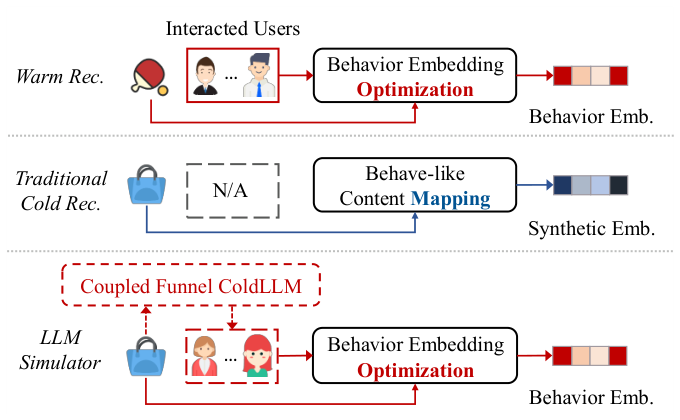
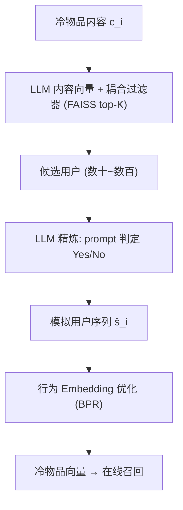
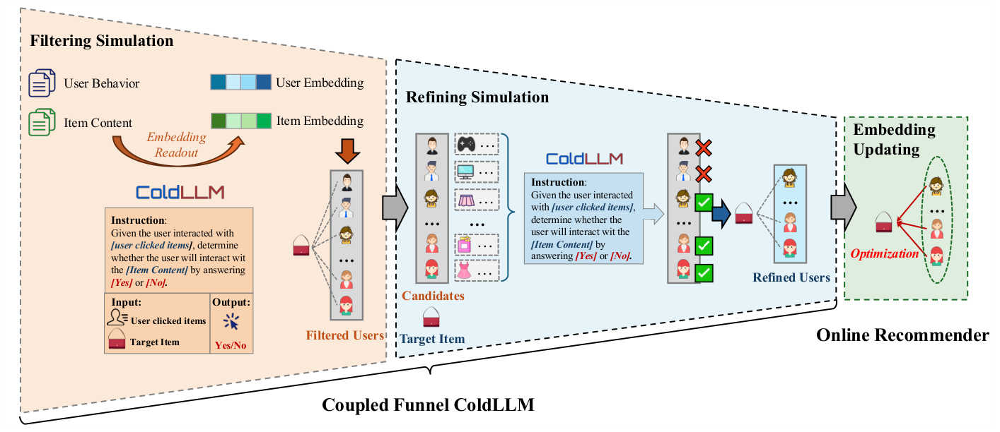

# Large Language Model Simulator for Cold-Start Recommendation (面向冷启动推荐的大语言模型模拟器)

- **会议/期刊**: WSDM 2025
- **作者与机构**: Feiran Huang, Yuanchen Bei, Zhenghang Yang, Junyi Jiang, Hao Chen, Qijie Shen, Senzhang Wang, Fakhri Karray, Philip S. Yu（暨南大学、浙江大学、澳门城市大学、阿里巴巴、中南大学、MBZUAI、UIC）
- **推荐链路定位**: 召回（冷物品 Embedding 生成与行为模拟）
- **研究方向**: 冷启动与长尾推荐 / 大语言模型推荐
- **论文原文**: [https://arxiv.org/abs/2402.09176v2](https://arxiv.org/abs/2402.09176v2)
- **开源代码**: [https://github.com/js05212/citeulike-a](https://github.com/js05212/citeulike-a)（仅数据集仓库，模型代码暂未开源）

## TL;DR (1分钟核心速览)

本文直击严格冷启动的**根本矛盾**：冷物品没有任何行为数据，而现有方法（DropoutNet/CLCRec/ALDI 等）只是用内容特征"合成"一个行为 Embedding，天然存在 content-behavior gap。作者提出 **LLM Simulator** 范式——让 LLM 直接"模拟"哪些用户会与冷物品交互，把冷物品转化为暖物品再做行为 Embedding 优化；为控制十亿级用户遍历的开销，设计**耦合漏斗 ColdLLM**（FAISS 过滤 + LLM 精炼）。在 CiteULike/MovieLens 的 Full-Ranking 协议下，冷物品 NDCG 相对 LightGCN+ALDI 提升 36%–38%，两周线上 A/B 冷启 GMV 相对 ALDI +16.90%。

## Background & Motivation (背景与核心矛盾)

- **主流范式**: 冷启动推荐主流是"Embedding 模拟"——用内容特征经映射/生成/对抗/蒸馏得到合成行为向量（DeepMusic、GAR、ALDI），或用 dropout 式共训练（DropoutNet、CLCRec）对齐合成向量与真实行为向量。
- **前人局限**: ① **Content-behavior gap**：合成向量终究源自内容，与真实交互学到的行为向量分布不一致；② **冷热混推污染**：把内容向量与行为向量塞进同一 Embedding 层混推，反而拖累暖物品效果（表 1 中 DeepMusic 等在暖物品上明显掉点）；③ 少数"交互模拟"工作（UCC、MI-GCN）仅用 DNN 从内容生成交互，缺乏世界知识，冷物品上表现极差（UCC 冷 Recall 仅 0.0020）。
- **核心洞察 (Key Insight)**: 冷启动的本质不是"缺 Embedding"，而是"缺行为"。若能**凭空造出可信的用户-物品交互**，冷物品即可复用成熟的暖物品 Embedding 优化流程，从根上消除 gap。
- **本文切入点**: 用 LLM 的世界知识做"用户意图模拟器"，再用**漏斗式级联**把 LLM 的调用量从十亿级压到百级，使方案在工业规模可行。

<figure class="paper-figure" markdown="span">
  <figcaption>图1：传统物品冷启动模型与我们的ColdLLM之间的比较。</figcaption>
</figure>

## Method (核心方法设计)

### 1. 整体框架 (Overall Architecture)

输入冷物品内容 $\boldsymbol{c}_i$，先经**过滤模拟**：用 LLM 末层 token 均值池化得到内容向量，与用户行为向量做内积，FAISS 近似检索出 top-$K$候选用户（十亿 → 数十/数百）；再经**精炼模拟**：对每个候选用户构造"历史点击 + 目标物品"的 prompt，由 LoRA 微调的 LLaMA-7B 输出 Yes/No，仅保留 Yes 用户构成模拟序列$\hat{\boldsymbol{s}}_i$；最后把$\hat{\boldsymbol{s}}_i$ 送入既有行为 Embedding 优化器（BPR/LightGCN 等）更新冷物品向量，供下游召回使用。线上仅更新冷物品 Embedding，不污染用户与暖物品向量。

<figure class="paper-figure" markdown="span">
  <figcaption>图2：所提出的ColdLLM的整体模型架构。</figcaption>
</figure>

### 2. 关键设计拆解 (Key Designs)

1. **行为模拟替代 Embedding 模拟（范式级改动）**：痛点是用映射函数逼近行为向量必然有 gap。本文改为 $\hat{\boldsymbol{s}}_i = \mathrm{ColdLLM}(\boldsymbol{c}_i, \mathcal{U}, \mathcal{H}, \mathcal{C})$，冷物品经模拟后等价于暖物品，再走$\boldsymbol{e}_i^{(c)} = \mathrm{Emb_{opt}}(\boldsymbol{c}_i, \hat{\boldsymbol{s}}_i, \boldsymbol{E})$。直觉：Embedding 由真实优化器产出而非"猜"出来，分布天然对齐。

2. **耦合漏斗过滤（把 LLM 从 O(|U|) 降到 O(1)）**：直接用 LLM 遍历十亿用户不可行。过滤打分 $\hat{Y}_{ui}^{(L)} = \boldsymbol{F}_U^{(L)}(\boldsymbol{e}_u)^\top \boldsymbol{F}_I^{(L)}(\mathrm{LLM_{emb}}(\boldsymbol{c}_i))$，其中物品侧用 LLM 内容向量（补足纯 ID 向量缺失的内容意图），并用 **coupled loss** 让过滤器蒸馏 LLM 的 Yes/No 判定：
$$\mathcal{L}_{coupled} = -\sum_{(u,i)} \left[ \hat{Z}_{ui}\ln\hat{Y}_{ui}^{(L)} + (1-\hat{Z}_{ui})\ln(1-\hat{Y}_{ui}^{(L)}) \right]$$
配合 BPR 损失 $\mathcal{L}_{BPR}$ 与 ALDI 对齐损失联合训练。直觉：过滤器学的是"LLM 会怎么判"，因此过滤后候选的 LLM 采纳率从随机 8.18% 提升到 85.96%。

3. **上下文裁剪与训练策略**：用户历史过长且与目标物品无关，用 $\boldsymbol{C}_u^{(f)} = \mathrm{Top}_L\{\boldsymbol{f}_i^\top \boldsymbol{f}_j \mid \forall j \in \boldsymbol{C}_u\}$只保留 top-$L$相关历史，压缩 prompt 长度。LLM 用 LoRA（$W' = W + BA$，作用于 Q/K/V 与 FFN）微调；正负样本按 1:1 采样正-负、1:1 采样正-未观测，缓解线上 70%–90% 负反馈的极度不平衡。推理侧：过滤约 60 ms，精炼每对 200–400 ms、总计 <8 s，Embedding 更新 120 ms；3 台 8×A100 每小时可处理 8,640 个冷物品。

## Experimental Setup & Evaluation Protocol (实验设置与评估协议)

- **数据集与预处理**:

| 数据集 | #Users | #Items | #Interactions | 稀疏度/密度 | 特征/场景说明 |
| :--- | :---: | :---: | :---: | :---: | :--- |
| CiteULike | 5,551 | 16,980 | 204,986 | 0.22% | 学术文章推荐，含文本内容特征 |
| MovieLens | 6,040 | 3,883 | 1,000,210 | 4.26% | 电影推荐，含类型/简介特征 |

- **数据划分与防穿越 (Splitting Strategy)**: 沿用 ALDI 设定，随机取 **20% 物品作为冷物品**（其交互切成冷验证/冷测试 1:1）；剩余 80% 暖物品交互按 **8:1:1 比例划分**训练/验证/测试。属"物品级冷启动划分"，冷物品在训练期完全不可见。
- **排名评测协议 (Ranking Protocol)**: 无偏 **Full-Ranking**（全库未交互物品排序），测试时随机抽 2,000 用户评估，指标 Recall@20 / NDCG@20，分别报告 Overall / Cold / Warm 三档。
- **对比基线与超参设置**: 10 个基线分三类——dropout 类（DropoutNet、MTPR、CLCRec）、生成类（DeepMusic、MetaEmb、GNP、GAR、ALDI）、行为模拟类（UCC、MI-GCN）；统一挂在 MF / NGCF / LightGCN 三种骨干上。Embedding 维度 $d=200$，过滤阶段 AdamW lr=$1\times10^{-5}$、batch=128、top-$K$=20；精炼阶段 lr=$5\times10^{-5}$；Embedding 更新 Adam lr=$1\times10^{-3}$，按验证集 NDCG 早停。

## Key Experimental Results (实验关键数据)

### 1. 主实验对比 (Main Results)

以最强骨干 LightGCN 为例（Recall/NDCG @20，加粗为最优）：

| 方法 | CiteULike Overall R/N | CiteULike Cold R/N | CiteULike Warm R/N | MovieLens Cold R/N |
| :--- | :---: | :---: | :---: | :---: |
| DropoutNet | 0.0883 / 0.0639 | 0.2309 / 0.1312 | 0.1175 / 0.0692 | 0.0340 / 0.0373 |
| CLCRec | 0.1293 / 0.0965 | 0.2435 / 0.1425 | 0.2149 / 0.1302 | 0.0677 / 0.0816 |
| DeepMusic | 0.0985 / 0.0745 | 0.2239 / 0.1259 | 0.2528 / 0.1541 | 0.0635 / 0.0719 |
| GNP | 0.1609 / 0.1197 | 0.2606 / 0.1532 | 0.2528 / 0.1541 | 0.0771 / 0.0760 |
| ALDI | 0.1626 / 0.1201 | 0.2692 / 0.1539 | 0.2528 / 0.1541 | 0.1229 / 0.1295 |
| UCC | 0.1374 / 0.1260 | 0.0020 / 0.0011 | 0.3002 / 0.2010 | 0.0063 / 0.0073 |
| MI-GCN | 0.1557 / 0.1483 | 0.0507 / 0.0262 | 0.3372 / 0.2362 | 0.0307 / 0.0312 |
| **ColdLLM** | **0.2285 / 0.1747** | **0.3601 / 0.2126** | **0.3252 / 0.2156** | **0.1759 / 0.1762** |
| Improv. (vs 次优) | +40.52% / +17.80% | +33.76% / +38.14% | — / — | +43.12% / +36.06% |

跨三骨干平均：Overall NDCG +10.79%、Cold NDCG **+37.10%**（相对 LightGCN 骨干下的最优基线）。

### 2. 消融实验 (Ablation Study)

| 变体 | Overall Recall | Cold Recall | Cold NDCG | 说明 |
| :--- | :---: | :---: | :---: | :--- |
| w/o (LSF & R) | 最低 | 最低 | 最低 | 去掉 LLM 过滤与精炼，退化为纯行为过滤 |
| w/o (BF & R) | 次低 | 次低 | 次低 | 去掉行为过滤与精炼 |
| w/o LSF | 中 | 中 | 中 | 仅去 LLM 耦合过滤，掉点最明显 |
| w/o BF | 中 | 中 | 中 | 仅去行为过滤 |
| w/o R | 较高 | 较高 | 较高 | 仅去精炼阶段 |
| **ColdLLM** | **0.2285** | **0.3601** | **0.2126** | 完整模型 |

过滤策略采纳率（LLM 判 Yes 的比例）：Random 8.18% → w/o LSF 80.45% → w/o BF 81.33% → **ColdLLM 85.96%**。

### 3. 关键实验发现 (Key Findings)

1. **LLM 过滤是漏斗的"质量阀门"**：去掉 LSF 的掉点大于去掉 BF，且采纳率从 85.96% 跌至 80.45%，说明 LLM 内容向量带来的世界知识是候选质量的主因，而非单纯的向量检索。
2. **精炼阶段不可省但可叠加**：`w/o R` 掉点小于 `w/o (LSF & R)`，表明过滤与精炼是互补而非冗余——过滤负责"广度召回"，精炼负责"精度裁决"，二者级联才把冷 NDCG 推到 0.2126。
3. **$K$存在冷热权衡**：CiteULike 上 Overall/Warm 在$K=10$最优，Cold 在$K=50$最优，$K$ 过大则引入无关交互噪声；线上 A/B 中 ColdLLM 相对 ALDI 仍取得 Cold-PV +7.25%、Cold-PCTR +3.70%、**Cold-GMV +16.90%**，验证了模拟交互对商业指标的实质拉动。

## Highlights & Limitations (亮点、对比与审稿批判)

- **与代表作对比 (vs. Prior Work)**: 与 ALDI（知识蒸馏对齐合成向量）相比，本文不再"逼近"行为向量而是"生成"行为本身，从范式上绕开 content-behavior gap；与 UCC/MI-GCN（DNN 生成交互）相比，LLM 的世界知识使冷 Recall 从 0.0020/0.0507 跃至 0.3601，量级差异说明"模拟质量"才是瓶颈；与 TALLRec 等 LLM4Rec 相比，本文不把 LLM 当排序器，而是当**数据生成器**，规避了 LLM 在线延迟问题。
- **可迁移亮点**: ① "LLM 蒸馏进轻量过滤器"的 coupled loss 可直接迁移到任何需要 LLM 参与但受延迟约束的召回场景；② 用物品向量做用户历史 top-$L$ 裁剪，是压缩长 prompt 的通用低成本技巧。
- **审稿级局限批判**: ① 精炼阶段每对 200–400 ms、单机每小时仅 8,640 冷物品，冷物品洪峰期（如大促上新）仍是吞吐瓶颈，且依赖 3 台 8×A100 的算力门槛；② 离线仅两个中等规模数据集、冷物品按随机 20% 划分，未考察"内容特征缺失/多模态冷物品"与"冷用户+冷物品双冷"场景，LLM 模拟的鲁棒性证据不足；③ Yes/No 二值判定丢弃了交互强度信息，作者亦承认连续打分是未来工作。

## Rating (四维评分)

- **方法创新性 (Novelty)**: ⭐⭐⭐⭐ （"行为模拟替代 Embedding 模拟"是范式级重构，耦合漏斗的蒸馏式过滤器设计巧妙，但 LLM 模拟交互的思想在 UCC 等工作中已有雏形）
- **评估协议与实验扎实度 (Protocol & Experiments)**: ⭐⭐⭐⭐ （三骨干 × 十基线 × Full-Ranking + 两周线上 A/B 相当完整，但仅两数据集、缺显著性检验与双冷场景）
- **写作与数学规范度 (Clarity & Rigor)**: ⭐⭐⭐⭐ （公式简洁、漏斗复杂度分析清晰，但部分符号（如 $\boldsymbol{F}_U^{(L)}$与$\boldsymbol{F}_U^{(B)}$）区分度不足，精炼阶段二值化处理略显粗糙）
- **工业落地与复现价值 (Industrial & Practical Value)**: ⭐⭐⭐⭐ （给出完整系统架构、延迟分解与吞吐数据，线上 GMV 增益可信；但模型代码未开源、算力门槛高，复现成本偏大）

