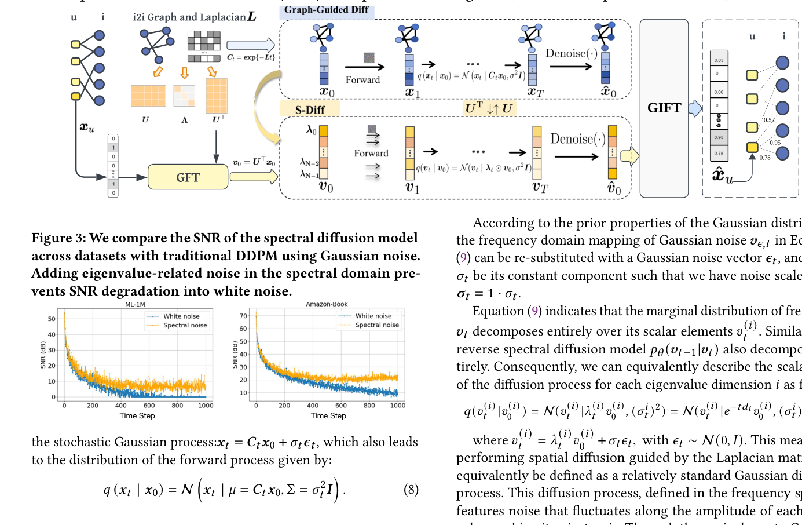
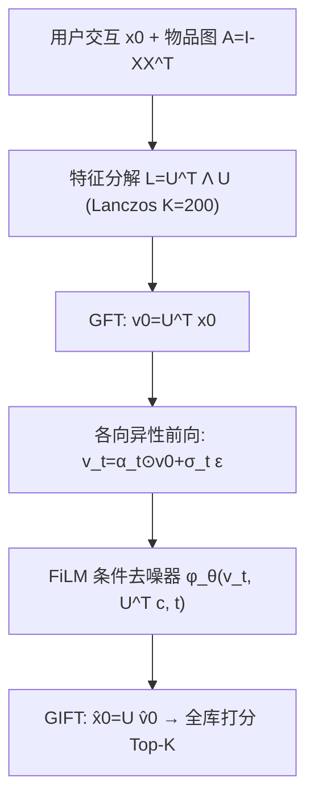

# S-Diff: An Anisotropic Diffusion Model for Collaborative Filtering in Spectral Domain (谱域各向异性扩散协同过滤)

- **会议/期刊**: WSDM 2025
- **作者与机构**: Rui Xia, Lisong Wang (南京航空航天大学); Yanhua Cheng, Yongxiang Tang, Xiaocheng Liu, Xialong Liu, Peng Jiang (快手科技)
- **推荐链路定位**: 召回（用户全库打分）
- **研究方向**: 协同过滤与双塔召回 / 生成式推荐
- **论文原文**: [https://arxiv.org/abs/2501.00384v1](https://arxiv.org/abs/2501.00384v1)
- **开源代码**: 暂未开源

## TL;DR (1分钟核心速览)

现有扩散式协同过滤（DiffRec、Giff）在空间域注入各向同性高斯噪声，前向过程把交互信号退化为白噪声，SNR 趋零且无法利用相似用户的集体偏好。S-Diff 将用户交互向量经图傅里叶变换映射到物品图拉普拉斯谱域，用特征值 $e^{-td_i}$参数化各向异性噪声调度，使低频（全局偏好）分量被保留、高频被优先破坏，再以 FiLM 条件去噪网络逐元素融合条件信号恢复$\hat{\boldsymbol{v}}_0$。在 Amazon-Book / Yelp / ML-1M 三数据集、7:1:2 比例划分、全库排序协议下，Recall@20 相对最强基线 Giff 分别提升 5.5% / 8.4% / 2.1%。

## Background & Motivation (背景与核心矛盾)

- **主流范式**: 生成式 CF 把用户交互向量 $\boldsymbol{x}_0$ 当作数据分布，用 DDPM 式前向加噪 + 条件反向去噪恢复偏好（CODIGEM、DiffRec、Giff）；图侧则以 LightGCN/BSPM 为代表的低通滤波范式，靠邻域平滑提取低频全局偏好。
- **前人局限**: ① 传统扩散仅以单用户交互向量为条件，前向过程不含任何协同信号，编码与解码语义割裂，无法刻画相似用户的共享偏好；② 空间域各向同性高斯噪声在 $T$步后使$q(\boldsymbol{x}_T)\to\mathcal{N}(0,\boldsymbol{I})$，SNR 退化为白噪声，去噪解码器恢复难度陡增。
- **核心洞察 (Key Insight)**: 图热扩散方程 $\frac{d\boldsymbol{x}_t}{dt}=-\boldsymbol{L}\boldsymbol{x}_t$的解$\boldsymbol{x}_t=e^{-\boldsymbol{L}t}\boldsymbol{x}_0$ 本身就是"平滑即破坏"的过程——低频特征值衰减慢、高频衰减快，恰好与 CF 中"全局偏好应保留、局部噪声应滤除"的先验同构。
- **本文切入点**: 把前向破坏算子从标量 $\alpha_t$换成谱域对角算子$\boldsymbol{\Lambda}_t$，让噪声强度随图频率各向异性地分配，从而在有限步内维持有界 SNR。

<figure class="paper-figure" markdown="span">
  <figcaption>图 2：各向异性噪声的谱域扩散模型：对基于物品的拉普拉斯矩阵进行特征值分解，得到正交矩阵 𝑼⊤，将用户交互向量 𝒙 映射到谱域为 𝒗，即图傅里叶变换（GFT）。随后利用特征值的不同影响在谱表示中引入各向异性噪声。之后从噪声向量 𝒗𝑇 恢复用户原始交互信号，并使用图逆傅里叶变换（GIFT）将解码信号 ˆ𝒗0 映射回空间域为</figcaption>
</figure>

## Method (核心方法设计)

### 1. 整体框架 (Overall Architecture)

输入用户交互向量 $\boldsymbol{x}_0\in\{0,1\}^{|\mathcal{I}|}$，先由物品-物品归一化邻接$\boldsymbol{A}=\tilde{\boldsymbol{X}}^\top\tilde{\boldsymbol{X}}$构造拉普拉斯$\boldsymbol{L}=\boldsymbol{I}-\boldsymbol{A}$并做特征分解$\boldsymbol{L}=\boldsymbol{U}^\top\boldsymbol{\Lambda}\boldsymbol{U}$（Lanczos 截断前$K{=}200$维）。前向：GFT 得$\boldsymbol{v}_0=\boldsymbol{U}^\top\boldsymbol{x}_0$，按特征值施加各向异性噪声得$\boldsymbol{v}_t$。反向：以 50% 随机掩码后的历史交互$\boldsymbol{c}$为条件，FiLM 去噪器预测$\hat{\boldsymbol{v}}_0$，经 GIFT 映回空间域$\hat{\boldsymbol{x}}_0=\boldsymbol{U}\hat{\boldsymbol{v}}_0$后全库排序取 Top-K。训练仅需$T{=}5$步弱噪声，推理走 5 步采样 + classifier-free guidance（$s{=}0.02$）。

### 2. 关键设计拆解 (Key Designs)

1. **谱域各向异性前向扩散（Anisotropic Forward in Spectral Domain）**：痛点在于空间域标量噪声对所有频率一视同仁。本文把前向写成 $\boldsymbol{v}_t=\boldsymbol{\alpha}_t\odot\boldsymbol{v}_0+\boldsymbol{\sigma}_t\boldsymbol{\epsilon}$，其中$\boldsymbol{\alpha}_t=\boldsymbol{\lambda}_t=[e^{-td_1},\dots,e^{-td_{|\mathcal{I}|}}]$、$\boldsymbol{\sigma}_t^2=\boldsymbol{1}-\boldsymbol{\lambda}_t^2$（VP 形式）。因$d_i\in[0,2]$且$t\in[0,\tau]$，$\alpha_t^{(i)}\in[e^{-2\tau},1]$，故 SNR$=\frac{\boldsymbol{\alpha}_t^2}{1-\boldsymbol{\alpha}_t^2}$存在下界$\frac{e^{-4\tau}}{1-e^{-4\tau}}$，不会退化为白噪声——这正是"低频保留、高频先毁"的物理直觉。
2. **有界噪声调度与 FiLM 逐元素条件融合**：纯特征值调度会让小特征值分量被噪声淹没，故引入 $\boldsymbol{\alpha}_t=(1-\alpha_{\min})\boldsymbol{\lambda}_t+\alpha_{\min}$、$\boldsymbol{\sigma}_t=\min(\sqrt{1-\boldsymbol{\lambda}_t^2},\sigma_{\max})$双向截断。反向侧因前向是逐元素各向异性，去噪器也须逐元素融合条件：$\gamma_i=f((\boldsymbol{U}^\top\boldsymbol{c})_i)$、$\beta_i=h((\boldsymbol{U}^\top\boldsymbol{c})_i)$，$\boldsymbol{v}_{\text{fused}}=\boldsymbol{v}_t+\boldsymbol{\gamma}\odot(\boldsymbol{U}^\top\boldsymbol{c})+\boldsymbol{\beta}$，再与正弦时间编码拼接送入 MLP。相比 concat 融合，FiLM 的乘性调制与前向的 Hadamard 结构严格对偶。
3. **训练目标与推理开销**：损失为谱域 MSE $\mathcal{L}_t=\mathbb{E}\|\boldsymbol{\phi}_\theta(\boldsymbol{v}_t,\boldsymbol{U}^\top\boldsymbol{c},t)-\boldsymbol{v}_0\|^2$，等价于 ELBO 的重构项；条件以 2% 概率置空以支持 classifier-free guidance，无需负采样。推理时以测试集全部历史交互为条件（不掩码）加噪再恢复。复杂度为$\mathcal{O}(K|\mathcal{I}|m)$（$m{=}10$），比空间域扩散多一次 GFT/GIFT 映射，但随物品维度增大开销趋于收敛。

## Experimental Setup & Evaluation Protocol (实验设置与评估协议)

- **数据集与预处理**: 沿用公开预处理版本，未额外做 k-core 过滤说明：

| 数据集 | #Users | #Items | #Interactions | 稀疏度 | 场景说明 |
| :--- | :---: | :---: | :---: | :---: | :--- |
| ML-1M | 5,949 | 2,810 | 571,531 | 96.6% | 电影评分转隐式 |
| Yelp | 54,574 | 34,395 | 1,402,736 | 99.93% | 本地商户 |
| Amazon-Book | 108,822 | 94,949 | 3,146,256 | 99.97% | 图书电商，极稀疏 |

- **数据划分与防穿越**: 按 **7:1:2 比例划分**训练/验证/测试，验证集选最优 epoch，测试集做超参与最终结果抽取（非 Leave-One-Out，非全局时间戳切分）。
- **排名评测协议**: 采用 **Full-Ranking 全库未交互物品排序**，报告 Recall@{10,20} 与 NDCG@{10,20}，结果为 10 次运行平均。
- **对比基线与超参设置**: 9 个基线覆盖三类——MF/LightGCN（embedding 与图卷积）、CDAE/MultiDAE/MultiVAE（AE/VAE 去噪）、CODIGEM/DiffRec（扩散）、LinkProp/BSPM/Giff（图信号处理）。批大小 100，学习率 1e-4，无权重衰减，最多 1000 epoch；$T{=}5$、$\tau{=}1$、$t_k$在$[0,5]$ 线性等距。

## Key Experimental Results (实验关键数据)

### 1. 主实验对比 (Main Results)

| 方法 | Amazon R@10 | Amazon R@20 | Amazon N@20 | Yelp R@20 | Yelp N@20 | ML-1M R@10 | ML-1M R@20 | ML-1M N@20 |
| :--- | :---: | :---: | :---: | :---: | :---: | :---: | :---: | :---: |
| MF | 0.0437 | 0.0689 | 0.0339 | 0.0560 | 0.0276 | 0.0876 | 0.1503 | 0.0966 |
| LightGCN | 0.0534 | 0.0822 | 0.0411 | 0.0904 | 0.0436 | 0.0987 | 0.1707 | 0.1083 |
| MultiVAE | 0.0628 | 0.0935 | 0.0485 | 0.0945 | 0.0458 | 0.1007 | 0.1726 | 0.1076 |
| DiffRec | 0.0895 | 0.1010 | 0.0547 | 0.0960 | 0.0478 | 0.1058 | 0.1787 | 0.1148 |
| LinkProp | 0.1087 | 0.1488 | 0.0832 | 0.0980 | 0.0485 | 0.1039 | 0.1509 | 0.1031 |
| BSPM | 0.1055 | 0.1435 | 0.0814 | 0.1033 | 0.0505 | 0.1107 | 0.1740 | 0.1079 |
| Giff | 0.1109 | 0.1521 | 0.0865 | 0.0992 | 0.0520 | 0.1108 | 0.1977 | 0.1176 |
| **S-Diff** | **0.1155** | **0.1604** | **0.0876** | **0.1075** | **0.0561** | **0.1277** | **0.2018** | **0.1225** |
| Improv. vs Giff | +4.1% | +5.5% | +1.3% | +8.4% | +7.9% | +15.3% | +2.1% | +4.2% |

### 2. 消融实验 (Ablation Study)

| 配置 | ML-1M R@10 | ML-1M N@10 | ML-1M log(SNR) | Yelp R@10 | Yelp N@10 | Yelp log(SNR) |
| :--- | :---: | :---: | :---: | :---: | :---: | :---: |
| DDPM in Spectral（各向同性） | 0.0998 | 0.0901 | 5.25 | 0.0595 | 0.0374 | 7.74 |
| S-Diff-VE（方差爆炸） | 0.1207 | 0.0942 | 8.90 | 0.0610 | 0.0384 | 15.89 |
| **S-Diff-VP（本文）** | **0.1255** | **0.0970** | **12.73** | **0.0635** | **0.0392** | **21.55** |
| w.o. FiLM（concat 替代） | 下降（图 6） | — | — | — | — | — |

### 3. 关键实验发现 (Key Findings)

1. **谱域本身不是收益来源，各向异性才是**：仅在谱域用经典 DDPM 各向同性调度（DDPM in Spectral）时 ML-1M R@10 仅 0.0998，甚至低于空间域 Giff 的 0.1108；换成特征值参数化后跃升至 0.1255，说明"频率相关的噪声分配"而非"换坐标系"贡献了主要增益。
2. **SNR 下界与精度强正相关**：VP 形式在 ML-1M 上 log(SNR) 达 12.73，是各向同性谱域 DDPM（5.25）的 2.4 倍，对应 R@10 提升 25.8%；VE 形式居中（8.90 / 0.1207），验证了方差保持约束对协同信号恢复的必要性。
3. **稀疏度越高、图滤波类基线越吃亏，扩散多步去噪优势越明显**：Amazon-Book（99.97% 稀疏）上 Giff 的 N@20 为 0.0865，S-Diff 为 0.0876 但 R@20 拉开 5.5%；而 ML-1M（96.6%）上 Giff 已很强，S-Diff 仍靠 R@10 的 +15.3% 说明多步变分下界优化带来了更强的谱表达力，而非单纯依赖图平滑。

## Highlights & Limitations (亮点、对比与审稿批判)

- **与代表作对比 (vs. Prior Work)**: 与 DiffRec 相比，S-Diff 不在潜空间压缩而在谱域正交分解，既降维又保留频率语义；与 Giff 相比，Giff 在空间域用图滤波器做确定性平滑再扩散，前向不含随机性且噪声各向同性，S-Diff 把随机噪声直接注入谱域并逐特征值调度，编码-解码语义一致；与 CF-Diff 相比，后者需预计算多跳邻域作条件、扩展性差，S-Diff 仅需一次截断特征分解。
- **可迁移亮点**: ① "用图特征值参数化扩散噪声调度"可迁移到任何带物品图的生成式召回（如语义 ID 生成式推荐的前向加噪）；② FiLM 逐元素条件融合与前向 Hadamard 结构对偶的设计，可作为谱域条件生成的通用模板。
- **审稿级局限批判**: ① 推理需对每个用户做 GFT/GIFT 与 5 步迭代采样，图 5 显示物品维度增大时开销显著上升，且需预先持有 $K{=}200$维特征向量，冷启动物品无法即时纳入；② 评估仅用 7:1:2 随机划分与三个中小规模数据集，缺少时间切分与线上 A/B，且未报告与 LightGCN 类基线在同等调参预算下的显著性检验；③$\alpha_{\min}$、$\sigma_{\max}$ 在 Amazon-Book 上需"保留更小特征向量"才最优，超参跨数据集迁移性存疑。

## Rating (四维评分)

- **方法创新性 (Novelty)**: ⭐⭐⭐⭐ （把图热核 $e^{-\boldsymbol{L}t}$ 与 DDPM 前向严格等价化，各向异性噪声调度有 SNR 下界理论支撑，但本质是图低通滤波的扩散化重述）
- **评估协议与实验扎实度 (Protocol & Experiments)**: ⭐⭐⭐ （Full-Ranking 协议与 10 次平均可信，但仅随机比例划分、无时间切分/线上验证，消融以图呈现缺少数值表）
- **写作与数学规范度 (Clarity & Rigor)**: ⭐⭐⭐⭐ （谱域推导从 ODE 到 VP 调度链条完整，符号统一；部分公式排版与 $T{=}5$ 弱噪声设定下的 ELBO 近似说明略简）
- **工业落地与复现价值 (Industrial & Practical Value)**: ⭐⭐⭐ （思路可直接嵌入现有图召回管线，但需维护特征分解与多步采样，未开源、推理延迟对物品维度敏感，工程化仍需优化）

