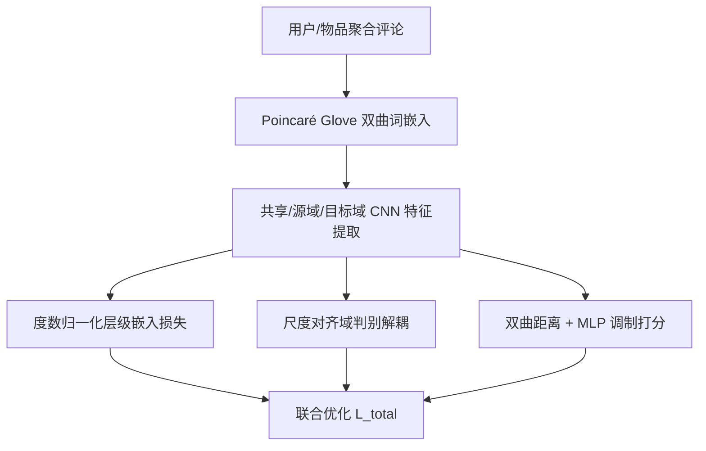
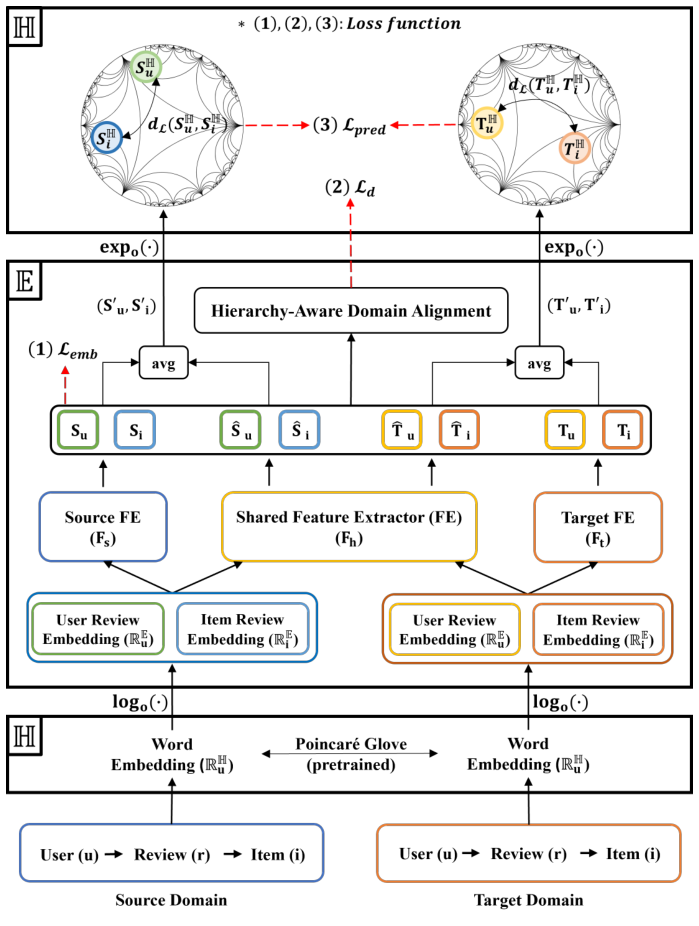

# Review-Based Hyperbolic Cross-Domain Recommendation (基于评论的双曲跨域推荐)

- **会议/期刊**: WSDM 2025
- **作者与机构**: Yoonhyuk Choi (Samsung), Jiho Choi (KAIST), Taewook Ko (Samsung), Chong-Kwon Kim (KENTECH)
- **推荐链路定位**: 召回（跨域表征学习 + 排序打分）
- **研究方向**: 跨域与多场景推荐 / 冷启动与长尾推荐
- **论文原文**: [https://arxiv.org/abs/2403.20298v3](https://arxiv.org/abs/2403.20298v3)
- **开源代码**: [https://github.com/ChoiYoonHyuk/HEAD](https://github.com/ChoiYoonHyuk/HEAD)

## TL;DR (1分钟核心速览)

针对评论驱动的跨域推荐（CDR）在欧氏空间难以刻画幂律层级结构、且传统基于距离的域对齐在双曲空间中会因几何敏感性引发“层级坍塌”的痛点，本文提出 HEAD：用 Poincaré Glove 将评论文本嵌入双曲空间，以**度数归一化的层级嵌入损失**把高度数节点拉向原点、低度数节点推向边界，并以**尺度对齐**替代距离最小化来做域解耦。在 Amazon 5-core 的 12 个域对上，采用 80/10/10 比例划分与 HR@10/NDCG@10 全库排序评测，NDCG@10 较 SOTA 基线 SER 平均提升约 10.4%。

## Background & Motivation (背景与核心矛盾)

- **主流范式**: 评论驱动 CDR 以域解耦（DisenCDR / SER）为代表，通过共享/域专属特征提取器分离域可共享与域特有知识，无需重叠用户即可迁移。
- **前人局限**: 其一，这些方法全部在欧氏空间嵌入，而用户-物品二部图度数服从幂律分布，欧氏体积随半径多项式增长，无法无损容纳指数级层级；其二，双曲空间对位置扰动极度敏感，直接最小化跨域距离会把低度数节点错误拉近原点，破坏树状结构（图 1）。
- **核心洞察 (Key Insight)**: 双曲几何要求“热门节点靠原点、冷门节点靠边界”，因此域对齐不应改变节点的**位置尺度**，只应调整其**方向/角度**信息。
- **本文切入点**: 用度数作为层级先验做归一化嵌入，并在送入域判别器前对特征做模长归一化（尺度对齐），从而在保留层级的前提下完成域解耦。

## Method (核心方法设计)

### 1. 整体框架 (Overall Architecture)

输入为源域与目标域的用户/物品聚合评论文档，先用 Poincaré Glove 得到双曲词向量并经指数映射投影到 Lorentz 模型；随后经对数映射回欧氏空间，交由三个多通道 CNN 特征提取器（共享 FE、源域 FE、目标域 FE）抽取特征；特征分别进入层级嵌入损失（度数归一化）、域解耦损失（尺度对齐 + GRL 判别器）与预测损失；推理时将源域与共享特征平均后加交互隐向量，再指数映射回双曲空间，用可学习 MLP 调制的 Lorentz 距离打分。

<figure class="paper-figure" markdown="span">
  <figcaption>图2：层次感知双曲嵌入与域解耦（HEAD）方案的整体框架。(1)-(3)表示三类损失函数。</figcaption>
</figure>

### 2. 关键设计拆解 (Key Designs)

1. **度数归一化层级嵌入（Proposition 4.1）**：HRCF 式 root alignment 只是把所有节点一律推离原点，无法反映流行度。本文在距离项前乘以度数权重 $(max(d)-d_{u'})/max(d)$：
$$S^{norm}_{u,deg}=\frac{1}{N_u}\sum_{u'}\frac{\max(d_u)-d_{u'}}{\max(d_u)}\|S_{u'}-S^{root}_u\|_2^2$$
层级嵌入损失取 $\mathcal{L}_{emb}=1/\sqrt{S^{norm}_{u,deg}+S^{norm}_{i,deg}+T^{norm}_{u,deg}+T^{norm}_{i,deg}}$。作者证明梯度尺度正比于该权重，故低度数节点获得更大推离梯度、高度数节点被锚定在原点附近，天然契合双曲空间的指数容量。

2. **尺度对齐域解耦（Proposition 4.2/4.3）**：传统解耦直接把特征送入判别器，域专属特征分离时模长随之膨胀，在双曲空间中造成放大扰动。本文将输入先做模长归一化再判别：
$$d_S=F_d\!\left(\frac{S}{\|S\|}\right),\quad \tilde{d}_S=F_d\!\left(g\!\left(\frac{\tilde{S}}{\|\tilde{S}\|}\right)\right)$$
其中 $g(\cdot)$为梯度反转层。由余弦定理可证归一化后更新量正比于单位向量而非原模长，判别器可分性$S=\|x\|\|y\|f(x,y)$ 的梯度不再受输入协变尺度影响，收敛更稳定。

3. **训练目标、负采样与推理效率**：总损失 $\mathcal{L}_{total}=\lambda_1\mathcal{L}_{emb}+\lambda_2\mathcal{L}_{d}+\mathcal{L}_{pred}+\delta\|\theta\|$，预测用双曲边际排序损失$\mathcal{L}_{pred}=\max(p(S^H_u,S^H_i)^2-p(S^H_u,S^H_j)^2+\epsilon,0)$，$\epsilon=0.1$；负采样取评分$y_{u,j}\le 3$的物品。整体复杂度$O(N_t)$ 线性于目标域规模，判别器仅两层 MLP，尺度对齐为线性操作，线上开销可控。

## Experimental Setup & Evaluation Protocol (实验设置与评估协议)

- **数据集与预处理**: Amazon 5-core 评论数据，3 个源域 × 4 个目标域共 12 个域对（含相似域对如 Cloth-Beauty、CDs-Digital Music、Toys-Video Games 与不相似域对）：

| 数据集 | #Users | #Items | #Reviews | 角色 |
| :--- | :---: | :---: | :---: | :--- |
| Clothing | 1,219,520 | 376,858 | 11,285,464 | 源域 |
| CDs and Vinyl | 112,391 | 73,713 | 1,443,755 | 源域 |
| Toys and Games | 208,143 | 78,772 | 1,828,971 | 源域 |
| Luxury Beauty | 3,818 | 1,581 | 34,278 | 目标域 |
| All Beauty | 990 | 85 | 5,269 | 目标域 |
| Digital Music | 16,561 | 11,797 | 169,781 | 目标域 |
| Video Games | 55,217 | 17,408 | 497,577 | 目标域 |

- **数据划分与防穿越 (Splitting Strategy)**: 目标域按 `80%/10%/10%` 比例划分训练/验证/测试，**不考虑时间序列**（与 SER、HDNR 等基线一致），并采用 300 轮无提升即早停。
- **排名评测协议 (Ranking Protocol)**: 报告 HR@10 与 NDCG@10，遵循前人设定的评测流程（未显式声明采样负例比例，按原文基线复现协议执行）。
- **对比基线与超参设置**: 单域基线 DeepCoNN、AHN、HGCF、GDCF、HDNR；跨域基线 DDTCDR、RC-DFM、CATN、MMT、SER、DH-GAT。词嵌入维度统一 $d=100$，显著性水平$p<0.05$（表中 `*` 标注）。

## Key Experimental Results (实验关键数据)

### 1. 主实验对比 (Main Results)

以 Luxury Beauty 与 Video Games 两个目标域为例（源域取 Cloth / CDs / Toys 三列，NDCG@10 / HR@10）：

| 方法 | LB (Cloth) | LB (CDs) | LB (Toys) | VG (Cloth) | VG (CDs) | VG (Toys) |
| :--- | :---: | :---: | :---: | :---: | :---: | :---: |
| DeepCoNN | 0.093 / 0.177 | 0.093 / 0.177 | 0.093 / 0.177 | 0.124 / 0.220 | 0.124 / 0.220 | 0.124 / 0.220 |
| AHN | 0.129 / 0.231 | 0.129 / 0.231 | 0.129 / 0.231 | 0.171 / 0.306 | 0.171 / 0.306 | 0.171 / 0.306 |
| HDNR (H) | 0.144 / 0.262 | 0.144 / 0.262 | 0.144 / 0.262 | 0.189 / 0.344 | 0.189 / 0.344 | 0.189 / 0.344 |
| MMT | 0.146 / 0.270 | 0.125 / 0.241 | 0.139 / 0.264 | 0.161 / 0.298 | 0.156 / 0.300 | 0.188 / 0.351 |
| SER | 0.149 / 0.283 | 0.136 / 0.270 | 0.147 / 0.286 | 0.199 / 0.353 | 0.205 / 0.352 | 0.221 / 0.394 |
| DH-GAT (H) | 0.152 / 0.285 | 0.142 / 0.266 | 0.145 / 0.271 | 0.200 / 0.366 | 0.202 / 0.371 | 0.214 / 0.389 |
| **HEAD-E (H)** | 0.162\* / 0.303\* | 0.160\* / 0.299\* | 0.163\* / 0.308\* | 0.232\* / 0.397\* | 0.226\* / 0.380\* | 0.235\* / 0.414\* |
| **HEAD-P (H)** | **0.173\*** / **0.321\*** | **0.166\*** / **0.314\*** | **0.169\*** / **0.320\*** | **0.238\*** / **0.408\*** | **0.232\*** / **0.396\*** | **0.244\*** / **0.417\*** |

HEAD-P 相对 SER 在 Luxury Beauty 上 NDCG@10 提升约 16.1%（0.149→0.173），在 Video Games 上提升约 10.4%（0.221→0.244），全部 12 个域对均取得最优且通过 $p<0.05$ 显著性检验。

### 2. 消融实验 (Ablation Study)

原文未提供逐组件移除的独立消融表，但通过 HEAD-E（欧氏 Glove）vs HEAD-P（Poincaré Glove）、HEAD w/o SA vs w/ SA 的对照可拆解各组件贡献：

| 配置 | 关键变化 | 效果 |
| :--- | :--- | :--- |
| HEAD-E | 欧氏 Glove 词嵌入 | 仍优于所有基线，说明层级嵌入+尺度对齐是主增益来源 |
| HEAD-P | 双曲 Poincaré Glove | 较 HEAD-E 再提升约 2–3 个 NDCG 点，验证双曲词嵌入的层级保真价值 |
| HEAD w/o SA | 去掉尺度对齐 | 域判别精度低于 SER，说明层级嵌入本身会放大特征尺度 |
| HEAD w/ SA | 加尺度对齐 | 判别精度最优，验证 Proposition 4.3 |

### 3. 关键实验发现 (Key Findings)

1. **双曲几何本身即强基线**：单域双曲方法 HDNR 在无跨域信息时 NDCG@10 已达 0.144（Luxury Beauty），接近跨域 SOTA SER 的 0.149，说明幂律层级建模的收益可与跨域迁移相当，二者叠加（HEAD）才突破 0.17。
2. **尺度对齐是解耦生效的前提**：图 3 显示 HEAD w/o SA 的域判别 BCE 反而高于 SER（因层级嵌入的分离特性放大尺度），加入尺度对齐后才取得最优判别精度，直接印证“双曲空间中位置扰动被指数放大”的核心论点。
3. **度数归一化确实重塑了几何分布**：图 4 中 Digital Music 的 1000 个采样物品，仅用 root alignment 时低度数节点随机散布，加入度数归一化后节点按度数从原点向边界分层排列，结构保真度显著提升。
4. **超参鲁棒区间窄但平坦**：图 5 显示 $\lambda_1,\lambda_2$取大值时排序损失被压制导致性能骤降，最优为 Digital Music 上$\lambda_1=\lambda_2=0.05$、Video Games 上$\lambda_1=0.1,\lambda_2=0.05$，但低于阈值后性能变化平缓，调参成本可控。

## Highlights & Limitations (亮点、对比与审稿批判)

- **与代表作对比 (vs. Prior Work)**: 相较 SER/DisenCDR 等欧氏域解耦方法，HEAD 首次把域解耦搬进双曲空间并指出“距离对齐 = 层级坍塌”这一被忽视的失效模式；相较 DH-GAT 等双曲 CDR，HEAD 额外引入域解耦与度数感知的层级保持，而非仅做图注意力对齐；相较 HRCF 等单域双曲正则，HEAD 的度数归一化把流行度先验显式写入损失权重。
- **可迁移亮点**: (1) 模长归一化后再送域判别器/对抗对齐，可推广到任何在非欧空间做域适应的场景；(2) 以节点度数作为损失权重调节几何位置，是低成本注入幂律先验的通用技巧。
- **审稿级局限批判**: (1) 评测仅用 HR@10/NDCG@10 且未明确负采样协议，缺少全库排序下的 MRR/Recall 等更严格指标；(2) 数据划分忽略时间序列，存在未来信息泄漏风险，且未报告双曲映射与 Poincaré Glove 预训练带来的额外推理延迟；(3) 超参 $\lambda_1,\lambda_2$ 需逐数据集网格搜索，跨域对泛化时的自动调参机制缺失。

## Rating (四维评分)

- **方法创新性 (Novelty)**: ⭐⭐⭐⭐ （首次系统论证双曲空间下距离式域对齐的层级坍塌问题，并给出度数归一化与尺度对齐两条有理论证明的修正）
- **评估协议与实验扎实度 (Protocol & Experiments)**: ⭐⭐⭐ （12 个域对覆盖相似/不相似场景且带显著性检验，但划分忽略时序、评测指标偏少、缺独立消融表）
- **写作与数学规范度 (Clarity & Rigor)**: ⭐⭐⭐⭐ （三个 Proposition 均附梯度尺度证明，双曲映射与损失定义清晰，复杂度分析完整）
- **工业落地与复现价值 (Industrial & Practical Value)**: ⭐⭐⭐⭐ （代码开源，整体复杂度线性于目标域规模，判别器与归一化开销极低，适合冷启动场景快速落地）

