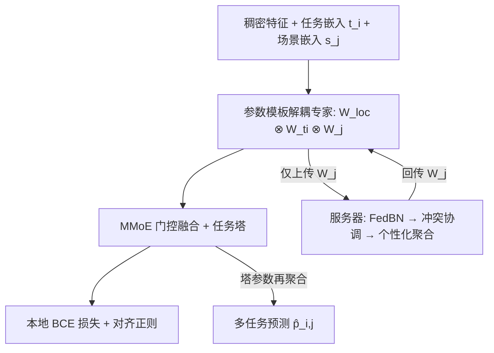

# Towards Personalized Federated Multi-Scenario Multi-Task Recommendation (面向个性化联邦多场景多任务推荐)

- **会议/期刊**: WSDM 2025
- **作者与机构**: Yue Ding, Yanbiao Ji, Xun Cai, Xin Xin, Yuxiang Lu, Suizhi Huang, Chang Liu, Xiaofeng Gao, Tsuyoshi Murata, Hongtao Lu（上海交通大学、山东大学、东京工业大学）
- **推荐链路定位**: 精排（多任务多目标预估）
- **研究方向**: 跨域与多场景推荐 / 多任务学习与列表级重排
- **论文原文**: [论文原文链接](https://arxiv.org/abs/2406.18938v2)
- **开源代码**: [开源代码仓库链接](https://github.com/yuangh-x/2022-NIPS-Tenrec)

## TL;DR (1分钟核心速览)

本文首次提出「联邦多场景多任务推荐」这一新问题：每个场景对应一个持有私有数据的客户端，需在不上传数据的前提下联合训练 MMoE 多任务模型。核心痛点是数据级、模型级、任务级三种优化冲突相互交织。作者提出 PF-MSMTrec，用参数模板把专家网络解耦为全局共享/任务专属/场景专属三类参数，仅对场景专属参数做联邦聚合，并辅以联邦批归一化、梯度冲突协调与个性化聚合。在 AliExpress 四国场景与 Tenrec 双场景上，CTR/CTCVR 的 AUC 全面超越 PEPNet、AESM2 及 FedAvg/FedProx/Ditto/FedAMP，且联邦版甚至超过集中式 SOTA。

## Background & Motivation (背景与核心矛盾)

- **主流范式**: 工业界已从单场景多任务（MMoE/PLE/ESMM/AITM）走向多场景多任务（STAR/AESM2/PEPNet/HiNet），通过共享专家与场景/任务专属参数复用跨业务知识。
- **前人局限**: ① 现有多场景模型默认数据可集中，而跨国分支、广告联盟等场景下各参与方数据私有，无法训练统一全局模型；② 直接把多场景多任务塞进 FedAvg 会同时引爆三类冲突——数据级（各客户端特征空间不一致）、模型级（参数平均因分布差异而互相拖累）、任务级（"跷跷板"现象）。
- **核心洞察 (Key Insight)**: 冲突的根源在于「哪些参数该共享、哪些该私有」没有被显式区分；若只让场景专属参数参与聚合、任务与局部参数留在本地，则聚合本身即可成为跨场景知识迁移的正向信号。
- **本文切入点**: 用参数模板对专家网络做细粒度解耦，把联邦聚合从"整模型平均"降级为"场景参数对齐"，并在聚合前后插入归一化与梯度冲突协调。

## Method (核心方法设计)

### 1. 整体框架 (Overall Architecture)

每个场景 $j$对应一个客户端，本地采用 MMoE 结构：$N$个专家网络接收稠密特征、任务嵌入$t_i$与场景嵌入$s_j$，门控网络按任务加权融合专家输出，再由任务塔输出预测。训练分两阶段闭环：本地前向时，专家参数由「局部参数$\mathbf{W}_{loc}^n$⊗ 任务参数$\mathbf{W}_{t_i}^n$⊗ 场景参数$\mathbf{W}_j^n$」逐元素相乘构成；每轮通信时，仅$\mathbf{W}_j^n$ 上传服务器，经联邦批归一化、冲突协调、个性化聚合后回传；最后对任务塔参数再做一轮个性化聚合。

### 2. 关键设计拆解 (Key Designs)

1. **专家参数模板解耦（Parameter Template）**：痛点是 FedAvg 平均全部参数会让场景差异互相污染。本文将专家权重分解为三类可学习因子的逐元素积 $\mathbf{E}_{t_i}^n = \mathbf{W}_{loc}^n \otimes \mathbf{W}_{t_i}^n \otimes \mathbf{W}_j^n$，其中$\mathbf{W}_{t_i}^n=\mathrm{MLP}_t(t_i)$、$\mathbf{W}_j^n=\mathrm{MLP}_s(s_j)$由嵌入动态生成。只有$\mathbf{W}_j^n$ 参与联邦聚合，任务共性参数与局部个性参数留在客户端。直觉：场景参数作为"共享锚点"嵌入局部参数内部，聚合更新可反向影响个性化学习，实现"聚合即正则"。

2. **联邦批归一化 + 冲突协调 + 个性化聚合（FedBN & Conflict Coordination）**：痛点是各客户端上传的 $\mathbf{W}_j^n$分布差异大，直接平均导致模型级冲突。FedBN 把服务器上所有客户端的共享参数视作一个 batch 做归一化，$\mathrm{FedBN}(\mathbf{W}_j^n)=\gamma_g\cdot\frac{\mathbf{W}_j^n-\mu_g}{\sqrt{\sigma_g^2+\epsilon_g}}+\beta_g$，其中$\gamma_g,\beta_g$由各客户端本地 BN 参数平均得到；作者证明若通信发生在每个本地 batch 之后，平均结果仅与$\beta_g$相关，说明参数级归一化等价于隐式利用客户端数据分布。冲突协调借鉴 CAGrad，因隐私不能上传梯度，改用相邻两轮参数差$\Delta\hat{\mathbf{W}}_j^n=[\bar{\mathbf{W}}_j^n]_r-[\bar{\mathbf{W}}_j^n]_{r-1}$近似梯度，求解$\max_{\mathbf{U}}\min\langle\Delta\mathbf{W}_j^n,\mathbf{U}\rangle$s.t.$\|\mathbf{U}-\Delta\bar{\mathbf{W}}_j^n\|\le c\|\Delta\bar{\mathbf{W}}_j^n\|$，得到协调方向$\mathbf{U}^*$后按$[\mathbf{W}_j^n]_r=[\mathbf{W}_j^n]_{r-1}+[\Delta\bar{\mathbf{W}}_j^n]_r+\psi_n\mathbf{U}^*$个性化更新，$\psi_n$ 为每个专家可学习权重。

3. **训练目标与推理开销**：总损失 $\mathcal{L}_j=\mathcal{L}_{BCE,j}+\lambda\sum_{n}\|\bar{\mathbf{W}}_j^n-\mathbf{W}_j^n\|_2^2$，正则项拉近本地共享参数与全局聚合参数以防个性化漂移。无负采样设计（CTR/CVR 天然正负样本），推理时仅需本地前向，通信开销为每轮上传$N$ 个场景参数矩阵，远小于整模型。

## Experimental Setup & Evaluation Protocol (实验设置与评估协议)

- **数据集与预处理**: 两个公开数据集，AliExpress 取 NL/ES/FR/US 四国场景（79 维特征），Tenrec 取 QK-video 与 QB-video 两场景（16 维特征）：

| 数据集 | #Train | #Valid | #Test | #Features | 场景说明 |
| :--- | :---: | :---: | :---: | :---: | :--- |
| AliExpress NL | 12.1M | 5.6M | 5.6M | 79 | 荷兰站电商 |
| AliExpress ES | 22.3M | 9.3M | 9.3M | 79 | 西班牙站电商 |
| AliExpress FR | 18.2M | 8.8M | 8.8M | 79 | 法国站电商 |
| AliExpress US | 19.9M | 7.5M | 7.5M | 79 | 美国站电商 |
| Tenrec-QK-video | 69.3M | 8.7M | 8.7M | 16 | 腾讯 QQ 看视频 |
| Tenrec-QB-video | 1.9M | 0.2M | 0.2M | 16 | 腾讯 QQ 浏览器视频 |

- **数据划分与防穿越 (Splitting Strategy)**: 按训练/验证/测试比例划分（AliExpress 约 6:2:2，Tenrec 约 8.7:1.1:1.1），各场景独立划分，未采用全局时间戳切分。
- **排名评测协议 (Ranking Protocol)**: 采用 AUC 作为排序质量指标，$\mathrm{AUC}=\frac{1}{|D^+||D^-|}\sum_{x^+\in D^+}\sum_{x^-\in D^-}\mathbb{I}(f(x^+)>f(x^-))$，基于全测试集正负样本对计算，属无偏全库评估；显著性用单样本 t 检验$p<0.05$。
- **对比基线与超参设置**: 两组基线——多场景多任务组（Single-task、MMoE、PLE、ESMM、AITM、STAR、AESM2、PEPNet）与联邦组（FedAvg、FedProx、Ditto、FedAMP）。专家网络为三层 MLP {512,256,128}，塔网络 {128,64,32}，Adam，学习率 0.001，dropout 0.2，冲突协调系数 $c=0.4$，正则系数$\lambda=0.5$，专家数默认 4。

## Key Experimental Results (实验关键数据)

### 1. 主实验对比 (Main Results)

AliExpress 四场景（节选 CTR/CTCVR AUC，加粗为全局最优）：

| 方法 | NL CTR | NL CTCVR | ES CTR | ES CTCVR | FR CTR | FR CTCVR | US CTR | US CTCVR |
| :--- | :---: | :---: | :---: | :---: | :---: | :---: | :---: | :---: |
| MMoE | 0.7195 | 0.8574 | 0.7269 | 0.8899 | 0.7226 | 0.8748 | 0.7053 | 0.8639 |
| PLE | 0.7268 | 0.8571 | 0.7268 | 0.8861 | 0.7252 | 0.8679 | 0.7092 | 0.8699 |
| STAR | 0.7263 | 0.8624 | 0.7281 | 0.8891 | 0.7269 | 0.8803 | 0.7088 | 0.8765 |
| AESM2 | 0.7260 | 0.8638 | 0.7295 | 0.8949 | 0.7241 | 0.8808 | 0.7088 | 0.8774 |
| PEPNet | 0.7310 | 0.8687 | **0.7342** | 0.8915 | 0.7296 | 0.8813 | 0.7105 | 0.8851 |
| FedAvg | 0.7265 | 0.8551 | 0.7280 | 0.8886 | 0.7265 | 0.8664 | 0.7084 | 0.8701 |
| FedAMP | 0.7270 | 0.8552 | 0.7282 | 0.8905 | 0.7266 | 0.8708 | 0.7089 | 0.8665 |
| **PF-MSMTrec (Fed)** | **0.7316** | 0.8653 | 0.7325 | 0.8925 | **0.7321** | **0.8851** | **0.7142** | 0.8791 |
| Improv.% (vs 最优基线) | +0.08% | -0.39% | -0.23% | -0.27% | +0.34% | +0.43% | +0.52% | -0.68% |

Tenrec 双场景（节选）：

| 方法 | QK click | QK like | QB click | QB like |
| :--- | :---: | :---: | :---: | :---: |
| Single-task | 0.7957 | 0.9160 | 0.8013 | 0.9343 |
| AESM2 | 0.7942 | 0.9219 | 0.8047 | 0.9297 |
| PEPNet | 0.7953 | 0.9200 | 0.8076 | 0.9331 |
| FedAvg | 0.7960 | 0.9155 | 0.8025 | 0.9351 |
| **PF-MSMTrec (Fed)** | **0.7965** | **0.9202** | **0.8083** | 0.9327 |

### 2. 消融实验 (Ablation Study)

AliExpress 消融（A1: 专家+塔全用 FedAvg；A2: 专家全参数 FedAvg；A3: 仅场景参数 FedAvg（完整版）；A4: 仅塔 FedAvg）：

| 配置 | NL CTR | NL CTCVR | FR CTR | FR CTCVR | US CTR | US CTCVR |
| :--- | :---: | :---: | :---: | :---: | :---: | :---: |
| A1 | 0.7274 | 0.8617 | 0.7298 | 0.8849 | 0.7081 | 0.8799 |
| A2 | 0.7289 | 0.8511 | 0.7305 | 0.8849 | 0.7128 | 0.8792 |
| **A3 (完整)** | **0.7316** | **0.8653** | **0.7321** | **0.8851** | **0.7142** | 0.8791 |
| A4 | 0.7268 | 0.8651 | 0.7296 | 0.8890 | 0.7135 | 0.8740 |

### 3. 关键实验发现 (Key Findings)

1. **解耦粒度决定收益上限**：A1→A3 在 NL CTR 上从 0.7274 升至 0.7316（+0.42pt），而 A2（专家全参数聚合）CTCVR 反而跌至 0.8511，说明任务参数必须留在本地，否则任务级冲突被聚合放大；塔网络聚合（A4）影响最小，验证"冲突主战场在专家层"。
2. **联邦版反超集中式 SOTA**：PF-MSMTrec (Fed) 在 FR CTR 达 0.7321、US CTR 达 0.7142，均高于集中式 PEPNet（0.7296/0.7105），说明场景参数聚合起到了跨域正则作用，隐私约束下不仅不掉点还略有增益。
3. **专家数存在最优拐点**：专家数从 2 增至 4 时 NL CTCVR 由 0.8625 升至 0.8653，继续增至 5/6 则回落（US CTCVR 从 0.8791 骤降至 0.8185），印证"专家过少欠拟合、过多则冲突加剧"的跷跷板判断。

## Highlights & Limitations (亮点、对比与审稿批判)

- **与代表作对比 (vs. Prior Work)**: 相比 PEPNet/STAR 等集中式多场景模型，本文首次引入客户端隔离约束并证明联邦聚合可替代集中训练；相比 FedAvg/FedProx/Ditto/FedAMP 等通用联邦方法，本文不做整模型平均，而是按参数语义分层聚合，在 AliExpress 上 CTR AUC 领先 FedAMP 约 0.5pt；相比 FedEM/MAS 等联邦多任务工作，本文额外处理了场景异构性。
- **可迁移亮点**: ① "参数模板逐元素积解耦 + 仅聚合场景因子"可迁移到任何需要隐私隔离的多业务联合建模；② 用相邻轮参数差近似梯度做冲突协调，规避了联邦场景下梯度不可上传的硬约束，可复用到其他隐私受限的多目标优化。
- **审稿级局限批判**: ① 实验仅在两个公开数据集、每场景单客户端设定下验证，未模拟大规模跨设备（cross-device）客户端数量与通信轮次开销；② 冲突协调需保存上一轮参数并求解带约束的二次优化，每轮服务器侧计算与存储成本未量化，且 $c$、$\lambda$、专家数均需人工调参，超参敏感度分析缺失。

## Rating (四维评分)

- **方法创新性 (Novelty)**: ⭐⭐⭐⭐ （首次定义联邦多场景多任务问题，参数模板解耦与"参数差近似梯度"的冲突协调组合有新意，但各模块多为已有技术的针对性改造）
- **评估协议与实验扎实度 (Protocol & Experiments)**: ⭐⭐⭐⭐ （AliExpress 四场景 + Tenrec 双场景、两组基线、消融与专家数分析完整，但缺少通信开销与超参敏感性实验）
- **写作与数学规范度 (Clarity & Rigor)**: ⭐⭐⭐⭐ （公式推导清晰，FedBN 仅与 $\beta_g$ 相关的结论有附录证明，但部分符号上下标混用、表格标题存在笔误）
- **工业落地与复现价值 (Industrial & Practical Value)**: ⭐⭐⭐⭐ （代码与数据开源，架构可直接嵌入现有 MMoE 精排链路，但多客户端通信成本与服务器侧优化开销需进一步工程验证）

