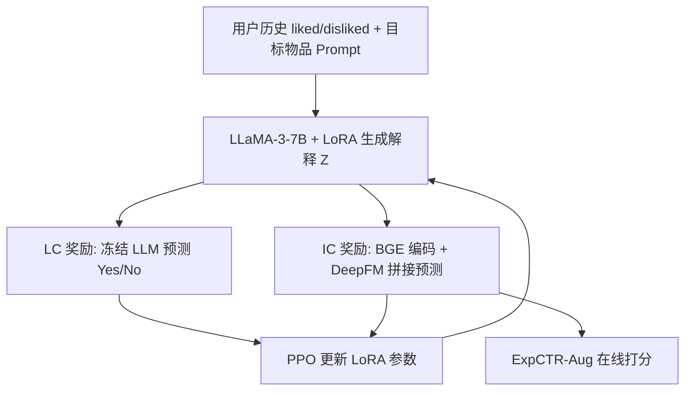
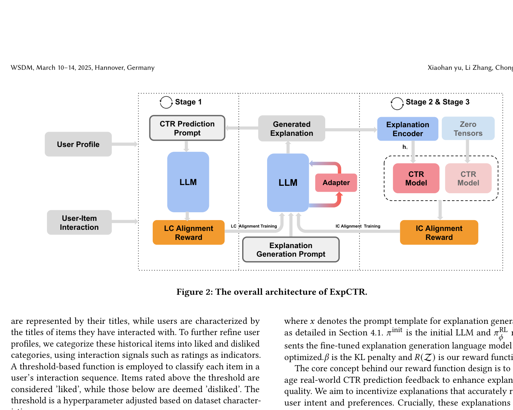

# Explainable CTR Prediction via LLM Reasoning (基于 LLM 推理的可解释 CTR 预估)

- **会议/期刊**: WSDM 2025
- **作者与机构**: Xiaohan Yu, Chong Chen (华为云 BU)；Li Zhang (UCL)
- **推荐链路定位**: 精排（CTR 预估 + 解释生成一体化）
- **研究方向**: CTR 预估与特征交叉 / 大语言模型推荐
- **论文原文**: [https://arxiv.org/abs/2412.02588v1](https://arxiv.org/abs/2412.02588v1)
- **开源代码**: 暂未开源

## TL;DR (1分钟核心速览)

现有可解释推荐采用"事后 (post-hoc)"范式：解释生成器独立于推荐模型训练，既需大量人工构造解释数据，又无法保证解释忠实反映模型决策。本文提出 ExpCTR，将 LLM 解释生成直接嵌入 CTR 流程，用 PPO 配合两个奖励——LC 对齐（解释能否让冻结 LLM 正确预测用户行为）与 IC 对齐（解释作为文本特征能否提升 ID-CTR 模型）——驱动 LoRA 微调，三阶段迭代训练。在 BookCrossing/ML-20M/Amazon Books 上，ExpCTR-Aug 相对 DeepFM 的 AUC 分别提升 18.2%/11.9%/17.8%，且无需任何解释标注数据。

## Background & Motivation (背景与核心矛盾)

- **主流范式**: 可解释推荐以 post-hoc 为主，先训练黑盒 CTR 模型，再独立训练解释生成器（模板/RNN/Transformer/LLM），依赖从评论中清洗出的"伪解释"三元组数据集。
- **前人局限**: ① 资源密集——高质量 user-item-explanation 三元组稀缺，需词重叠分析、LSH 去重、人工改写等大量工序；② 解释不可靠——信息单向流动（模型→生成器），生成器无反馈通道，无法验证解释是否忠实于推荐模型内部机理。
- **核心洞察 (Key Insight)**: 若把联合概率分解方向反过来，写成 $P(Z,\hat{y}\mid\mathcal{D})=P(Z\mid\mathcal{D})\cdot P(\hat{y}\mid Z,\mathcal{D})$，则解释$Z$ 成为 CTR 预测的输入特征，二者形成闭环，解释质量可由下游 CTR 效果直接"打分"。
- **本文切入点**: 用真实交互反馈（而非人工解释标注）作为 RL 奖励信号，让 LLM 在"解释→预测→奖励"回路中自我进化。

## Method (核心方法设计)

### 1. 整体框架 (Overall Architecture)

输入为用户历史（按评分阈值划分为 liked/disliked 物品标题列表）与目标物品，经 CoT 风格 prompt 送入 LLaMA-3-7B（LoRA）生成一句话解释 $Z_{u,i}$。解释分两路消费：一路作为 prompt 让冻结 LLM 输出 Yes/No 概率得到$s^u_{u,i}$（LC 奖励）；另一路经 BGE-small 编码为$\mathbf{z}_{u,i}$，与 ID 模型隐向量$\mathbf{h}_{u,i}$拼接送入 DeepFM 得到$s^r_{u,i}$（IC 奖励）。PPO 以两奖励驱动生成器更新，Stage 2/3 交替迭代，最终同时产出解释生成器与增强版 CTR 模型。

<figure class="paper-figure" markdown="span">
  <figcaption>图2：ExpCTR的整体架构。</figcaption>
</figure>

### 2. 关键设计拆解 (Key Designs)

1. **LC 对齐奖励（解释须反映用户真实意图）**：痛点在于解释可能"文采好但不准"。做法是把解释塞进冻结 LLM 的 CTR prompt，取首 token "Yes"/"No" 的 softmax 概率得 $s^u_{u,i}$，奖励定义为$R_{LC}(Z_{u,i})=1-|y_{u,i}-s^u_{u,i}|$。直觉：解释若真抓住了用户动机，冻结 LLM 仅凭该解释就能判对标签；同时做 batch 内标准化 + 截断$R^{norm}_{LC}=\mathrm{clip}\big((R_{LC}-\mu)/\sigma,\delta\big)$ 以稳定 PPO 梯度。

2. **IC 对齐奖励（解释须与 ID-CTR 模型机理一致）**：痛点在于解释与推荐模型"各说各话"。做法是将解释向量与 ID 隐向量拼接预测 $s^r_{u,i}=f(\mathrm{Concat}(\mathbf{h}_{u,i},\mathbf{z}_{u,i}))$，奖励同时惩罚预测误差与"解释增益"：
$$R_{IC}(Z_{u,i})=1-|y_{u,i}-s^r_{u,i}|+|s^r_{u,i}-\tilde{s}^r_{u,i}|$$
其中 $\tilde{s}^r_{u,i}$是把$\mathbf{z}_{u,i}$置零后的预测。直觉：解释若携带 ID 特征之外的互补语义，则$|s^r-\tilde{s}^r|$ 大，奖励高——这直接激励解释提供"模型原本不知道"的信息，而非复述 ID 嵌入。

3. **训练目标、负采样与推理效率**：PPO 目标为 $\mathcal{L}= \mathbb{E}\big[R(Z)-\beta\log\frac{\pi^{RL}_\phi(Z\mid x)}{\pi_{init}(Z\mid x)}\big]$，KL 惩罚$\beta=0.05$。三阶段迭代：Stage 1 仅用 LC 奖励预热生成器；Stage 2 用累积解释作文本特征训练 CTR 模型；Stage 3 切换 IC 奖励精调生成器，2/3 交替。三个"LLM 角色"（初始模型、生成器、LC 奖励模型）共享同一底座，仅生成器挂 LoRA，参数量与显存开销大幅压缩；推理时解释生成可离线批处理，在线仅需 BGE 编码 + DeepFM 前向。

## Experimental Setup & Evaluation Protocol (实验设置与评估协议)

- **数据集与预处理**: 每用户分层随机采样 1 个交互为目标物品，取时间上前 10 个交互为历史；评分阈值二值化（ML-20M/Amazon 为 4，BookCrossing 为 5）。

| 数据集 | #Train | #Valid | #Test | 阈值 | 场景说明 |
| :--- | :---: | :---: | :---: | :---: | :--- |
| BookCrossing | 32,000 | 4,000 | 4,000 | 5 | 图书评分 + 评论 |
| ML-20M | 16,000 | 2,000 | 2,000 | 4 | 电影评分 |
| Amazon Books | 16,000 | 2,000 | 2,000 | 4 | 图书评论 |

- **数据划分与防穿越 (Splitting Strategy)**: 比例划分 8:1:1；历史序列严格取目标物品**之前**的交互，避免未来信息泄漏。
- **排名评测协议 (Ranking Protocol)**: 本质为**逐样本二分类打分**（非全库排序），指标为 AUC / LogLoss / MAE / RMSE；无负采样环节，正负样本由评分阈值天然给出。
- **对比基线与超参设置**: 14 个 ID-based 基线（FM、DeepFM、AutoInt、PNN、xDeepFM、FiGNN、DCN/V2、DIN、DIEN、Caser、GRU4Rec、SASRec、BERT4Rec）+ 2 个 LLM 基线（ICL、TALLRec）；底座 LLaMA-3-7B，解释编码 BGE-small，IC 奖励基于 DeepFM（RecBole 实现），学习率 $1\times10^{-5}$，$\beta=0.05$，$\delta=1.0$，每轮迭代 2 epoch，单机 A800。

## Key Experimental Results (实验关键数据)

### 1. 主实验对比 (Main Results)

| 模型 | BookCrossing AUC | ML-20M AUC | Amazon AUC | Amazon LogLoss |
| :--- | :---: | :---: | :---: | :---: |
| FM | 0.5176 | 0.6231 | 0.5667 | 0.6876 |
| DeepFM | 0.5222 | 0.6212 | 0.5639 | 0.6873 |
| xDeepFM | 0.5124 | 0.6440 | 0.5640 | 0.6912 |
| SASRec | 0.5322 | 0.6197 | 0.5181 | 0.7145 |
| TALLRec | 0.5389 | 0.6660 | 0.5744 | 0.6868 |
| ICL | 0.5663 | 0.6320 | 0.5930 | 0.7246 |
| ExpCTR-LLM | 0.6042 | 0.6707 | 0.6290 | 0.6831 |
| **ExpCTR-Aug** | **0.6173** | **0.6951** | **0.6641** | **0.6493** |
| Improv. vs DeepFM | +18.2% | +11.9% | +17.8% | — |

### 2. 消融实验 (Ablation Study)

原文未设标准 `w/o` 消融表，但通过奖励轨迹与双打分口径提供了等价证据：

| 配置 | BookCrossing AUC | ML-20M AUC | 说明 |
| :--- | :---: | :---: | :--- |
| ICL（无 RL 训练） | 0.5663 | 0.6320 | 冻结 LLM 零样本 |
| ExpCTR-LLM（仅 LC 奖励链） | 0.6042 | 0.6707 | 解释质量经 LC 验证 |
| ExpCTR-Aug（LC + IC 奖励链） | **0.6173** | **0.6951** | 解释作文本特征增益 |
| $\beta=0.01$/$0.5$（极端 KL） | 下降 | 下降 |$\beta=0.05$ 最优 |
| $\delta=0.5$/$5.0$（极端截断） | 波动明显 | 较稳定 |$\delta=1.0$ 折中 |

### 3. 关键实验发现 (Key Findings)

1. **IC 奖励是主要增益来源**：ExpCTR-Aug 相对 ExpCTR-LLM 在 ML-20M 上 AUC 再涨 2.44 个点（0.6707→0.6951），说明解释作为文本特征确实注入了 ID 嵌入之外的互补语义，而非仅"说得像"。
2. **LC 奖励轨迹与性能强相关**：ML-20M 上 LC 奖励上升更陡、平台更高，对应其相对 ICL 的 9.1% AUC 提升；BookCrossing 的 IC 奖励曲线先降后升，反映 IC 对齐需先"破坏"再"重建"解释风格。
3. **LLM 基线并非不可战胜**：TALLRec 在 ML-20M 上 AUC 0.6660 已超所有 ID 模型，但 ExpCTR-Aug 仍高出 2.91 个点，证明"RL 对齐 + 解释作特征"比单纯指令微调更有效；而 DIN/DIEN 在 Amazon 上 AUC 仅 0.51 左右，暴露纯 ID 序列模型在稀疏文本场景的脆弱性。

## Highlights & Limitations (亮点、对比与审稿批判)

- **与代表作对比 (vs. Prior Work)**: 相比 PETER/RecExplainer 等 post-hoc 方法，本文彻底取消解释标注数据集，且建立"解释→CTR"的反向反馈通道；相比 TALLRec 的指令微调，本文用双奖励把"用户意图"与"模型机理"两个目标显式解耦；相比 ICL 零样本，本文的增益来自 RL 而非 prompt 工程。
- **可迁移亮点**: ① "把生成内容当特征喂回判别模型、用性能差作奖励"的闭环设计可迁移到理由生成、query 改写等任务；② 三 LLM 角色共享底座 + 单 LoRA 的显存压缩技巧，适合工业侧低成本落地。
- **审稿级局限批判**: ① 评估为逐样本二分类而非全库排序，且样本量仅万级，AUC 绝对值偏低（0.62–0.69），与工业 CTR 场景差距大；② 训练需 PPO + 三阶段迭代 + 每样本一次 LLM 生成，离线成本高，论文未报告训练时长与推理延迟；③ 解释质量仅靠下游指标间接评估，缺人工忠实性评测。

## Rating (四维评分)

- **方法创新性 (Novelty)**: ⭐⭐⭐⭐ （反转联合概率分解、双奖励解耦用户意图与模型机理，思路清晰且有理论落点）
- **评估协议与实验扎实度 (Protocol & Experiments)**: ⭐⭐⭐ （三数据集 + 16 基线较全，但逐样本二分类、无全库排序、无标准消融表、无显著性检验）
- **写作与数学规范度 (Clarity & Rigor)**: ⭐⭐⭐⭐ （公式与三阶段流程交代清楚，奖励归一化细节完整；但部分符号如 $s^u$/$s^r$与 Eq.6 的$f$ 复用略含混）
- **工业落地与复现价值 (Industrial & Practical Value)**: ⭐⭐⭐ （LoRA 共享底座降低显存，但 PPO 三阶段训练与在线解释生成开销大，且未开源）

