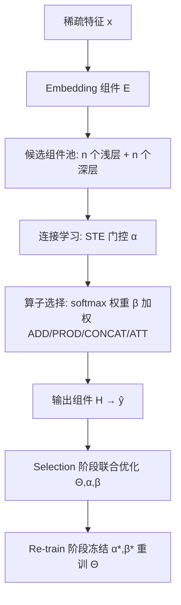
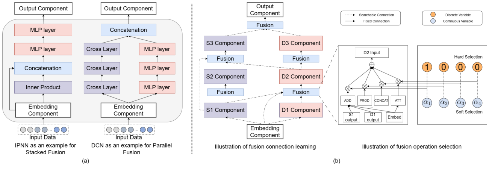

# Fusion Matters: Learning Fusion in Deep Click-through Rate Prediction Models (融合至关重要：深度CTR模型中的融合学习)

- **会议/期刊**: WSDM 2025
- **作者与机构**: Kexin Zhang, Fuyuan Lyu, Xing Tang, Dugang Liu, Chen Ma, Kaize Ding, Xiuqiang He, Xue Liu（Northwestern / McGill & MILA / 腾讯FiT / 深圳大学 / 香港城市大学）
- **推荐链路定位**: 精排
- **研究方向**: CTR预估与特征交叉
- **论文原文**: [论文原文链接](https://arxiv.org/abs/2411.15731v1)
- **开源代码**: [开源代码仓库链接](https://github.com/kexin-kxzhang/OptFusion)

## TL;DR (1分钟核心速览)

深度CTR模型的演进长期聚焦于设计更强的浅层/深层特征交叉组件，而"组件之间如何融合"（连接拓扑 + 融合算子）几乎被固化为 stacked 与 parallel 两种朴素范式，且同一范式在不同数据集上表现反复横跳。本文提出 OptFusion，把融合连接与融合算子统一纳入一个以组件为节点的 DAG 搜索空间，用 STE 松弛连接、softmax 松弛算子，并以 one-shot 联合选择算法同时学习二者。在 Criteo/Avazu/KDD12 三个大规模数据集上，AUC 相对最强基线 EDCN 分别提升 0.0011/0.0021/0.0036，且总训练时间显著短于 AutoCTR 与 NASRec。

## Background & Motivation (背景与核心矛盾)

- **主流范式**: 现有深度CTR模型（DCN、DeepFM、xDeepFM、IPNN 等）的融合方式只有两种——stacked（浅层在前、深层在后串行）与 parallel（浅层深层并行后 concat/add），连接与算子均为人工预先指定。
- **前人局限**: 其一，DCNv2 的 parallel 版在 MovieLens 上优于 stacked 版，但在 Criteo 上反而更差，MaskNet 亦有同样现象，说明"最优融合"强依赖数据分布，固定范式必然次优；其二，EDCN、FinalMLP 等专家设计虽有效，但绑定特定组件与特定设置，无法泛化；AutoCTR/NASRec 虽引入 NAS，却把组件类型、特征输入、超参一并塞入搜索空间，空间爆炸导致搜索低效且易陷局部最优。
- **核心洞察 (Key Insight)**: 融合本身是一个独立且高杠杆的设计维度——EDCN 仅改变融合方式、复用 DCN 的组件即可获得大幅提升；因此应把搜索空间"收窄"到融合这一件事上，而非扩大。
- **本文切入点**: 固定组件集合（1 个 embedding + $n$个浅层 +$n$ 个深层 + 1 个输出），只搜索"谁连谁"与"用什么算子融合"，并用 one-shot 联合优化捕捉连接与算子之间的相互影响。

## Method (核心方法设计)

### 1. 整体框架 (Overall Architecture)

OptFusion 将 CTR 模型形式化为 $\hat{y}=\mathcal{P}(\mathcal{G}\mid \mathbf{c},\mathbf{o})(\mathcal{E}(x),\Theta)$，其中$\mathcal{G}=\{\mathcal{G}_s,\mathcal{G}_d\}$为候选组件集，$\mathbf{c}$为连接状态、$\mathbf{o}$为融合算子。整体含$2n+2$个组件（默认$n=3$），按层级$L(\cdot)$单调递增排列以杜绝环。每个组件$j$的输入由其所有前驱组件的输出经连接门控与算子融合得到，最终输出层聚合深层与 embedding 层表示给出点击概率。训练分两阶段：selection 阶段联合优化模型参数$\Theta$与架构参数$\{\boldsymbol{\alpha},\boldsymbol{\beta}\}$，re-train 阶段冻结架构、仅重训$\Theta$。

<figure class="paper-figure" markdown="span">
  <figcaption>图1：(a) 深度CTR模型中两种主流融合设计的示意图。(b) OptFusion的框架，由1个embedding组件、n个cross组件、n个deep组件和1个输出组件组成，作为融合连接搜索的候选集。组件的选择构成有向无环图（DAG）。融合操作选择也被设计用于融合来自低层组件的表示。</figcaption>
</figure>

### 2. 关键设计拆解 (Key Designs)

1. **连接学习的连续松弛（STE 门控）**：离散的 CONNECTED/DISCONNECTED 不可导，作者为每对组件引入架构参数 $\alpha_{ij}\in\mathbb{R}^{(2n+2)^2}$，以$\alpha_{ij}>0$表示连接，并用直通估计器$S(x)=\mathbb{I}[x>0]$（前向阶跃、反向梯度直通）实现"离散前向 + 可导反向"，同时施加层级约束$\alpha_{ij}\geq 0 \Rightarrow L(i)<L(j)$ 保证 DAG 无环。这样连接拓扑就能与模型参数端到端联合训练。

2. **融合算子的软选择与两种变体**：每个组件 $j$在算子集$\mathcal{O}=\{\text{ADD},\text{PROD},\text{CONCAT},\text{ATT}\}$上维护$\beta_{oj}$，以$p_{oj}=\exp(\beta_{oj})/\sum_{o'}\exp(\beta_{o'j})$ 加权聚合所有候选算子的输出：
$$\hat{\mathbf{e}}_j=\sum_{o\in\mathcal{O}}p_{oj}\cdot o\big(\{\alpha_{ij}\cdot\mathbf{e}_i\}\big)$$
re-train 时若保留软加权即 OptFusion-Soft（$\beta^*=\beta$），若取$\arg\max_o\beta_{oj}$ 做 one-hot 即 OptFusion-Hard。软选择保留了算子间的可微竞争，硬选择则给出可解释的离散架构。

3. **One-shot 联合选择与训练目标**：顺序式"先选连接再选算子"会忽略二者耦合（选错算子会压低某些连接的概率），故 selection 阶段同时优化 $\min_{\Theta,\{\boldsymbol{\alpha},\boldsymbol{\beta}\}}\mathcal{L}_D(\Theta,\boldsymbol{\alpha},\boldsymbol{\beta})$，re-train 阶段$\Theta^*=\arg\min_\Theta \mathcal{L}_D(\Theta,\boldsymbol{\alpha}^*,\boldsymbol{\beta}^*)$。损失为常规交叉熵，无额外负采样设计（CTR 二分类天然含负样本）；推理开销与 EDCN 同量级，仅多出算子加权的前向计算。

## Experimental Setup & Evaluation Protocol (实验设置与评估协议)

- **数据集与预处理**: 三个大规模公开基准，类别特征低频值统一替换为 `OOV`（`min_count=2`），Criteo 数值特征做 $\lfloor\log_2 x\rfloor$ 离散化，Avazu 时间戳拆为 hour/weekday/is_weekend：

| 数据集 | #Samples | #Fields | #Values | 正样本比例 | 场景说明 |
| :--- | :---: | :---: | :---: | :---: | :--- |
| Criteo | 4.6×10⁷ | 39 | 6.8×10⁶ | 0.2562 | 展示广告点击，26 类别 + 13 数值 |
| Avazu | 4.0×10⁷ | 24 | 4.4×10⁶ | 0.1698 | 10 天移动广告点击日志 |
| KDD12 | 1.5×10⁸ | 11 | 6.0×10⁶ | 0.0445 | 搜索会话广告点击，极度不平衡 |

- **数据划分与防穿越 (Splitting Strategy)**: 沿用 CTR 领域标准做法，按样本随机比例划分训练/验证/测试（非时序切分），未做额外冷启动划分。
- **排名评测协议 (Ranking Protocol)**: 采用 AUC 与 LogLoss 两项指标，在完整测试集上做全局打分评估（非采样负例排序）；按领域惯例，AUC 提升 0.1% 即视为显著，并补充双侧 t 检验（$p<0.05$）。
- **对比基线与超参设置**: 基线覆盖四类——stacked（FNN、PNN、DCNv2s）、parallel（DeepFM、DCN、xDeepFM、DCNv2p）、专家融合（EDCN）、NAS（AutoCTR、NASRec）。Embedding 维度 Criteo/Avazu 取 40、KDD12 取 16，batch size 4096，MLP 三层且神经元数为 $\text{dim}_{emb}\times\text{num}_{field}$，Adam 优化，学习率与$L_2$网格搜索，$\alpha$ 初始化为 0.5 保证起始等权。

## Key Experimental Results (实验关键数据)

### 1. 主实验对比 (Main Results)

| Method | Criteo AUC | Criteo LogLoss | Avazu AUC | Avazu LogLoss | KDD12 AUC | KDD12 LogLoss |
| :--- | :---: | :---: | :---: | :---: | :---: | :---: |
| PNN | 0.8048 | 0.4463 | 0.7886 | 0.3752 | 0.8011 | 0.1527 |
| DCNv2s | 0.8088 | 0.4427 | 0.7877 | 0.3753 | 0.8030 | 0.1536 |
| DeepFM | 0.8038 | 0.4486 | 0.7856 | 0.3806 | 0.7963 | 0.1532 |
| DCNv2p | 0.8085 | 0.4451 | 0.7894 | 0.3759 | 0.8012 | 0.1531 |
| EDCN | 0.8102 | 0.4419 | 0.7917 | 0.3727 | 0.8122 | 0.1498 |
| AutoCTR | 0.8082 | 0.4436 | 0.7883 | 0.3761 | 0.7949 | 0.1533 |
| NASRec | 0.8090 | 0.4435 | 0.7893 | 0.3752 | 0.7958 | 0.1530 |
| **OptFusion-H** | 0.8108* | 0.4413* | 0.7935* | 0.3717* | 0.8129 | 0.1496 |
| **OptFusion-S** | **0.8113*** | **0.4408*** | **0.7938*** | **0.3715*** | **0.8158*** | **0.1489*** |
| Improv. | +0.0011 | −0.0023 | +0.0021 | −0.0012 | +0.0036 | −0.0009 |

（* 表示相对最优基线的双侧 t 检验 $p<0.05$ 显著；KDD12 上 OptFusion-H 未标显著，说明硬选择在该数据集上收益有限。）

### 2. 消融实验 (Ablation Study)

| 消融维度 | 配置 | Criteo AUC | Avazu AUC | KDD12 AUC |
| :--- | :--- | :---: | :---: | :---: |
| 固定算子 | ADD | 0.8111 | 0.7872 | 0.7924 |
| 固定算子 | PROD | 0.8077 | 0.7860 | 0.7938 |
| 固定算子 | CONCAT | 0.8075 | 0.7837 | 0.7926 |
| 固定算子 | ATT | 0.8073 | 0.7843 | 0.7883 |
| 搜索算子 | Hard | 0.8108 | 0.7935 | 0.8129 |
| 搜索算子 | Soft | **0.8113** | **0.7938** | **0.8158** |
| 选择算法 | Sequential | 0.8109 | 0.7934 | — |
| 选择算法 | One-shot | **0.8113** | **0.7938** | — |
| 浅层组件 | OptFusion-CrossNetV2 | 0.8111 | 0.7942 | — |
| 浅层组件 | OptFusion-CIN | 0.8112 | **0.7955** | — |
| 组件数 | $n=2$/$n=3$/$n=4$ | 0.8112 / 0.8113 / 0.8115 | 0.7937 / 0.7938 / 0.7939 | — |

### 3. 关键实验发现 (Key Findings)

1. **融合搜索的收益在"难数据集"上被放大**：KDD12 正样本率仅 0.0445、特征域最少，OptFusion-Soft 相对 EDCN 的 AUC 增益达 +0.0036，远高于 Criteo 的 +0.0011；说明当数据稀疏、单靠堆叠组件难以提分时，融合拓扑的重构才是主要增量来源。
2. **算子搜索优于任何单一固定算子，且无参算子更稳**：固定 ADD 在 Criteo 上已达 0.8111，但在 Avazu 上骤降至 0.7872；而 Soft 搜索在三个数据集上分别为 0.8113/0.7938/0.8158，全面领先。ADD/PROD 这类无参数算子整体优于 CONCAT/ATT，作者归因于带参数算子训练更不稳定——这提示工业实践中算子候选集应优先保留轻量无参算子。
3. **联合选择与组件无关性均被验证**：One-shot 相比 Sequential 在 Criteo/Avazu 上分别提升 0.0004/0.0004，证实连接与算子存在耦合；把浅层组件换成 CrossNetV2 或 CIN 后 OptFusion 仍稳居第一（Avazu 上 OptFusion-CIN 达 0.7955），说明收益来自融合范式而非某个特定组件。此外 $n$从 2 增至 4 仅带来 0.0001–0.0003 的边际提升，训练时间却增至 1.76 倍，$n=3$ 是性价比拐点。

## Highlights & Limitations (亮点、对比与审稿批判)

- **与代表作对比 (vs. Prior Work)**: 相比 EDCN/FinalMLP 的"专家手工设计融合"，OptFusion 把融合从先验知识变为可学习变量，且不绑定任何特定组件；相比 AutoCTR/NASRec 的"大而全搜索空间"，它主动收窄到融合维度，搜索空间从 $\mathcal{O}(2^{2n}\times k^n)$ 量级降到可控规模，因而训练更快、结果更优——NASRec 在 KDD12 上甚至不如 DCNv2s，正是空间过大导致次优的直接证据。
- **可迁移亮点**: 其一，"STE 门控 + softmax 算子加权"这套双松弛 one-shot 范式可直接迁移到多任务网络中专家/塔之间的连接搜索；其二，案例研究揭示的规律（输出层偏好同时连深层与 embedding 层、embedding 层被广泛连接）可作为新模型结构设计的人工先验。
- **审稿级局限批判**: 其一，搜索空间仅覆盖融合，组件类型与 embedding 维度仍靠人工指定，若组件本身选择不当，融合搜索的天花板有限；其二，实验仅在三个公开数据集上以 AUC/LogLoss 离线评估，缺少线上 A/B 与延迟实测，且 OptFusion-Soft 在推理时需对每个组件计算全部 $k$ 个算子再加权，实际服务开销高于 Hard 版，论文未给出二者的线上延迟对比。

## Rating (四维评分)

- **方法创新性 (Novelty)**: ⭐⭐⭐⭐ （首次把"融合"从附属设计提升为独立可学习维度，双松弛 one-shot 联合选择思路清晰，但 STE + softmax 松弛本身是 NAS 领域的成熟工具组合）
- **评估协议与实验扎实度 (Protocol & Experiments)**: ⭐⭐⭐⭐ （三大规模数据集 + 四类基线 + 显著性检验 + 算子/算法/组件/规模四组消融较完整，但缺少时序切分与线上验证）
- **写作与数学规范度 (Clarity & Rigor)**: ⭐⭐⭐⭐ （搜索空间规模推导清晰、公式与符号定义完整，案例研究可视化直观；部分符号如 $\alpha$与$\boldsymbol{\alpha}$ 混用略欠统一）
- **工业落地与复现价值 (Industrial & Practical Value)**: ⭐⭐⭐⭐ （代码开源、训练时间优于同类 NAS、Hard 变体推理开销可控，但 Soft 变体的多算子前向成本与搜索阶段额外开销需在工业场景中权衡）

