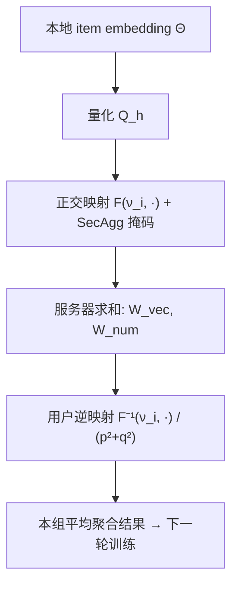

# Privacy-Preserving Orthogonal Aggregation for Guaranteeing Gender Fairness in Federated Recommendation (隐私保护正交聚合：保障联邦推荐中的性别公平)

- **会议/期刊**: WSDM 2025
- **作者与机构**: Siqing Zhang, Yuchen Ding, Wei Tang, Wei Sun, Yong Liao (USTC), Peng Yuan Zhou (Aarhus University)
- **推荐链路定位**: 联邦召回（矩阵分解式 item embedding 聚合）
- **研究方向**: 去偏公平、可信隐私与工业架构 / 联邦推荐
- **论文原文**: [论文原文链接](https://arxiv.org/abs/2411.19678v1)
- **开源代码**: 暂未开源

## TL;DR (1分钟核心速览)

联邦推荐（FRS）中性别组公平长期被忽视：现有 F2MF/F2PGNN 只对齐两组性能差，反而压制优势组，且其噪声式敏感属性保护可被 99.90% 精度反推性别。本文提出 PPOA，用正交属性向量把不同性别映射到高维正交子空间，使服务器在不知性别的前提下完成分组聚合，再叠加 SecAgg 掩码与 16-bit 量化。在 ML-100K/ML-1M/Foursquare-NYC 的 Leave-One-Out 全库排序下，女性/男性 NDCG@10 最高提升 8.25%/6.36%，整体提升 7.30%。

## Background & Motivation (背景与核心矛盾)

- **主流范式**: FRS 中用户本地训练、仅上传 item embedding，服务器按样本量加权平均聚合；公平工作以 F2MF 为代表，在本地损失上加 $\lambda\mathcal{L}_{fair}$ 强制拉平两组性能。
- **前人局限**: 其一，F2MF 只处理"性能差异"，忽略数据不平衡与偏好差异，强行对齐学习速度会拖慢贡献更大的优势组（图 6 中男性性能明显下滑）；其二，为上传组统计量而注入的高斯噪声几乎不提供保护——$\sigma=0.07$ 时 6022 名用户全部被识别，准确率 99.90%。
- **核心洞察 (Key Insight)**: 不公平的根源在**聚合阶段**：少数群体（女性用户少）的偏好被多数群体参数淹没。若能让各组只聚合本组更新，即可从源头消除组间干扰，且无需任何显式公平约束。
- **本文切入点**: 设计双射 $\mathcal{F}:\mathbb{R}^d\to\mathbb{R}^{2d}$，把不同组的向量映射到互相正交的子空间，服务器照常求和，用户用逆映射$\mathcal{F}^{-1}$ 取回本组均值——分组聚合与性别隐私同时成立。

## Method (核心方法设计)

### 1. 整体框架 (Overall Architecture)

每轮中，TTP 生成两组正交属性向量 $\boldsymbol{\nu}_\alpha,\boldsymbol{\nu}_\beta$及 SecAgg 掩码分发给用户；用户先对本地 item embedding 做$h$-bit 量化，再用$\mathcal{F}$映射到本组子空间并叠加掩码，上传$(\boldsymbol{\vartheta}_{vec}\|\boldsymbol{\vartheta}_{num})$；服务器对两部分分别求和（掩码自动抵消），广播$(\mathbf{W}_{vec}\|\mathbf{W}_{num})$；各用户用本组$\boldsymbol{\nu}_i$ 做逆映射并除以组内人数，得到**仅含本组**的平均聚合结果，进入下一轮本地训练。

### 2. 关键设计拆解 (Key Designs)

1. **正交聚合 OA（分组聚合的代数实现）**：直接按性别分组聚合会泄露属性，聚类又不可行。取 $\boldsymbol{\nu}_\alpha=(p,q)$、$\boldsymbol{\nu}_\beta=(-q,p)$，定义$\mathcal{F}(\boldsymbol{\nu}_i,\boldsymbol{\Theta}_i^{(j)})=(\theta_1\boldsymbol{\nu}_i,\dots,\theta_d\boldsymbol{\nu}_i)$，逆映射为逐块点积$\mathcal{F}^{-1}(\boldsymbol{\nu}_i,\mathbf{W})=(\mathbf{W}_1\cdot\boldsymbol{\nu}_i,\dots)$。由于$\boldsymbol{\nu}_\alpha\cdot\boldsymbol{\nu}_\beta=0$，他组贡献在点积中严格为零，用户得到$\frac{1}{n_i}\sum_j\boldsymbol{\Theta}_i^{(j)}$。定理 1 将其推广到$v$组：只要属性向量两两内积为常数$\mu$，即满足$\mathcal{F}^{-1}(\boldsymbol{\nu}_g,\sum_i\sum_j\mathcal{F}(\boldsymbol{\nu}_i,\boldsymbol{\Theta}_i^{(j)}))=\mu\sum_j\boldsymbol{\Theta}_g^{(j)}$。直觉上这是"用内积做组选择器"，把隐私保护转化为一次线性投影。
2. **SecAgg + 量化（隐私与通信的补齐）**：OA 本身不隐藏 $\boldsymbol{\nu}_i$，故用户向量先加一次性掩码$\boldsymbol{\xi}$，服务器所见与随机向量不可区分，从机制上杜绝第 4 节的统计量反推攻击；OA 把上传维度从$d$增至$2d$，用 16-bit 量化（32-bit 浮点→16-bit 整数）恰好抵消这一倍开销。
3. **训练目标、负采样与推理效率**：本地损失即标准逻辑回归式交叉熵 $\mathcal{L}_i=\sum_{(i,j)\in\mathcal{D}_i}-[r_{ij}\log\hat{r}_{ij}+(1-r_{ij})\log(1-\hat{r}_{ij})]$，无额外公平正则、无负采样设计；额外计算仅为标量乘与点积，复杂度$O(d)$，实测单轮额外开销 < 1 秒。

## Experimental Setup & Evaluation Protocol (实验设置与评估协议)

- **数据集与预处理**（评分 >0 统一转为隐式反馈，过滤交互 <10 的用户）：

| 数据集 | #Users | #Items | #Interactions | 稀疏度 | 场景说明 |
| :--- | :---: | :---: | :---: | :---: | :--- |
| ML-100K | 943 | 1,682 | 100,000 | 93.70% | 电影评分 |
| ML-1M | 6,040 | 3,706 | 1,000,209 | 95.53% | 电影评分 |
| Foursquare-NYC | 899 | 3,485 | 36,342 | 98.84% | LBS 签到 |

- **数据划分与防穿越**: `Leave-One-Out`（每用户最后一条为测试）。
- **排名评测协议**: 全库排序（对全部未交互 item 打分），指标 HR@10 / NDCG@10；组性能取组内用户指标均值，整体性能取两组均值的平均（非全体用户平均）。
- **对比基线与超参**: FedMF（无公平约束）、F2MF（SOTA 公平 FRS；因不引入额外数据源且公平机制相同，F2PGNN 未作基线）；embedding 维度 $d=32$、batch 256、lr 0.001、本地 3 epoch、F2MF 取$\lambda=0.5,\rho=1$、PPOA 量化$h=16$，5 次重复取均值。

## Key Experimental Results (实验关键数据)

### 1. 主实验对比 (Main Results)

以 NDCG@10 为核心（原文主结果为图 6 曲线，此处取文中报告值）：

| 数据集 / 组别 | FedMF | F2MF | PPOA | Improv.% (vs 最优基线) |
| :--- | :---: | :---: | :---: | :---: |
| ML-100K Female | 0.2072 | 较低 | **0.2243** | +8.25% |
| ML-100K Male | 0.2061 | 较低 | **0.2192** | +6.36% |
| ML-100K Overall | — | — | **—** | +7.30% |
| ML-1M / NYC | 次优 | 训练偏慢 | **最优** | 各组均领先 |

公平性（$|E_{male}-E_{female}|$，越小越好）：

| 方法 | ML-100K HR | ML-100K NDCG | ML-1M HR | ML-1M NDCG | NYC HR | NYC NDCG |
| :--- | :---: | :---: | :---: | :---: | :---: | :---: |
| FedMF | 0.0128 | 0.0011 | 0.0429 | 0.0234 | 0.0564 | 0.0209 |
| F2MF | 0.0078 | 0.0023 | 0.0264 | 0.0177 | 0.0207 | 0.0060 |
| PPOA | 0.0316 | 0.0051 | **0.0165** | **0.0110** | **0.0038** | **0.0010** |

### 2. 消融实验 (Ablation Study)

| 配置 | 关键结果 | 说明 |
| :--- | :--- | :--- |
| PPOA 完整版 | 最优 HR/NDCG | 基准 |
| 交换男女模型参数 | ML-100K NDCG@10 下降 28.62% | 验证组偏好被真实保留 |
| w/o 量化 ($h$ 关闭) | 精度几乎不变 | 量化不损性能 |
| 量化 $h=16$| 通信开销减半 | 抵消$2d$ 维度膨胀 |
| 计算开销 | 单轮额外 < 1 s | $O(d)$ 可忽略 |

### 3. 关键实验发现 (Key Findings)

1. **分组聚合优于性能对齐**：PPOA 在 ML-100K 上同时提升两组（+8.25%/+6.36%），而 F2MF 因强制拉平学习速度导致男性组训练变慢，说明"消除组间干扰"比"施加公平约束"更符合帕累托改进。
2. **公平性随数据规模改善**：ML-1M 与 NYC 上 PPOA 的 HR 差距降至 0.0165/0.0038，显著优于 F2MF；ML-100K 公平性反而较差（0.0316），但该数据集上 PPOA 两组绝对性能均最优，作者归因于小数据下组内样本不足。
3. **偏好确实被保留**：交换男女参数后 NDCG@10 骤降 28.62%，t-SNE 显示 PPOA 的男女 item embedding 呈"形状相似、分布分离"，定量印证了偏好差异（图 1(c) 中 top-K 重合度差近 50%）被模型捕获而非抹平。

## Highlights & Limitations (亮点、对比与审稿批判)

- **与代表作对比 (vs. Prior Work)**: 相比 F2MF/F2PGNN 的"损失层公平约束"，PPOA 把公平前移到**聚合算子**，不牺牲任何一方；相比 FedMF 的同态加密，SecAgg+量化在隐私强度与通信开销间取得更优折中，且首次指出噪声式属性保护的统计可辨识漏洞。
- **可迁移亮点**: 正交属性向量本质是"隐私保护的组选择器"，可直接迁移到年龄/地区等多属性分组聚合；量化抵消维度膨胀的技巧适用于任何需要上传高维向量的联邦协议。
- **审稿级局限批判**: 其一，完全隔离组间信息在少数群体数据极少时会欠拟合，作者仅以 Group Fusion 系数 $\gamma$ 作定性讨论、未实验验证；其二，ML-100K 公平性指标劣于 F2MF，且主结果以曲线呈现、缺少完整数值表与显著性检验，评估严谨度略打折。

## Rating (四维评分)

- **方法创新性 (Novelty)**: ⭐⭐⭐⭐ （正交映射实现隐私分组聚合，代数构造简洁且有定理 1 支撑，属机制级创新）
- **评估协议与实验扎实度 (Protocol & Experiments)**: ⭐⭐⭐ （三数据集+LOO 全库排序合理，但主结果缺数值表、无显著性检验，公平性在小数据集上不占优）
- **写作与数学规范度 (Clarity & Rigor)**: ⭐⭐⭐⭐ （攻击分析与定理证明完整，符号清晰，量化/掩码开销分析到位）
- **工业落地与复现价值 (Industrial & Practical Value)**: ⭐⭐⭐ （协议轻量、额外开销 <1s 且通信不增，但依赖 TTP、未开源，多属性扩展时通信随组数增长）

