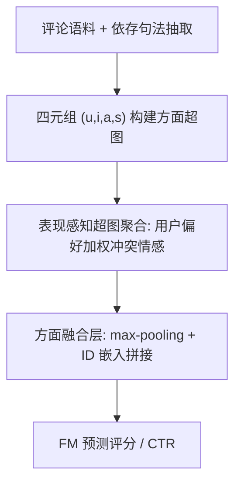
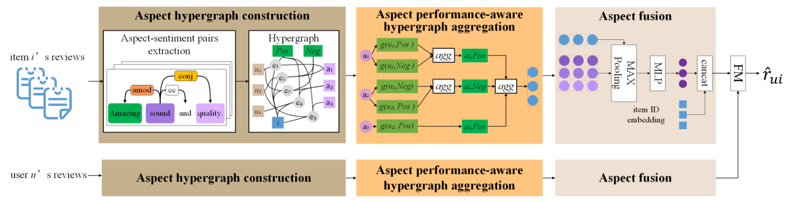

# An Aspect Performance-aware Hypergraph Neural Network for Review-based Recommendation (面向评论推荐的方面表现感知超图神经网络)

- **会议/期刊**: WSDM 2025
- **作者与机构**: Junrui Liu, Tong Li, Di Wu, Zifang Tang, Yuan Fang, Zhen Yang（北京工业大学、北京警察学院、新加坡管理大学）
- **推荐链路定位**: 精排（评分预测 / CTR 预估）
- **研究方向**: 图神经网络与知识图谱推荐 / 多模态推荐（文本评论理解）
- **论文原文**: [https://arxiv.org/abs/2501.15429v1](https://arxiv.org/abs/2501.15429v1)
- **开源代码**: [https://github.com/dianziliu/APH](https://github.com/dianziliu/APH)

## TL;DR (1分钟核心速览)

现有评论驱动推荐只建模"用户关心哪些方面"，却忽略了"物品在该方面实际表现如何"——因为数据集中根本没有方面级评分。APH 从用户评论中抽取 $(u,i,a,s)$ 四元组构建方面超图，用"用户偏好 + 情感语义"联合加权聚合相互冲突的情感极性，反推出物品在各方面的表现分，并以此作为注意力权重聚合方面节点。在 6 个 Amazon/Yelp 数据集上，MSE 平均降低 2.30%，Pre@5 与 Rec@5 分别提升 4.89% 与 1.60%。

## Background & Motivation (背景与核心矛盾)

- **主流范式**: APRE、MA-GNNs、RGNN 等方法从评论中抽取显式方面，用 GNN/注意力建模用户对物品特定属性的细粒度偏好，再聚合方面表示用户与物品。
- **前人局限**: 其一，聚合公式 $x_i=\sum_{a}w(x_a)\cdot x_a$ 中的权重只由方面内容或用户偏好决定，**完全不含物品在该方面的真实表现**，导致"用户很在意但物品做得很差"的方面被错误高权重聚合；其二，方面级表现数据在真实数据集中不可得，无法直接监督学习。
- **核心洞察 (Key Insight)**: 评论中的情感极性虽主观且相互冲突（同一甜点，清淡口味者说"刚好"、甜食爱好者说"太淡"），但冲突本身源于**用户偏好差异**；若按用户偏好对情感加权再聚合，即可从群体冲突中还原出物品的客观表现（上例可推断该甜点偏淡）。
- **本文切入点**: 用表达能力更强的**超图**（一条超边完整承载一个四元组关系，简单图会丢失"谁对什么持何种极性"）替代简单图，并在超边聚合中显式引入"表现推断"算子。

## Method (核心方法设计)

### 1. 整体框架 (Overall Architecture)

APH 分四步闭环：① 用 spaCy 依存句法（`amod`、`nsubj+acomp`、`dobj` 三条规则）无监督抽取方面-情感对，结合用户与物品构成四元组 $(u,i,a,s)$，每条四元组即一条连接四类节点的超边；② 方面表现感知超图聚合层对与物品$i$、方面$a$ 相关的全部超边做 softmax 加权，权重由"物品-方面"与"用户偏好条件下的情感"的关系注意力决定，聚合得到物品/用户的方面表示；③ 方面融合层对一阶方面邻居做 max-pooling 后与 ID 嵌入拼接，刻画"因某方面极端表现购买"与"因整体表现购买"两种决策模式；④ FM 层融合用户与物品向量输出评分。

<figure class="paper-figure" markdown="span">
  <figcaption>图2：APH 框架。该框架首先从评论中提取方面和用户情感以构建超图。然后，为了从冲突的用户情感中学习物品与方面之间的真实关系，APH 考虑用户偏好以识别其情感的权重。同样，我们采用类似方式计算基于方面的用户表示。最后，APH 融合物品、邻居方面节点及其 ID 嵌入以进行预测。</figcaption>
</figure>

### 2. 关键设计拆解 (Key Designs)

1. **方面表现感知超图聚合（Aspect Performance-aware Aggregation）**：针对"表现不可得"痛点，把聚合权重从 $w(x_a)$改写为$w(x_a, q_i(x_u,x_s))$，其中$q_i$ 用 MLP 实现，将用户嵌入与情感极性嵌入映射为"该用户情感的可信度修正项"；超边权重为
$$w(e)=\frac{\exp[\pi(x_i,q_i(x_u,x_s),x_a)]}{\sum_{e'\in E_i}\exp[\pi(x_i,q_i(x_{u'},x_{s'}),x_a)]}$$
其中 $\pi$为关系注意力$\text{LeakyReLU}[(x_iW_1)(x_qW_2+x_aW_3)]$。关键细节：softmax 的归一化范围取$E_i$（物品全部超边）而非$E_{i,a}$（单方面超边），否则同一方面内权重恒为 1，无法体现方面间表现差异。物理直觉：偏好温和的用户给出"过甜"评价，其情感被降权，从而让群体冲突收敛到物品真实表现。
2. **方面融合层（Aspect Fusion）**：用户可能因某方面极端表现或整体表现决策，故对排序后的方面特征矩阵做 max-pooling 得 $\hat{g}_i=\max_{t=1}^{d_2}X_i(:,t)$，经 ReLU 后与方面聚合表示$m_i$拼接为$y_i=m_i\oplus g_i$，兼顾"尖峰方面"与"综合方面"两种信号。
3. **训练目标与复杂度**：采用 MSE 回归损失 $\mathcal{L}=\frac{1}{|D|}\sum_{(u,i)}(r_{ui}-\hat{r}_{ui})^2+\lambda\|\Phi\|_F^2$，无负采样；CTR 任务改用交叉熵 + sigmoid，负采样比 4:1。单次预测复杂度$O(|E_i|d^3)$，瓶颈在超边聚合，可离线预计算物品侧表示。

## Experimental Setup & Evaluation Protocol (实验设置与评估协议)

- **数据集与预处理**: Amazon 五个 5-core 子集 + Yelp（用户/物品至少 10 条评论）：

| 数据集 | #Users | #Items | #Interactions | 密度 | 场景说明 |
| :--- | :---: | :---: | :---: | :---: | :--- |
| Music | 1,429 | 900 | 10,261 | 0.80% | 乐器，最稠密 |
| Office | 4,905 | 2,420 | 53,228 | 0.45% | 办公用品 |
| Toys | 19,412 | 11,924 | 167,597 | 0.07% | 玩具游戏 |
| Games | 24,303 | 10,672 | 231,577 | 0.09% | 电子游戏 |
| Beauty | 22,363 | 12,101 | 198,502 | 0.07% | 美妆 |
| Yelp | 26,084 | 65,786 | 3,519,533 | 0.04% | 本地生活，最稀疏 |

- **数据划分与防穿越 (Splitting Strategy)**: 随机 **比例划分**，80% 用户-物品评论对训练、20% 测试（非时间切分，存在轻度未来信息泄漏风险）。
- **排名评测协议 (Ranking Protocol)**: 评分预测用 MSE 与 NDCG@10；CTR 任务用 **Sampled Ranking**，每个正样本采 4 个未观测负样本，报告 Pre@5 / Rec@5。
- **对比基线与超参设置**: 三类基线——传统评分模型（PMF、SVD++）、评论模型（CDL、DeepCoNN、NARRE、CARL、DAML、DSRLN）、方面模型（NRCA、ANR、MA-GNNs、RGNN）；结果取 5 次运行均值，标准差多小于 0.001。

## Key Experimental Results (实验关键数据)

### 1. 主实验对比 (Main Results)

评分预测 MSE（越低越好，节选）：

| 模型 | Music | Office | Toys | Games | Beauty | Yelp |
| :--- | :---: | :---: | :---: | :---: | :---: | :---: |
| SVD++ | 0.7952 | 0.7213 | 0.8276 | 1.2081 | 1.2129 | 1.2973 |
| NARRE | 0.7688 | 0.7266 | 0.7912 | 1.1120 | 1.1997 | 1.2675 |
| DAML | 0.7401 | 0.7164 | 0.7909 | 1.1086 | 1.2175 | 1.2700 |
| DSRLN | 0.7538 | 0.7131 | 0.8141 | 1.1205 | 1.1951 | 1.1655 |
| RGNN | 0.7319 | 0.7125 | **0.7786** | 1.0996 | 1.1885 | 1.2645 |
| **APH** | **0.6795** | **0.6884** | 0.7859 | **1.0829** | **1.1757** | **1.1467** |
| Improv. | 7.16% | 3.38% | -0.94% | 1.52% | 1.08% | 1.61% |

CTR 任务（Pre@5 / Rec@5，节选）：

| 模型 | Music | Office | Games | Beauty | Yelp |
| :--- | :---: | :---: | :---: | :---: | :---: |
| RGNN | 0.2690/0.7453 | 0.3229/0.6967 | 0.2809/0.7164 | 0.2985/0.7387 | 0.3824/0.6592 |
| DSRLN | 0.2721/0.7518 | 0.3386/0.7386 | 0.2673/0.7131 | 0.3044/0.7642 | 0.4278/0.7248 |
| **APH** | **0.2730/0.7566** | **0.3461/0.7433** | **0.3263/0.7890** | **0.3158/0.7753** | **0.4407**/0.6996 |

NDCG@10 上 APH 在六数据集全面最优（如 Yelp 0.965 vs. RGNN 0.963）。

### 2. 消融实验 (Ablation Study)

| 变体 | Music | Office | Toys | Games | Beauty | Yelp |
| :--- | :---: | :---: | :---: | :---: | :---: | :---: |
| APH(MAX) | 0.7006 | 0.6951 | 0.7972 | 1.0879 | 1.1773 | 1.1913 |
| APH(MEAN) | 0.6933 | 0.7010 | 0.7918 | 1.0799 | 1.1820 | 1.1755 |
| APH(-AF) | 0.6873 | 0.7068 | 0.8040 | 1.0958 | 1.1899 | 1.1869 |
| APH(-FM) | 0.8173 | 0.7196 | 0.8228 | 1.1052 | 1.1999 | 1.1714 |
| **APH** | **0.6795** | **0.6884** | **0.7859** | **1.0829** | **1.1757** | **1.1467** |

### 3. 关键实验发现 (Key Findings)

1. **表现感知聚合是最大增益源**：替换为 max/mean pooling 后 MSE 在 Music 上从 0.6795 升至 0.6933/0.7006（退化 2.0%–3.1%），Yelp 上退化至 1.1755/1.1913，证明"从冲突情感推断表现"而非简单池化是核心贡献；且 MAX 与 MEAN 各有胜负，说明单一池化无法自适应方面重要性。
2. **FM 高阶交互不可替代**：去掉 FM 改用点积后 Music MSE 暴涨至 0.8173（+20.3%），说明用户/物品的方面级细粒度特征需要二阶交叉才能有效匹配，而非简单内积。
3. **方面融合层在稀疏集上更关键**：`-AF` 在 Toys（密度 0.07%）上 MSE 从 0.7859 退化到 0.8040（+2.3%），而在稠密的 Music 上仅 +1.1%，说明稀疏场景下方面邻居是补充协同信号的主要来源；Toys 上 RGNN 反超（0.7786 vs. 0.7859）则因该集抽取的方面更多反映用户特征而非物品特征，放大了预测方差。

## Highlights & Limitations (亮点、对比与审稿批判)

- **与代表作对比 (vs. Prior Work)**: 相比 APRE（仅用方面内容相似度定权）与 MA-GNNs（预定义四方面 + 路由融合），APH 首次把"物品方面表现"作为可学习隐变量引入聚合权重；相比 RGNN（为每个用户/物品建子图 + 图池化），APH 用统一超图保留四元组完整语义，避免简单图的关系坍缩。
- **可迁移亮点**: ① "用偏好加权冲突主观信号反推客观属性"的聚合范式可迁移到多模态评论、A/B 反馈融合等场景；② softmax 归一化范围取全邻居集而非同组子集这一细节，是避免组内权重饱和的通用技巧。
- **审稿级局限批判**: ① 方面抽取依赖依存句法与情感词典，Top-10 方面中出现 "son"、"daughter" 等噪声词，抽取质量直接决定上限且无端到端联合优化；② 随机 80/20 划分而非时间切分，评测偏乐观；超边聚合复杂度 $O(|E_i|d^3)$ 在 Yelp 级（2000 万四元组）数据上在线推理开销未做实测。

## Rating (四维评分)

- **方法创新性 (Novelty)**: ⭐⭐⭐⭐ （"从冲突情感反推方面表现"的建模视角新颖，超图四元组建模与归一化范围设计有巧思，但整体仍是注意力聚合框架的增量改进）
- **评估协议与实验扎实度 (Protocol & Experiments)**: ⭐⭐⭐ （六数据集 + 双任务 + 消融较完整，但随机划分存在泄漏风险、CTR 仅采样排序、缺显著性检验与效率实测）
- **写作与数学规范度 (Clarity & Rigor)**: ⭐⭐⭐⭐ （公式推导链条清晰、复杂度分析明确，但部分符号如 $q_i$与$p_i(a)$ 的对应关系表述略松散）
- **工业落地与复现价值 (Industrial & Practical Value)**: ⭐⭐⭐⭐ （代码与数据已开源，规则抽取无需标注成本，但依存句法预处理与超图构建的工程链路较重，大规模在线部署需预计算优化）

