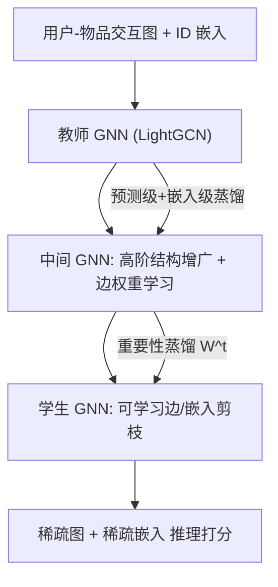
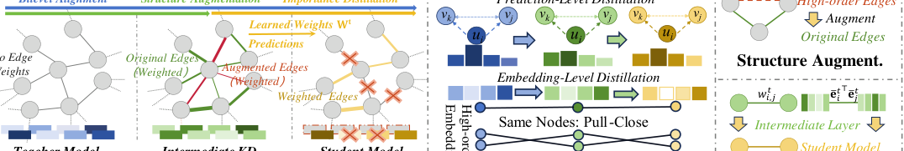

# LightGNN: Simple Graph Neural Network for Recommendation (轻量图神经网络推荐)

- **会议/期刊**: WSDM 2025
- **作者与机构**: Guoxuan Chen, Lianghao Xia, Chao Huang (香港大学 HKUDS)
- **推荐链路定位**: 召回（图协同过滤表征学习）
- **研究方向**: 图神经网络与知识图谱推荐 / 自监督对比学习与交互去噪
- **论文原文**: [https://arxiv.org/abs/2501.03228v3](https://arxiv.org/abs/2501.03228v3)
- **开源代码**: [https://github.com/HKUDS/LightGNN](https://github.com/HKUDS/LightGNN)

## TL;DR (1分钟核心速览)

GNN 协同过滤面临两大痛点：交互图与 ID 嵌入表规模爆炸导致存储/计算不可扩展，且隐式反馈中充斥误点击与冗余同类交互。LightGNN 提出**可学习剪枝框架**：为每条边赋可学习权重、对嵌入维度做幅度剪枝，并用**分层知识蒸馏**（预测级+嵌入级双层对齐、高阶结构增广的中间蒸馏层、重要性蒸馏）保住性能。在 Gowalla/Yelp/Amazon 三数据集、Full-Ranking 协议下，裁剪 80% 边与 90% 嵌入条目仍全面超越 18 个基线，Amazon Recall@20 达 0.1189（较最强基线 SimRec 0.1067 提升 11.4%），FLOPs 降 90%。

## Background & Motivation (背景与核心矛盾)

- **主流范式**: 以 LightGCN 为代表的 GNN 协同过滤通过 $L$ 阶邻域嵌入平滑捕获高阶协同信号，配合 BPR 损失训练；SGL/SimGCL/HCCF 等自监督方法进一步缓解稀疏性。
- **前人局限一（可扩展性）**: 时间复杂度 $O(L\times|\mathcal{E}|\times d)$、空间$O(|\mathcal{E}|+(I+J)\times d)$，边数与 ID 嵌入表随用户/物品线性膨胀，存储与推理开销难以承受。
- **前人局限二（噪声与冗余）**: 隐式反馈含误点击、流行度偏置等噪声；用户对同类目物品的重复交互构成冗余。现有压缩方法（PinSage 随机采样、SimRec/UnKD 知识蒸馏）**不显式识别**这些噪声，高压缩率下性能崩塌（图 1(b)）。
- **核心洞察 (Key Insight)**: 借鉴彩票假设——GNN 中仅一小部分边与嵌入条目对最终推荐真正重要，若能**端到端学习其重要性**并配合强监督蒸馏，可在激进剪枝下保留甚至提升精度。
- **本文切入点**: 把"剪枝"建模为可学习权重 + 分层蒸馏的联合优化问题，让剪枝本身承担去噪与去冗余职责。

## Method (核心方法设计)

### 1. 整体框架 (Overall Architecture)

LightGNN 采用"教师—中间—学生"三段式：先训练完整 LightGCN 作为教师；再构建**结构增广的中间 GNN**（引入 $h$跳高阶边）并由教师蒸馏，学习每条边的可信权重$\mathbf{W}^t$；最后训练带可学习剪枝权重$\mathbf{W}^s$ 的学生模型，通过预测级/嵌入级双层对齐 + 重要性蒸馏 + 均匀性正则联合优化，迭代执行"训练—按权重幅度剪枝"直至目标保留率。推理时仅保留稀疏边与稀疏嵌入，前向传播开销大幅下降。

<figure class="paper-figure" markdown="span">
  <figcaption>图2：所提出的 LightGNN 模型的整体框架。</figcaption>
</figure>

### 2. 关键设计拆解 (Key Designs)

1. **可学习边剪枝与嵌入/层剪枝**：将传播算子改为 $\mathbf{E}_{U,l}=\mathbf{D}_U^{-\frac{1}{2}}(\mathbf{A}\odot\mathbf{W})\mathbf{D}_V^{-\frac{1}{2}}\mathbf{E}_{V,l-1}+\mathbf{E}_{U,l-1}$，其中$\mathbf{W}$仅在候选边上可学习。$|w_{i,j}|$越大表示该边对推荐越重要，训练后按幅度丢弃最小的$\rho\%$边；嵌入条目同理按$|e_{i,d'}|$剪枝，并减少传播层数$L$ 以缓解过平滑。直觉：权重在端到端 BPR 梯度下自然编码"这条交互是否服务于偏好建模"。

2. **分层知识蒸馏（双层对齐 + 中间层 + 重要性蒸馏）**：预测级用温度化软标签对齐 $\mathcal{L}_{p\text{-}kd}$，嵌入级用 InfoNCE 对齐师生最终表征$\mathcal{L}_{e\text{-}kd}$。中间蒸馏层在增广图$\bar{\mathcal{E}}=\{(u_i,v_j)\mid \bar{a}^{(h)}_{i,j}\neq 0\}$ 上学习高阶连接，防止激进剪枝丢失高阶模式。最终剪枝权重为复合量：
$$\bar{w}^s_{i,j}=w^s_{i,j}+\beta_1 w^t_{i,j}+\beta_2\sigma(\bar{\mathbf{e}}_i^{t\top}\bar{\mathbf{e}}_j^t)$$
即学生自身权重 + 中间教师边权重 + 教师嵌入内积预测，三者融合使剪枝决策同时具备端到端梯度与高阶结构先验。

3. **均匀性正则与训练目标**：以嵌入剪枝掩码的 $l_0$重叠度定义正样本集$\mathcal{S}_i=\{u_{i_1}\mid\|\mathbf{e}_i\odot\mathbf{e}_{i_1}\|_0\geq\max(\|\mathbf{e}_i\|_0,\|\mathbf{e}_{i_1}\|_0)-\delta\}$，构造自适应对比损失$\mathcal{L}_{u\text{-}reg}$推远无关节点、拉近剪枝模式相似节点，抑制过平滑。总损失$\mathcal{L}=\lambda_0\mathcal{L}_{bpr}+\lambda_1\mathcal{L}_{p\text{-}kd}+\lambda_2\mathcal{L}_{e\text{-}kd}+\lambda_3\mathcal{L}_{u\text{-}reg}+\lambda_4\|\Theta\|_F^2$；负采样沿用 BPR 均匀采样，无需额外难负样本挖掘。

## Experimental Setup & Evaluation Protocol (实验设置与评估协议)

- **数据集与预处理**: 过滤交互数 $<3$ 的用户/物品，评分二值化为隐式反馈。

| 数据集 | #Users | #Items | #Interactions | 密度 | 场景说明 |
| :--- | :---: | :---: | :---: | :---: | :--- |
| Gowalla | 25,557 | 19,747 | 294,983 | $5.85\times10^{-4}$ | 地理位置签到 |
| Yelp | 42,712 | 26,822 | 182,357 | $1.59\times10^{-4}$ | 商户评分（最稀疏） |
| Amazon | 76,469 | 83,761 | 966,680 | $1.51\times10^{-4}$ | 图书评分（最大规模） |

- **数据划分与防穿越**: 按 $70:5:25$ 比例划分训练/验证/测试（沿用 SimRec 设定）。
- **排名评测协议**: 无偏 **Full-Ranking**（对每个用户全部未交互物品排序），指标 Recall@{20,40} 与 NDCG@{20,40}。
- **对比基线与超参**: 18 个基线覆盖矩阵分解（BiasMF）、神经 CF（NCF/AutoR）、图方法（NGCF/GCCF/LightGCN/DGCF/PinSage/STGCN/GCMC）、自监督（SGL/SimGCL/NCL/HCCF/SLRec）、压缩方法（GLT/UnKD/SimRec）。嵌入维度 $d=32$，GNN 层数 2，batch 4096，Adam 优化器，RTX 3090 测效率。

## Key Experimental Results (实验关键数据)

### 1. 主实验对比 (Main Results)

| 数据集/指标 | LightGCN | SGL | SimGCL | HCCF | UnKD | SimRec | **LightGNN** | Improv.% |
| :--- | :---: | :---: | :---: | :---: | :---: | :---: | :---: | :---: |
| Amazon R@20 | 0.0868 | 0.0874 | 0.0921 | 0.0885 | 0.0947 | 0.1067 | **0.1189** | +11.4% |
| Amazon N@20 | 0.0571 | 0.0569 | 0.0605 | 0.0578 | 0.0607 | 0.0734 | **0.0820** | +11.7% |
| Gowalla R@20 | 0.2230 | 0.2332 | 0.2328 | 0.2293 | 0.2331 | 0.2434 | **0.2610** | +7.2% |
| Gowalla N@20 | 0.1433 | 0.1509 | 0.1506 | 0.1482 | 0.1496 | 0.1592 | **0.1684** | +5.8% |
| Yelp R@20 | 0.0761 | 0.0803 | 0.0788 | 0.0789 | 0.0819 | 0.0823 | **0.0879** | +6.8% |
| Yelp N@20 | 0.0373 | 0.0398 | 0.0395 | 0.0391 | 0.0392 | 0.0414 | **0.0443** | +7.0% |

### 2. 消融实验 (Ablation Study)

Recall@20，Gowalla 与 Yelp 在不同保留率（嵌入/边）下：

| 变体 | Gowalla .33/.44 | Gowalla .11/.19 | Gowalla .08/.16 | Yelp .11/.60 | Yelp .08/.57 |
| :--- | :---: | :---: | :---: | :---: | :---: |
| ~EmbP（随机丢嵌入） | 0.2197 | 0.0741 | 0.0586 | 0.0434 | 0.0357 |
| ~EdgeP（随机丢边） | 0.2418 | 0.1341 | 0.1133 | 0.0745 | 0.0709 |
| ~BothP（全随机） | 0.1800 | 0.0556 | 0.0421 | 0.0311 | 0.0231 |
| BnEdge（二值边权） | 0.2210 | 0.1280 | 0.1165 | 0.0775 | 0.0754 |
| -BiAln（去双层对齐） | 0.2350 | 0.1934 | 0.1812 | 0.0666 | 0.0650 |
| -IntKD（去中间层） | 0.2607 | 0.2100 | 0.1890 | 0.0788 | 0.0769 |
| -ImpD（去重要性蒸馏） | 0.2593 | 0.2135 | 0.1923 | 0.0808 | 0.0797 |
| **LightGNN** | **0.2610** | **0.2162** | **0.1966** | **0.0856** | **0.0842** |

### 3. 关键实验发现 (Key Findings)

1. **可学习剪枝远胜随机丢弃**：高压缩率下（Gowalla 仅保留 11%/8%）随机丢弃性能崩塌超 70%（0.0556 vs 0.2162），而 LightGNN 几乎无损，证明边权重确实编码了"哪些交互是噪声/冗余"。
2. **中间蒸馏层对稀疏数据最关键**：去掉 -IntKD 后 Yelp 在 .11/.60 保留率下从 0.0856 跌至 0.0788（-7.9%），因 Yelp 最稀疏，高阶增广边能补足被剪掉的直接邻接信息；而 Gowalla 上该模块影响较小。
3. **剪枝带来去噪与抗过平滑双重红利**：MAD 指标上 LightGNN 在 Yelp 达 0.9404、Gowalla 达 0.8742，均高于 SimGCL（0.9103/0.8595）；案例研究（图 6）显示模型对"太咸/太辣"等负评交互自动赋低权重，对同类目冗余商户赋低权重，且这些文本/评分从未作为输入。

## Highlights & Limitations (亮点、对比与审稿批判)

- **与代表作对比**: 相比 PinSage 的随机邻居采样，LightGNN 用梯度学习边重要性；相比 SimRec/UnKD 仅做高层蒸馏，本文显式剪掉细粒度噪声边与嵌入条目，故在同等压缩率下精度更高；相比 GLT 仅剪边，本文联合剪边、嵌入与层数，压缩维度更全。
- **可迁移亮点**: ①"复合剪枝权重 = 学生权重 + 教师权重 + 教师内积预测"的三源融合思路可迁移到任何需要结构化稀疏化的图模型；②用剪枝掩码重叠度定义对比学习正样本，是一种无需数据增广的自监督构造技巧。
- **审稿级局限批判**: ①三段式训练（教师→中间→学生）与多轮"训练-剪枝"迭代带来较高离线调参成本，论文未报告总训练时长；②剪枝率与 $\beta_1,\beta_2,\delta$ 等超参较多且按数据集网格搜索，跨域迁移的鲁棒性缺乏验证；③仅在三个中小规模公开数据集验证，未给出工业级亿级图上的分布式剪枝方案。

## Rating (四维评分)

- **方法创新性 (Novelty)**: ⭐⭐⭐⭐ （将彩票假设与分层蒸馏结合到 GNN 推荐剪枝，复合权重与掩码对比正样本设计有新意，但各组件单独看均非首创）
- **评估协议与实验扎实度 (Protocol & Experiments)**: ⭐⭐⭐⭐ （三数据集 Full-Ranking + 18 基线 + 完整消融/效率/过平滑/案例研究，惟缺显著性检验与训练开销报告）
- **写作与数学规范度 (Clarity & Rigor)**: ⭐⭐⭐⭐ （公式与符号定义清晰、框架图完整，但正文存在少量排版与符号不一致瑕疵）
- **工业落地与复现价值 (Industrial & Practical Value)**: ⭐⭐⭐⭐⭐ （代码开源，80% 边/90% 嵌入裁剪下 FLOPs 降 90%、存储降 70%，对大规模召回部署价值直接）

