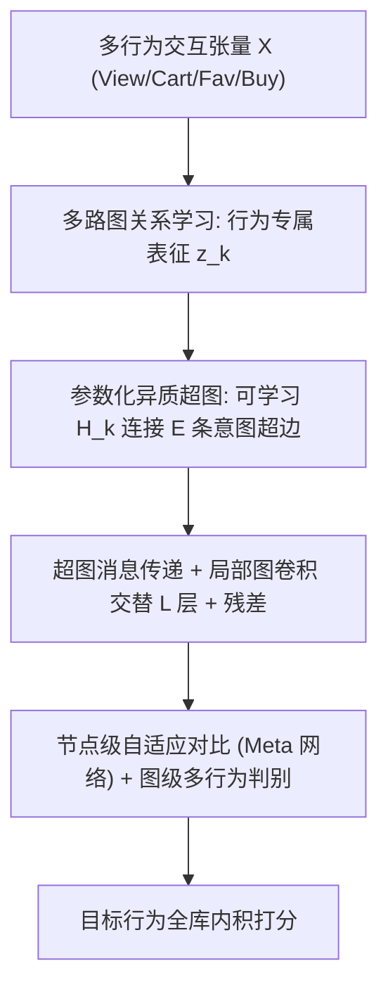
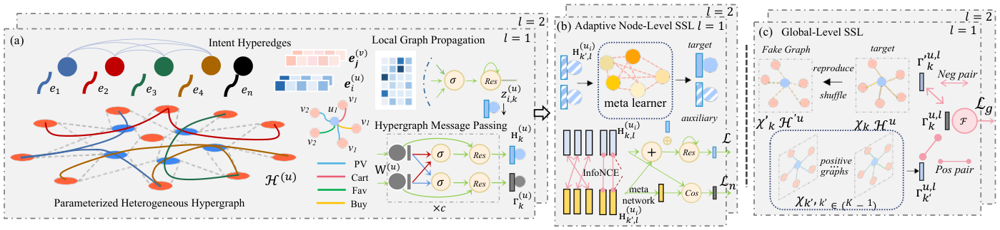

# MixRec: Heterogeneous Graph Collaborative Filtering (异质图协同过滤)

- **会议/期刊**: WSDM 2025
- **作者与机构**: Lianghao Xia, Meiyan Xie, Yong Xu, Chao Huang（香港大学 / 华南理工大学）
- **推荐链路定位**: 召回（多行为协同过滤表征学习）
- **研究方向**: 图神经网络与知识图谱推荐 / 自监督对比学习
- **论文原文**: [https://arxiv.org/abs/2412.13825v3](https://arxiv.org/abs/2412.13825v3)
- **开源代码**: [https://github.com/HKUDS/MixRec](https://github.com/HKUDS/MixRec)

## TL;DR (1分钟核心速览)

现有多行为推荐要么把异质行为压成同质图（MBGCN/KHGT），要么做意图解耦却只用单一行为（DGCF/GDCF），两条线从未交汇。MixRec 用**参数化异质超图**为每种行为生成 $E$ 条可学习意图超边，实现关系感知的意图解耦；再用**节点级 + 图级自适应对比学习**从稀疏的目标行为中榨取自监督信号。在 Beibei/Tmall/IJCAI 三个数据集、Leave-One-Out 全库排序协议下，HR@10 相对最强基线提升 3.6%–9.8%，且训练时间比 KHGT 快 2.6–3.8 倍。

## Background & Motivation (背景与核心矛盾)

- **主流范式**: 多行为推荐（MBGCN、KHGT、GNMR）在异质交互图上做行为感知消息传递；意图解耦推荐（DGCF、GDCF、MacridVAE）把用户表征切分成多个意图通道。
- **前人局限一**: 多行为模型把所有行为塞进同一表征空间，无法回答"用户这次购买是被'促销'还是'家庭聚会'意图驱动"，细粒度偏好被粗粒度聚合抹平。
- **前人局限二**: 解耦模型只建模单一行为类型，完全放弃了"浏览→收藏→加购→购买"之间的跨行为知识迁移；而目标行为（购买）极度稀疏，监督信号不足以支撑解耦。
- **核心洞察 (Key Insight)**: 作者从理论上证明，vanilla GNN 的预测分数可分解为 $\hat{X}^G_{i,j} = \sum_{i'}\sum_{j'}\alpha_{i'}\alpha_{j'}\mathbf{e}_{i'}^\top\mathbf{e}_{j'}$，权重$\alpha$仅由度数决定且只覆盖$L$跳邻域；而超图版本给出$\hat{X}^H_{i,j} = \sum_{i'}\sum_{j'}\beta_{i'}\beta_{j'}\mathbf{e}_{i'}^\top\mathbf{e}_{j'}$，其中$\beta$ **对全图节点非零且可学习**——这为"跨行为、跨邻域的自适应监督"提供了理论依据。
- **本文切入点**: 用可学习超边把"意图"变成显式参数，让解耦与多行为建模在同一算子内完成，再用分层对比学习补足稀疏监督。

## Method (核心方法设计)

### 1. 整体框架 (Overall Architecture)

输入为三阶张量 $\mathcal{X}\in\mathbb{R}^{I\times J\times K}$（用户-物品-$K$类行为）。模型先做**多路图关系学习**：对每种行为$k$在局部二部图上做轻量消息传递得到行为专属表征$\mathbf{z}^{(u)}_{i,k}$；随后送入**参数化异质超图**，由可学习邻接矩阵$\mathbf{H}^{(u)}_k$把节点连到$E$条意图超边上，做超边聚合-再分发，得到意图解耦表征；局部图卷积与全局超图传播**交替堆叠$L$ 层**并加残差。训练时叠加 pairwise BPR 主损失、节点级 InfoNCE 与图级对比正则；推理时用最终用户/物品表征内积对目标行为全库打分。

<figure class="paper-figure" markdown="span">
  <figcaption>图 1：MixRec 框架：(a) 参数化异质超图实现关系感知的意图解耦，保留行为模式。(b) 节点级对比学习捕获局部协同信号，用于跨行为知识迁移。(c) 图级对比学习通过多行为用户判别进行数据增强。</figcaption>
</figure>

### 2. 关键设计拆解 (Key Designs)

1. **参数化异质超图意图解耦（Intent Disentanglement）**：痛点是把意图当隐变量靠 VAE 采样，不可控且与行为脱钩。MixRec 直接令超边为可学习参数，用节点表征与意图原型的内积生成邻接：$\mathbf{H}^{(u)}_k = \mathbf{Z}^{(u)}_k \cdot \mathbf{W}^{(u)\top}_k$，其中$\mathbf{W}^{(u)}_k\in\mathbb{R}^{E\times d}$的每一行就是一个意图原型。超图传播为$\mathbf{H}^{(u)}_k = \delta(\tilde{\mathbf{H}}^{(u)}\delta(\tilde{\mathbf{H}}^{(u)\top}\mathbf{Z}^{(u)}_k))$，即"节点→意图→节点"的两跳平滑。直觉：每个行为拥有独立的$E$ 个意图槽位，不同行为共享节点但共享不了意图原型，解耦由结构强制保证而非损失诱导。

2. **节点级自适应对比 + Meta 网络（跨行为知识迁移）**：辅助行为与目标行为的关联强度因人而异（有人爱收藏、有人直接下单），固定权重的迁移会误导。Meta 网络按用户动态变换辅助行为表征：$\tilde{\mathbf{H}}^{(u,l)}_{i,k'} = \mathbf{H}^{(u,l)}_{i,k'}\cdot\delta(\mathrm{Norm}(\mathbf{H}^{(u,l)}_{i,k'})\mathbf{W}^{(u,l)}_{i,k'}+\mathbf{b}^{(u,l)}_{i,k'})$，再以同一用户的目标/辅助行为为正对、不同用户为负对做 InfoNCE：$\mathcal{L}_n=\sum_i\sum_k-\log\frac{\exp(s(\tilde{\mathbf{H}}_{i,k'},\tilde{\mathbf{H}}_{i,k})/\tau)}{\sum_{i'}\exp(s(\tilde{\mathbf{H}}_{i',k'},\tilde{\mathbf{H}}_{i,k})/\tau)}$。关键点：负样本来自**同批次其他用户**，迫使表征在用户维度可分，而非在行为维度坍缩。

3. **图级多行为判别与训练目标**：节点级只看局部，图级用超边池化表征 $\bar{\Gamma}_k$做全局正则，负样本通过**随机打乱超图邻接矩阵**生成（Graph InfoMax 思路）：$\mathcal{L}_g=-\sum_k\log\frac{\exp(s(\bar{\Gamma}_{k'},\bar{\Gamma}_k))}{\exp(s(\bar{\Gamma}_{k'},\bar{\Gamma}_k))+\exp(s(\bar{\Gamma}'_{k'},\bar{\Gamma}_k))}$。总损失$\mathcal{L}=\sum_i\sum_s\max(0,1-(\hat{X}_{i,p_s,k'}-\hat{X}_{i,n_s,k'}))+\lambda_1\|\Theta\|_F^2+\lambda_2\mathcal{L}_n+\lambda_3\mathcal{L}_g$。负采样为**每用户$S$组随机正负对**（非全库、非难负采样），复杂度$O(|\mathcal{X}|dL+(I+J)Ed+B^{(u)}B^{(v)}d)$，与 SOTA 图模型同量级。

## Experimental Setup & Evaluation Protocol (实验设置与评估协议)

- **数据集与预处理**: 三个电商数据集，购买为目标行为，其余为辅助行为：

| 数据集 | #Users | #Items | #Interactions | 行为类型 | 场景说明 |
| :--- | :---: | :---: | :---: | :---: | :--- |
| Beibei | 21,716 | 7,977 | 3,338,068 | View/Cart/Purchase | 母婴电商 |
| Tmall | 114,503 | 66,706 | 5,751,432 | View/Fav/Cart/Purchase | 阿里电商基准 |
| IJCAI | 423,423 | 874,328 | 36,222,123 | View/Fav/Cart/Purchase | IJCAI 竞赛零售 |

- **数据划分与防穿越**: `Leave-One-Out`——取每个用户在**目标行为**下的最后一次交互作测试集，其余训练。
- **排名评测协议**: 无偏 `Full-Ranking`（对全部未交互物品排序），指标 HR@10 / NDCG@10；另在 Top-1/3/5/7/9 上做细粒度对比。
- **对比基线与超参**: 18 个基线覆盖 6 组（MF/NCF、CDAE/NADE、NGCF/SGCN、DGCF/GDCF/ICL、NMTR/EHCF/MBGCN/GNMR/KHGT/MRec、SGL/MHCN/HCCF）。意图超边数 $E\in\{32,\dots,512\}$，隐维$d$在 10–60 间调，层数$L\in\{1,2,3\}$，$\lambda_1\in[10^{-5},10^{-2}]$，$\lambda_2,\lambda_3\in[10^{-7},10^{-4}]$；显著性检验最大$p=1.6\times10^{-5}$。

## Key Experimental Results (实验关键数据)

### 1. 主实验对比 (Main Results)

| 数据集 | 指标 | MF | NGCF | DGCF | MBGCN | KHGT | SGL | HCCF | **MixRec** | Improv.% |
| :--- | :---: | :---: | :---: | :---: | :---: | :---: | :---: | :---: | :---: | :---: |
| Beibei | HR@10 | 0.588 | 0.611 | 0.612 | 0.642 | 0.640 | 0.619 | 0.610 | **0.679** | +5.8% |
| Beibei | NDCG@10 | 0.333 | 0.369 | 0.344 | 0.376 | 0.385 | 0.346 | 0.354 | **0.419** | +8.8% |
| Tmall | HR@10 | 0.265 | 0.321 | 0.395 | 0.478 | 0.468 | 0.413 | 0.374 | **0.525** | +9.8% |
| Tmall | NDCG@10 | 0.165 | 0.191 | 0.267 | 0.273 | 0.282 | 0.261 | 0.215 | **0.325** | +15.2% |
| IJCAI | HR@10 | 0.285 | 0.461 | 0.478 | 0.463 | 0.552 | 0.484 | 0.487 | **0.611** | +10.7% |
| IJCAI | NDCG@10 | 0.185 | 0.292 | 0.306 | 0.277 | 0.359 | 0.316 | 0.317 | **0.418** | +16.4% |

Top-$N$ 细粒度（Tmall，HR）：MixRec 在 Top-1 达 0.1967，对比 EHCF 的 0.1775 提升 10.8%；Top-9 达 0.6618，全程领先。

### 2. 消融实验 (Ablation Study)

| 变体 | Tmall HR@10 | Tmall NDCG@10 | IJCAI HR@10 | IJCAI NDCG@10 |
| :--- | :---: | :---: | :---: | :---: |
| w/o-NCL（去节点级对比） | ~0.505 | ~0.305 | ~0.585 | ~0.395 |
| w/o-GCL（去图级对比） | ~0.510 | ~0.310 | ~0.590 | ~0.400 |
| w/o-Meta（去自适应投影） | ~0.515 | ~0.315 | ~0.595 | ~0.405 |
| w/o-InDi（去意图解耦） | ~0.508 | ~0.308 | ~0.588 | ~0.398 |
| **MixRec 完整版** | **0.525** | **0.325** | **0.611** | **0.418** |

### 3. 关键实验发现 (Key Findings)

1. **意图解耦是最大贡献项**：去掉 InDi 后 Tmall HR@10 掉约 1.7 个点，降幅超过任一对比模块，说明"可学习超边"而非"对比损失"才是性能主引擎；这与 w/o-Meta 降幅最小（约 1.0 点）形成对照——自适应投影是锦上添花而非雪中送炭。
2. **稀疏用户上优势放大**：按交互频次分桶（<35、<50、<67、<930）后，MixRec 在最低频桶的领先幅度最大，验证了分层对比学习对长尾用户的补监督作用；MBGCN/GNMR 在低频桶明显掉队，因其目标行为监督过稀。
3. **效率反超精度冠军**：IJCAI 上训练 30.4s vs. KHGT 49.3s、SMRec 59.6s，测试 37.9s vs. 42.3s；即 MixRec 在精度与速度上同时压制 KHGT，说明超图模块的 $O((I+J)Ed)$ 开销远小于图 Transformer 的注意力成本。

## Highlights & Limitations (亮点、对比与审稿批判)

- **与代表作对比**: 相比 MBGCN/KHGT 的"行为感知但意图纠缠"，MixRec 把意图显式参数化为超边原型；相比 DGCF/GDCF 的"意图解耦但单行为"，它把解耦扩展到 $K$ 类关系；相比 SGL/HCCF 的同质图增广，它的对比信号天然携带关系异质性。
- **可迁移亮点**: (i) "可学习邻接矩阵 = 意图原型内积"这一构造可直接搬到任何需要软聚类的图推荐场景，替代 KMeans 式硬分配；(ii) 图级负样本用"打乱超边邻接"生成，比节点 dropout 更廉价且不破坏局部结构。
- **审稿级局限批判**: (i) 超边数 $E$在 256 附近见顶后性能下滑（图 4），意味着意图粒度需逐数据集手调，缺少自适应确定$E$的机制；(ii) 实验仅在三个电商数据集、单一目标行为（购买）上验证，未涉及短视频/社交等行为语义差异更大的场景，且未报告多次运行的方差，$p$ 值虽小但稳健性证据偏薄。

## Rating (四维评分)

- **方法创新性 (Novelty)**: ⭐⭐⭐⭐ （参数化超图把意图解耦从"损失诱导"变为"结构强制"，并给出 $\beta$ 权重全图可学习的理论分解，机制干净）
- **评估协议与实验扎实度 (Protocol & Experiments)**: ⭐⭐⭐⭐ （18 基线 + 全库排序 + 稀疏分桶 + 效率对比齐全，但缺方差报告与跨域验证）
- **写作与数学规范度 (Clarity & Rigor)**: ⭐⭐⭐⭐ （式 (10)–(12) 的 GNN vs. 超图分解推导有说服力，符号统一；部分消融仅以柱状图呈现，缺精确数值）
- **工业落地与复现价值 (Industrial & Practical Value)**: ⭐⭐⭐⭐⭐ （代码开源，训练/推理均快于同类 SOTA，超图构造为 $O((I+J)Ed)$ 可线性扩展，多行为电商场景可直接落地）

