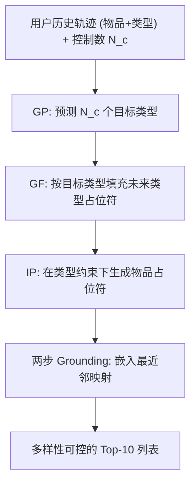
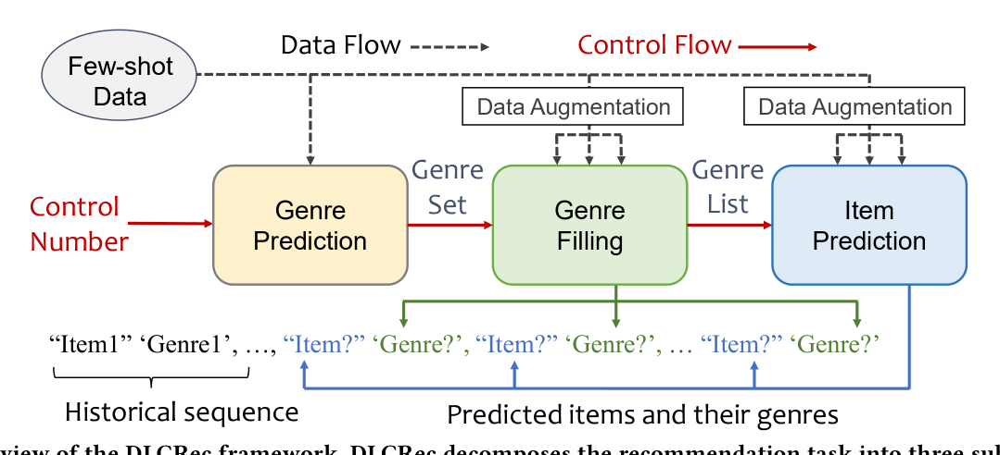

# DLCRec: A Novel Approach for Managing Diversity in LLM-Based Recommender Systems (面向 LLM 推荐系统多样性管理的新框架)

- **会议/期刊**: WSDM 2025
- **作者与机构**: Jiaju Chen, Chongming Gao (USTC), Shuai Yuan (HKUST), Shuchang Liu, Qingpeng Cai, Peng Jiang (独立/快手)
- **推荐链路定位**: 端到端生成式（列表级生成推荐）
- **研究方向**: 大语言模型推荐 / 生成式推荐
- **论文原文**: [论文原文链接](https://arxiv.org/abs/2408.12470v3)
- **开源代码**: [开源代码仓库链接](https://github.com/Jiaju-Chen/DLCRec)

## TL;DR (1分钟核心速览)

LLM 微调推荐精度高但输出高度同质化，现有"单 prompt 控制多样性"过于粗糙。DLCRec 把列表推荐拆成 **类型预测 (GP) → 类型填充 (GF) → 物品预测 (IP)** 三个独立微调、级联推理的子任务，让用户指定的"类型数"作为控制数在三级间传播，并用 GF-N/GF-D/IP-N/IP-D 四种增广对抗多样性信号稀疏与偏斜。在 Movie/Steam 上，控制数 2/5/8 三档下 MAE_Cov@10 全面最低（如 Movie 控制数 8 时 0.511 vs. 基线 5.475），精度仅小幅让步。

## Background & Motivation (背景与核心矛盾)

- **主流范式**: 以 BIGRec 为代表的 LLM 微调推荐将用户历史序列直接映射为下一物品/列表，语义泛化强、少样本友好。
- **前人局限**: ① 微调目标只对齐"最可能"的显式信号，模型倾向复现历史高频类型，形成回音室；② 单 prompt / CoT 提示无法表达"列表需覆盖 $k$ 个类型"这类组合约束，控制数一变即失效。
- **核心洞察 (Key Insight)**: 多样性本质是**列表级类型覆盖约束**，而 LLM 擅长的是逐 token 的局部生成——把"覆盖几个类型"这一全局约束显式拆成可监督的中间变量（类型集合），才能被微调学到。
- **本文切入点**: 用任务分解把隐式的多样性需求转成三级显式监督信号，再用增广补齐控制数分布的稀疏长尾。

## Method (核心方法设计)

### 1. 整体框架 (Overall Architecture)

输入为用户历史交互轨迹（物品 + 主类型），输出为长度 10 的推荐列表。训练阶段三个子任务各自用 few-shot 数据独立指令微调（PEFT），互不共享数据；推理阶段按用户给定控制数 $N_c$级联执行：GP 依据$N_c$生成$N_c$ 个目标类型 → GF 将这些类型填入未来位置占位符 → IP 在类型约束下逐位生成物品，最后经 BIGRec 式两步 grounding（生成嵌入 → 最近邻映射回真实物品）保证合法性。控制数贯穿三级 prompt，实现"改一个数、控整张列表"。

<figure class="paper-figure" markdown="span">
  <figcaption>图2：DLCRec框架概览。DLCRec将推荐任务分解为三个子任务：类型预测、类型填充和物品预测。该框架由两个互补组件构成：训练框架（黑线）和控制框架（红线）。在训练框架中，我们利用少样本数据与数据增强独立训练每个子任务。相比之下，控制框架通过在三个子任务中传播控制数，实现对最终推荐列表多样性的显式控制。</figcaption>
</figure>

### 2. 关键设计拆解 (Key Designs)

1. **三级任务分解 (GP/GF/IP)**：单任务微调把"选类型"与"选物品"耦合，模型退化为复制历史高频类型（图 5 显示 GP+GF 合并后 Recall@10 从 0.785 跌至 0.345）。分解后 GF 用固定模板 `"item" 'genre', "_" '?', ...` 约束输出格式，使类型序列成为 IP 的显式条件，等价于把全局覆盖约束注入自回归解码的每一步条件分布 $P(y_t \mid x, y_{<t}, \mathcal{G})$，其中$\mathcal{G}$ 为 GF 输出的类型多重集。

2. **面向控制分布的四种数据增广**：原始数据中类型数分布尖峰于 4–5（图 3），极端控制数几乎无监督。GF-D 从 $[1,10]$均匀采样$N_c$并增删类型使序列类型数对齐$N_c$；GF-N 随机替换一个类型注入噪声；IP-N 以错误率$r=0.3$ 把部分物品替换为异类型物品，模拟上游 GP/GF 的预测误差；IP-D 为 GF-D 新增的类型补采物品。直觉是让模型在训练中"见过"上游出错与极端控制数，从而在推理时对 OOD 控制目标鲁棒。

3. **训练目标与推理开销**：三模型均优化标准自回归损失 $\mathcal{L}=-\sum_{t}\log P_{\Phi}(y_t\mid x,y_{<t})$，无负采样（全物品空间生成 + 最近邻 grounding）。推理需串行调用三次 LLM（GP→GF→IP），延迟约为单模型基线的 3 倍，是主要工程代价。

## Experimental Setup & Evaluation Protocol (实验设置与评估协议)

- **数据集与预处理**: 仅保留正反馈（MovieLens-10M 评分 >3；Steam 游玩时长 >3h），序列长 20（前 10 历史 / 后 10 未来），丢弃不足 20 的序列；每数据集随机采样 1,000 条构成 train/val/test。

| 数据集 | #Items | #Interactions | #Sequences | #Genres |
| :--- | :---: | :---: | :---: | :---: |
| Movie | 10,681 | 5,885,448 | 4,650,273 | 20 |
| Steam | 6,772 | 1,106,982 | 444,311 | 22 |

- **数据划分与防穿越 (Splitting Strategy)**: 按时间排序后 `8:1:1` 比例划分，历史/未来严格前后切分，无穿越。
- **排名评测协议 (Ranking Protocol)**: 生成式全物品空间输出（非采样排序），grounding 后计算 NDCG@10、Recall@10；控制指标为 Cov@10（列表实际类型覆盖数）与 MAE_Cov@10（与目标控制数的平均绝对误差，越低越好）。三档控制数 Low=2 / Medium=5 / High=8。
- **对比基线与超参设置**: BIGRec_div（带控制数 prompt 微调）与 BIGRec_CoT（先 CoT 生成类型再推荐）；骨干 Llama3，≤25 epoch，batch 250，lr ∈ {1e-4, 5e-4, 1e-3}，AdamW，greedy 解码。

## Key Experimental Results (实验关键数据)

### 1. 主实验对比 (Main Results)

| 数据集 / 控制数 | 方法 | NDCG@10 | Recall@10 | Cov@10 | MAE_Cov@10 |
| :--- | :--- | :---: | :---: | :---: | :---: |
| Movie / 2 | BIGRec_div | **0.0490** | **0.0428** | 2.526 | 1.112 |
| | BIGRec_CoT | 0.0466 | 0.0396 | 2.517 | 0.987 |
| | DLCRec | 0.0357 | 0.0306 | 2.478 | **0.798** |
| Movie / 5 | BIGRec_div | **0.0481** | **0.0426** | 2.515 | 2.529 |
| | BIGRec_CoT | 0.0469 | 0.0400 | 2.519 | 2.541 |
| | DLCRec | 0.0450 | 0.0405 | **4.468** | **0.662** |
| Movie / 8 | BIGRec_div | **0.0480** | **0.0426** | 2.508 | 5.492 |
| | BIGRec_CoT | 0.0470 | 0.0403 | 2.525 | 5.475 |
| | DLCRec | 0.0436 | 0.0383 | **7.495** | **0.511** |
| Steam / 5 | BIGRec_div | 0.0218 | 0.0182 | 2.713 | 2.291 |
| | BIGRec_CoT | 0.0277 | 0.0225 | 2.257 | 2.745 |
| | DLCRec | **0.0289** | **0.0272** | **4.582** | **0.434** |
| Steam / 8 | BIGRec_div | 0.0216 | 0.0179 | 2.743 | 5.257 |
| | BIGRec_CoT | **0.0274** | **0.0223** | 2.253 | 5.747 |
| | DLCRec | 0.0273 | 0.0248 | **7.873** | **0.131** |

### 2. 消融实验 (Ablation Study)

控制数 = 5，Movie / Steam 两数据集：

| IP 增广 | GF 增广 | Movie NDCG@10 | Movie MAE_Cov@10 | Steam NDCG@10 | Steam MAE_Cov@10 |
| :--- | :--- | :---: | :---: | :---: | :---: |
| 无 | 无 | 0.0390 | 1.133 | 0.0274 | 0.704 |
| IP-ND | 无 | 0.0430 | 0.710 | 0.0265 | 0.485 |
| IP-ND | GF-N | 0.0437 | 0.603 | 0.0280 | 0.494 |
| IP-ND | GF-D | 0.0425 | 0.611 | 0.0260 | **0.192** |
| IP-ND | GF-ND | **0.0450** | 0.662 | **0.0289** | 0.434 |
| 无 | GF-ND | 0.0449 | 1.109 | 0.0281 | 0.666 |
| IP-D | GF-ND | 0.0454 | 1.251 | 0.0282 | 0.219 |

### 3. 关键实验发现 (Key Findings)

1. **控制精度是数量级差距而非边际改进**：控制数 8 时 DLCRec 的 Cov@10 达 7.495/7.873，而两个基线始终停在 2.5 左右——说明单 prompt 微调根本没有学会"覆盖多类型"，分解监督才是必要条件。
2. **精度代价随控制数增大而收窄**：Movie 上控制数 2 时 NDCG 落后基线约 27%，但控制数 5/8 时差距缩至 6%/9%；Steam 控制数 5 时 DLCRec 反而在 NDCG/Recall/MAE_Cov 三项全胜，表明分解框架在中等多样性区间几乎免费。
3. **增广互补、单用有害**：GF-D 单独配合 IP-ND 在 Steam 上把 MAE_Cov 压到 0.192（最优控制），但 IP-D 单独使用时 Movie MAE_Cov 反升至 1.251——注入的噪声干扰了物品预测能力，只有 IP-N 与 IP-D 联用才恢复精度（0.0450/0.662）。

## Highlights & Limitations (亮点、对比与审稿批判)

- **与代表作对比 (vs. Prior Work)**: 相比 BIGRec 仅做序列→物品的端到端微调，DLCRec 引入类型级中间监督；相比 BIGRec_CoT 的推理期提示链，DLCRec 把同样的"先想类型再选物品"流程**训练期固化**为三个专用模型，控制信号不再依赖 prompt 措辞；相比 RLFT 类可控推荐（如 LLM 奖励对齐），本文完全避开 RL 的数据密集与收敛难题，用增广替代奖励塑形。
- **可迁移亮点**: ① "全局约束 → 中间离散变量 → 分级监督"的分解范式可迁移到新颖性、价格带、时长等任意列表级属性控制；② GF-D 的"按目标分布重采样控制数"是低成本解决控制信号长尾的通用手段。
- **审稿级局限批判**: ① 推理需串行三次 LLM 前向，延迟约为基线 3 倍，论文未报告实际时延与显存开销；② 仅以"主类型数"定义多样性，忽略类型内分布均衡与物品级新颖度，且 Movie/Steam 各仅 1,000 条测试序列、无显著性检验，统计效力偏弱。

## Rating (四维评分)

- **方法创新性 (Novelty)**: ⭐⭐⭐⭐ （把多样性控制重构为三级可监督子任务，思路清晰且非 prompt 工程堆砌，但各组件本身均为已有技术组合）
- **评估协议与实验扎实度 (Protocol & Experiments)**: ⭐⭐⭐ （三档控制数 + 控制/精度双维度指标设计合理，但测试集仅 1,000 条、基线仅两个、缺显著性检验）
- **写作与数学规范度 (Clarity & Rigor)**: ⭐⭐⭐⭐ （任务模板与增广规则描述具体可复现，公式简洁；但缺复杂度与延迟分析）
- **工业落地与复现价值 (Industrial & Practical Value)**: ⭐⭐⭐⭐ （代码开源、基于 Llama3 + PEFT 易复现；三模型串行推理的时延是上线前必须解决的门槛）

