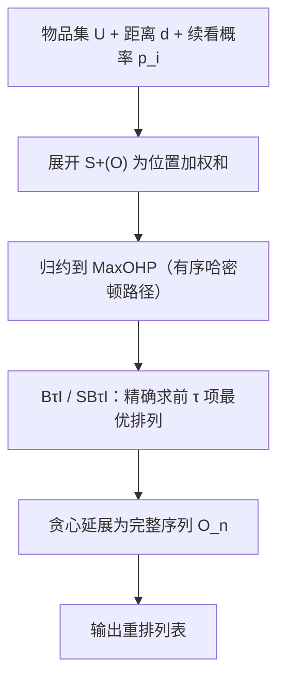

# Sequential Diversification with Provable Guarantees (带可证明保证的序列多样化)

- **会议/期刊**: WSDM 2025
- **作者与机构**: Honglian Wang, Sijing Tu, Aristides Gionis (KTH Royal Institute of Technology)
- **推荐链路定位**: 重排 (Re-ranking / 列表构造)
- **研究方向**: 多任务学习与列表级重排 / 去偏公平与工业架构
- **论文原文**: [论文原文链接](https://arxiv.org/abs/2412.10944v3)
- **开源代码**: [开源代码仓库链接](https://github.com/HongLWang/Sequential-diversification-with-provable-guarantees)

## TL;DR (1分钟核心速览)

现有多样化方法把多样性定义在**集合**上，忽略排序位置与用户中途退出行为。本文提出**序列多样性** $S(O)=\mathbb{E}_{A\sqsubseteq O}[D(A)]$：用户按续看概率$p_i$逐项浏览、随时退出，目标是最大化被接受前缀的期望多样性。作者证明 MaxSSD 为 NP 难且**非有序子模**，通过归约到"有序哈密顿路径"给出 BτI/SBτI 等常数近似算法；在 7 个数据集、4 档续看概率区间下，$S^+$ 全面优于 EXPLORE/MMR/DPP 等强基线。

## Background & Motivation (背景与核心矛盾)

- **主流范式**: 多样化被建模为集合选择问题（MMR、MSD、DPP、覆盖子模），用贪心或局部搜索求解，目标值只依赖"选了哪些"，不依赖"怎么排"。
- **前人局限**: ① 假设固定选取 $k$ 项，忽略用户会因疲劳/失去兴趣提前退出，实际浏览长度是随机变量；② 贪心虽隐式产出顺序，但该顺序只是算法副产物，不针对任何排序性质优化。
- **核心洞察 (Key Insight)**: 用户几乎总按序列消费内容且优先看高位项，因此多样性必须与**位置折扣**和**续看概率**耦合；序列多样性分数主要由排名靠前的少数项决定。
- **本文切入点**: 把 Coppolillo et al. 的经验性 EXPLORE 框架做严格理论化——建立 NP 难性、给出常数因子近似保证，并证明覆盖多样性下问题是有序子模（贪心即 $1/2$-近似）。

## Method (核心方法设计)

### 1. 整体框架 (Overall Architecture)

输入为物品集 $U$、两两距离$d(\cdot,\cdot)$（推荐用 Jaccard 距离、IR 用$1-\cos$）与续看概率$p_i$（由相关性分数插值得到）。核心是把期望多样性展开为按位置的加权和，再归约到"有序哈密顿路径"这一可近似问题：先用 BτI/SBτI 精确求解前$\tau$项的最优排列，再用贪心边际增益延展为完整序列；覆盖多样性分支则直接走有序子模贪心。训练侧无需学习参数，$p_i$ 可由矩阵分解评分映射而来，推理为一次性组合优化。

### 2. 关键设计拆解 (Key Designs)

1. **序列多样性目标与闭式展开**：痛点是把"随机退出"写进目标后无法直接优化。利用各 $p_i$独立，用户恰接受前$k$项的概率为$\prod_{t\le k}p_{\pi(t)}(1-p_{\pi(k+1)})$，代入期望并合并同类项得
$$S^+(O)=\sum_{i=1}^{n-1}p_{O_{i+1}}\,d(\pi(i+1),O_i),\quad p_{O_i}=\prod_{t=1}^{i}p_{\pi(t)}$$
直觉：第 $i+1$项与已接受前缀的距离被"用户能走到第$i+1$ 步"的累积概率加权，越靠后权重指数衰减——这正是位置折扣的物理来源。

2. **有序哈密顿路径归约（MaxOHP）**：$S^+$非有序子模，标准贪心失效。作者定义$H(O)=\sum_{i=1}^{n-1}W_{O_i}d(\pi(i),\pi(i+1))$，$W_{O_i}=\prod_{j=i+1}^{n}p_{O_j}$，并证明当$p_i\in[a,b]$ 时
$$S^+(O^*)\le\frac{b(1-a)}{a(1-b)}H(O^*),\qquad 2S^+(O)\ge H(O)$$
于是 MaxOHP 的 $\alpha$-近似即 MaxSSD 的$\frac{a(1-b)}{2b(1-a)}\alpha$-近似。关键技巧：对最优序列做相邻交换论证（Lemma 3）得到$d(\pi(i+1),O_i^*)$ 的上界，再用三角不等式把"到前缀的距离和"压到"路径边长和"。

3. **BτI / SBτI 与训练推理开销**：BτI 在截断目标 $\tilde H(O^\tau)=\sum_{i=1}^{\tau-1}\sum_{j=i+1}^{\tau}p_{O_j}d(\pi(i),\pi(i+1))$上穷举最优$\tau$项排列，复杂度$O(\binom{n}{\tau}\tau!)$；SBτI 改为直接最大化$S^+(O^\tau)$的前$\tau$项，近似比$\frac{a^\tau(1-b)(1-b^{\tau-1})}{a^\tau(1-b)+b^{\tau+1}}$。均匀概率下 BτI 达$1-p^{\tau-1}-p^{n-\tau}+p^n$；$p\to1$时改用贪心匹配 GM（先按边权降序构造匹配再拼路径），近似比$\frac{3(e-1)}{16e^2}-\Theta(1/t_n)$。无负采样、无训练损失；工程上用 BτI-H 启发式（先贪心取 top-100 候选再精确选$\tau$）把开销降到可接受。

## Experimental Setup & Evaluation Protocol (实验设置与评估协议)

- **数据集与预处理**: 5 个推荐数据集 + 2 个 IR 数据集；Netflix 采样 5K 电影、Yahoo 采样 3K 歌曲，均剔除交互少于 20 的用户。

| 数据集 | #Users | #Items | #Interactions | avg(R) | avg(dist) |
| :--- | :---: | :---: | :---: | :---: | :---: |
| Coat | 290 | 300 | 6,960 | 24.0 | 0.73 |
| KuaiRec | 1,411 | 3,327 | 4,676,570 | 3,314.4 | 0.91 |
| Netflix | 4,999 | 1,112 | 557,176 | 1,121.5 | 0.83 |
| Movielens | 6,040 | 3,706 | 1,000,208 | 165.6 | 0.83 |
| Yahoo | 21,181 | 3,000 | 963,296 | 45.8 | 0.26 |
| LETOR | 1,691 | 65 | 316,694 | 41.2 | 0.33 |
| LTRC | 5,154 | 146 | 995,152 | 29.60 | 0.26 |

- **数据划分与防穿越**: 非传统训练/测试切分；对每个用户构造**全物品完整序列**并计算 $S^+(O)$，属"全列表构造 + 期望指标"评估范式，无时间戳穿越问题。
- **排名评测协议**: 全库序列构造（每个用户对全部物品排序），报告跨用户均值与标准差；续看概率分四档插值：small $[0.1,0.3]$、medium$[0.4,0.6]$、large$[0.7,0.9]$、full$[0.1,0.9]$。
- **对比基线与超参设置**: Random、EXPLORE、DUM、MSD、MMR、DPP；$\lambda\in[0,1]$ 网格搜索取 MaxSSD 最优；补充指标 ExpDCG 与 ExpSerendipity。

## Key Experimental Results (实验关键数据)

### 1. 主实验对比 (Main Results)

$S^+(O)$，续看概率$[0.4,0.6]$（Table 3，节选）：

| 方法 | Coat | KuaiRec | Netflix | Movielens | Yahoo | LETOR | LTRC |
| :--- | :---: | :---: | :---: | :---: | :---: | :---: | :---: |
| Random | 0.646 | 0.383 | 0.921 | 0.878 | 0.231 | 0.208 | 0.359 |
| EXPLORE | 1.276 | 0.681 | 1.861 | 2.142 | 1.684 | 0.440 | 0.597 |
| DUM | 1.214 | 0.411 | 1.779 | 2.080 | 1.793 | 0.564 | 0.640 |
| MSD | 1.211 | 0.704 | 1.888 | 2.228 | 1.793 | 0.577 | 0.662 |
| MMR | 1.282 | 0.725 | 1.937 | 2.232 | 1.793 | 0.570 | 0.644 |
| DPP | 1.284 | 0.711 | 1.933 | 2.230 | 1.793 | 0.557 | 0.642 |
| B2I | **1.289** | 0.778 | 1.946 | **2.235** | 1.795 | 0.592 | 0.670 |
| SB4I | 1.076 | **0.786** | **1.951** | 2.227 | **1.834** | **0.600** | **0.677** |
| Improv.% (vs 最强基线) | +0.4% | +8.4% | +0.7% | +0.1% | +2.3% | +4.0% | +2.3% |

低参与区间 $[0.1,0.3]$（Table 2）：B2I 在 Coat/KuaiRec/Movielens/LTRC 四项最优（如 KuaiRec 0.058 vs MMR 0.051，+13.7%）；高参与区间$[0.7,0.9]$（Table 4）DPP/MMR 反超，但 B4I 在 Yahoo 取 41.969 为全场最优，Movielens 71.317 与 DPP 71.362 基本持平。

### 2. 消融实验 (Ablation Study)

原文无传统"移除模块"消融，核心对照为 $\tau$ 与精确/启发式变体：

| 配置 | Coat (low) | KuaiRec (low) | Netflix (med) | Yahoo (full) | 说明 |
| :--- | :---: | :---: | :---: | :---: | :--- |
| B2I（=SB2I，贪心） | **0.109** | 0.058 | 1.946 | 27.567 | $\tau=2$ 退化为贪心 |
| B3I / B4I | 0.106 / 0.104 | 0.058 / 0.058 | 1.919 / 1.910 | 27.709 / 27.746 | 优化 MaxOHP 中间目标 |
| SB3I / SB4I | 0.083 / 0.084 | 0.058 / 0.058 | 1.948 / **1.951** | 29.296 / **29.312** | 直接优化 $S^+$ 前缀 |
| B4I-H（top-100 候选） | 0.104 | 0.058 | 1.910 | 27.746 | 与精确版几乎无损 |

### 3. 关键实验发现 (Key Findings)

1. **低参与区间应只优化前 2 项**：$[0.1,0.3]$下 B2I 在 4/7 数据集最优，而$\tau$ 增至 3/4 反而下降（Coat 0.109→0.104），因为用户大概率看完两项即退出，优化更长前缀会牺牲前两位的多样性。
2. **SBτI 随 $\tau$单调受益，BτI 不然**：中/高参与区间 SB4I 在 5 个数据集最优（KuaiRec 0.786、LETOR 0.600），因其直接优化目标$S^+$而非中间量$H$，避免了归约引入的近似误差；图 1 热力图显示$\tau\le4$时$A>B$覆盖 84%–100% 有效区域，$\tau\ge6$ 后 BτI 才反超。
3. **多样性提升不以相关性为代价**：ExpDCG 上 B3I/B4I 在 Movielens 全档位追平最优基线、Yahoo 中高档位登顶；ExpSerendipity 上 BτI/SBτI 在几乎所有档位取得最优或次优（如 Coat 中档 0.354 vs DPP 0.218），说明序列目标天然挖掘"相关但意外"的物品。

## Highlights & Limitations (亮点、对比与审稿批判)

- **与代表作对比 (vs. Prior Work)**: 相比 EXPLORE（Coppolillo et al.，纯经验、无保证），本文给出 NP 难性与常数近似比；相比 Kleinberg et al. 的有序子模覆盖框架，本文处理了**非有序子模**的成对和多样性这一更难分支；相比 MMR/MSD/DPP，本文目标显式含位置折扣与退出概率，而非把排序当副产物。
- **可迁移亮点**: ① "先精确优化 top-τ 再贪心延展"的截断策略可迁移到任何带位置折扣的列表级目标（如 DCG 约束下的重排）；② 用相邻交换论证把序列目标归约到路径问题，是处理非子模排序目标的通用分析套路。
- **审稿级局限批判**: ① BτI 精确版复杂度 $O(\binom{n}{\tau}\tau!)$，KuaiRec 级别物品量必须依赖 top-100 启发式，理论保证在实用版本上失效；② 续看概率由矩阵分解评分线性插值而来，未验证真实点击/退出日志下的鲁棒性，且全列表构造评估与线上只展示前 10–20 项的场景存在 gap；③ 高参与区间 DPP/MMR 仍占优，方法并非全域统治。

## Rating (四维评分)

- **方法创新性 (Novelty)**: ⭐⭐⭐⭐ （首次为序列多样性建立 NP 难性与常数近似保证，有序哈密顿路径归约与相邻交换论证颇具巧思）
- **评估协议与实验扎实度 (Protocol & Experiments)**: ⭐⭐⭐⭐ （7 数据集 × 4 档概率区间 + 双补充指标，覆盖充分；但缺真实退出日志与线上验证）
- **写作与数学规范度 (Clarity & Rigor)**: ⭐⭐⭐⭐⭐ （定义—归约—近似比链条完整，Lemma/Corollary 层层递进，图 1 直观对比两算法近似比区域）
- **工业落地与复现价值 (Industrial & Practical Value)**: ⭐⭐⭐⭐ （代码开源、无需训练、启发式可扩展；但组合优化开销与 $p_i$ 估计质量是上线前必须解决的门槛）

