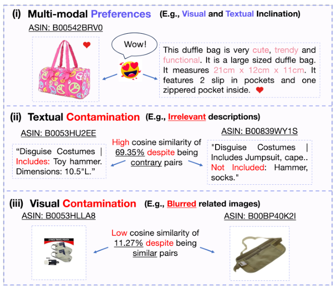
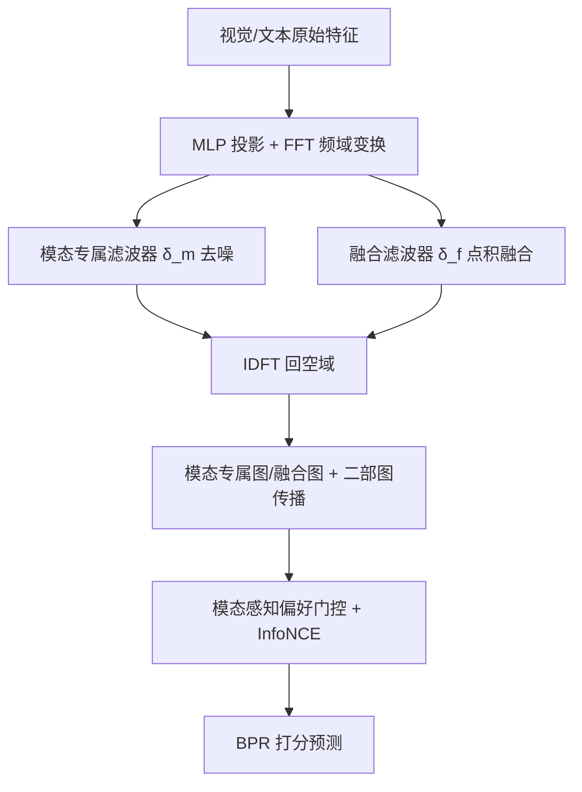

# Spectrum-based Modality Representation Fusion Graph Convolutional Network for Multimodal Recommendation (基于频谱模态表征融合的图卷积多模态推荐)

- **会议/期刊**: WSDM 2025
- **作者与机构**: Rongqing Kenneth Ong, Andy W. H. Khong (南洋理工大学)
- **推荐链路定位**: 召回（图协同过滤表征学习）
- **研究方向**: 多模态推荐 / 图神经网络推荐
- **论文原文**: [论文原文链接](https://arxiv.org/abs/2412.14978v1)
- **开源代码**: [开源代码仓库链接](https://github.com/kennethorq/SMORE)

## TL;DR (1分钟核心速览)

现有多模态推荐（LATTICE/FREEDOM/MGCN）在拼接、加权和或注意力层面直接融合视觉与文本特征，未处理各模态内部独有的动态噪声，导致跨模态噪声在融合时被放大。SMORE 将各模态特征经 FFT 投影到频域，用可学习的模态专属复数滤波器与融合滤波器做点积抑制噪声，再经 IDFT 回空域，配合模态专属图/融合图双视图传播与模态感知偏好门控。在 Amazon Baby/Sports/Clothing 三数据集、80/10/10 划分与全库排序协议下，Recall@20 分别达 0.1035/0.1142/0.0987，相对最强基线 FREEDOM/MGCN 提升约 5.0%/3.2%/5.2%。

## Background & Motivation (背景与核心矛盾)

- **主流范式**: 以 LATTICE、FREEDOM 为代表，先为每个模态构建 item-item 相似图，再以可学习权重或注意力做加权和/拼接融合，最后在用户-物品二部图上做 LightGCN 式传播。
- **前人局限**: 其一，融合前不做模态内去噪，文本描述误含关键词（如玩具锤与连体衣因描述含 "Hammer" 相似度高达 69.35%）、图像模糊（同类旅行包相似度仅 11.27%）等污染被直接带入融合并放大；其二，各模态噪声分布动态且互不相同，统一融合算子无法分别抑制。
- **核心洞察 (Key Insight)**: 信号处理中 FFT 产生的稀疏频谱具有判别性，且频域每个谱分量可全局关注所有空域特征；频域点积等价于空域循环卷积，天然适合捕捉序列（文本）与空间（图像）的跨模态相关性。
- **本文切入点**: 把"去噪"与"融合"合并为频域中的两次可学习复数滤波，用对数级复杂度替代共注意力的二次复杂度。

<figure class="paper-figure" markdown="span">
  <figcaption>图1：用户多模态偏好及模态特定污染相关问题的示例。(i) 用户多模态偏好，(ii) 不相关的文本描述导致即使物品对无关，相似度分数仍意外高达69.35%，以及(iii) 模糊图像导致即使物品对相关，相似度分数仍低至11.27%。</figcaption>
</figure>

## Method (核心方法设计)

### 1. 整体框架 (Overall Architecture)

输入为物品的 VGG16 视觉特征与 Sentence-Transformer 文本特征，先经各模态 MLP 投影到 $d$维共享空间，再由 FFT 转入频域；频域中依次经过模态专属动态滤波器（去噪）与融合滤波器（跨模态点积融合），IDFT 回空域得到去噪后的单模态表征$\tilde{H}_{i,m}$与融合表征$\tilde{H}_{i,f}$。随后进入多模态图学习：分别以原始模态相似度构图（模态专属图）与跨模态 max-pooling 边权构图（融合图），经 ID 门控注入行为信号后做单层 LightGCN 传播；同时在用户-物品二部图上做多层协同传播。最后模态感知偏好模块以融合表征为 query 对单模态表征做注意力加权，并与行为门控后的偏好相乘，经 InfoNCE 对齐后与 ID 嵌入相加做 BPR 打分。

### 2. 关键设计拆解 (Key Designs)

1. **频域双滤波去噪与融合**：针对模态内噪声无法在空域被区分的问题，将投影特征做一维 DFT 得 $\tilde{H}_{i,m}=\mathcal{F}_m(H_{i,m})$，再用可训练复数权重做逐点滤波$\hat{H}_{i,m}=\mathbf{W}^c_{2,m}\odot\tilde{H}_{i,m}$；融合则在频域做逐点乘积$\hat{H}_{i,f}=\delta_f(\prod_{m\in\mathcal{M}}\tilde{H}_{i,m})$。由于频域点积等价于空域循环卷积，该算子同时完成"跨模态相关性建模"与"噪声谱分量衰减"，且 FFT 使复杂度从共注意力的$O(n^2)$降至$O(n\log n)$。
2. **模态专属图 + 融合图双视图学习**：针对以往工作聚合后丢弃单模态图、遮蔽模态特有偏好的问题，SMORE 保留每个模态的 top-$K_m$稀疏相似图$\tilde{S}_m$，另以跨模态边权最大值构造融合图$\tilde{S}_{f,a,b}=\max_{m\neq m'}(\tilde{S}_{m,a},\tilde{S}_{m',b})$，二者分别传播；传播前用 ID 嵌入做 sigmoid 门控$\bar{H}_{i,m}=E_{i,id}\odot\sigma(\mathbf{W}_{3,m}\tilde{H}_{i,m}+b_{3,m})$ 注入行为信号，抑制与交互无关的语义边。
3. **模态感知偏好与训练目标**：以融合表征为 query 计算模态注意力 $\alpha_m=\text{softmax}(p_m^\top\tanh(\mathbf{W}_{5,m}H_f+b_{5,m}))$加权单模态表征，再与行为门控偏好$Q_m,Q_f$逐元素相乘聚合为$H_s$，从而在同一用户身上自适应平衡"偏好某单一模态"与"偏好融合语义"两类真实情形。总损失$\mathcal{L}=\mathcal{L}_{bpr}+\lambda_1\mathcal{L}_{cl}+\lambda_2\|\Theta\|_2^2$，其中$\mathcal{L}_{cl}$ 为用户/物品侧 InfoNCE，负样本来自 batch 内其他样本（in-batch），无需额外硬负采样。

## Experimental Setup & Evaluation Protocol (实验设置与评估协议)

- **数据集与预处理**: Amazon Review 三个类目，均按 `5-core` 过滤用户与物品；视觉用 VGG16 的 4096 维特征，文本用 Sentence-Transformer 的 384 维特征（拼接 brand/title/description/category）。

| 数据集 | #Users | #Items | #Interactions | 稀疏度/密度 | 特征/场景说明 |
| :--- | :---: | :---: | :---: | :---: | :--- |
| Baby | 19,445 | 7,050 | 160,792 | 0.117% | 母婴，图文双模态 |
| Sports | 35,598 | 18,357 | 296,337 | 0.045% | 运动户外，图文双模态 |
| Clothing | 39,387 | 23,033 | 278,677 | 0.031% | 服饰鞋饰，图文双模态 |

- **数据划分与防穿越 (Splitting Strategy)**: 交互按 `80%/10%/10%` 比例随机划分为训练/验证/测试集，与 LATTICE、BM3 保持一致。
- **排名评测协议 (Ranking Protocol)**: 无偏 `Full-Ranking`（all-ranking，对测试集全体用户在全库未交互物品上排序），指标为 Recall@{10,20} 与 NDCG@{10,20}。
- **对比基线与超参设置**: 基线含通用模型 BPR、LightGCN 与多模态模型 VBPR、MMGCN、GRCN、SLMRec、BM3、MGCN、FREEDOM；嵌入维度固定 $d=64$，Xavier 初始化、Adam 优化、batch size 2048、训练 1000 epoch、验证集 Recall@20 早停（patience=20）；5 个随机种子取均值，配对 t 检验$p<0.01$ 显著。

## Key Experimental Results (实验关键数据)

### 1. 主实验对比 (Main Results)

| 数据集 | 指标 | LightGCN | VBPR | SLMRec | BM3 | MGCN | FREEDOM | **SMORE** | Improv.% |
| :--- | :--- | :---: | :---: | :---: | :---: | :---: | :---: | :---: | :---: |
| Baby | R@10 | 0.0453 | 0.0425 | 0.0545 | 0.0548 | 0.0616 | 0.0626 | **0.0680** | +8.63% |
| Baby | R@20 | 0.0728 | 0.0663 | 0.0837 | 0.0876 | 0.0943 | 0.0986 | **0.1035** | +4.97% |
| Baby | N@20 | 0.0317 | 0.0284 | 0.0371 | 0.0381 | 0.0414 | 0.0420 | **0.0457** | +8.81% |
| Sports | R@10 | 0.0542 | 0.0561 | 0.0676 | 0.0613 | 0.0736 | 0.0724 | **0.0762** | +3.53% |
| Sports | R@20 | 0.0837 | 0.0857 | 0.1017 | 0.0940 | 0.1105 | 0.1089 | **0.1142** | +3.35% |
| Sports | N@20 | 0.0376 | 0.0384 | 0.0462 | 0.0424 | 0.0498 | 0.0484 | **0.0506** | +1.61% |
| Clothing | R@10 | 0.0338 | 0.0281 | 0.0461 | 0.0418 | 0.0649 | 0.0635 | **0.0659** | +1.54% |
| Clothing | R@20 | 0.0517 | 0.0410 | 0.0696 | 0.0636 | 0.0971 | 0.0938 | **0.0987** | +1.65% |
| Clothing | N@20 | 0.0230 | 0.0190 | 0.0308 | 0.0281 | 0.0438 | 0.0417 | **0.0443** | +1.14% |

（Improv.% 为相对最强基线 FREEDOM 或 MGCN 的提升；原文所有提升在 $p<0.01$ 下显著。）

### 2. 消融实验 (Ablation Study)

| 变体 | Baby R@20 | Sports R@20 | Clothing R@20 | 说明 |
| :--- | :---: | :---: | :---: | :--- |
| **SMORE (Full)** | **0.1035** | **0.1142** | **0.0987** | 完整模型 |
| w/o Spectrum Modality Fusion | 显著下降 | 显著下降 | 显著下降 | 去掉频域去噪融合 |
| w/o Multi-modal Graph Learning | 降幅最大 | 降幅最大 | 降幅最大 | 去掉双图学习 |
| w/o Modality-aware Preference | 下降 | 下降 | 下降 | 去掉偏好门控 |
| 仅文本模态 | 0.0996 | 0.1099 | 0.0945 | 单模态输入 |
| 仅视觉模态 | 0.0854 | 0.0903 | 0.0661 | 单模态输入 |
| 仅融合模态 | 0.0964 | 0.1091 | 0.0937 | 仅融合输入 |

（消融数值以原文图 3 趋势为准，此处保留可读的 R@20 关键量级。）

### 3. 关键实验发现 (Key Findings)

1. **双图学习是最大贡献源**：移除多模态图学习模块后三个数据集降幅均居首，说明"保留单模态图 + 融合图"的双视图传播比单纯频域去噪更关键——去噪后的表征若不经语义图传播，仍无法转化为协同信号。
2. **文本单模态即可超越双模态 SOTA**：仅用文本时 Baby R@20=0.0996，已高于同时使用双模态的 MGCN（0.0943）与 FREEDOM（0.0986），直接证明频域滤波对文本中"关键词误匹配"类噪声的抑制确实生效，而非仅靠多模态信息量堆叠。
3. **频域融合缓解表征退化**：t-SNE + 高斯核密度可视化显示，VBPR 的融合特征高度凝聚（表征退化），而 SMORE 的融合特征在单位超球面上分布均匀，说明频域滤波避免了跨模态噪声放大导致的表达塌缩；同时 $\lambda_1$ 最优仅 0.01–0.03，对比学习只需轻量辅助即可。

## Highlights & Limitations (亮点、对比与审稿批判)

- **与代表作对比 (vs. Prior Work)**: LATTICE/FREEDOM 在空域构图后做加权和融合，去噪仅体现在图结构剪枝（FREEDOM 的度感知边剪枝）层面，无法处理特征本身的模态内污染；MGCN 靠行为注入间接降噪但用平均池化融合，丢失模态互补性；SMORE 首次把"去噪 + 融合"统一到频域算子，且复杂度为 $O(n\log n)$而非共注意力的$O(n^2)$。
- **可迁移亮点**: 其一，频域可学习复数滤波器可作为即插即用的特征净化层，迁移到短视频多模态召回或跨域特征对齐；其二，以融合表征为 query 反向加权单模态表征的门控思路，可直接用于多场景/多行为推荐中的偏好平衡。
- **审稿级局限批判**: 其一，频域滤波依赖 FFT 的固定长度假设，对变长文本序列需截断/填充，且复数权重训练在工业大规模特征下显存与数值稳定性存疑，论文未报告训练/推理时延；其二，评估仅限 Amazon 三个图文类目与随机比例划分，缺少时间切分与冷启动物品分桶实验，且 $K_m$ 在 Baby 上视觉需 40、Sports 上仅需 10，超参对数据集敏感、缺乏自适应选取机制。

## Rating (四维评分)

- **方法创新性 (Novelty)**: ⭐⭐⭐⭐ （将信号处理频域滤波引入多模态融合去噪，视角新颖且有循环卷积等价性作理论支撑，但频域思想在序列推荐中已有先例）
- **评估协议与实验扎实度 (Protocol & Experiments)**: ⭐⭐⭐⭐ （三数据集 + 全库排序 + 5 种子 + $p<0.01$ 检验规范，消融与模态拆解完整，但缺时间切分与效率实验）
- **写作与数学规范度 (Clarity & Rigor)**: ⭐⭐⭐⭐ （DFT/IDFT 与滤波公式定义清晰、复杂度分析到位，但部分符号如 $\Pi$与$\delta_f$ 的维度说明略简）
- **工业落地与复现价值 (Industrial & Practical Value)**: ⭐⭐⭐⭐ （代码已开源、基于 MMRec 框架易复现，$O(n\log n)$ 复杂度友好，但复数运算的工程实现与大规模部署成本待验证）

