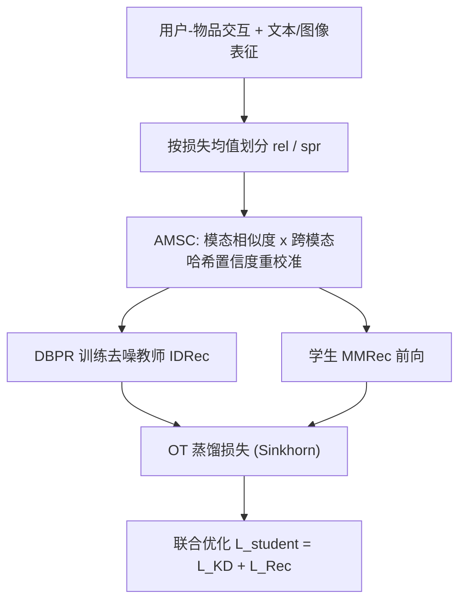
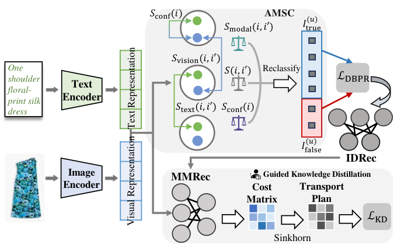

# Teach Me How to Denoise: A Universal Framework for Denoising Multi-modal Recommender Systems via Guided Calibration (教我怎么去噪：基于引导校准的多模态推荐通用去噪框架)

- **会议/期刊**: WSDM 2025
- **作者与机构**: Hongji Li (兰州大学), Hanwen Du (俄亥俄州立大学), Youhua Li (香港城市大学), Junchen Fu (格拉斯哥大学), Chunxiao Li (中科大), Ziyi Zhuang (上海交大), Jiakang Li (罗格斯大学), Yongxin Ni (新加坡国立大学)
- **推荐链路定位**: 精排（多模态表征学习与隐式反馈去噪）
- **研究方向**: 多模态推荐 / 自监督与交互去噪
- **论文原文**: [https://arxiv.org/abs/2504.14214v1](https://arxiv.org/abs/2504.14214v1)
- **开源代码**: [https://github.com/Neon-Jing/Guider](https://github.com/Neon-Jing/Guider)

## TL;DR (1分钟核心速览)

多模态推荐（MMRecs）同时受"模态内容噪声"与"模态-推荐语义错位"双重困扰，而 IDRec 去噪依赖的"噪声交互相似度低"假设在多模态空间失效（图 4 显示干净/噪声交互的 $s_{ui}$ 分布几乎重叠）。本文提出 GUIDER：用 AMSC 基于模态内相似度与跨模态哈希置信度重校准干净/噪声样本，用 DBPR 训练去噪教师 IDRec，再以最优传输（OT）距离蒸馏指导 MMRec 学生。在 4 个数据集、5 个基座上，全库排序 Recall@20 相对最优基线最高提升约 11%（DRAGON+MicroLens）。

## Background & Motivation (背景与核心矛盾)

- **主流范式**: MMRecs 通过模态编码器融合文本/图像表征做协同过滤（VBPR、MMGCN、BM3、DRAGON、FREEDOM），去噪则沿用 IDRec 的样本选择（T-CE）或重加权（R-CE、WBPR、BOD），核心假设是 $w_{ui}\propto s_{ui}$。
- **前人局限**: ① 模态内容本身含噪（图 1(a)(b) 的误导性标题/无关图片）；② 跨类别物品视觉表征高度相似（图 1(c) 的吊带、手机、婴儿服），造成模态语义与推荐语义错位。
- **核心洞察 (Key Insight)**: 作者用 10% oracle 噪声做对照实验，发现 IDRec 上干净/噪声交互的 $s_{ui}$ 分布可分，而 MMRecs 上二者几乎重叠——**相似度不再是噪声的有效指示器**，直接套用去噪损失反而拖慢收敛（图 3 出现长停滞期）。
- **本文切入点**: 不在多模态空间硬去噪，而是"绕道"——先在 ID 空间训练去噪教师，再通过蒸馏把去噪信号"教"给多模态学生。

## Method (核心方法设计)

### 1. 整体框架 (Overall Architecture)

GUIDER 是即插即用框架，分三阶段闭环：先按推荐损失均值把每个用户的交互切成可靠集 $I^{(u)}_{rel}$与可疑集$I^{(u)}_{spr}$；AMSC 用模态内相似度与跨模态哈希置信度把可疑样本重校准为$I^{(u)}_{true}$/$I^{(u)}_{false}$；DBPR 以$I^{(u)}_{true}$为正、$I^{(u)}_{false}$ 为负训练 LightGCN 教师；学生 MMRec 同时优化推荐损失与基于 OT 距离的蒸馏损失，Sinkhorn 迭代求解传输计划。

<figure class="paper-figure" markdown="span">
  <figcaption>图5：GUIDER框架概览。</figcaption>
</figure>

### 2. 关键设计拆解 (Key Designs)

1. **AMSC 自适应模态相似度校准**：痛点在于损失阈值划分会误杀"表征含噪但真实"的交互。对每个可疑样本 $i$与可靠样本$i'$计算$S(i,i')=S_{modal}(i,i')\times S_{conf}(i)$，其中$S_{modal}=\max(S_{text},S_{vision})$取模态内最大相似度，$S_{conf}$用跨模态哈希$\text{hash}(x)=\text{sign}(W^\top x+b)$的余弦一致性度量图文是否自洽；若$S(i,i')>S_{thres}$则把$i$ 翻转为干净样本。直觉：**推荐空间远但模态空间近**的物品更可能是被误判的真阳性，而图文自洽度低则说明该物品表征本身不可信。

2. **DBPR 去噪贝叶斯个性化排序**：把 AMSC 的划分直接注入 pairwise 损失，$\mathcal{L}_{DBPR}=-\sum_{u}\sum_{i\in I^{(u)}_{true},j\in I^{(u)}_{false}}\log\sigma(s_{ui}-s_{uj})$。相比 BPR 从全库均匀采负样本，这里把"高损失可疑交互"当作**难负样本**，让教师学到更锐利的偏好边界，同时天然抑制假阳性。

3. **OT 距离蒸馏与训练目标**：KL 散度在分布几乎不重叠时梯度不稳、易过平滑与模型坍缩，故改用熵正则最优传输：$\mathcal{L}_{KD}=\langle P_\lambda,D\rangle$，代价矩阵$D_{m,n}=\|z^t_m-z^s_n\|_2^2$建立在 pairwise 排序 logits$z=\{\log\sigma(s_{ui}-s_{uj})\}$上，$P_\lambda=\arg\min_{P\in U(z^t,z^s)}\sum P_{x,y}D_{x,y}-\lambda H(P)$由 Sinkhorn 迭代$u^l=z^s\oslash(K^\top v^{l-1})$、$v^l=z^s\oslash(Ku^{l-1})$求解，核$K=\exp(-D/\lambda)$。总损失$\mathcal{L}_{student}=\mathcal{L}_{KD}+\mathcal{L}_{Rec}$。训练无需额外负采样（负样本来自 AMSC 划分），推理阶段仅保留学生 MMRec，**零额外在线开销**。

## Experimental Setup & Evaluation Protocol (实验设置与评估协议)

- **数据集与预处理**: 三个 Amazon 子集 + 短视频平台 MicroLens，按 [55] 流水线预处理：

| 数据集 | #Users | #Items | #Interactions | 稀疏度 | 特征/场景说明 |
| :--- | :---: | :---: | :---: | :---: | :--- |
| Baby | 19,445 | 7,050 | 160,792 | 99.88% | 亚马逊母婴，图文 |
| Sports | 35,598 | 18,357 | 296,337 | 99.95% | 亚马逊运动户外 |
| Clothing | 39,387 | 23,033 | 237,488 | 99.97% | 亚马逊服饰 |
| MicroLens | 98,129 | 17,228 | 705,174 | 99.97% | 短视频封面+标题，噪声最重 |

- **数据划分与防穿越 (Splitting Strategy)**: 每个用户交互历史按 `8:1:1` 比例划分训练/验证/测试。
- **排名评测协议 (Ranking Protocol)**: 无偏 `Full-Ranking`（全库未交互物品排序），指标 Recall@{5,20} 与 NDCG@{5,20}。
- **对比基线与超参设置**: 5 个 MMRec 基座（VBPR、MMGCN、BM3、DRAGON、FREEDOM）× 5 种去噪方案（T-CE、R-CE、WBPR、BOD、GUIDER），教师默认 LightGCN；嵌入维度 $d=64$，Xavier 初始化，AdamW，学习率$[10^{-4},10^{-3}]$，$L_2$系数$[10^{-4},10^{-2}]$，验证集 10 epoch 早停；提升以$p<0.05$ 显著性标注。

## Key Experimental Results (实验关键数据)

### 1. 主实验对比 (Main Results)

以最强基座 DRAGON 与最弱基座 VBPR 为例（R@20 / N@20，完整 16 列见原文表 2）：

| 数据集 | 方法 | R@5 | R@20 | N@5 | N@20 |
| :--- | :--- | :---: | :---: | :---: | :---: |
| Baby | DRAGON | 0.0366 | 0.1021 | 0.0239 | 0.0425 |
| Baby | +BOD (最优基线) | 0.0359 | 0.0997 | 0.0233 | 0.0413 |
| Baby | **+GUIDER** | **0.0385** | **0.1137** | **0.0254** | **0.0447** |
| Sports | DRAGON | 0.0439 | 0.1100 | 0.0296 | 0.0495 |
| Sports | +BOD | 0.0427 | 0.1086 | 0.0272 | 0.0485 |
| Sports | **+GUIDER** | **0.0465** | **0.1129** | **0.0310** | **0.0507** |
| Clothing | DRAGON | 0.0392 | 0.0947 | 0.0260 | 0.0417 |
| Clothing | +BOD | 0.0379 | 0.0932 | 0.0254 | 0.0407 |
| Clothing | **+GUIDER** | **0.0404** | **0.0980** | **0.0277** | **0.0436** |
| MicroLens | DRAGON | 0.0465 | 0.1096 | 0.0299 | 0.0487 |
| MicroLens | +BOD | 0.0441 | 0.1103 | 0.0274 | 0.0468 |
| MicroLens | **+GUIDER** | **0.0507** | **0.1142** | **0.0327** | **0.0511** |
| MicroLens | VBPR | 0.0333 | 0.0818 | 0.0213 | 0.0351 |
| MicroLens | **VBPR+GUIDER** | **0.0356** | **0.0944** | **0.0226** | **0.0394** |

GUIDER 在全部 5 个基座 × 4 个数据集上均取得最优，且全部带 `*` 显著性标记；MicroLens 上 VBPR 的 R@20 相对提升约 15.4%，DRAGON 的 R@20 相对 BOD 提升约 3.5%（0.1142 vs. 0.1103），而 R@5 提升达 14.9%。

### 2. 消融实验 (Ablation Study)

基座 BM3，指标 R@20 / N@20：

| 变体 | Baby | Sports | Clothing | MicroLens |
| :--- | :---: | :---: | :---: | :---: |
| w/o KD（直接 AMSC+DBPR） | 0.0875 / 0.0391 | 0.0997 / 0.0442 | 0.0616 / 0.0285 | 0.0815 / 0.0327 |
| w/o DBPR（仅 KD） | 0.0891 / 0.0389 | 0.0985 / 0.0443 | 0.0652 / 0.0301 | 0.0864 / 0.0355 |
| w/o AMSC | 0.0912 / 0.0407 | 0.1011 / 0.0453 | 0.0706 / 0.0329 | 0.0882 / 0.0365 |
| w/ KL 散度替代 OT | 0.0953 / 0.0419 | 0.1035 / 0.0464 | 0.0807 / 0.0373 | 0.0932 / 0.0408 |
| **GUIDER** | **0.0981 / 0.0419** | **0.1047 / 0.0458** | **0.0853 / 0.0391** | **0.0965 / 0.0430** |

### 3. 关键实验发现 (Key Findings)

1. **"直接去噪"确实不可行**：w/o KD 变体在 Clothing 上 R@20 仅 0.0616，甚至低于 BM3 原版 0.0641，定量印证了 IDRec 去噪损失直接迁移到多模态空间会引入错误信号；而 w/o DBPR（仅蒸馏）同样几乎无增益，说明**去噪教师与蒸馏二者缺一不可**。
2. **AMSC 是最大贡献源**：去掉 AMSC 后 Clothing R@20 从 0.0853 跌至 0.0706（降 17.2%），MicroLens 从 0.0965 跌至 0.0882，说明模态语义重校准比蒸馏距离度量更关键；OT 换 KL 也稳定掉点（Clothing 0.0807），验证了 KL 在分布不重叠时的过平滑问题。
3. **噪声越重收益越大**：MicroLens 噪声水平最高，GUIDER 相对 BOD 的 R@20 增益（0.1142 vs. 0.1103）与 R@5 增益（0.0507 vs. 0.0441）均为四数据集最大；在注入 5%–20% 随机噪声的鲁棒性实验中，GUIDER 不仅整体更高，且随噪声比例上升的**衰减斜率明显更缓**。

## Highlights & Limitations (亮点、对比与审稿批判)

- **与代表作对比 (vs. Prior Work)**: 与 T-CE/R-CE/WBPR 的本质区别在于它们把"低相似度=噪声"当作公理，而本文先用 oracle 噪声实验证伪该公理，再以"ID 空间去噪 + 跨空间蒸馏"绕开多模态空间的判别困难；与 FREEDOM 的图剪枝去噪相比，GUIDER 不改图结构、不依赖度敏感先验，可作为插件叠加在任意 MMRec 上（实验中甚至叠加在 FREEDOM 之上仍有增益）。
- **可迁移亮点**: ① "教师去噪 + OT 蒸馏"范式可迁移到任何表征空间与 ID 空间错位的场景（如冷启动、跨域）；② 用跨模态哈希一致性作为样本置信度，是一个极低成本（仅 sign 投影）的通用可靠性信号。
- **审稿级局限批判**: ① AMSC 需对每个可疑样本与全部可靠样本两两计算模态相似度，复杂度随用户交互数平方增长，作者在结论中也承认大规模数据上的效率隐患；② 教师固定为 LightGCN，未讨论教师容量/结构对蒸馏上限的影响，且 $S_{thres}$与$\lambda$ 虽称"不敏感"，但图 7 显示 0.7 与 1.0 两端均有明显掉点，实际调参仍需搜索。

## Rating (四维评分)

- **方法创新性 (Novelty)**: ⭐⭐⭐⭐ （以 oracle 噪声实验证伪 IDRec 去噪假设，再用"ID 教师 + OT 蒸馏"跨空间破局，问题重构比模块堆叠更有价值）
- **评估协议与实验扎实度 (Protocol & Experiments)**: ⭐⭐⭐⭐ （4 数据集 × 5 基座 × 5 去噪基线，全库排序 + 显著性检验 + 噪声注入鲁棒性实验，覆盖充分；略欠线上 A/B 与效率实测）
- **写作与数学规范度 (Clarity & Rigor)**: ⭐⭐⭐⭐ （动机—证伪—方法的叙事链条清晰，OT/Sinkhorn 公式完整；但表 2 中 R-CE 在 Clothing 出现 0.579 的疑似笔误，部分符号上下标不统一）
- **工业落地与复现价值 (Industrial & Practical Value)**: ⭐⭐⭐⭐ （即插即用、推理零额外开销、代码已开源；但 AMSC 的平方级相似度计算在千万级交互上需近似检索加速）

