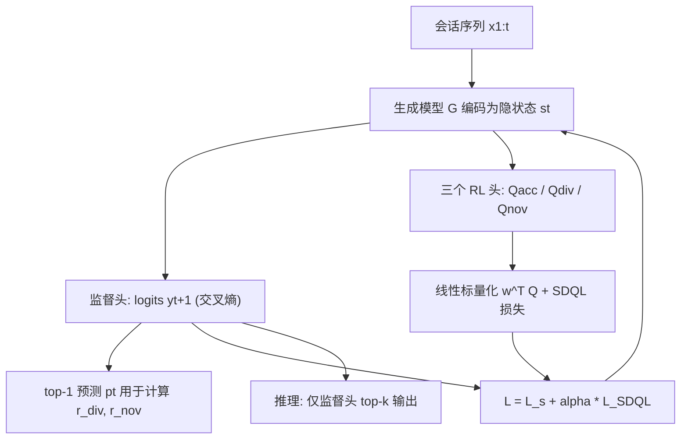

# Choosing the Best of Both Worlds: Diverse and Novel Recommendations through Multi-Objective Reinforcement Learning (兼得鱼与熊掌：通过多目标强化学习实现多样且新颖的推荐)

- **会议/期刊**: WSDM 2022
- **作者与机构**: Dušan Stamenković (University of Novi Sad)、Alexandros Karatzoglou (Google Research)、Ioannis Arapakis / Kleomenis Katevas (Telefonica Research)、Xin Xin (Shandong University)
- **推荐链路定位**: 重排（在序列推荐主干上做打分正则，推理仍用监督头 top-k）
- **研究方向**: 强化学习与动态探索推荐 / 序列与会话推荐
- **论文原文**: [https://arxiv.org/abs/2110.15097v1](https://arxiv.org/abs/2110.15097v1)
- **开源代码**: 暂未开源（论文仅给出 Google Drive 实现链接）

## TL;DR (1分钟核心速览)

针对"只优化相关性导致过滤气泡、推荐重复度高"的痛点，本文提出 SMORL：在任意序列/会话推荐主干（GRU4Rec/Caser/NextItNet/SASRec）之上并联三个一维 Q 头（准确率、多样性、新颖性），用标量化 Deep Q-Learning 损失作为正则项与交叉熵联合训练，推理时仍只用监督头。在 RC15 与 RetailRocket 上，聚合覆盖度 CV@20 相对主干提升约 20%（相对单目标 SQN 提升约 40%），HR/NDCG 不降反升，重复度 R@20 下降约 8%。

## Background & Motivation (背景与核心矛盾)

- **主流范式**: 会话推荐以自监督"预测下一点击"交叉熵训练（GRU4Rec、Caser、NextItNet、SASRec），RL 路线以 SQN 为代表，用 Double Q-learning 头提升点击/购买准确率。
- **前人局限**: ① 纯相关性优化把用户锁进过滤气泡，物品曝光子空间急剧收缩、推荐高度重复；② SQN 这类单目标 RL 在提准确率的同时使覆盖度下降最多 20%、重复度上升，即"越准越窄"。
- **核心洞察 (Key Insight)**: 多样性/新颖性等业务目标本质是**不可微指标**，无法直接写进监督损失，但可以写成 RL 的奖励函数；且序列模型的隐状态 $s_t$ 已是天然的用户状态，无需另建 RL 环境模型。
- **本文切入点**: 不做后处理重排、不训多模型集成，而是用多目标 RL 头作为**正则器**微调单一主干，让监督头保留强负信号、RL 头注入多样性与新颖性梯度。

## Method (核心方法设计)

### 1. 整体框架 (Overall Architecture)

输入会话序列 $x_{1:t}$，生成模型$G$编码为隐状态$s_t=G(x_{1:t})$；$s_t$同时送入监督头（全连接 + softmax 得 logits$y_{t+1}$，交叉熵训练）与三个 RL 头（各输出一维 Q 值）。奖励由"下一真实点击"（准确率）与"监督头 top-1 预测"（多样性、新颖性）计算，经线性标量化后由 SDQL 损失回传，与交叉熵加权求和更新主干。推理阶段丢弃 RL 头，仅用监督头取 top-k，零额外在线开销。

### 2. 关键设计拆解 (Key Designs)

1. **向量值 Q 头与 SDQL 标量化损失**：单目标 DQN 无法承载冲突目标，本文将 Q 扩为三维向量 $\mathbf{Q}(s_t,a_t)=[Q_{acc},Q_{div},Q_{nov}]$，每个分量由独立全连接层$\delta(s_t H_z+b_z)$ 得到；损失对向量做线性标量化后再算 TD 误差：
$$\mathcal{L}_{\text{SDQL}}=\left(\mathbf{w}^{\top}\big(y^{\text{SDQL}}_t(s_t,a_t)-\gamma\mathbf{Q}(s_{t+1},a_t)\big)\right)^2$$
其中 $y^{\text{SDQL}}_t=r_t+\gamma \mathbf{Q}'(s_{t+1},\arg\max_{a'}[\mathbf{w}^{\top}\mathbf{Q}'(s_{t+1},a')])$。直觉：标量化把"多目标权衡"压缩为一个可微标量 TD 目标，$\mathbf{w}$ 即业务旋钮，改权重即改策略偏好，无需重训多个模型。

2. **基于冻结嵌入空间的多样性奖励**：若用当前训练中的嵌入算相似度，早期不稳定会给出噪声奖励。作者预训一个 GRU4Rec 并**冻结**其嵌入层 $E_{div}$，以"会话最后点击物品$l_t$"与"top-1 预测$p_t$"的余弦距离作奖励：
$$r_{div}=1-\cos(\mathbf{e}_{l_t},\mathbf{e}_{p_t})=1-\frac{\mathbf{e}_{l_t}^{\top}\mathbf{e}_{p_t}}{\|\mathbf{e}_{l_t}\|\|\mathbf{e}_{p_t}\|}$$
该奖励作用于**整条会话**而非单个列表，鼓励推荐偏离用户近期兴趣簇，从源头抑制过滤气泡。

3. **基于流行度分位的新颖性奖励与训练目标**：真实场景无法追踪用户"已见过"的物品，故用"低流行度≈高新颖"的概率代理：若 top-1 预测落在最热门 $x\%$（按训练集流行度分布取长尾起点，$x\approx10$）内则$r_{nov}=0$，否则为$1$。总损失$\mathcal{L}_{\text{SMORL}}=\mathcal{L}_{s}+\alpha\mathcal{L}_{\text{SDQL}}$，采用双网络交替更新（Algorithm 1）稳定训练；负信号完全由监督交叉熵提供（RL 头只对正动作给强梯度），无需额外负采样。

## Experimental Setup & Evaluation Protocol (实验设置与评估协议)

- **数据集与预处理**:

| 数据集 | #Sequences | #Items | #Clicks | #Purchases | 过滤/场景说明 |
| :--- | :---: | :---: | :---: | :---: | :--- |
| RC15 | 200,000 | 26,702 | 1,110,965 | 43,946 | 丢弃长度<3 的会话后采样 20 万条，仅用点击 |
| RetailRocket | 195,523 | 70,852 | 1,176,680 | 57,269 | 物品交互<3 与序列长度<3 均剔除，view 视作 click |

- **数据划分与防穿越**: 5 折交叉验证，每折按 8:1:1 划分训练/验证/测试，报告各折平均；输入为预测时刻前最近 10 个物品（不足补 padding）。
- **排名评测协议**: 全库打分（对全部候选物品取 top-k），报告 HR@10/20、NDCG@10/20；多样性用聚合覆盖度 CV@k（全体物品与长尾物品两套），新颖性用长尾覆盖度 CVLP@k，并自提**重复度指标** $R@K=\frac{1}{N}\sum_{i=1}^{N}\#\{\text{session }i\text{ top-}k\text{ 中的重复项}\}$。
- **对比基线与超参**: 四个主干（GRU4Rec、Caser、NextItNet、SASRec）× 三种训练方式（原始、SQN 单目标 RL、SMORL）；嵌入维度统一 64，Adam，batch 256，学习率 RC15 为 0.01 / RetailRocket 为 0.005，$\gamma=0.5$，$\alpha$ 默认 1（敏感性分析见下）。

## Key Experimental Results (实验关键数据)

### 1. 主实验对比 (Main Results)

RC15 上代表性结果（完整表见原文 Table 2/3，此处取 GRU 与 SASRec 两组）：

| 模型 | HR@10 | NDCG@10 | CV@20 | CVLP@20 | R@20 |
| :--- | :---: | :---: | :---: | :---: | :---: |
| GRU | 0.3793 | 0.2279 | 0.5942 | 0.5492 | 53.24 |
| GRU-SQN | 0.3946 | 0.2394 | 0.5364 | 0.4849 | 53.47 |
| **GRU-SMORL** | **0.4007** | **0.2433** | **0.6334** | **0.5927** | **48.88** |
| SASRec | 0.4257 | 0.2599 | 0.6792 | 0.6436 | 49.28 |
| SASRec-SQN | 0.4288 | 0.2630 | 0.5755 | 0.5283 | 50.79 |
| **SASRec-SMORL** | **0.4315** | **0.2651** | **0.7158** | **0.6842** | **48.48** |

RetailRocket 上 SASRec-SMORL 将 HR@10 从 0.3085 提至 **0.3521**（+14.1%），CV@20 从 0.7149 提至 **0.7476**，CVLP@20 从 0.6838 提至 **0.7202**，R@20 从 66.07 降至 **56.14**；NextItNet-SMORL 的 CV@20 达 **0.8129**（全表最高）。

### 2. 消融实验 (Ablation Study)

以 NextItNet 在 RetailRocket 上按权重配置 $\mathbf{w}$ 做目标子集消融（原文 Fig. 3，数值为图中读数）：

| 配置 $\mathbf{w}$ | NDCG@20 | CV@20 | CVLP@20 | R@20 |
| :--- | :---: | :---: | :---: | :---: |
| 原始 NextItNet（无 SMORL） | 0.2186 | 0.6837 | 0.6495 | 54.00 |
| (0,1,0) 仅多样性 | 0.2174 | 0.7927 | 0.7702 | 48.30 |
| (0,0,1) 仅新颖性 | 0.2302 | 0.7891 | 0.7661 | 48.35 |
| (1,1,0) 准确+多样 | 0.2438 | 0.7684 | 0.7431 | 52.79 |
| (1,0,1) 准确+新颖 | 0.2459 | 0.7731 | 0.7483 | 52.96 |
| (0,1,1) 多样+新颖 | 0.2337 | **0.8007** | **0.7790** | **48.29** |

### 3. 关键实验发现 (Key Findings)

1. **单目标 RL 是"零和"、多目标是"正和"**：SQN 在 RC15 上把 GRU 的 CV@20 从 0.5942 压到 0.5364（-9.7%），而 SMORL 同时把 HR@10 提到 0.4007 且 CV@20 提到 0.6334——说明准确率与多样性并非必然冲突，冲突源于"只强化准确率"这一目标设定本身。
2. **多样性与新颖性高度耦合，但都需准确率兜底**：仅强化多样性/新颖性时 NDCG@20 分别掉到 0.2174/0.2302（低于原始 0.2186 附近），而 (0,1,1) 组合在覆盖度上最优（CV@20=0.8007）却准确率仅 0.2337；加入准确率目标后 NDCG 回升至 0.2438–0.2459，代价是覆盖度回落约 3 个点——印证"先保排序、再谈多样"的工程次序。
3. **RL 梯度强度存在明确最优区间**：$\alpha$从 0 增至 5 时 NDCG@20 与 CV@20 同步上升，$\alpha=5$取得最佳平衡；$\alpha>10$后因监督梯度被淹没而质量骤降。且复杂主干需要更大$\alpha$（SASRec/NextItNet 在 RC15 上最优$\alpha=3$，SASRec 在 RetailRocket 上达 10），提示模型容量越大、RL 正则越需加码。

## Highlights & Limitations (亮点、对比与审稿批判)

- **与代表作对比 (vs. Prior Work)**: 相比 SQN（单目标 RL，只提准确率、牺牲覆盖度），SMORL 用向量 Q + 标量化把"权衡"变成可调旋钮；相比 DPP/后处理重排类方法（在固定列表上做贪心交换，最多做到"准确率换多样性"的折中），SMORL 在训练期就改变表征，因而能实现准确率与覆盖度同向提升；相比 Pareto 网格搜索/多梯度下降，标量化单模型训练成本低一个量级。
- **可迁移亮点**: ① "冻结预训练嵌入 + 余弦距离"构造稳定多样性奖励的技巧，可直接搬到任何需要嵌入空间去冗余的召回/重排任务；② 重复度指标 $R@K$ 计算零成本，适合作为线上过滤气泡的监控指标。
- **审稿级局限批判**: ① 多样性奖励锚定"会话最后点击"，对长会话兴趣漂移场景过于粗糙，且冻结嵌入来自另一模型，跨域时语义对齐存疑；② 新颖性用流行度分位硬阈值（$x\approx10$）代理，对流行度分布不同的平台需重调，缺乏自适应机制；③ 仅在两个电商点击数据集上验证，未做线上 A/B，且$\alpha$ 最优值在 0.75–10 间大幅波动，调参成本被低估。

## Rating (四维评分)

- **方法创新性 (Novelty)**: ⭐⭐⭐⭐ （首次将 MORL 引入推荐，向量 Q + 标量化正则的框架简洁且通用，但各组件均为已有技术的组合）
- **评估协议与实验扎实度 (Protocol & Experiments)**: ⭐⭐⭐⭐ （4 主干 × 2 数据集 × 5 折交叉验证，指标覆盖准确/多样/新颖/重复四维，消融与 $\alpha$ 敏感性完整；缺线上验证）
- **写作与数学规范度 (Clarity & Rigor)**: ⭐⭐⭐⭐ （MOMDP 形式化清晰、算法伪代码完整，但奖励设计的理论依据多为经验论证，缺收敛性讨论）
- **工业落地与复现价值 (Industrial & Practical Value)**: ⭐⭐⭐⭐ （推理零额外开销、可插拔到任意序列主干，工程价值高；但代码仅 Drive 链接、$\alpha$ 需逐场景调参）

