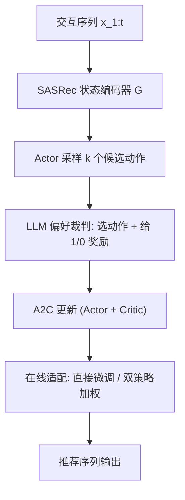

# Large Language Model driven Policy Exploration for Recommender Systems (大语言模型驱动的推荐系统策略探索)

- **会议/期刊**: WSDM 2025
- **作者与机构**: Jie Wang, Joemon M. Jose (University of Glasgow); Alexandros Karatzoglou (Amazon); Ioannis Arapakis (Telefonica Research)
- **推荐链路定位**: 端到端生成式（在线 RL 序列推荐策略）
- **研究方向**: 强化学习与动态探索推荐 / 大语言模型推荐
- **论文原文**: [论文原文链接](https://arxiv.org/abs/2501.13816v1)
- **开源代码**: 暂未开源

## TL;DR (1分钟核心速览)

在线 RL 推荐从零训练时冷启动回报极低、探索不足且易受分布漂移影响。本文提出 iALP：用 LLM 作为"用户代理"对候选动作打分（1/0 奖励），据此离线预训练 A2C 策略；再提出 A-iALP 的两种在线适配方案（直接微调 $ft$与冻结+可学习双策略加权$ap$）。在 LFM/Industry/Coat 三个模拟环境上，A-iALP$_{ap}$ 的累计回报较 A2C 分别提升约 17.8%/11.9%/3.3%，且首个 epoch 即达 A2C 数倍回报。

## Background & Motivation (背景与核心矛盾)

- **主流范式**: 将推荐建模为 MDP，用 DQN/PG/A2C 等在线 RL 优化累计回报（Return）以追求长期留存。
- **前人局限**: ① 离线 RL 策略在静态日志上训练，上线后遭遇分布漂移，OOD 状态下动作失准；② 在线 RL 从随机初始化开始，需大量交互步才能收敛，而用户在前若干次不满意推荐后即流失，形成"冷启动即流失"的死循环。
- **核心洞察 (Key Insight)**: LLM 具备语言化的用户目标理解能力，可作为"用户偏好裁判"在离线阶段生成动作与奖励，从而给在线策略一个高质量起点，绕开随机探索的早期劣质推荐阶段。
- **本文切入点**: 把 LLM 从"推荐器"降级为"离线奖励/动作生成器"，只用于预训练，在线阶段完全脱离 LLM，兼顾冷启动质量与推理成本。

## Method (核心方法设计)

### 1. 整体框架 (Overall Architecture)

模型以 SASSeq 式序列编码器 $G(\cdot)$将交互序列$x_{1:t}$映射为状态$s_t$；Actor 输出动作分布并采样$k$个候选$a_t^k$，构造 prompt 送入 LLM，由 LLM 选出最可能被用户接受的 item 并给出 1/0 奖励$r_p$；该 (状态, 动作, 奖励) 三元组写入 LLM 回放池，驱动 A2C 的 actor-critic 更新。在线阶段切换为模拟环境奖励$r$，通过直接微调或双策略加权继续优化。

### 2. 关键设计拆解 (Key Designs)

1. **LLM 偏好蒸馏作为子策略与奖励源**：痛点是从零 RL 无有效奖励信号。本文将 LLM 视为子策略 $a_t \sim \mathrm{LLM}[p(s_t, a_t^k)]$，奖励定义为$r_p = 1.0$（被选中）或$0.0$（回答 None）。直觉上 LLM 用物品文本属性（title/brand/category）做语义判断，等价于一个零成本的"伪用户"，为离线预训练提供稠密且语义合理的监督。

2. **A-iALP$_{ap}$冻结+可学习双策略融合**：直接微调$ft$会因 LLM 偏好与真实行为分布不一致而"污染"预训练策略，且探索被压制。本文冻结$\pi_\theta$、另起可学习策略$\pi_\beta$，按权重混合：
$$a_t \sim \tilde{\pi}(\cdot|s_t) = (1-\alpha)\pi_\theta(\cdot|s_t) + \alpha\pi_\beta(\cdot|s_t)$$
其中 $\alpha$ 随训练步数从初值升至 1。早期由预训练策略保底输出高质量序列，后期新策略接管以适配真实反馈，天然实现"先利用后探索"的课程式过渡。

3. **训练目标、负采样与推理效率**：预训练损失 $\mathcal{L} = \mathcal{L}_A + \mathcal{L}_Q$，其中$\mathcal{L}_A = -\log\pi_\theta(a_t|s_t)\cdot A(s_t,a_t)$，$\mathcal{L}_Q$为 one-step TD 误差平方；在线阶段同构，仅将$r_p$替换为环境奖励$r$。动作空间为全库离散 item，无显式负采样，靠 actor 采样$k$ 个候选 + LLM 判别隐式构造对比。在线推理仅需 Actor 前向，成本与传统 RL 相当，LLM 只在离线预训练出现。

## Experimental Setup & Evaluation Protocol (实验设置与评估协议)

- **数据集与预处理**: 三个公开序列数据集，按 80%/20% 划分模拟在线训练/测试环境：

| 数据集 | #Items | #Sequences | #Interactions | 物品属性 | 场景说明 |
| :--- | :---: | :---: | :---: | :---: | :--- |
| LFM | 18,297 | 11,073 | 146,255 | title; album; artist | Last.fm 音乐流媒体 |
| Industry | 5,814 | 10,935 | 71,872 | title; category; brand | Amazon 工业科学类 |
| Coat | 290 | 300 | 11,600 | jacket colour; type | 服装购买 |

- **数据划分与防穿越 (Splitting Strategy)**: 比例划分（80% 训练环境 / 20% 测试环境），非 Leave-One-Out；测试环境与训练环境共享同一模拟器但序列不重叠。
- **排名评测协议 (Ranking Protocol)**: 非传统 Top-N 排序，而是 RL 回合级指标——Return（累计奖励 $R=\sum_t r_t$）、Length（序列长度）、Average Reward（$R/Len$），并额外报告$R@e, Len@e, R_{avg}@e$（$e\in\{0,1,2\}$）刻画早期训练表现。
- **对比基线与超参设置**: 基线为 DQN、PG、A2C（与 iALP 同架构）及纯离线 iALP；LLM 采用 Mistral-7B + LoRA（1000 条交互微调 prompt 格式），预训练 100 epochs，在线统一训练 50k steps，取最近 20 回合生成学习曲线。

## Key Experimental Results (实验关键数据)

### 1. 主实验对比 (Main Results)

在线训练收敛后（50k steps）测试环境表现：

| 方法 | LFM R | LFM Len | Industry R | Industry Len | Coat R | Coat Len |
| :--- | :---: | :---: | :---: | :---: | :---: | :---: |
| DQN | 28.8 | 9.53 | 40.3 | 11.3 | 54.3 | 22.1 |
| PG | 29.7 | 8.46 | 43.3 | 10.4 | 79.3 | 29.8 |
| A2C | 28.1 | 9.29 | 46.3 | 10.8 | 81.7 | 29.9 |
| iALP (纯离线) | 11.2 | 7.21 | 25.3 | 10.7 | 31.2 | 12.9 |
| A-iALP$_{ft}$ | 31.5 | **10.1** | **52.4** | **11.5** | 83.2 | 29.6 |
| A-iALP$_{ap}$ | **33.1** | 10.2 | 51.8 | 11.3 | **84.4** | 29.7 |
| **Improv. vs A2C** | **+17.8%** | +9.8% | **+11.9%** | +6.5% | **+3.3%** | -0.7% |

冷启动首回合（$e=0$）对比：iALP 在 LFM 上$R@0=5.11$vs A2C 的 1.96（+160%），Industry 上$6.35$vs$2.43$（+161%）；$e=1$时 A-iALP$_{ft}$在 LFM 达$R@1=8.83$，远超 A2C 的 6.12。

### 2. 消融实验 (Ablation Study)

| 配置 | LFM R | Industry R | 说明 |
| :--- | :---: | :---: | :--- |
| A2C（无预训练） | 28.1 | 46.3 | 从零在线 RL |
| iALP（仅预训练，不更新） | 11.2 | 25.3 | 纯离线，无在线适配 |
| A-iALP$_{ft}$（直接微调） | 31.5 | **52.4** | 预训练 + 在线微调 |
| A-iALP$_{ap}$（双策略加权） | **33.1** | 51.8 | 冻结 + 可学习策略融合 |
| LLMOnline（LLM 直接在线决策） | 早期持平，后期落后 | 同左 | 在线调用 LLM 成本高、适应性差 |

### 3. 关键实验发现 (Key Findings)

1. **预训练是冷启动回报的决定性因素**：$e=0$ 时 iALP 回报约为 A2C 的 2.6 倍，说明 LLM 蒸馏的偏好信号能直接绕开随机探索的劣质推荐期，这是纯在线 RL 无法通过增加步数弥补的。
2. **在线适配不可省略，但方式有讲究**：纯离线 iALP 收敛后回报反而最低（LFM 11.2），说明 LLM 偏好与真实用户行为存在系统性偏差；A-iALP$_{ap}$在 LFM 上比$ft$ 高 5.1%，验证了冻结策略保底 + 渐进接管的抗漂移价值。
3. **LLM 在线直调不如"离线蒸馏+轻量在线"**：LLMOnline 早期与 A-iALP 持平，但随步数增加被反超，且推理耗时显著更高，证明将 LLM 限制在离线预训练阶段是成本-收益最优解。

## Highlights & Limitations (亮点、对比与审稿批判)

- **与代表作对比 (vs. Prior Work)**: 相较 SQN/SAC（Xin et al.）等纯离线 RL，本文引入 LLM 伪用户解决冷启动；相较 LLMOnline（Shi et al. 直接用 LLM 作在线 agent），本文把 LLM 降级为离线奖励源，在线成本降低一个量级且长期回报更高；相较 DQN/PG/A2C，本文不改 RL 算法本身，仅改"初始化从哪来"，工程侵入性极低。
- **可迁移亮点**: ① "LLM 当伪用户生成 (s,a,r) 三元组"可迁移到任何缺乏在线反馈的 RL 场景（如广告出价、对话策略）；② 冻结+可学习双策略的 $\alpha$ 渐进混合是一种通用的"预训练策略安全上线"范式。
- **审稿级局限批判**: ① 全部实验基于模拟器（DeepFM/序列模型作奖励模型），模拟器偏差可能放大或掩盖真实分布漂移问题，缺乏线上 A/B 验证；② 预训练依赖 Mistral-7B 与 LoRA 微调，LLM 选择偏差（如对文本属性丰富的物品更友好）未被量化分析，且 Coat 上提升仅 3.3%，小物品集场景收益有限。

## Rating (四维评分)

- **方法创新性 (Novelty)**: ⭐⭐⭐⭐ （将 LLM 定位为离线奖励生成器而非推荐器，配合双策略渐进融合，思路简洁但切中在线 RL 冷启动痛点）
- **评估协议与实验扎实度 (Protocol & Experiments)**: ⭐⭐⭐ （三数据集 + 多探索策略 + 早期 epoch 指标较完整，但全为模拟环境、无真实线上验证，且缺显著性检验）
- **写作与数学规范度 (Clarity & Rigor)**: ⭐⭐⭐⭐ （MDP 符号与 A2C 损失定义清晰，算法伪代码完整；但正文存在 iALP/A-iALP 拼写不一致等笔误）
- **工业落地与复现价值 (Industrial & Practical Value)**: ⭐⭐⭐⭐ （在线阶段零 LLM 调用、成本与传统 RL 持平，预训练可离线批量完成，落地路径清晰；可惜未开源代码）

