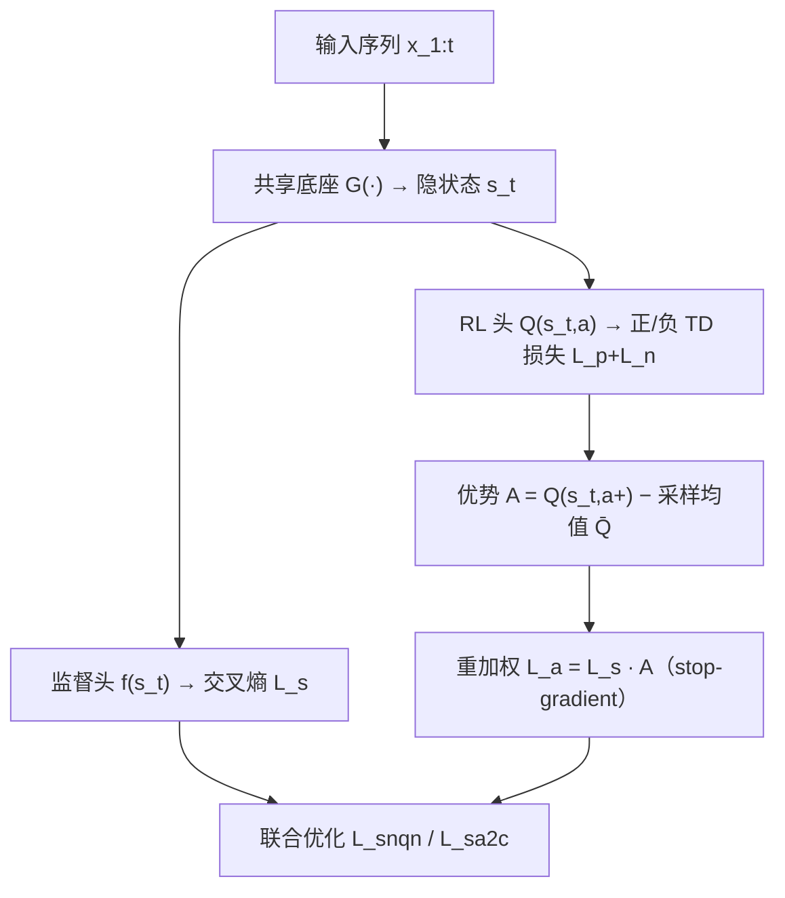

# Supervised Advantage Actor-Critic for Recommender Systems (面向推荐系统的监督式优势演员-评论家)

- **会议/期刊**: WSDM 2022
- **作者与机构**: Xin Xin (山东大学)、Alexandros Karatzoglou (Google Research)、Ioannis Arapakis (Telefonica Research)、Joemon M. Jose (University of Glasgow)
- **推荐链路定位**: 精排（会话/序列 Next-Item 排序）
- **研究方向**: 强化学习与动态探索推荐 / 序列与会话推荐
- **论文原文**: [https://arxiv.org/abs/2111.03474v1](https://arxiv.org/abs/2111.03474v1)
- **开源代码**: 暂未开源（论文给出 Google Drive 数据与实现链接）

## TL;DR (1分钟核心速览)

针对自监督 RL 推荐（SQN/SAC）的两大痛点——RL 头只在正动作上训练导致 Q 值系统性正偏、且原始 Q 值强依赖序列时间戳——本文提出 **SNQN**：在 Q-learning 的 TD 损失中显式加入采样负动作的负 TD 误差，使 RL 头本身即可用于排序；进一步提出 **SA2C**：用「正动作 Q 值减去采样动作平均 Q 值」的优势估计替代原始 Q 值来重加权监督交叉熵。在 RC15 与 RetailRocket 上以 8:1:1 划分、HR/NDCG@5/10/20 评测，SA2C 相对 SASRec 在 RC15 购买 HR@5 提升约 11.3%，相对 SASRec-SAC 亦稳定领先。

## Background & Motivation (背景与核心矛盾)

- **主流范式**: 会话推荐以监督式 next-item 交叉熵训练（GRU/Caser/NextItNet/SASRec），近期工作 SQN/SAC 将 RL 头与监督头共享底座联合训练，用奖励（点击/购买）把模型引向长期收益。
- **前人局限一**: SQN/SAC 的 RL 头仅在正动作上定义 TD 损失，隐式反馈缺乏负奖励信号，Q 值被系统性高估，RL 头无法直接用于推荐，只能充当正则项。
- **前人局限二**: SAC 直接用绝对 Q 值作 critic 重加权 actor，而 Q 值是整条序列后续累积收益的估计，长序列早期的一个坏动作也可能拿到高 Q 值，时间戳偏置被引入监督学习。
- **核心洞察 (Key Insight)**: 若在 RL 训练中采样负动作，则「正动作 Q 值 − 采样动作平均 Q 值」即为一个天然归一化的优势量，既消除正偏又抵消时间戳偏置，且无需遍历巨大动作空间求期望。
- **本文切入点**: 用负采样同时修好 RL 头的排序能力（SNQN）与 critic 的归一化质量（SA2C）。

## Method (核心方法设计)

### 1. 整体框架 (Overall Architecture)

底座生成模型 $G(\cdot)$将序列$x_{1:t}$编码为隐状态$s_t=G(x_{1:t})$，其上并联两个头：监督头$f(s_t)$输出分类 logits 走交叉熵，RL 头$Q(s_t,a)=\delta(G(x_{1:t})h_t^{\top}+b)$输出 Q 值走 TD 损失。训练时对每个正动作采样$|N_t|$个未交互负动作，正负 TD 误差联合回传，梯度经共享底座互相迁移；SA2C 阶段再用优势$A(s_t,a_t^+)$对监督损失加权，并以 SNQN 预训练$T$ 步保证 Q 值稳定后再启用重加权。推理时默认用监督头出 top-k，SNQN 下 RL 头亦可独立出推荐。

### 2. 关键设计拆解 (Key Designs)

1. **SNQN：负采样 TD 损失（让 RL 头可排序）**：SQN 只有正 TD 误差，Q 值正偏。SNQN 对每个负动作 $a_t^-\in N_t$追加一项负 TD 误差，且因假设负动作不改变用户状态，bootstrap 项在$Q(s_t,a')$而非$Q(s_{t+1},a')$ 上取 max：
$$L_q=\big(r(s_t,a_t^+)+\gamma\max_{a'}Q(s_{t+1},a')-Q(s_t,a_t^+)\big)^2+\sum_{a_t^-\in N_t}\big(r_n+\gamma\max_{a'}Q(s_t,a')-Q(s_t,a_t^-)\big)^2$$
负奖励取常数 $r_n=0$。直觉：负项把未交互物品的 Q 值往下压，等价于在 RL 空间内做对比学习，使 Q 值具备判别性而非单调正偏。

2. **SA2C：采样优势作 critic（消除时间戳偏置）**：精确期望 Q 需遍历全动作空间，代价不可接受；作者用正动作加 $|N_t|$ 个负动作的均值近似：
$$\bar{Q}(s_t,a)=\frac{\sum_{a'\in\{a_t^+\}\cup N_t}Q(s_t,a')}{|N_t|+1},\qquad A(s_t,a_t^+)=Q(s_t,a_t^+)-\bar{Q}(s_t,a)$$
并以 $L_a=L_s\cdot A(s_t,a_t^+)$ 重加权监督头，计算优势时对 Q 值 stop-gradient。直觉：优势是「相对平均水平的超额收益」，序列整体水位被减掉，长序列早期动作不再因累积收益大而被误判为好动作。

3. **训练目标、负采样与推理效率**：总损失 $L_{snqn}=L_s+L_q$，$L_{sa2c}=L_a+L_q$；采用 double Q-learning（两套参数交替更新）稳定训练；负采样为均匀分布（刻意排除 sampler 影响），每正样本采 10 个负样本，$\gamma=0.5$，购买/点击奖励比$r_p/r_c=5$。推理仅需一次前向，RL 头不引入额外在线开销。

## Experimental Setup & Evaluation Protocol (实验设置与评估协议)

- **数据集与预处理**:

| 数据集 | #Sequences | #Items | #Clicks | #Purchases | 过滤/场景说明 |
| :--- | :---: | :---: | :---: | :---: | :--- |
| RC15 | 200,000 | 26,702 | 1,110,965 | 43,946 | 剔除长度<3 的会话后采样 20 万条，电商点击+购买 |
| RetailRocket | 195,523 | 70,852 | 1,176,680 | 57,269 | 剔除交互<3 的物品与长度<3 的序列，view→click、add-to-cart→purchase |

- **数据划分与防穿越 (Splitting Strategy)**: 随机 **比例划分 8:1:1**（非 Leave-One-Out、非全局时间戳切分），每组实验重复 5 次取均值。
- **排名评测协议 (Ranking Protocol)**: 报告 HR@5/10/20 与 NDCG@5/10/20，分别统计 purchase 与 click 两类目标；未声明全库 Full-Ranking 或采样排序细节，属该文评估严谨性上的薄弱点。
- **对比基线与超参设置**: 底座为 GRU / Caser / NextItNet / SASRec 四种 SOTA 序列模型，对照方法为 SQN、SAC 及各自底座原版；序列长度 10（不足补 padding），embedding 维度 $d=64$，Adam，batch 256，SNQN 学习率 0.01(RC15)/0.005(RR)，SA2C 预训练后降至 0.001；未报告显著性检验。

## Key Experimental Results (实验关键数据)

### 1. 主实验对比 (Main Results)

RC15 购买目标（监督头出推荐，节选）：

| Models | HR@5 | NDCG@5 | HR@10 | NDCG@10 | HR@20 | NDCG@20 |
| :--- | :---: | :---: | :---: | :---: | :---: | :---: |
| GRU | 0.3994 | 0.2824 | 0.5183 | 0.3204 | 0.6067 | 0.3429 |
| GRU-SQN | 0.4228 | 0.3016 | 0.5333 | 0.3376 | 0.6233 | 0.3605 |
| GRU-SAC | 0.4394 | 0.3154 | 0.5525 | 0.3521 | 0.6378 | 0.3739 |
| GRU-SA2C | **0.4514** | **0.3297** | **0.5606** | **0.3652** | **0.6420** | **0.3859** |
| SASRec | 0.4228 | 0.2938 | 0.5418 | 0.3326 | 0.6329 | 0.3558 |
| SASRec-SQN | 0.4336 | 0.3067 | 0.5505 | 0.3435 | 0.6442 | 0.3674 |
| SASRec-SAC | 0.4540 | 0.3246 | 0.5701 | 0.3623 | 0.6576 | 0.3846 |
| SASRec-SA2C | **0.4705** | **0.3385** | **0.5756** | **0.3728** | **0.6648** | **0.3956** |

RetailRocket 购买目标（节选）：

| Models | HR@5 | NDCG@5 | HR@10 | NDCG@10 | HR@20 | NDCG@20 |
| :--- | :---: | :---: | :---: | :---: | :---: | :---: |
| GRU | 0.4608 | 0.3834 | 0.5107 | 0.3995 | 0.5564 | 0.4111 |
| GRU-SQN | 0.5069 | 0.4130 | 0.5589 | 0.4289 | 0.5946 | 0.4392 |
| GRU-SAC | 0.4942 | 0.4179 | 0.5464 | 0.4341 | 0.5870 | 0.4428 |
| GRU-SA2C | **0.5526** | **0.4754** | **0.5963** | **0.4897** | **0.6313** | **0.4985** |
| NextItNet | 0.5630 | 0.4630 | 0.6127 | 0.4792 | 0.6477 | 0.4881 |
| NextItNet-SAC | 0.5895 | 0.4985 | 0.6358 | 0.5162 | 0.6657 | 0.5243 |
| NextItNet-SA2C | **0.6226** | **0.5422** | **0.6573** | **0.5534** | 0.6842 | **0.5603** |

以 SASRec 为参照，SA2C 在 RC15 购买 HR@5 相对提升 $(0.4705-0.4228)/0.4228\approx 11.3\%$，相对 SASRec-SAC 提升约$3.6\%$；RetailRocket 上 GRU-SA2C 相对 GRU-SAC 的 HR@5 提升约$11.8\%$。

### 2. 消融实验 (Ablation Study)

| 配置 (RC15, GRU 底座) | 购买 HR@5 | 购买 NDCG@5 | 点击 HR@5 | 点击 NDCG@5 |
| :--- | :---: | :---: | :---: | :---: |
| 监督基线 GRU | 0.3994 | 0.2824 | 0.2876 | 0.1982 |
| + SQN（仅正 TD） | 0.4228 | 0.3016 | 0.3020 | 0.2093 |
| + SNQN（正+负 TD） | 0.4368 | 0.3115 | 0.3124 | 0.2164 |
| + SAC（原始 Q 重加权） | 0.4394 | 0.3154 | 0.2863 | 0.1985 |
| + SA2C（优势重加权） | **0.4514** | **0.3297** | **0.3287** | **0.2307** |
| RL 头单独出推荐：DQN | 0.3642 | 0.2476 | 0.2096 | 0.1353 |
| RL 头单独出推荐：SNQN | **0.3698** | **0.2497** | **0.2286** | **0.1495** |
| SA2C + off-policy 校正 $\rho$ | 0.3551 | — | 0.2595 | — |

### 3. 关键实验发现 (Key Findings)

1. **负 TD 项是主要增益来源，且能反哺监督头**：SNQN 相对 SQN 在 RC15 购买 HR@5 从 0.4228 升至 0.4368，点击 HR@5 从 0.3020 升至 0.3124；由于两头共享底座 $G(\cdot)$，RL 空间的对比信号经梯度回流提升了监督表征，且图 2 显示 SNQN 收敛明显快于 SQN。
2. **优势重加权优于原始 Q 值重加权，且对点击目标尤为关键**：SA2C 相对 SAC 在 RC15 点击 HR@5 从 0.2863 跃至 0.3287（+14.8%），而 SAC 的点击指标甚至低于纯监督 GRU（0.2876），说明绝对 Q 值的时间戳偏置在稀疏点击信号上会直接伤害 actor。
3. **负样本数量存在先升后降的甜点，负奖励取值几乎无关**：图 3/图 4 显示 $|N_t|$从 1 增至 10 时性能上升、继续增至 20 则回落；而表 6 中$r_n\in\{0,-0.5,-1,-2\}$ 对结果无显著差异，说明增益来自「存在负样本」这一对比结构本身，而非负奖励的强度标定。

## Highlights & Limitations (亮点、对比与审稿批判)

- **与代表作对比 (vs. Prior Work)**: 与 SQN/SAC 的本质区别在于 RL 头是否见过负动作——SQN 的 RL 头只是正则器，SNQN 的 RL 头是可独立排序的判别器；与 SAC 相比，SA2C 把 critic 从「绝对累积收益」换成「相对平均水平的优势」，用采样均值替代全动作空间期望，把 $O(|\mathcal{I}|)$的归一化成本降到$O(|N_t|)$。
- **可迁移亮点**: ①「采样均值近似基线」的优势估计可直接移植到任何带负采样的 RL 精排/重排模型，无需额外 critic 网络；② 用 SNQN 预训练 $T$ 步再启用重加权，是缓解 RL 早期 Q 值抖动导致 actor 崩坏的通用 warm-up 技巧。
- **审稿级局限批判**: ① 评估仅用 8:1:1 随机划分与 HR/NDCG，未声明 Full-Ranking 协议、未做显著性检验，且随机划分在会话推荐中存在信息泄漏风险；② 负采样固定为均匀分布，未探索 hard negative，而工业场景中难负样本才是关键；③ 表 5 显示 off-policy 校正反而降低标准 NDCG，作者仅归因于方差，未给出可用的替代方案，实际部署时行为策略估计仍是硬伤。

## Rating (四维评分)

- **方法创新性 (Novelty)**: ⭐⭐⭐⭐ （负采样 TD + 采样优势 critic 两个改动都很轻，但精准命中 SQN/SAC 的正偏与时间戳偏置，思路干净）
- **评估协议与实验扎实度 (Protocol & Experiments)**: ⭐⭐⭐ （四种底座 × 两个数据集的交叉验证较充分，但划分协议与排名协议交代含糊、缺显著性检验）
- **写作与数学规范度 (Clarity & Rigor)**: ⭐⭐⭐⭐ （公式与算法伪代码清晰，负动作不改状态的假设交代明确，复杂度分析略欠）
- **工业落地与复现价值 (Industrial & Practical Value)**: ⭐⭐⭐⭐ （仅加一个 RL 头与负采样，推理零额外开销，奖励可自定义为购买/停留时长，工程改造成本极低）

