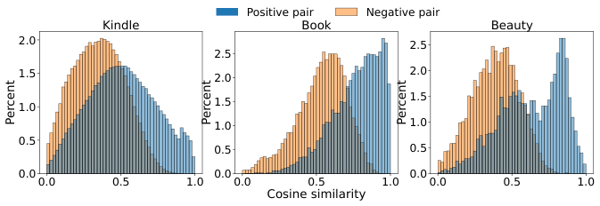
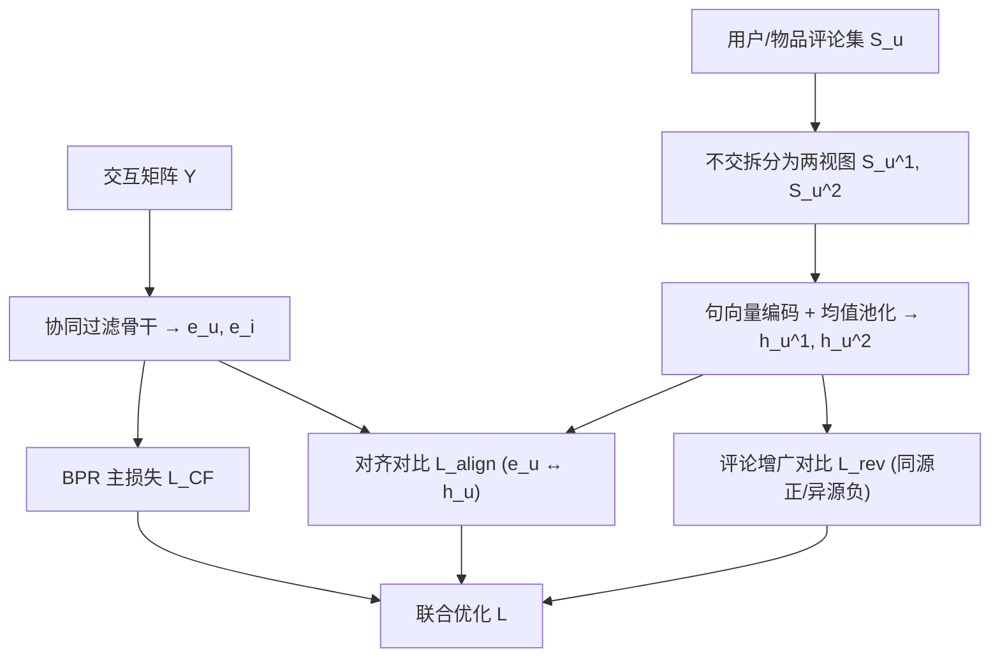

# A Contrastive Framework with User, Item and Review Alignment for Recommendation (面向推荐的用户-物品-评论对齐对比框架)

- **会议/期刊**: WSDM 2025
- **作者与机构**: Hoang V. Dong, Yuan Fang, Hady W. Lauw（Singapore Management University）
- **推荐链路定位**: 召回（协同过滤表征学习）
- **研究方向**: 自监督对比学习与交互去噪 / 多模态推荐（文本模态）
- **论文原文**: [https://arxiv.org/abs/2501.11963v2](https://arxiv.org/abs/2501.11963v2)
- **开源代码**: 暂未开源

## TL;DR (1分钟核心速览)

现有评论感知推荐把评论当作**附加特征**，一旦用户/物品无评论就需填充哑向量，且评论语义空间与协同空间彼此割裂。ReCAFR 改换思路：把评论当作**自监督对比信号**——同一用户（物品）的两份评论视图互为正样本、跨用户（物品）为负样本做增广对比；再用第二个对比任务把协同嵌入 $\mathbf{e}$与评论嵌入$\mathbf{h}$ 拉入同一空间。在 4 个 Amazon/Yelp 数据集、Full-Ranking 协议下，ReCAFR+SimGCL 相对最强基线 NDCG@5 提升 2.4%–7.7%，且删除 30% 评论后性能衰减显著小于 NARRE/RGCL/RMCL。

## Background & Motivation (背景与核心矛盾)

- **主流范式**: 评论感知推荐（NARRE 注意力聚合评论、RGCL 把评论当二部图边特征、RMCL 多意图对比）普遍把评论编码为**用户/物品的输入特征**，再与协同隐因子拼接或融合。
- **前人局限**: ① 评论并非普适，大量用户/物品零评论，特征级用法必须填充或插补哑向量，直接污染表征；② 评论语义信号与交互协同信号分处两个隐空间，表征间存在**不一致（inconsistency）**，融合反而互相拖累。
- **核心洞察 (Key Insight)**: 同一用户的评论在写作风格与关注维度上呈现稳定的“用户签名”，跨用户则显著发散；物品侧同理。图 1 在 Kindle/Book/Beauty 上验证：正样本对余弦相似度分布明显右移于负样本对。
- **本文切入点**: 既然评论天然自带“同源相似、异源相异”的判别结构，就不必把它当特征喂进去，而应把它做成**对比学习的增广视图**，并额外施加跨模态对齐约束。

<figure class="paper-figure" markdown="span">
  <figcaption>图1：正样本对与负样本对的相似度分布比较。</figcaption>
</figure>

## Method (核心方法设计)

### 1. 整体框架 (Overall Architecture)

ReCAFR 在任意协同过滤骨干（BPR/LightGCN/SGL/SimGCL/DirectAU）之上并联两个自监督对比模块。输入侧，交互矩阵驱动骨干产出协同嵌入 $\mathbf{e}_u,\mathbf{e}_i$；评论侧，对每个用户（物品）的评论集$S_u$随机不交拆分为两个视图$S_u^1,S_u^2$，经预训练句向量模型$f(\cdot)$编码后均值池化得视图表征$\mathbf{h}_u^k$。模块 (b) 以同源视图为正、异源视图为负做 InfoNCE 对比，从评论中榨取语义监督信号；模块 (c) 再将$\mathbf{e}_u$与随机采样的$\mathbf{h}_u$对齐，把协同与语义两套表征压入统一空间。三者联合优化，推理时仅用$\mathbf{e}_u^\top\mathbf{e}_i$ 打分，评论分支零推理开销。

### 2. 关键设计拆解 (Key Designs)

1. **评论增广对比（Review-Augmented Contrastive Learning）**：痛点是把评论当特征会在缺失时失效；本文改为在评论集内部造正负样本对，缺失评论的用户/物品直接从求和项中跳过而非填充。核心式为
$\mathcal{L}^{\text{user}}_{\text{rev}}=\sum_{u\in U}-\log\frac{\exp(\text{sim}(\mathbf{h}_u^1,\mathbf{h}_u^2)/\tau)}{\sum_{u'\in U}\exp(\text{sim}(\mathbf{h}_u^1,\mathbf{h}_{u'}^2)/\tau)}$，
物品侧对称。直觉：同一作者的评论共享偏好签名，对比目标强迫编码器把“签名”从噪声文本中剥离出来，等价于用评论做了一次语义级数据增广，直接缓解交互稀疏。

2. **三方对齐对比（Alignment Contrastive Strategy）**：痛点是 $\mathbf{e}$由交互学得、$\mathbf{h}$ 由语言模型初始化，二者空间不同源，简单拼接会产生表征漂移。本文用第二个 InfoNCE 把同一实体的两种表征拉近、不同实体推远：
$\mathcal{L}^{\text{user}}_{\text{align}}=\sum_{u\in U}-\log\frac{\exp(\text{sim}(\mathbf{e}_u,\mathbf{h}_u)/\tau)}{\sum_{u'\in U}\exp(\text{sim}(\mathbf{e}_u,\mathbf{h}_{u'})/\tau)}$。
直觉：这相当于给协同嵌入加了一个“语义锚点”正则，使 $\mathbf{e}$ 在保持协同判别力的同时吸收评论语义，从而在评论缺失时仍具备语义泛化能力。

3. **训练目标、负采样与推理效率**：总损失
$\mathcal{L}=\mathcal{L}_{\text{CF}}+\lambda_1(\mathcal{L}^{\text{user}}_{\text{rev}}+\mathcal{L}^{\text{item}}_{\text{rev}})+\lambda_2(\mathcal{L}^{\text{user}}_{\text{align}}+\mathcal{L}^{\text{item}}_{\text{align}})+\lambda_3\|\Theta\|_2^2$。
负采样为 **In-batch 全库负样本**（分母遍历全体用户/物品），无需额外构造难负例；主损失沿用 BPR 的三元组均匀负采样。推理阶段仅做内积检索，评论编码与对比分支全部离线，在线开销与骨干模型完全一致。

## Experimental Setup & Evaluation Protocol (实验设置与评估协议)

- **数据集与预处理**:

| 数据集 | #Users | #Items | #Interactions | #Reviews | 密度 | 说明 |
| :--- | :---: | :---: | :---: | :---: | :---: | :--- |
| Kindle | 365,687 | 356,888 | 3,348,523 | 3,327,676 | .003% | Amazon，2-core |
| Book | 500,000 | 678,705 | 11,417,323 | 11,266,408 | .003% | Amazon，5-core 后随机采 500K 用户 |
| Beauty | 6,119 | 5,082 | 23,291 | 22,257 | .075% | Amazon，2-core |
| Yelp | 22,450 | 17,213 | 606,123 | 601,512 | .157% | Phoenix 子集，2-core |

- **数据划分与防穿越**: 随机 **80%/10%/10% 比例划分**（训练/验证/测试），非时间戳切分，存在轻度未来信息泄漏风险。
- **排名评测协议**: **Full-Ranking（全库未交互物品排序）**，报告 Recall@{5,20}、Precision@{5,20}、NDCG@{5,20}，五次重复取均值±标准差。
- **对比基线与超参设置**: 无评论组 BPR / LightGCN / SGL / DirectAU / SimGCL（后四者亦作 ReCAFR 骨干）；评论组 NARRE / RGCL / RMCL（缺失评论用 10K 随机评论均值池化插补）。嵌入维度 $d=64$，Adam，batch 1024，lr 0.01；$\lambda_1\in\{.001,.01,1,10,20\}$、$\lambda_2\in[0.1,0.6]$、$\lambda_3\in[0.1,1.0]$网格搜索，$\tau\in[0,1]$。

## Key Experimental Results (实验关键数据)

### 1. 主实验对比 (Main Results)

与评论感知 SOTA 对比（Recall@5 / NDCG@5，全部评论可用）：

| 方法 | Kindle R@5 | Kindle N@5 | Book R@5 | Book N@5 | Beauty R@5 | Beauty N@5 | Yelp R@5 | Yelp N@5 |
| :--- | :---: | :---: | :---: | :---: | :---: | :---: | :---: | :---: |
| NARRE | .0238 | .0269 | .0160 | .0266 | .0266 | .0303 | .0129 | .0171 |
| RGCL | .0242 | .0292 | .0183 | .0305 | .0269 | .0325 | .0142 | .0196 |
| RMCL | .0236 | .0288 | .0172 | .0294 | .0273 | .0315 | .0144 | .0192 |
| **ReCAFR+SimGCL** | **.0269** | **.0302** | **.0184** | **.0307** | **.0296** | **.0365** | **.0155** | **.0202** |
| Improv. vs 最强基线 | +11.2% | +3.4% | +0.5% | +0.7% | +8.4% | **+7.7%** | +7.6% | +3.1% |

与无评论骨干的增益（NDCG@5，ReCAFR+X vs X）：SimGCL 在 Beauty 上 .0339→.0365（+7.7%）、Yelp 上 .0188→.0202（+7.4%）；LightGCN 在 Book 上 .0254→.0311（+22.4%），说明骨干越弱、评论信号补益越大。

### 2. 消融实验 (Ablation Study)

NDCG@5，骨干为 SimGCL：

| 变体 | Kindle | Book | Beauty | Yelp |
| :--- | :---: | :---: | :---: | :---: |
| ReCAFR+SimGCL（完整） | **.0302** | **.0307** | **.0365** | **.0202** |
| w/o text emb. init. | .0294 | .0286 | .0351 | .0199 |
| w/o user CL | .0281 | .0281 | .0346 | .0186 |
| w/o item CL | .0276 | .0284 | .0331 | .0182 |

### 3. 关键实验发现 (Key Findings)

1. **对比信号远胜特征初始化**：仅去掉文本嵌入初始化只掉 0.8%–6.8%，而去掉任一侧对比学习掉 6.9%–9.9%（Beauty 上 .0365→.0331），证明收益主体来自对比目标而非“评论当特征”的语义先验。
2. **缺失评论鲁棒性是核心差异化优势**：删除 30% 评论后，NARRE 在 Yelp 上 NDCG@5 从 .0171 崩至 .0140（−18%），RGCL 从 .0196 至 .0156（−20%），而 ReCAFR 仅 .0202→.0184（−8.9%），且图 3 显示随缺失率升至 30% 其曲线下降最平缓。
3. **超参呈“倒 U”且对齐需适度**：$\lambda_1\approx10$时四数据集同时最优，说明评论对比是主导信号；$\lambda_2$ 在 Amazon 上取 [0.4,0.5]、Yelp 取 0.2 最佳，过小导致空间不一致、过大则约束过强压缩模型容量。此外 LLM 精炼评论（GPT-4o mini 摘要+推理）可再带来 NDCG@5 增益（Beauty 上 SimGCL 骨干 .0365→.0376），验证框架与 LLM 增强正交可叠加。

## Highlights & Limitations (亮点、对比与审稿批判)

- **与代表作对比 (vs. Prior Work)**: NARRE 用注意力把评论聚成特征，缺失即失效；RGCL 虽用对比但增广发生在**图结构**（节点/边 dropout），评论仅作边特征；RMCL 在评论内部做多意图对比但未与协同空间对齐。ReCAFR 的本质差异是把增广搬到**评论文本视图**并显式施加跨空间对齐，因而同时解决稀疏与不一致两个问题。
- **可迁移亮点**: ① “同源多视图不交拆分 + In-batch 负样本”这一零标注增广范式可直接移植到多模态（图像/音频）或 LLM 生成画像等任意侧信息；② 缺失样本从损失求和项中直接跳过而非插补，是处理非普适侧信息的通用工程技巧。
- **审稿级局限批判**: ① 评论编码依赖预训练句向量模型且需对每条评论离线前向，Book 数据集千万级评论的预处理成本与存储开销未量化；② 数据划分采用随机 80/10/10 而非全局时间戳切分，Full-Ranking 下存在未来交互泄漏，线上时序泛化性存疑；③ 推理虽只用 $\mathbf{e}$，但对齐损失可能使$\mathbf{e}$ 偏向评论覆盖密集的头部用户/物品，长尾无评论群体的收益未被单独分桶验证。

## Rating (四维评分)

- **方法创新性 (Novelty)**: ⭐⭐⭐⭐ （把评论从特征层升维到对比信号层，双对比任务设计简洁且由图 1 分布分析直接驱动，但 InfoNCE + 跨模态对齐范式本身在多模态领域已有先例）
- **评估协议与实验扎实度 (Protocol & Experiments)**: ⭐⭐⭐⭐ （4 数据集 × 5 骨干 × 5 次重复 + 缺失评论鲁棒性曲线 + LLM 正交实验较完整，扣分在随机划分而非时间切分）
- **写作与数学规范度 (Clarity & Rigor)**: ⭐⭐⭐⭐ （损失公式与符号定义清晰、用户/物品侧对称性交代明确，但复杂度分析置于附录、$\lambda_2$ 搜索范围与正文描述略有出入）
- **工业落地与复现价值 (Industrial & Practical Value)**: ⭐⭐⭐⭐ （推理零额外开销、可插拔任意 CF 骨干、对评论缺失天然鲁棒，非常契合工业场景；扣分在未开源且评论离线编码成本未评估）

