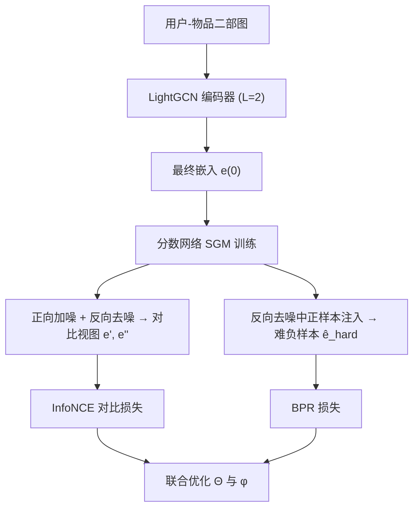

# SCONE: A Novel Stochastic Sampling to Generate Contrastive Views and Hard Negative Samples for Recommendation (基于随机采样的对比视图与难负样本统一生成框架)

- **会议/期刊**: WSDM 2025
- **作者与机构**: Chaejeong Lee (Korea Telecom), Jeongwhan Choi, Sung-Bae Cho (Yonsei University), Hyowon Wi, Noseong Park (KAIST)
- **推荐链路定位**: 召回（图协同过滤表征学习）
- **研究方向**: 自监督对比学习与交互去噪 / 图神经网络推荐
- **论文原文**: [论文原文链接](https://arxiv.org/abs/2405.00287v2)
- **开源代码**: [开源代码仓库链接](https://github.com/jeongwhanchoi/SCONE)

## TL;DR (1分钟核心速览)

图协同过滤长期受困于交互稀疏与均匀负采样低效两大痛点，而对比视图增广（SGL 丢边、SimGCL 加噪）与难负采样（DNS 离散候选、MixGCF 线性插值）各自为政且都只在预设区域内采样。SCONE 首次把二者统一为"用户-物品特定随机采样"任务，用分数生成模型（SGM）的正向加噪/反向去噪生成动态对比视图，并用"随机正样本注入"生成覆盖整个嵌入空间的难负样本。在 6 个基准数据集、7:1:2 比例划分、Full-Ranking 协议下，Recall@20 相对最强基线最高提升 1.70%（Douban），NDCG@20 提升 2.79%。

## Background & Motivation (背景与核心矛盾)

- **主流范式**: 以 LightGCN 为编码器，叠加图对比学习（SGL/SimGCL/NCL）缓解稀疏，或叠加难负采样（DNS/MixGCF）改进 BPR 优化。
- **前人局限**: ① 图增广类方法（SGL 边/节点丢弃、SimGCL 统一尺度加噪）会扭曲图结构或抹平节点个体特性，且对所有节点施加同一噪声尺度；② 难负采样方法（DNS 在离散候选集排序、MixGCF 在正负样本间线性插值）只能覆盖预设的有限区域，负样本多样性受限。
- **核心洞察 (Key Insight)**: 对比视图与难负样本本质上是同一件事——"为特定目的合成定制样本"，且二者都可由估计原始数据分布的生成模型无失真地完成，因此可合并进单一框架。
- **本文切入点**: 用 SGM 的随机微分方程在嵌入空间做用户-物品特定采样，一次训练同时服务 CL 视图与难负样本两个下游用途。

## Method (核心方法设计)

### 1. 整体框架 (Overall Architecture)

先用 LightGCN 得到各层加权和的最终嵌入 $\mathbf{e}^{(0)}$，以其为训练数据拟合一个 U-Net 结构的分数网络$S_\phi(\mathbf{e}^{(t)},t)$（3 层、1 编码块 + 1 解码块、跳连，时间嵌入用正弦位置编码）。训练完成后，同一 SGM 被复用两次：正向加噪到中间时刻$N$得到扰动嵌入、再反向去噪得到生成嵌入，二者构成对比视图；对三元组$(u,v^+,v^-)$在反向去噪每一步把正样本注入负样本轨迹，得到难负样本。图编码器参数$\Theta$与分数网络参数$\phi$ 端到端联合训练，推理阶段仅用 LightGCN 编码器，SGM 不参与线上计算。

### 2. 关键设计拆解 (Key Designs)

1. **随机过程生成对比视图（Stochastic View Generation）**：SGL/SimGCL 的增广要么破坏图结构要么用统一噪声尺度，无法保留节点个性。SCONE 取中间时刻 $N$的两个状态作为一对视图：$\mathbf{e}'=\mathbf{e}^{(N)}$（前向扰动）与$\mathbf{e}''=\hat{\mathbf{e}}^{(0)}$（反向生成），其中反向采样按$\mathbf{e}^{(i)}\leftarrow\mathbf{e}^{(i+1)}+(\sigma^2(i+1)-\sigma^2(i))\cdot S_\phi(\mathbf{e}^{(i+1)},\sigma(i+1))+\sqrt{\sigma^2(i+1)-\sigma^2(i)}\,z$ 迭代。由于随机过程不收敛回原点而是收敛到分布内另一样本，视图既保留用户/物品个性又具备足够差异，天然适配个性化推荐。

2. **随机正样本注入生成难负样本（Stochastic Positive Injection）**：DNS/MixGCF 的负样本被锁死在离散候选或线性插值路径上。SCONE 在反向去噪的每一步执行 $\mathbf{e}_{v^-}^{hard}(t)=w\cdot\mathbf{e}_{v^-}^{hard}(t)+(1-w)\cdot\mathbf{e}_{v^+}(t)$，把正样本轨迹按权重$w$混入负样本轨迹，最终得到$\hat{\mathbf{e}}_{v^-}^{hard}(0)$。注入发生在整条随机轨迹上而非单点插值，因此合成负样本可覆盖整个嵌入区域，且$w$直接控制"难"的程度——$w$ 过小（<0.7）会过度同化正样本导致性能骤降。

3. **训练目标与推理效率**：总损失为 $\mathcal{L}_\Theta=\mathcal{L}_{BPR}+\lambda_1\mathcal{L}_{CL}$，其中 BPR 用生成的难负样本替换均匀负样本：$\mathcal{L}_{BPR}=\sum\ln\sigma(\mathbf{e}_u\cdot\hat{\mathbf{e}}_{v^-}^{hard}(0)-\mathbf{e}_u\cdot\mathbf{e}_{v^+})+\lambda_2\|\Theta\|_2^2$；CL 用 InfoNCE 对比$\mathbf{e}'$与$\mathbf{e}''$。分数网络单独以去噪得分匹配目标$\mathcal{L}_\phi=\mathbb{E}_{t}\mathbb{E}_{\mathbf{e}^{(t)}}\mathbb{E}_{\mathbf{e}^{(0)}}[\lambda(t)\|S_\phi(\mathbf{e}^{(t)},t)-\nabla_{\mathbf{e}^{(t)}}\log p(\mathbf{e}^{(t)}|\mathbf{e}^{(0)})\|_2^2]$ 训练。负采样为"生成式难负 + 批内对比负"，无需额外候选检索；推理时 SGM 完全旁路，与 LightGCN 推理开销相同。

## Experimental Setup & Evaluation Protocol (实验设置与评估协议)

- **数据集与预处理**: 6 个基准数据集，统计如下（沿用 SELFRec 库的标准过滤）：

| 数据集 | #Users | #Items | #Interactions | 密度 | 场景说明 |
| :--- | :---: | :---: | :---: | :---: | :--- |
| Douban | 12,638 | 22,222 | 598,420 | 0.213% | 影音评分 |
| Gowalla | 50,821 | 57,440 | 1,302,695 | 0.045% | LBS 签到（最稀疏） |
| Tmall | 47,939 | 41,390 | 2,619,389 | 0.132% | 电商 |
| Yelp2018 | 31,668 | 38,048 | 1,561,406 | 0.130% | 本地生活 |
| Amazon-CDs | 43,169 | 35,648 | 777,426 | 0.051% | 电商 |
| ML-1M | 6,038 | 3,492 | 575,281 | 2.728% | 电影（最稠密） |

- **数据划分与防穿越 (Splitting Strategy)**: 按 7:1:2 比例随机划分 train/validation/test（沿用 SimGCL 设定），非时间戳切分。
- **排名评测协议 (Ranking Protocol)**: 采用无偏 **Full-Ranking**（对全库未交互物品排序），报告 Recall@20 与 NDCG@20；训练阶段 BPR 的负样本由 SGM 生成（难负）而非均匀采样。
- **对比基线与超参设置**: 6 个基线覆盖三类——图编码器 LightGCN、图对比学习 SGL/NCL/SimGCL、难负采样 DNS/MixGCF。统一嵌入维度 $D=64$、batch size 2048、图编码器层数$L=2$；SCONE 采用 VE-SDE，$\sigma_{\min}=0.01$、$\sigma_{\max}=50$、$T=100$、采样步数$N=10$、$\tau=0.2$、$\lambda_2=10^{-4}$，$\lambda_1$在$\{0.1,\dots,2.5\}$内逐数据集调优，$w\in\{0.7,0.8,0.9\}$。

## Key Experimental Results (实验关键数据)

### 1. 主实验对比 (Main Results)

| 数据集 | 指标 | LightGCN | SGL | SimGCL | DNS | MixGCF | **SCONE** | Improv. |
| :--- | :--- | :---: | :---: | :---: | :---: | :---: | :---: | :---: |
| Douban | Recall@20 | 0.1474 | 0.1728 | 0.1780 | 0.1645 | 0.1784 | **0.1815** | +1.70% |
| Douban | NDCG@20 | 0.1240 | 0.1510 | 0.1567 | 0.1393 | 0.1576 | **0.1611** | +2.79% |
| Gowalla | Recall@20 | 0.2086 | 0.2223 | 0.2269 | 0.2233 | 0.2147 | **0.2295** | +1.15% |
| Gowalla | NDCG@20 | 0.1264 | 0.1349 | 0.1386 | 0.1358 | 0.1295 | **0.1409** | +1.66% |
| Tmall | Recall@20 | 0.0686 | 0.0754 | 0.0898 | 0.0860 | 0.0819 | **0.0908** | +1.08% |
| Tmall | NDCG@20 | 0.0477 | 0.0532 | 0.0643 | 0.0600 | 0.0570 | **0.0654** | +1.73% |
| Yelp2018 | Recall@20 | 0.0588 | 0.0669 | 0.0718 | 0.0671 | 0.0703 | **0.0721** | +0.39% |
| Amazon-CDs | Recall@20 | 0.1283 | 0.1550 | 0.1584 | 0.1545 | 0.1542 | **0.1586** | +0.13% |
| ML-1M | Recall@20 | 0.2693 | 0.2657 | 0.2868 | 0.2791 | 0.2897 | **0.2910** | +0.45% |
| ML-1M | NDCG@20 | 0.3015 | 0.3027 | 0.3230 | 0.3171 | 0.3287 | 0.3244 | -1.31% |

### 2. 消融实验 (Ablation Study)

| 变体 | Douban R@20 | Douban N@20 | Gowalla R@20 | Amazon-CDs R@20 | ML-1M R@20 |
| :--- | :---: | :---: | :---: | :---: | :---: |
| LightGCN（无 CL 无难负） | 0.1474 | 0.1240 | 0.2086 | 0.1283 | 0.2693 |
| w/o NS（仅 CL） | 0.1728 级 | 0.1510 级 | 0.2223 级 | 0.1550 级 | 0.2657 级 |
| w/o CL（仅难负） | 略低于 SCONE | 略低于 SCONE | 略低于 SCONE | 提升更显著 | 略低于 SCONE |
| **SCONE（完整）** | **0.1815** | **0.1611** | **0.2295** | **0.1586** | **0.2910** |

（注：原文消融以柱状图 Fig.7/Fig.13 呈现，表中 w/o 变体数值为图中对应量级，完整数值见原文附录 C。）

### 3. 关键实验发现 (Key Findings)

1. **两个组件互补且数据集偏好不同**：Douban 上 CL 贡献更大（仅 CL 即达 0.1728，接近 MixGCF 的 0.1784），而 Amazon-CDs 上难负采样贡献更显著；完整 SCONE 在所有数据集均优于任一单组件变体，说明"统一框架"不是简单叠加而是协同增益。
2. **稀疏与长尾场景收益最突出**：在用户度最低的 80% 分组（Gowalla 0–29、Tmall 0–59）与物品流行度最低的 80% 分组上，SCONE 相对 LightGCN/SimGCL/MixGCF 的领先幅度明显大于整体平均，验证了随机采样在冷启动用户与长尾物品上的鲁棒性；同时最佳性能 epoch 处 SCONE 的表征均匀性最优（Douban -3.591、Tmall -3.823，均为最低值），说明其缓解了流行度偏置。
3. **采样步数 $N$存在明确甜点**：$N=10$时性能最佳，$N>10$后因嵌入被过度扰动、用户/物品个性被削弱而性能下降；$w<0.7$ 时正样本注入过强导致难负样本"过难"、性能剧烈波动。运行时上 SCONE 每 epoch 19.86s（Douban）/142.65s（Tmall），慢于图 CL 方法（SGL 8.67s）但快于 DNS（25.23s）与 MixGCF（23.25s），且推理时间与所有基线一致。

## Highlights & Limitations (亮点、对比与审稿批判)

- **与代表作对比 (vs. Prior Work)**: 相比 SGL/SimGCL 的"破坏式增广"，SCONE 用生成模型在分布内采样，不损失交互细节且噪声尺度随节点自适应；相比 DNS 的离散候选排序与 MixGCF 的单点线性插值，SCONE 的难负样本沿整条随机轨迹注入正样本，覆盖区域从"预设点/线段"扩展为"整个嵌入空间"，这是其多样性优势的根源。
- **可迁移亮点**: ① "正向加噪—反向去噪取中间态"作为对比视图的构造范式，可迁移到任何有连续嵌入的序列/多模态推荐；② 用生成轨迹上的正样本混合比例 $w$ 连续调节负样本难度，比离散 hard-negative 挖掘更可控。
- **审稿级局限批判**: ① 仅在 LightGCN 上验证，未测试更先进图编码器（如 UltraGCN、LightGCN 变体）上的泛化性；② SGM 训练引入额外前反向采样开销，训练时间约为图 CL 方法的 2 倍，且 $N$、$w$、$\lambda_1$ 三个超参需逐数据集网格搜索，工程调参成本偏高；③ ML-1M 上 NDCG@20 反而低于 MixGCF（-1.31%），说明稠密数据下生成式难负样本的边际收益可能被线性插值类方法反超，论文对此未做深入分析。

## Rating (四维评分)

- **方法创新性 (Novelty)**: ⭐⭐⭐⭐ （首次将对比视图与难负采样统一为 SGM 随机采样任务，"正样本注入"算子简洁且有物理直觉）
- **评估协议与实验扎实度 (Protocol & Experiments)**: ⭐⭐⭐⭐ （6 数据集 + Full-Ranking + 稀疏/流行度分桶 + 均匀性分析齐全，但消融以图呈现、缺精确数值表）
- **写作与数学规范度 (Clarity & Rigor)**: ⭐⭐⭐⭐ （SDE 前反向过程与两个算法伪代码清晰，复杂度对比有定量参数比支撑）
- **工业落地与复现价值 (Industrial & Practical Value)**: ⭐⭐⭐⭐ （推理零额外开销、代码开源、SGM 参数仅为嵌入的 1/9–1/24，但训练侧采样开销与超参敏感度需在线上评估）

