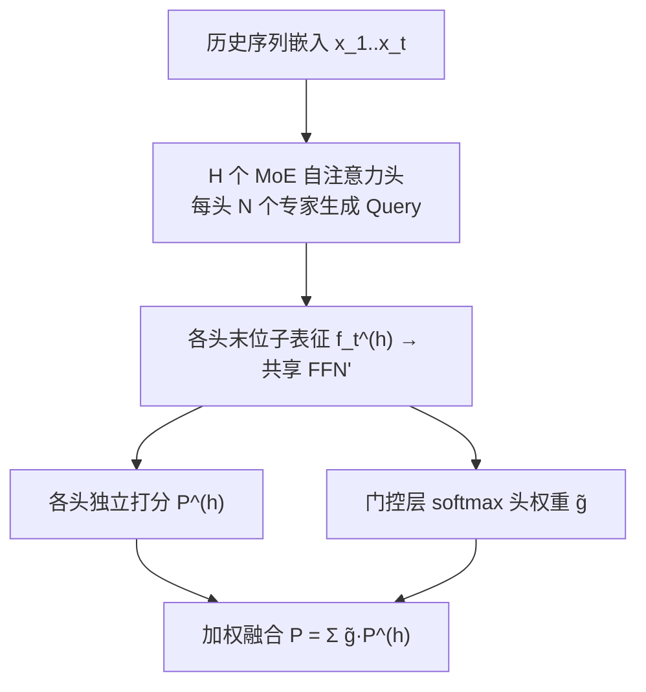
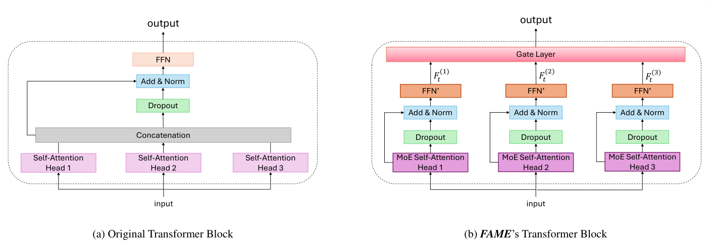

# Facet-Aware Multi-Head Mixture-of-Experts Model for Sequential Recommendation (面向序列推荐的多面感知多头混合专家模型)

- **会议/期刊**: WSDM 2025
- **作者与机构**: Mingrui Liu, Sixiao Zhang, Cheng Long（南洋理工大学）
- **推荐链路定位**: 精排（Next-Item 预测）
- **研究方向**: 序列与会话推荐 / 生成式与表征解耦（交叉）
- **论文原文**: [https://arxiv.org/abs/2411.01457v2](https://arxiv.org/abs/2411.01457v2)
- **开源代码**: 基于 [RecBole](https://github.com/RUCAIBox/RecBole) 与 [SSLRec](https://github.com/HKUDS/SSLRec) 实现，作者独立仓库暂未开源

## TL;DR (1分钟核心速览)

现有序列推荐把每个物品压成**单一向量**，无法表达物品的"多面性"（如电影同时有类型、主演两个面），也无法表达用户在同一面内的多重偏好（既爱动作片又爱歌舞片）。FAME 直接复用最后一层多头注意力的**各头子嵌入分别独立预测**下一物品，并用门控动态加权各头重要性；再在每个头内用 **MoE 替换 Query 投影矩阵**，让不同专家解耦同一面内的多种偏好。在 Beauty/Sports/Toys/ML-20m 四个数据集、`Leave-One-Out` + `Full-Ranking` 协议下，NDCG@20 相对最强基线（ICLRec/DuoRec）提升 1.9%–8.6%。

## Background & Motivation (背景与核心矛盾)

- **主流范式**: SASRec/BERT4Rec 类自注意力模型将序列编码为单一序列向量 $F_t$，与物品嵌入做内积打分；多意图工作（MiasRec、MSGIFSR、Atten-Mixer）则从"多个物品表征"或"层级窗口"角度刻画用户多意图。
- **前人局限**: ① 单一嵌入无法刻画物品的多面属性，当用户意图由某一面（如"主演 Hugh Jackman"而非"类型"）主导时，单向量会把不同面的信号混叠；② 即便承认多意图，现有方法也未在**同一面内部**进一步解耦（用户在同一类型面下可能同时偏好动作与歌舞）。
- **核心洞察 (Key Insight)**: 多头注意力的不同头天然学到不同注意力分布（Transformer 文献已证实头分工），因此**各头的子嵌入本身就可视为物品不同面的表征**，无需额外引入属性侧信息或增加表征维度。
- **本文切入点**: 把"多头"从内部计算机制升级为**多路预测器**，并在每个头内嵌入 MoE 把"面"再细分为"面内偏好"。

## Method (核心方法设计)

### 1. 整体框架 (Overall Architecture)

模型以 SASRec 为骨架，仅替换**最后一个 Transformer 块**：输入物品序列经嵌入后进入若干 MoE 自注意力头，每个头 $h$输出末位物品的子表征$f_t^{(h)}$，经**共享的降维 FFN'** 得到$F_t^{(h)}$；每个头用自己学到的物品子嵌入$x_v^{(h)}$独立打分，最后由门控层输出头权重$\tilde{g}^{(h)}$ 加权融合为统一偏好分数。训练采用两阶段：先预训练标准 SASRec，再替换末层 Query 矩阵为 MoE 并端到端微调。

<figure class="paper-figure" markdown="span">
  <figcaption>图2：所提出模型的概览：(a) 展示了原始 Transformer 块，而 (b) 描绘了我们提出的 FAME 模型的架构。为简洁起见，图中省略了 FFN（FFN’）之后的 LayerNorm 和 Dropout 操作。</figcaption>
</figure>

### 2. 关键设计拆解 (Key Designs)

1. **多面感知多头预测（Facet-Aware Multi-Head Prediction）**：痛点是把 $d$维整向量当唯一表征会抹平物品多面性。做法是让每个头在$d'=d/H$子空间内独立预测，物品子嵌入由$x_v^{(h)}=x_v^{\top}W_f^{(h)}$线性投影得到，头内打分$P^{(h)}(v_{t+1}=v|\mathcal{S}_u)=x_v^{(h)\top}F_t^{(h)}$；再用门控$\tilde{g}=\mathrm{softmax}([F_t^{(1)}|\cdots|F_t^{(H)}]^{\top}W_g+b_g)$融合$P=\sum_{h}\tilde{g}^{(h)}P^{(h)}$。直觉：不同头关注不同面，门控按当前上下文挑选"主导面"，避免等权拼接稀释信号。

2. **MoE 自注意力层（面内偏好解耦）**：痛点是一个面内仍有多种偏好（动作 vs 歌舞）。做法是把标准 Query 投影 $W_Q^{(h)}$替换为$N$个专家矩阵$W_{Q(n)}^{(h)}$，第$n$个专家生成$q_{i(n)}^{(h)}=x_i^{\top}W_{Q(n)}^{(h)}$，各自算注意力得$f_{i(n)}^{(h)}=\sum_j\tilde{\alpha}_{ij(n)}^{(h)}v_j^{(h)}$；路由器$\beta_{i\cdot}^{(h)}=\mathrm{softmax}([f_{i(1)}^{(h)}|\cdots|f_{i(N)}^{(h)}]^{\top}W_{exp}^{(h)})$加权聚合$f_i^{(h)}=\sum_n\beta_{i(n)}^{(h)}f_{i(n)}^{(h)}$。关键点：**Key/Value 仍共享**，只有 Query 分支化，因此新增参数仅$N\cdot d\cdot d'$，且专家间通过共享 K/V 保持语义对齐。

3. **训练目标与推理开销**：采用全局交叉熵（全库 softmax，等价于免负采样）$\mathcal{L}_{ce}=-\sum_{u}\log\frac{\exp(x_{t+1}^{(u)\top}f_t^{(u)})}{\sum_{i}\exp(x_i^{\top}f_t^{(u)})}$。由于$H$个头维度之和恒为$d$，多头本身不增计算量；MoE 仅作用于末层 Query，额外开销为$O(N\cdot d\cdot d')$，推理时仍是对全库内积，与 SASRec 同阶。

## Experimental Setup & Evaluation Protocol (实验设置与评估协议)

- **数据集与预处理**（均做 `5-core` 过滤）：

| 数据集 | #Users | #Items | #Interactions | 平均长度 | 密度 |
| :--- | :---: | :---: | :---: | :---: | :---: |
| Beauty | 22,363 | 12,101 | 198,502 | 8.8 | 0.07% |
| Sports | 25,598 | 18,357 | 296,337 | 8.3 | 0.05% |
| Toys | 19,412 | 19,392 | 167,597 | 8.6 | 0.04% |
| ML-20m | 96,726 | 16,297 | 1,856,746 | 19.2 | 0.11% |

- **数据划分与防穿越**: `Leave-One-Out`——末位为测试、倒数第二位为验证、其余训练。
- **排名评测协议**: 无偏 `Full-Ranking`（全库未交互物品排序，**不做负采样**），指标 HR@{5,10,20} 与 NDCG@{5,10,20}。
- **对比基线与超参**: 覆盖四类——RNN（GRU4Rec）、注意力（SASRec/BERT4Rec）、对比学习（CL4SRec/ICLRec/DuoRec）、多意图（Atten-Mixer/MSGIFSR/MiasRec）及 CORE。嵌入维度在 $\{64,128\}$中择优（更大维度易不收敛），Adam lr=0.001、batch=256，$H\in\{1,2,4,8,16\}$、$N\in\{2,4,8,16,32\}$ 网格调参。

## Key Experimental Results (实验关键数据)

### 1. 主实验对比 (Main Results)

| 数据集 | 指标 | SASRec | BERT4Rec | CL4SRec | ICLRec | DuoRec | MiasRec | **FAME** | Improv. |
| :--- | :--- | :---: | :---: | :---: | :---: | :---: | :---: | :---: | :---: |
| Beauty | HR@20 | 0.1057 | 0.1075 | 0.1195 | 0.1252 | 0.0912 | 0.1125 | **0.1345** | +7.4% |
| Beauty | NDCG@20 | 0.0474 | 0.0502 | 0.0601 | 0.0646 | 0.0479 | 0.0532 | **0.0687** | +6.3% |
| Sports | HR@20 | 0.0618 | 0.0607 | 0.0723 | 0.0753 | 0.0476 | 0.0651 | **0.0820** | +8.9% |
| Sports | NDCG@20 | 0.0256 | 0.0265 | 0.0344 | 0.0370 | 0.0231 | 0.0288 | **0.0402** | +8.6% |
| Toys | HR@20 | 0.0908 | 0.0968 | 0.1209 | 0.1382 | 0.0879 | 0.1143 | **0.1409** | +1.9% |
| Toys | NDCG@20 | 0.0448 | 0.0464 | 0.0627 | 0.0745 | 0.0469 | 0.0567 | **0.0759** | +1.9% |
| ML-20m | HR@20 | 0.2996 | 0.3132 | 0.2760 | 0.2997 | 0.3108 | 0.3021 | **0.3230** | +3.1% |
| ML-20m | NDCG@20 | 0.1333 | 0.1438 | 0.1240 | 0.1382 | 0.1450 | 0.1383 | **0.1513** | +4.3% |

（`Improv.` 为相对该数据集最强基线的提升；FAME 在全部 24 个指标格上均最优。）

### 2. 消融实验 (Ablation Study)

原文以"头数扫描 + 专家数扫描"形式给出消融（$N=1$即退化为 `FAME w/o MoE`，$H=1$ 即退化为 SASRec）：

| 配置 | Beauty NDCG@20 | Sports NDCG@20 | Toys NDCG@20 | ML-20m NDCG@20 |
| :--- | :---: | :---: | :---: | :---: |
| SASRec ($H{=}1$) | 0.0474 | 0.0256 | 0.0448 | 0.1333 |
| FAME w/o MoE（最优 $H$） | 优于 SASRec | 优于 SASRec | 优于 SASRec | 优于 SASRec |
| **FAME（最优 $H,N$）** | **0.0687** | **0.0402** | **0.0759** | **0.1513** |

### 3. 关键实验发现 (Key Findings)

1. **多头预测机制本身即有效**：`FAME w/o MoE` 在所有数据集上稳定优于同维度 SASRec，说明"用各头子嵌入独立预测 + 门控融合"这一零额外复杂度的改造就能带来增益，增益来源是面级信息分离而非参数扩容。
2. **MoE 的增益依赖数据复杂度**：Beauty 在 $N>4$后收益饱和（用户偏好较单一），而 ML-20m 随$N$增大持续提升（偏好更复杂多样），Sports/Toys 在$N=32$ 出现过拟合——说明专家数应随数据偏好复杂度自适应，而非越大越好。
3. **最优头数呈数据集差异**：Beauty/Sports/Toys 偏好较少头（物品面较简单），ML-20m 需要更多头；且头数过多时所有模型都出现边际递减，与 Transformer 原始结论一致。案例研究（Sports 用户 230）显示门控给出 0.82 vs 0.18 的头权重，正确头命中真值物品，而等权拼接则漏召回。

## Highlights & Limitations (亮点、对比与审稿批判)

- **与代表作对比 (vs. Prior Work)**: 相比 MiasRec（用序列中多个物品表征刻画多意图），FAME 的多面性来自**物品自身表征的子空间分解**而非多物品聚合；相比 MSGIFSR/Atten-Mixer（层级窗口/多粒度会话图做意图分层），FAME 不改序列建模结构，只改末层预测头，**可即插即用地挂到任意注意力骨干**；相比 ICLRec/DuoRec 的对比学习路线，FAME 不依赖数据增广与负样本构造。
- **可迁移亮点**: ① "末层多头子嵌入分别打分 + 门控融合"是极低成本的多面建模 trick，可直接移植到 DIN/DIEN 类 CTR 模型的多兴趣建模；② "只分支 Query、共享 K/V"的 MoE 改造方式在控制参数量的同时保持专家语义对齐，适合其他需要解耦子空间的注意力结构。
- **审稿级局限批判**: ① 仅在末层引入 MoE，浅层仍是单 Query，深层语义是否已被浅层混叠所限未做验证；② 需先预训练 SASRec 再微调，训练流程两阶段且对 $H,N$双超参敏感（不同数据集最优值差异大），缺少自适应确定$H,N$ 的机制；③ 未报告推理延迟与显存实测，也未与 LLM4Rec 类强基线对比。

## Rating (四维评分)

- **方法创新性 (Novelty)**: ⭐⭐⭐⭐ （复用多头子空间做多面预测、头内 MoE 解耦偏好，思路简洁但理论分析偏直觉，缺少面-头对应性的定量验证）
- **评估协议与实验扎实度 (Protocol & Experiments)**: ⭐⭐⭐⭐ （四数据集 + `Full-Ranking` 无偏协议 + 十类基线覆盖全面，但消融以超参扫描替代逐组件拆表，且无显著性检验）
- **写作与数学规范度 (Clarity & Rigor)**: ⭐⭐⭐⭐ （公式链条完整、符号统一，MoE 与门控推导清晰；但部分表格数值存在明显排版异常，复杂度分析略简）
- **工业落地与复现价值 (Industrial & Practical Value)**: ⭐⭐⭐⭐ （仅改末层、参数量与计算量近零增长、可插拔到任意注意力骨干，工程落地门槛低；但两阶段训练与双超参调优增加上线成本）

