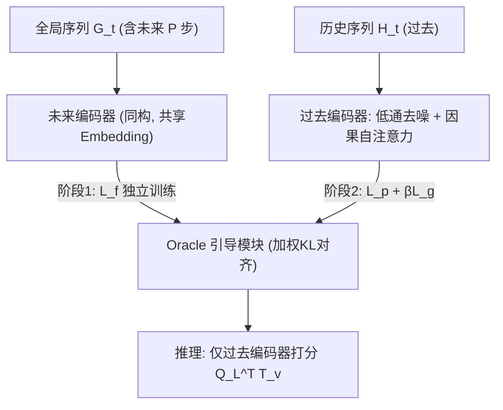
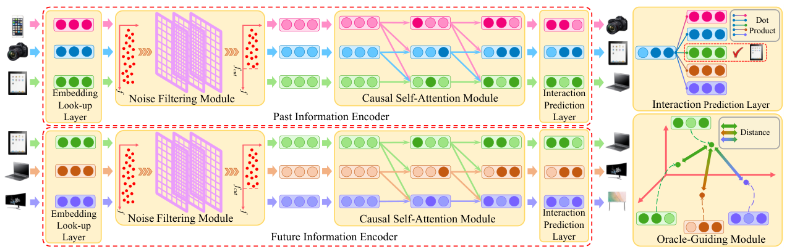

# Oracle-guided Dynamic User Preference Modeling for Sequential Recommendation (Oracle 引导的序列推荐动态用户偏好建模)

- **会议/期刊**: WSDM 2025
- **作者与机构**: Jiafeng Xia, Tun Lu, Peng Zhang, Li Shang, Ning Gu (复旦大学) ; Dongsheng Li (微软亚洲研究院) ; Hansu Gu
- **推荐链路定位**: 召回（序列 Next-Item 预测）
- **研究方向**: 序列与会话推荐 / 自监督对比学习与交互去噪
- **论文原文**: [https://arxiv.org/abs/2412.00813v1](https://arxiv.org/abs/2412.00813v1)
- **开源代码**: [https://github.com/Yaveng/Oracle4Rec](https://github.com/Yaveng/Oracle4Rec)

## TL;DR (1分钟核心速览)

序列推荐只用“过去”训练，导致偏好建模系统性偏差；本文提出 Oracle4Rec，用训练期可得的“未来交互”作为后验 Oracle，通过双编码器 + 指数衰减的 KL 对齐损失把未来信息蒸馏进过去编码器，并配无参 FFT 低通滤波去噪与两阶段训练。在 6 个真实数据集、`Leave-One-Out` + 1:99 采样排序协议下，HR@1/NDCG@10 相对最强基线 DualRec 提升约 2%–8%（如 ML1M HR@1 0.3482→0.3709，Beauty NDCG@10 0.3490→0.3632）。

## Background & Motivation (背景与核心矛盾)

- **主流范式**: SASRec/BERT4Rec/FMLP-Rec 等以因果自注意力或全 MLP 编码历史序列，仅用 $t$ 之前的交互训练 Next-Item 预测。
- **前人局限**: ① 仅用过去信息无法刻画偏好演化方向，训练目标与“未来真实兴趣”之间存在系统性偏差；② 已有用未来信息的 BERT4Rec/GRec/DualRec 采用右到左逆序建模、且未来与过去**同时联合训练**，未来信息被“稀释”为普通监督信号，引导作用弱；且均未处理序列噪声。
- **核心洞察 (Key Insight)**: 未来交互是训练期天然可得的**后验观测 (hindsight)**，可充当正则项收缩表征空间；作者用 KL 散度度量“预测偏好分布 vs 真实偏好分布”，发现加未来编码器后 KL 从 0.0085 降至 0.0070（ML100K，+17.6%），且能缓解仅用过去信息导致的**历史类别过拟合**（图 2 中 user 260 的 category 2 概率被显著下调）。
- **本文切入点**: 不做“掩码推断”，而做**表征对齐**——先独立学好未来编码器，再用它“教”过去编码器，得到 forward-looking 模型；推理时只用过去编码器，零额外开销。

## Method (核心方法设计)

### 1. 整体框架 (Overall Architecture)

输入为用户历史序列 $H_t^u$（长度$L$）与全局序列$G_t^u$（额外含未来$P$个交互）。两路**同构**编码器（共享 item/position embedding 以稳定训练、减少参数）各自经过：Embedding Look-up → 无参频域低通去噪 → 因果自注意力 → 交互预测层，分别输出$\mathbf{Q}\in\mathbb{R}^{L\times d}$与$\mathbf{R}\in\mathbb{R}^{L\times d}$。Oracle 引导模块最小化$\mathbf{Q}_L$与未来编码器对应位置表征的加权 KL 距离；训练采用 2PTraining：先以$\mathcal{L}_f$训未来编码器，再以$\mathcal{L}_p+\beta\mathcal{L}_g$训过去编码器与引导模块。推理阶段丢弃未来编码器，仅用$\mathbf{Q}_L^\top \mathbf{T}_v$ 全库打分。

<figure class="paper-figure" markdown="span">
  <figcaption>图1：Oracle4Rec 的架构，由三部分组成：过去信息编码器、未来信息编码器和 Oracle 引导模块。前两个编码器均由嵌入查找层、噪声过滤模块、因果自注意力模块和交互预测层组成。为便于展示，Oracle 引导模块被设定为在三维坐标系中最小化过去信息与未来信息之间的距离。</figcaption>
</figure>

### 2. 关键设计拆解 (Key Designs)

1. **无参频域低通去噪 (Noise Filtering Module)**：痛点在于首因/位置偏置噪声会污染注意力分布，而 FMLP-Rec 的可学习滤波器引入额外参数、训练更难。本文对第 $g$层表征做 FFT，按频率向量的$q$分位数取截止频率$f_{cut}^g$，用 0/1 指示矩阵保留低频分量后 IFFT，并加残差与 LayerNorm：$\mathbf{F}_g=\mathrm{LN}(\mathrm{Dropout}(\mathrm{IFFT}(\mathbf{X}_g\odot\mathbf{M}_g))+\mathbf{F}_{g-1})$。零参数即可滤除高频噪声，消融显示其贡献最大（Beauty HR@1 0.2199→0.2062 当移除）。

2. **Oracle 引导的指数衰减对齐 (Oracle-Guiding Module)**：痛点在于过去编码器只被“下一个物品”监督，学不到偏好演化方向。本文令过去预测表征 $\mathbf{Q}_L$对齐未来编码器在$v_t$及其后$P+1$ 个位置上的表征，权重按时间距离指数衰减：
$$\mathcal{L}_g=\sum_{i=1}^{P+2}\alpha_i\cdot f(\mathbf{Q}_L,\mathbf{R}_{L-P-2+i}),\quad \alpha_i=e^{-\gamma(i-1)}$$
其中 $f(\cdot)$ 实测 KL 散度最优（优于 JS/欧氏/余弦）。直觉：越近的未来越可信，衰减权重让模型学到“偏好漂移的方向”而非机械复制远期噪声。

3. **训练目标、负采样与推理效率**：过去损失 $\mathcal{L}_p$为 1 正 + 1 负的 BPR 式 sigmoid 交叉熵；未来损失$\mathcal{L}_f$对全局序列做**逐位置**（$L$个位置）的 next-item 监督，迫使未来编码器充分抽取后验信息；总目标$\mathcal{L}=\mathcal{L}_p+\beta\mathcal{L}_g$（阶段二）。负样本为均匀随机负采样（评测时 1:99）。推理仅保留单塔过去编码器，与 SASRec 同级开销，未来编码器只在训练期存在。

## Experimental Setup & Evaluation Protocol (实验设置与评估协议)

- **数据集与预处理**: 全部按 FMLP-Rec 惯例过滤交互数 < 5 的用户与物品（`5-core`）：

| 数据集 | #Users | #Items | #Interactions | 密度 | 场景 |
| :--- | :---: | :---: | :---: | :---: | :--- |
| ML100K | 943 | 1,349 | 99,287 | 7.805% | 电影 |
| ML1M | 6,040 | 3,416 | 999,611 | 4.485% | 电影 |
| Beauty | 22,363 | 12,101 | 198,052 | 0.073% | 美妆电商 |
| Sports | 25,598 | 18,357 | 296,337 | 0.063% | 户外电商 |
| Toys | 19,412 | 11,924 | 167,597 | 0.072% | 玩具电商 |
| Yelp | 30,431 | 20,033 | 316,354 | 0.052% | 本地商业 |

- **数据划分与防穿越 (Splitting Strategy)**: `Leave-One-Out`——每用户最后 1 个交互为测试、倒数第 2 个为验证、其余全部训练；序列按时间升序，超长截断取最近 $L=50$，不足左侧 padding。
- **排名评测协议 (Ranking Protocol)**: 主表为 `Sampled Ranking`，真值物品与 99 个用户未交互随机负样本共同排序（1:99）；附录另报 `Full-Ranking` 全库排序结果。指标 HR@{1,5,10}、NDCG@{5,10}、MRR。
- **对比基线与超参设置**: 13 个基线，覆盖 PopRec、GRU4Rec、Caser、RepeatNet、HGN、CLEA、SASRec、BERT4Rec、GRec、SRGNN、GCSAN、FMLP-Rec、DualRec（后三者及 BERT4Rec/GRec 可用未来信息）。$d\in\{32,64,128,256\}$，$L=50$，$P=10$，$\gamma\in[0.005,1.0]$，$q\in[0.3,1.0]$，$\beta\in\{0.005,0.01,0.05\}$，dropout 0.5，Adam lr=0.001；显著性$p<0.05$（表中 ★）。

## Key Experimental Results (实验关键数据)

### 1. 主实验对比 (Main Results)

选取 7 个代表性基线（含最强对手 DualRec），核心指标如下（★ 表示相对最强基线的统计显著）：

| 数据集 | 指标 | SASRec | BERT4Rec | SRGNN | GCSAN | FMLP-Rec | DualRec | **Oracle4Rec** | Improv.% |
| :--- | :--- | :---: | :---: | :---: | :---: | :---: | :---: | :---: | :---: |
| ML100K | HR@1 | 0.1926 | 0.1786 | 0.1834 | 0.2040 | 0.2085 | 0.2097 | **0.2257**★ | +7.63% |
| ML100K | NDCG@10 | 0.4034 | 0.3846 | 0.3946 | 0.4121 | 0.4208 | 0.4108 | **0.4353**★ | +3.45% |
| ML1M | HR@1 | 0.3478 | 0.3375 | 0.3404 | 0.3648 | 0.3541 | 0.3482 | **0.3709**★ | +1.67% |
| ML1M | NDCG@10 | 0.5608 | 0.5467 | 0.5389 | 0.5623 | 0.5648 | 0.5496 | **0.5863**★ | +3.81% |
| Beauty | HR@1 | 0.1794 | 0.1684 | 0.1777 | 0.1985 | 0.2038 | 0.2182 | **0.2199**★ | +0.78% |
| Beauty | NDCG@10 | 0.3211 | 0.3000 | 0.3078 | 0.3227 | 0.3436 | 0.3490 | **0.3632**★ | +4.07% |
| Sports | HR@1 | 0.1503 | 0.1405 | 0.1473 | 0.1674 | 0.1699 | 0.1831 | **0.1861**★ | +1.64% |
| Sports | NDCG@10 | 0.3037 | 0.2870 | 0.2916 | 0.3111 | 0.3240 | 0.3380 | **0.3471**★ | +2.69% |
| Toys | HR@1 | 0.1799 | 0.1504 | 0.1682 | 0.1995 | 0.1926 | 0.2170 | 0.2152 | -0.83% |
| Toys | NDCG@10 | 0.3075 | 0.2866 | 0.2995 | 0.3234 | 0.3346 | 0.3458 | **0.3565**★ | +3.09% |
| Yelp | HR@1 | 0.2276 | 0.2446 | 0.2400 | 0.2561 | 0.2704 | 0.2817 | **0.2970**★ | +5.43% |
| Yelp | NDCG@10 | 0.4699 | 0.4744 | 0.4675 | 0.4829 | 0.5040 | 0.5119 | **0.5300**★ | +3.54% |

### 2. 消融实验 (Ablation Study)

| 设置 | ML100K HR@1 | ML100K NDCG@5 | ML1M HR@1 | Beauty HR@1 | Beauty NDCG@5 |
| :--- | :---: | :---: | :---: | :---: | :---: |
| (11) Oracle4Rec 完整版 | **0.2257** | **0.3843** | **0.3709** | **0.2199** | **0.3316** |
| (1) w/o 噪声滤波模块 | 0.1909 | 0.3554 | 0.3658 | 0.2062 | 0.3104 |
| (2) 可学习滤波器替代 | 0.2042 | 0.3637 | 0.3523 | 0.2087 | 0.3121 |
| (3) w/o 未来编码器 | 0.1782 | 0.3391 | 0.3477 | 0.1878 | 0.3010 |
| (4) w/o 指数衰减权重 | 0.1983 | 0.3604 | 0.3347 | 0.2123 | 0.3255 |
| (5) 传统联合训练 | 0.2087 | 0.3670 | 0.3497 | 0.2041 | 0.3164 |
| (6) JS 散度替代 KL | 0.1968 | 0.3583 | 0.3555 | 0.2160 | 0.3257 |
| (7) 欧氏距离替代 KL | 0.1987 | 0.3622 | 0.3630 | 0.2071 | 0.3194 |
| (8) 余弦距离替代 KL | 0.2070 | 0.3712 | 0.3608 | 0.2078 | 0.3211 |
| (9) 仅用未来编码器 | 0.1911 | 0.3407 | 0.3283 | 0.1986 | 0.3017 |
| (10) R2L 逆序抽取未来 | 0.2078 | 0.3659 | 0.3389 | 0.2071 | 0.3174 |

### 3. 关键实验发现 (Key Findings)

1. **未来信息“引导”远胜“联合训练”**：去掉未来编码器（设置 3）ML100K HR@1 从 0.2257 跌至 0.1782（-21%），而传统联合训练（设置 5）仅 0.2087，说明 2PTraining 的“先学后教”是收益主因，而非未来信息本身；仅用未来编码器（设置 9）同样次优，证明对齐方向不可逆。
2. **无参低通滤波是第二大功臣且优于可学习滤波**：移除后 ML100K HR@1 降 15.4%，换成可学习滤波器（设置 2）仍低 9.5%，验证“零参数去噪”在稀疏电商数据上更易训练、泛化更好。
3. **通用性可迁移**：将引导模块 + 2PTraining 插入 GRU4Rec/SRGNN/GCSAN/FMLP-Rec，ML1M HR@1 分别提升 10.0%/5.1%/5.4%/3.3%（均 $p<0.05$），说明该范式与主干架构正交，可作为即插即用训练插件。

## Highlights & Limitations (亮点、对比与审稿批判)

- **与代表作对比 (vs. Prior Work)**: 与 BERT4Rec 的 Mask & Prediction 不同，本文不做“由上下文推断被掩码项”，而做**双塔表征对齐**，避免在噪声序列上强行推断导致的伪相关；与 DualRec/GRec 相比，本文未来信息为左到右自然顺序、先独立训练再引导、且对跨期未来按指数衰减区别对待，并额外处理噪声。
- **可迁移亮点**: ① “后验 Oracle 蒸馏”思路可直接移植到 CTR 序列建模、会话推荐等任何训练期可见未来标签的任务；② 无参 FFT 低通滤波可作为通用去噪前置层，零参数、易部署。
- **审稿级局限批判**: ① 主表为 1:99 采样排序，采样负样本会放大绝对指标，虽附录有 Full-Ranking 但正文未充分讨论；② 未来编码器使训练开销约翻倍（两阶段 + 逐位置未来监督），且 $P$、$\gamma$、$q$ 三个超参需逐数据集调优，工业大规模场景下的训练成本与调参负担未量化；③ Toys 上 HR@1 略低于 DualRec，说明收益在极稀疏数据上并非无条件成立。

## Rating (四维评分)

- **方法创新性 (Novelty)**: ⭐⭐⭐⭐ （“未来作 Oracle 引导过去”的视角清晰，配指数衰减对齐与两阶段训练，但本质是后验蒸馏/正则，理论新意中等）
- **评估协议与实验扎实度 (Protocol & Experiments)**: ⭐⭐⭐⭐ （6 数据集 + 13 基线 + 完整消融 + 通用性 + 显著性检验，唯主表采样排序略保守）
- **写作与数学规范度 (Clarity & Rigor)**: ⭐⭐⭐⭐ （模块公式与损失定义完整、与 DualRec 的五点差异对比清晰，部分推导置于附录）
- **工业落地与复现价值 (Industrial & Practical Value)**: ⭐⭐⭐⭐ （代码开源、推理零额外开销、可作插件插入现有序列模型，训练期成本翻倍是主要代价）

