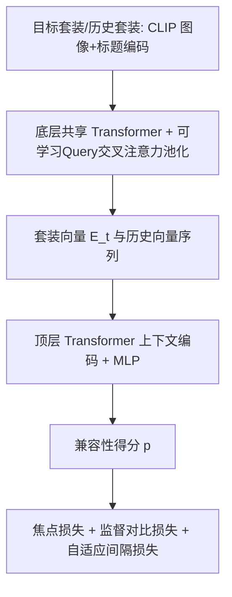
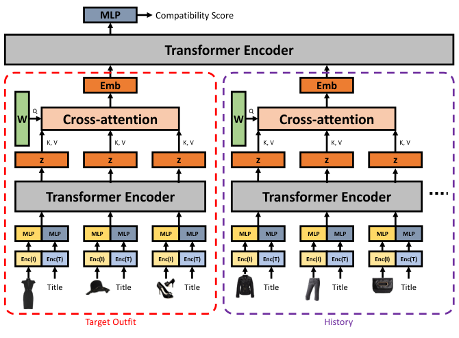

# Personalised Outfit Recommendation via History-aware Transformers (基于历史感知 Transformer 的个性化套装推荐)

- **会议/期刊**: WSDM 2025
- **作者与机构**: Myong Chol Jung, Julien Monteil, Philip Schulz, Volodymyr Vaskovych (Amazon Machine Learning)
- **推荐链路定位**: 精排（套装级兼容性打分 / 补全）
- **研究方向**: 序列与会话推荐 / 自监督对比学习与交互去噪
- **论文原文**: [论文原文链接](https://arxiv.org/abs/2407.00289v2)
- **开源代码**: 暂未开源

## TL;DR (1分钟核心速览)

现有套装推荐（CP/FITB）只建模套装内部搭配是否协调，忽略"这套衣服是否符合该用户个人品味"，导致主流审美用户被过度服务。本文提出 HAT：底层 Transformer 编码套装内部兼容性并用可学习 Query 的交叉注意力聚合为单向量，顶层 Transformer 以用户历史购买套装为上下文打分；训练上叠加焦点损失、以用户 ID 为标签的监督对比损失、以及按被替换单品注意力权重缩放间隔的自适应间隔损失。在 IQON3000/Polyvore-630 上，CP-Hard AUC 相对提升 15.7%/19.4%，FITB-Hard 准确率提升 6.5%/9.7%。

## Background & Motivation (背景与核心矛盾)

- **主流范式**: 套装推荐分两支——非个性化（CANN/MCAN/OutfitTransformer 只学套装内部搭配协调度）与个性化（FHN/LPAE/OutfitNet 引入用户-单品兼容信号），后者多依赖用户/单品 ID 嵌入或成对兼容度。
- **前人局限**: ① 非个性化模型对"内部协调但不合该用户品味"的套装无法区分，CP-Random 上接近饱和（OutfitTransformer 0.9468）却在 CP-Hard 上崩到 0.4650；② 依赖用户 ID 嵌入的个性化模型对冷启动用户失效，且未显式建模"用户只想替换一件单品来搭配已有衣橱"的真实购物行为。
- **核心洞察 (Key Insight)**: 用户历史购买的套装本身就是其风格标签——同一用户的套装嵌入应彼此靠近（图 2 的 t-SNE 验证）；而"只换一件单品的弱负样本"比"全随机负样本"更接近真实决策边界，且被替换单品的重要性可由注意力权重免费获得。
- **本文切入点**: 用"套装编码器 + 历史编码器"双层堆叠把兼容性打分条件化到购买史上，并用弱负样本 + 自适应间隔把决策边界推向细粒度。

## Method (核心方法设计)

### 1. 整体框架 (Overall Architecture)

输入为目标套装 $S_t$与用户历史$H_u=\{S_o\}_{o=1}^{M_u}$，每件单品由冻结 CLIP 的图像/标题编码拼接后送入底层共享权重 Transformer 编码器$t_\psi$，得到单品表征$Z^o$；再经可学习 Query$W$的交叉注意力池化为定长套装向量$E_o$。顶层 Transformer$t_\rho$接收$[E_t;E_1,\dots,E_{M_u}]$序列，经 MLP 与 sigmoid 输出兼容性得分$p_o$。训练时每个正样本配一个全随机负样本与一个弱负样本（1:1:1），三损失加权联合优化；推理时仅需一次前向即可对任意候选套装打分，历史套装数上限截断为 10。

<figure class="paper-figure" markdown="span">
  <figcaption>图1：HAT 的模型示意图。目标套装是我们要计算其兼容性得分的套装，由每件单品的图像和标题组成。K、V 和 Q 分别表示交叉注意力中的键、值和查询。底层 Transformer 编码器共享权重。</figcaption>
</figure>

### 2. 关键设计拆解 (Key Designs)

1. **可学习 Query 的交叉注意力套装池化**：痛点在于 OutfitTransformer 用固定 outfit token 输出，无法显式给出单品重要性且对套装长度敏感。本文改为共享可学习向量 $W\in\mathbb{R}^d$作 Query 对单品序列做单头注意力：$E_o=\mathrm{Softmax}(WZ_o^\top/\sqrt{d})Z_o$。好处有二：输出与单品数量/顺序无关；注意力矩阵$A^o$ 直接近似单品对兼容性的贡献度，且被后续自适应间隔损失零成本复用。

2. **监督对比学习对齐用户风格**：仅把历史拼进顶层 Transformer 不足以让模型"用上"历史。本文以 batch 内每个历史套装为锚，同用户套装为正、异用户为负，做 supervised contrastive：$\mathcal{L}_{CL}=\sum_k\frac{-1}{|P(k)|}\sum_{p\in P(k)}\log\frac{\exp(E_k\cdot E_p/\tau)}{\sum_{n\in B_{-k}}\exp(E_k\cdot E_n/\tau)}$。物理直觉是把同一用户的套装压成紧簇，使兼容性打分真正条件化于历史而非退化为全局先验。

3. **弱负样本与自适应间隔损失**：全随机负样本过于易分（信号弱）。本文构造只替换一件单品的弱负样本，因其兼容性介于 0/1 之间不宜硬标，改用间隔排序：$\mathcal{L}_{AM}=\sum_k\max(0,-p_p^k+p_w^k+m\cdot A_i^p)$，其中$A_i^p$为被替换单品的注意力权重。直觉是"换掉外套"应比"换掉耳环"受到更大惩罚，间隔随重要性自适应缩放。总损失$\mathcal{L}=c_{FL}\mathcal{L}_{FL}+c_{CL}\mathcal{L}_{CL}+c_{AM}\mathcal{L}_{AM}$，超参$\alpha=0.5,\gamma=2,\tau=1,m=5,c_{CL}=1,c_{AM}=0.5$；负样本为同类别随机替换（非 in-batch 免负采样），推理无额外开销。

## Experimental Setup & Evaluation Protocol (实验设置与评估协议)

- **数据集与预处理**: 沿用原始划分，未额外 k-core 过滤；套装由同一用户创建，视为其购买史。

| 数据集 | #Users | #Items | #Interactions(Outfits) | 稀疏度/密度 | 特征/场景说明 |
| :--- | :---: | :---: | :---: | :---: | :--- |
| IQON3000 | 3,568 | 672,335 | 308,747 | 极稀疏 | 每套 2–20 件，59 个类别 |
| Polyvore-630 | 630 | 205,234 | 150,380 | 极稀疏 | 每套固定 3 件、3 类别 |

- **数据划分与防穿越 (Splitting Strategy)**: 沿用基线发布的原始 train/test 划分（按套装划分，非全局时间戳切分）；历史套装仅取自训练可见的购买记录，目标套装不进入历史。
- **排名评测协议 (Ranking Protocol)**: CP 任务为二分类 AUC（正样本 vs. 构造负样本，1:1）；FITB 为 4 选 1 准确率（1 正 3 负），且**不提供目标套装标题**（比 OutfitTransformer 原设定更严格）。CP-Random/FITB-Random 为同类别全随机替换；CP-Hard 用"其他用户含重叠单品的正套装"作负样本，FITB-Hard 为同类别替换。
- **对比基线与超参设置**: Bi-LSTM、FHN、LPAE、LPAE-T、OutfitTransformer 共 5 个基线；统一冻结 CLIP ViT-B/32 + 可学习 MLP 投影；显著性用 10,000 次 bootstrap 的 95% 置信区间判定。

## Key Experimental Results (实验关键数据)

### 1. 主实验对比 (Main Results)

CP 任务（AUC）：

| Model | IQON CP-Random | IQON CP-Hard | Polyvore CP-Random | Polyvore CP-Hard |
| :--- | :---: | :---: | :---: | :---: |
| Bi-LSTM | 0.8909 | 0.4915 | 0.8051 | 0.5158 |
| FHN | 0.9047 | 0.5675 | 0.7490 | 0.4815 |
| LPAE | 0.9510 | 0.5605 | 0.7977 | 0.5127 |
| LPAE-T | 0.9628 | 0.5449 | 0.7872 | 0.4881 |
| OutfitTransformer | 0.9468 | 0.4650 | 0.7021 | 0.4528 |
| **HAT (ours)** | **0.9665** | **0.6565** | **0.8569** | **0.6159** |
| Improv. | +0.4% | **+15.7%** | +6.4% | **+19.4%** |

FITB 任务（Accuracy）：

| Model | IQON Random | IQON Hard | Polyvore Random | Polyvore Hard |
| :--- | :---: | :---: | :---: | :---: |
| Bi-LSTM | 0.7258 | 0.5627 | 0.4028 | 0.4554 |
| FHN | 0.5887 | 0.5645 | 0.4252 | 0.4813 |
| LPAE | 0.6739 | 0.5768 | 0.5164 | 0.4887 |
| LPAE-T | 0.6960 | 0.6006 | 0.4889 | 0.4652 |
| OutfitTransformer | 0.7195 | 0.5969 | 0.3989 | 0.3870 |
| **HAT (ours)** | **0.7406** | **0.6394** | **0.5356** | **0.5363** |
| Improv. | +2.0% | **+6.5%** | +3.7% | **+9.7%** |

### 2. 消融实验 (Ablation Study)

| 变体 | IQON CP-Hard | Polyvore CP-Hard | IQON FITB-Hard | Polyvore FITB-Hard |
| :--- | :---: | :---: | :---: | :---: |
| w/o $\mathcal{L}_{CL}$ | 0.5350 | 0.4888 | — | — |
| w/ $\mathcal{L}_{CL}$ | 0.6565 | 0.6159 | — | — |
| w/o $\mathcal{L}_{AM}$ | — | — | 0.5822 | 0.5060 |
| $\mathcal{L}_{AM}$但$A_i^p=1$ | — | — | 0.6164 | 0.5160 |
| 完整 HAT | 0.6565 | 0.6159 | 0.6394 | 0.5363 |

历史套装数敏感性（CP-Hard）：0 套时 IQON 仅 0.4859、Polyvore 0.4652；10 套升至 0.6565/0.6159；30 套进一步到 0.6701/0.6249，而 CP-Random 在 10 套后反降（0.9665→0.9647）。

### 3. 关键实验发现 (Key Findings)

1. **个性化收益集中在 Hard 协议**：CP-Random 上 HAT 仅比 LPAE-T 高 0.37%，但 CP-Hard 上高出 11.16 个百分点，说明随机负样本协议已饱和、无法度量个性化，Hard 协议才是真实增益来源。
2. **对比损失是历史可用的前提**：去掉 $\mathcal{L}_{CL}$ 后 CP-Hard 从 0.6565 跌至 0.5350（IQON）、0.6159 跌至 0.4888（Polyvore），几乎退回非个性化水平，证明"拼历史"本身不等于"用历史"。
3. **弱负样本 + 自适应间隔缺一不可**：去掉 $\mathcal{L}_{AM}$使 FITB-Hard 掉 5.7 个点（0.6394→0.5822），而保留间隔但令$A_i^p=1$ 仍掉 2.3 个点，说明"按单品重要性缩放间隔"本身贡献显著，而非仅弱负样本带来增益。

## Highlights & Limitations (亮点、对比与审稿批判)

- **与代表作对比 (vs. Prior Work)**: 相比 OutfitTransformer（非个性化、固定 outfit token），HAT 增加历史上下文与可学习 Query 池化，CP-Hard 从 0.4650 提升到 0.6565；相比 LPAE/FHN（依赖用户 ID 嵌入与成对兼容度），HAT 完全不用用户 ID 嵌入、仅靠购买史，天然对冷启动用户更友好；相比 SSE-PT（序列推荐预测下一件），HAT 面向套装集合打分而非单品序列。
- **可迁移亮点**: ① 用交叉注意力权重"免费"驱动间隔缩放，可迁移到任意 listwise/集合级排序的难负样本挖掘；② 以用户 ID 作监督对比标签对齐历史表征，可低成本移植到多场景/跨域用户表征对齐。
- **审稿级局限批判**: ① 历史套装等权处理，未建模时间衰减（一年前的购买与上周购买同权），与真实兴趣漂移不符；② 仅做打分/补全，不做套装生成或大规模检索，且历史长度截断为 10、长尾用户历史稀疏时个性化信号可能不足；③ 单品表征仅用标题+图像，未利用评论、尺码、材质等电商信号。

## Rating (四维评分)

- **方法创新性 (Novelty)**: ⭐⭐⭐⭐ （双层堆叠 + 注意力权重驱动自适应间隔的组合较新颖，但各组件均为已有技术的巧妙拼接，理论分析偏弱）
- **评估协议与实验扎实度 (Protocol & Experiments)**: ⭐⭐⭐⭐ （自建 CP-Hard/FITB-Hard 协议切中个性化评测要害，bootstrap 置信区间规范，但仅两个数据集且无线上验证）
- **写作与数学规范度 (Clarity & Rigor)**: ⭐⭐⭐⭐ （公式与符号定义清晰、动机—设计—消融链条完整，部分符号如 $p_0$/$p_o$ 存在笔误）
- **工业落地与复现价值 (Industrial & Practical Value)**: ⭐⭐⭐⭐ （冻结 CLIP + 轻量 Transformer 推理开销可控，冷启动友好，但未开源且历史拼接带来显存约束）

