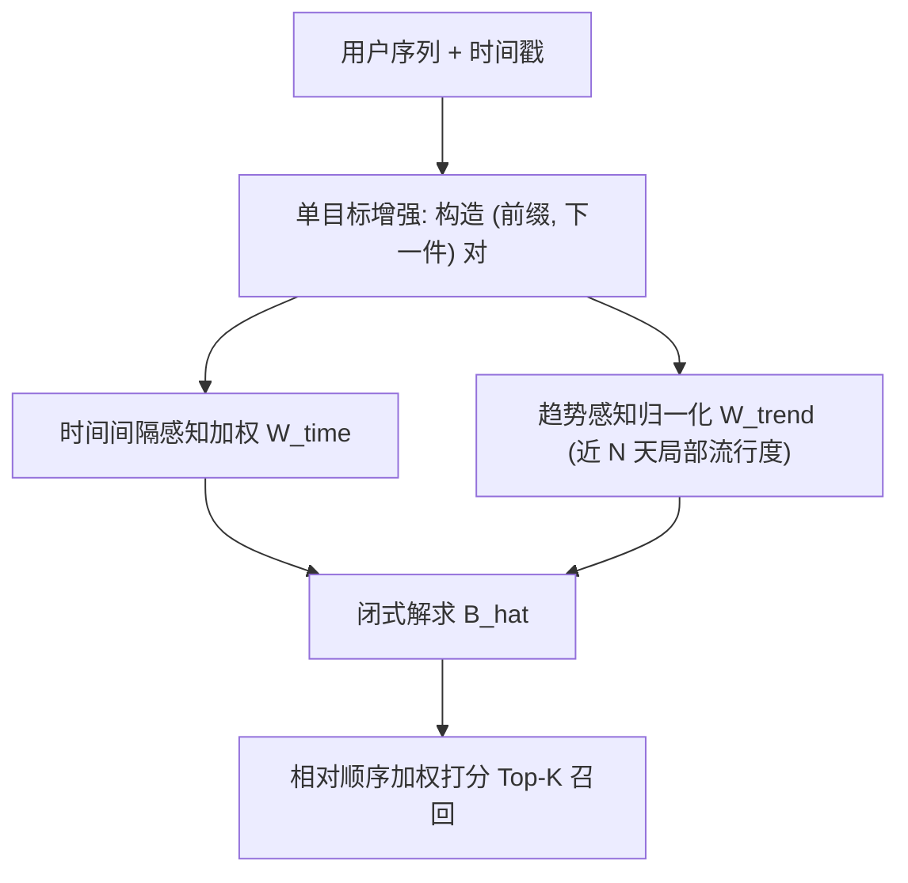
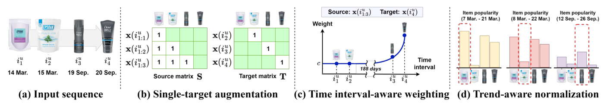

# Temporal Linear Item-Item Model for Sequential Recommendation (面向序列推荐的时间感知线性物品-物品模型)

- **会议/期刊**: WSDM 2025
- **作者与机构**: Seongmin Park, Mincheol Yoon, Minjin Choi, Jongwuk Lee (Sungkyunkwan University)
- **推荐链路定位**: 召回（Next-Item 全库排序）
- **研究方向**: 序列与会话推荐 / 冷启动与长尾推荐
- **论文原文**: [https://arxiv.org/abs/2412.07382v1](https://arxiv.org/abs/2412.07382v1)
- **开源代码**: [https://github.com/psm1206/TALE](https://github.com/psm1206/TALE)

## TL;DR (1分钟核心速览)

神经序列推荐精度高但训练/推理昂贵（Transformer 对序列长度二次复杂度），而线性 item-item 模型（SLIST）虽高效却只看物品相对顺序、完全忽略真实时间戳，无法刻画用户兴趣漂移。本文提出 TALE，用「单目标增强 + 时间间隔感知加权 + 趋势感知归一化」把时间信息注入闭式解线性模型，保持 $\mathcal{O}(n^3)$ 一次性求解、零额外推理开销。在 5 个 5-core 数据集、Leave-One-Out + Full-Ranking 协议下，相对 SLIST 平均 NDCG@10 提升 9.07%（最高 HR@1 +25%），长尾物品最高提升 30.45%，训练比 LinRec 快 6.9–57 倍。

## Background & Motivation (背景与核心矛盾)

- **主流范式**: 序列推荐由 SASRec/BERT4Rec 类 Transformer、DuoRec 类对比学习、FEARec/BSARec 类频域模型主导；另一支是 SLIST 这类用闭式解学习 item-to-item 转移矩阵 $\mathbf{B}$ 的线性模型，精度可比神经模型且极快。
- **前人局限**: (C1) 神经模型训练/推理慢，Transformer 对序列长度二次复杂度；(C2) 线性模型只用「顺序信息」，把所有相邻物品间隔视为等同，忽略真实时间戳，无法建模兴趣漂移。已有时间感知模型（TiSASRec、TCPSRec、TiCoSeRec）虽引入时间，却仍是重型神经架构，未解决效率问题。
- **核心洞察 (Key Insight)**: 真实数据中相邻交互间隔差异极大（Beauty 约 50% 相邻对间隔 >1 天，平均间隔 69.6 天），且「很久以前买的浴盐」与「刚买的剃须啫喱」对下一件商品的推荐贡献应截然不同（图 1）。同时，全局累计流行度归一化会把「短期爆款」与「长期常青款」同等对待，无法反映物品热度随时间漂移。
- **本文切入点**: 不改线性模型的闭式解骨架，只在构造源/目标矩阵时用时间戳做「加权 + 归一化」，让时间信息以零额外训练/推理成本的方式进入 $\hat{\mathbf{B}}$。

## Method (核心方法设计)

### 1. 整体框架 (Overall Architecture)

TALE 沿用线性 item-item 范式 $\min_{\mathbf{B}}\lVert\tilde{\mathbf{T}}-\tilde{\mathbf{S}}\mathbf{B}\rVert_F^2+\lambda\lVert\mathbf{B}\rVert_F^2$，核心是把 SLIST 的源矩阵$\mathbf{S}$、目标矩阵$\mathbf{T}$替换为时间加权版本$\tilde{\mathbf{S}}=\mathbf{W}_{\text{time}}\odot\mathbf{W}_{\text{trend}}\odot\mathbf{S}$、$\tilde{\mathbf{T}}=\mathbf{W}_{\text{trend}}\odot\mathbf{T}$，再一次性求闭式解$\hat{\mathbf{B}}_{\text{TALE}}=(\tilde{\mathbf{S}}^\top\tilde{\mathbf{S}}+\lambda\mathbf{I})^{-1}\tilde{\mathbf{S}}^\top\tilde{\mathbf{T}}$。三个组件分别负责：单目标增强重构训练对、时间间隔加权刻画相关性衰减、趋势感知归一化消除流行度偏置。推理时仅用相对顺序打分$s_{u,j}=\mathbf{X}_{u,*}\cdot\hat{\mathbf{B}}_{*,j}$，所有时间权重均可预计算。

<figure class="paper-figure" markdown="span">
  <figcaption>图 3：TALE 的三个组件示意图。单目标增强将输入序列中的每个物品作为目标、之前的物品作为源来构造训练矩阵。时间间隔感知加权调整每个源物品的重要性，趋势感知归一化根据物品在时间附近的流行度对其进行归一化。</figcaption>
</figure>

### 2. 关键设计拆解 (Key Designs)

1. **单目标增强 (Single-Target Augmentation)**：SLIST 的多目标增强把整个后缀当目标，理论上等价于给「第 $s$件到第$h$件」的转移赋权$w=(h-s)$，即**距离越远权重越大**，这与时间衰减直觉相反，且会淹没时间加权信号。TALE 改为每个前缀只预测紧邻的下一件，目标项权重恒为 1，从而让时间间隔加权真正主导相关性学习，同时目标矩阵更稀疏、矩阵乘法更省。核心目标即上式 Eq.(5)，其闭式解 Eq.(6) 保证训练仍是一次性凸优化。

2. **时间间隔感知加权 (Time Interval-aware Weighting)**：对源序列中每个物品按与目标的时间差赋权
$$w_{\text{time}}(\mathcal{S}_{u_k}, i_{u_s})=\max\left(\exp\left(-\frac{t_{u_{|\mathcal{S}_{u_k}|}}-t_{u_s}}{\tau_{\text{time}}}\right),\,c\right)$$
指数衰减让近期物品主导，阈值 $c$保留「很久以前但仍有弱协同信号」的长时依赖，避免 30 天间隔权重趋零导致信息全丢。$\tau_{\text{time}}$与$c$按数据集平均间隔自适应（ML-1M 间隔约 14 小时故$\tau$小，Beauty 需更大$c$）。

3. **趋势感知归一化与训练/推理开销**：用近 $N$天局部流行度$p_{u,j}(N)=\sum_v\mathbb{I}(|t_{u,j}-t_{v,j}|\le N)$构造$\mathbf{W}_{\text{trend}}=(\mathbf{P}_{\text{trend}})^{-\gamma}$（$\gamma=1/2$），替代全局累计流行度；当$N\to\infty$时退化为传统归一化 Eq.(4)，故为其广义形式。$\mathbf{P}_{\text{trend}}$ 可离线预计算，训练/推理零额外开销；总损失即带 L2 正则的 Eq.(5)，**无需负采样**（闭式解直接拟合全交互矩阵），推理为一次矩阵-向量乘。

## Experimental Setup & Evaluation Protocol (实验设置与评估协议)

- **数据集与预处理**: 全部采用 `5-core` 过滤（用户与物品交互数 <5 剔除）：

| 数据集 | #Users | #Items | #Interactions | 密度 | 平均长度 / 平均间隔 |
| :--- | :---: | :---: | :---: | :---: | :--- |
| ML-1M | 6,040 | 3,953 | 999,611 | 5.19% | 165.6 / 0.6d |
| Beauty | 22,363 | 12,101 | 198,502 | 0.07% | 8.9 / 69.6d |
| Toys | 19,412 | 11,924 | 167,597 | 0.07% | 8.6 / 86.0d |
| Sports | 29,858 | 18,357 | 296,337 | 0.06% | 8.3 / 74.1d |
| Yelp | 30,494 | 20,061 | 317,078 | 0.05% | 10.4 / 18.6d |

- **数据划分与防穿越**: `Leave-One-Out`——最后一件为测试、倒数第二件为验证、其余训练；推理时以训练+验证序列为输入预测测试项。
- **排名评测协议**: 无偏 `Full-Ranking`（对全库未交互物品排序），指标 HR@{1,5,10}、NDCG@{1,5,10}；并按训练集流行度把测试集切为 Head（前 20%）/ Tail（后 80%）评估去偏效果。
- **对比基线与超参**: 10 个基线，含非时间神经模型（SASRec、DuoRec、FEARec、BSARec）、时间神经模型（TiSASRec、TCPSRec、TiCoSeRec）、高效模型（LinRec、LRURec、SLIST）；神经模型最大序列长 50，TALE 的 $\lambda\in\{1,\dots,1000\}$、$\tau_{\text{time}}\in[2^{-10},2^{10}]$、$c\in[0,1]$、$N\in\{7,\dots,720\}$ 网格搜索，RecBole 框架实现。

## Key Experimental Results (实验关键数据)

### 1. 主实验对比 (Main Results)

| 数据集 | 指标 | BSARec | TiSASRec | SLIST | **TALE** | Improv.(vs SLIST) |
| :--- | :--- | :---: | :---: | :---: | :---: | :---: |
| ML-1M | HR@1 | 0.0623 | 0.0578 | 0.0596 | **0.0656** | +10.07% |
| ML-1M | NDCG@5 | 0.1261 | 0.1216 | 0.1164 | **0.1275** | +9.54% |
| Beauty | HR@5 | 0.0553 | 0.0579 | 0.0597 | **0.0674** | +12.90% |
| Beauty | NDCG@10 | 0.0445 | 0.0425 | 0.0499 | **0.0554** | +11.02% |
| Toys | HR@5 | 0.0606 | 0.0675 | 0.0722 | **0.0815** | +12.88% |
| Toys | NDCG@10 | 0.0500 | 0.0485 | 0.0599 | **0.0661** | +10.35% |
| Sports | HR@1 | 0.0022 | 0.0026 | 0.0155 | **0.0184** | +18.71% |
| Sports | NDCG@5 | 0.0175 | 0.0172 | 0.0271 | **0.0305** | +12.55% |
| Yelp | NDCG@5 | 0.0345 | 0.0326 | 0.0375 | **0.0394** | +5.07% |

效率对比（表 3）：ML-1M 上 TALE 训练 179s vs LinRec 1,241s（6.9×）、Beauty 上 5s vs 285s（57×）、Yelp 上 13s vs 230s（17.7×），且精度全面领先 LinRec/LRURec。

### 2. 消融实验 (Ablation Study)

NDCG@5，ML-1M / Beauty：

| (1) 单目标 | (2) 时间加权 | (3) 趋势归一 | ML-1M All | ML-1M Tail | Beauty All | Beauty Tail |
| :---: | :---: | :---: | :---: | :---: | :---: | :---: |
| ✓ | ✓ | ✓ | **0.1275** | **0.0814** | **0.0485** | **0.0271** |
| - | ✓ | ✓ | 0.0473 | 0.0161 | 0.0296 | 0.0154 |
| ✓ | - | ✓ | 0.1227 | 0.0739 | 0.0450 | 0.0239 |
| ✓ | ✓ | - | 0.1257 | 0.0773 | 0.0468 | 0.0243 |
| - | - | - | 0.1164 | 0.0624 | 0.0435 | 0.0235 |

### 3. 关键实验发现 (Key Findings)

1. **单目标增强是时间加权生效的前提**：去掉 (1) 而保留 (2) 时 ML-1M NDCG@5 从 0.1275 崩到 0.0473（-63%），验证了多目标增强的 $(h-s)$ 位置权重会放大远距离噪声、与时间衰减冲突；仅 (1)+(2) 组合即贡献最大增量。
2. **趋势归一化主要救长尾**：去掉 (3) 后 ML-1M/Beauty 的 Tail NDCG@5 分别下降 5.61%/2.98%；而传统全局归一化 SLIST+Norm. 虽提升 Tail（0.0624→0.0675）却使 Head 从 0.1559 跌至 0.1290、整体反降，说明局部窗口 $N$ 才是正确去偏方式。
3. **长间隔场景优势最明显**：按测试项与验证项间隔分 Short/Mid/Long 三组（图 4），所有模型随间隔增大性能下降，但 TALE 在 Mid/Long 组领先幅度最大，证明阈值 $c$ 保留的长时弱信号确实被有效利用；长尾整体最高提升 30.45%。

## Highlights & Limitations (亮点、对比与审稿批判)

- **与代表作对比 (vs. Prior Work)**: 相比 SLIST，TALE 首次把真实时间戳注入线性 item-item 闭式解，且通过单目标增强修正了其多目标增强的「远距离过权」理论缺陷；相比 TiSASRec/TCPSRec 等时间神经模型，TALE 精度更高且训练快 1–2 个数量级；相比 LinRec/LRURec 等高效神经模型，TALE 在全部 5 数据集上精度与速度双赢。
- **可迁移亮点**: (i) 用「局部时间窗流行度」替代全局累计流行度做归一化，可直接迁移到 GNN 邻接矩阵归一化或双塔召回的去偏；(ii) 闭式解模型上「先修正训练对构造、再加权」的解耦思路，可复用到其他线性/核方法推荐器。
- **审稿级局限批判**: (i) 趋势归一化使用以交互时刻为中心的对称窗口（含未来 $N$天），在严格在线流式场景存在信息泄漏风险，需改为纯历史窗口并重新验证；(ii)$\tau_{\text{time}}$、$c$、$N$ 三个超参对数据集平均间隔高度敏感、需逐数据集调参，跨域冷启动迁移成本较高；此外 Yelp 上 HR@5/@10 略低于 SLIST（-0.89%/-1.81%），说明短间隔密集场景下时间加权收益有限。

## Rating (四维评分)

- **方法创新性 (Novelty)**: ⭐⭐⭐⭐ （在极简线性骨架上做时间注入，单目标增强的位置权重理论分析是真正增量）
- **评估协议与实验扎实度 (Protocol & Experiments)**: ⭐⭐⭐⭐ （5 数据集 + Full-Ranking + Head/Tail 分桶 + 效率对比齐全，但缺显著性检验与线上验证）
- **写作与数学规范度 (Clarity & Rigor)**: ⭐⭐⭐⭐ （闭式解推导与 Eq.(9)-(12) 权重分析严谨，符号清晰，复杂度说明到位）
- **工业落地与复现价值 (Industrial & Practical Value)**: ⭐⭐⭐⭐⭐ （代码开源、零负采样、预计算权重、训练快数十倍，极易上线做召回基线）

