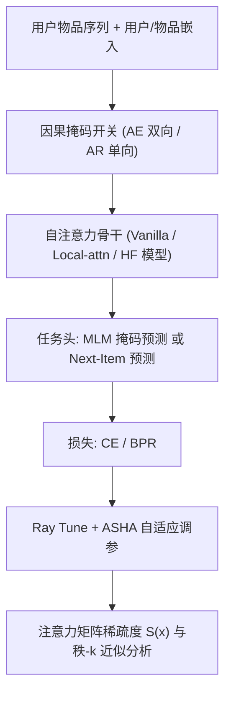

# Your Causal Self-Attentive Recommender Hosts a Lonely Neighborhood (你的因果自注意力推荐模型拥有一片“孤独的邻域”)

- **会议/期刊**: WSDM 2025
- **作者与机构**: Yueqi Wang (UC Berkeley), Zhankui He (UCSD), Zhenrui Yue (UIUC), Julian McAuley (UCSD), Dong Wang (UIUC)
- **推荐链路定位**: 召回（序列 Next-Item 预测）
- **研究方向**: 序列与会话推荐 / 自监督与表征分析
- **论文原文**: [https://arxiv.org/abs/2406.02048v3](https://arxiv.org/abs/2406.02048v3)
- **开源代码**: [https://github.com/yueqirex/SAR-Check](https://github.com/yueqirex/SAR-Check)

## TL;DR (1分钟核心速览)

序列推荐中“双向自编码 (AE, 如 BERT4Rec) 还是单向自回归 (AR, 如 SASRec)”之争长期结论不一，且前人只做统计综述或外围损失函数消融，从未触及自注意力矩阵本身。本文首次从**稀疏局部归纳偏置**与**低秩近似**两个可证明的度量切入，理论证明 AR 注意力天然形成“孤独邻域”（只关注近邻、远距离几乎不 attend），并借 ModSAR 模块化流水线在 5 个基准、Full-Ranking 协议下系统实证：AR 在 4/5 数据集上平均领先 AE 约 25.35%（vanilla）与 21.60%（设计空间变体）。

## Background & Motivation (背景与核心矛盾)

- **主流范式**: 序列推荐两大阵营——AE 类（BERT4Rec、LOCKER，双向注意力 + MLM 掩码预测）与 AR 类（SASRec、SSE-PT，因果掩码 + Next-Item 预测），二者均报告 SOTA。
- **前人局限**: ① 既有对比多为文献统计综述，结论互相矛盾（部分论文称 AE 双向注意力更优，部分称 AR 更优）；② 少量复现工作（如统一损失函数为 CE）只调整外围建模细节，未回答“注意力矩阵本身在学什么”这一根本问题。
- **核心洞察 (Key Insight)**: 推荐序列普遍短且稀疏（Beauty 平均长度仅 7.6），真正有信息量的往往是预测目标附近的少数近邻物品；因此**注意力分布的不均匀性（局部性）** 才是性能关键，而非双向可见性带来的“全局视野”。
- **本文切入点**: 用两个有数学上界保证的度量（L1/Lp 平滑稀疏度、噪声硬阈值秩-k 近似）量化 AE/AR 注意力矩阵，再用统一流水线 ModSAR 做大规模实证，把“理论性质—可视化—性能”三者闭环。

## Method (核心方法设计)

### 1. 整体框架 (Overall Architecture)

本文不是提出新模型，而是提出一套**分析框架 + 实验流水线 ModSAR**。分析侧：对训练好的 AE/AR 模型抽取注意力矩阵，分别计算平滑稀疏度 $S(\boldsymbol{x})$与噪声阈值秩$k$，并配以注意力热力图与奇异值衰减曲线做解释。实证侧：ModSAR 将自注意力推荐器拆为 {Feature, Modeling, Loss, Task} 四个正交设计维度（SSE-PT 用户嵌入 / Local-attn 局部窗口 / CE 与 BPR 损失 / AE-MLM 与 AR-Next-Item 任务），通过增删因果掩码在 AE 与 AR 之间自由切换，并接入 HuggingFace 模型（ALBERT、LLaMA、Transformer-XL），用 Ray Tune + ASHA 异步早停做自适应超参搜索，保证 AE/AR 对比在同等调参预算下公平。

### 2. 关键设计拆解 (Key Designs)

1. **平滑稀疏度度量 $S(\boldsymbol{x})$（量化“注意力有多集中”）**：传统“零元素占比”对 softmax 后全正的注意力矩阵失效；直接用$\max$归一化又不平滑、易被离群值主导。本文用$L_p$范数近似$\max$ 并代入平均绝对值之比，得到
$$S(\boldsymbol{x})=\frac{L_1(\boldsymbol{x})/n}{L_p(\boldsymbol{x})},\quad p=2$$
该度量满足两条理想性质：固定总和下分布越不均 $S$ 越大（Property 1），大元素主导整体稀疏度（Property 2）。数值越小代表越稀疏、注意力越集中于少数关键 token。表 2 显示 Vanilla-AR 平均 0.016 < Local-AE 0.018 < Vanilla-AE 0.022，即 AR 注意力最集中。

2. **噪声硬阈值秩-k 近似（量化“注意力承载多少信息动态”）**：肘部法选 $k$无误差保证。本文对加噪矩阵$Y=A+E$ 计算阈值
$$\tau=\sqrt{2\left(\sigma^2+\|\Sigma(Y)\|_F^2/n^2\right)\log(2n)},\quad k=\sum_{i=1}^{n}\mathbb{I}\{s_i>\tau\}$$
并证明 $\|A-A_k\|_F^2\le\min_r(\|A-A_r\|_F^2+r\sigma^2)$，即所选$k$对噪声鲁棒且逼近精度有闭式上界。结果：Vanilla-AE 平均仅需$k=5.4$即可保留模式，而 Vanilla-AR 需$k=8.6$、Local-AE 需$k=10.6$——AR 注意力奇异值衰减更慢，承载更丰富的数据动态与表征方差。

3. **训练目标、负采样与推理效率**：默认采用 Cross-Entropy 全库 softmax 损失（非 BPR 负采样），最大 1000 epoch、Recall@10 连续 20 轮不升即早停；单卡 3090 训练 40 分钟–3 小时。推理为标准的全库打分排序，AR 因因果掩码可增量式逐位置解码，在线开销与 AE 同阶。

## Experimental Setup & Evaluation Protocol (实验设置与评估协议)

- **数据集与预处理**: 基于 48 篇高被引序列推荐论文的调研选取最高频 5 个数据集；仅去除交互数 < 5 的用户与物品，**不做 k-core 过滤**以保留自然稀疏性；ML-1M 最大长度 200，其余 50。

| 数据集 | #Users | #Items | #Interactions | 平均长度 | 密度 | 场景说明 |
| :--- | :---: | :---: | :---: | :---: | :---: | :--- |
| Beauty | 52,204 | 57,289 | 395K | 7.6 | 1e-4 | 电商（最稀疏） |
| Sports | 83,970 | 83,728 | 589K | 7.0 | 8e-5 | 电商（最稀疏） |
| Video | 31,013 | 23,715 | 287K | 9.3 | 4e-4 | 电商 |
| Yelp | 31,371 | 36,616 | 300K | 9.6 | 3e-4 | 本地生活（长周期回访） |
| ML-1M | 6,040 | 3,416 | 1M | 165.5 | 5e-2 | 电影（最稠密） |

- **数据划分与防穿越 (Splitting Strategy)**: `Leave-One-Out`——最后一项为测试、倒数第二项为验证、其余训练，严格按时间序，无未来信息泄漏。
- **排名评测协议 (Ranking Protocol)**: 无偏 `Full-Ranking`（对全库未交互物品排序），指标 Recall@$\{5,10,20\}$与 NDCG@$\{5,10,20\}$。
- **对比基线与超参设置**: Vanilla-AE (BERT4Rec) vs Vanilla-AR (SASRec)；设计空间变体 Local-attn、SSE-PT、Loss-CE/BPR；HuggingFace 变体 ALBERT、LLaMA、Transformer-XL。网格搜索隐层 $\{32,64,128,256,512\}$、dropout 0.1–0.9、层数/头数$\{1,2,4\}$、掩码率$\{0.2,0.4,0.6,0.8\}$；变体实验用 Ray Tune + ASHA 自适应搜索。

## Key Experimental Results (实验关键数据)

### 1. 主实验对比 (Main Results)

Vanilla AE/AR 对比（节选 R@10 / N@10，加粗为最优）：

| 数据集 | 模型 | R@5 | R@10 | R@20 | N@5 | N@10 | N@20 |
| :--- | :---: | :---: | :---: | :---: | :---: | :---: | :---: |
| Beauty | AE | 0.0190 | 0.0302 | 0.0443 | 0.0122 | 0.0158 | 0.0193 |
| Beauty | **AR** | **0.0295** | **0.0391** | **0.0525** | **0.0220** | **0.0251** | **0.0284** |
| Sports | AE | 0.0102 | 0.0172 | 0.0279 | 0.0064 | 0.0087 | 0.0113 |
| Sports | **AR** | **0.0175** | **0.0242** | **0.0334** | **0.0127** | **0.0148** | **0.0172** |
| Video | AE | 0.0524 | 0.0837 | 0.1292 | 0.0337 | 0.0437 | 0.0552 |
| Video | **AR** | **0.0629** | **0.0941** | **0.1374** | **0.0422** | **0.0522** | **0.0631** |
| Yelp | **AE** | **0.0397** | **0.0575** | **0.0861** | **0.0276** | **0.0333** | **0.0405** |
| Yelp | AR | 0.0254 | 0.0426 | 0.0694 | 0.0161 | 0.0216 | 0.0284 |
| ML-1M | AE | 0.1490 | 0.2344 | 0.3425 | 0.0974 | 0.1248 | 0.1520 |
| ML-1M | **AR** | **0.2086** | **0.3008** | **0.4116** | **0.1440** | **0.1738** | **0.2018** |

AR 相对 AE 的提升：Beauty +48.26%、Sports +58.79%、Video +16.30%、Yelp −31.33%、ML-1M +34.73%，全指标平均 **+25.35%**；NDCG 平均增益 (+31.95%) 高于 Recall (+18.75%)，说明 AR 更擅长把命中项排到前列。

### 2. 消融实验 (Ablation Study)

设计空间变体下 AR 相对 AE 的平均提升（表 5 汇总）：

| 设计维度 | 具体配置 | AR 相对 AE 平均提升 | 说明 |
| :--- | :--- | :---: | :--- |
| Modeling | Local-attn | +19.64% | 提升最小，因 AE 已注入局部偏置 |
| Feature | SSE-PT 用户嵌入 | +24.01% | 用户特征不改变 AR 优势 |
| Loss | Loss-CE | +28.04% | 统一损失后 AR 仍领先 |
| Loss | Loss-BPR | +35.77% | BPR 下 AR 优势最大 |
| 全局 | 最佳 AR vs 最佳 AE | +21.60% | 与 vanilla 的 +25.35% 一致 |
| HF 模型 | ALBERT / LLaMA / Trm.-XL | +16.21% / +14.37% / +15.30% | 最佳 AR 领先最佳 AE +16.00% |

### 3. 关键实验发现 (Key Findings)

1. **局部性越强性能越高，且与理论度量严格对齐**：按 Vanilla-AE → Local-AE → Vanilla-AR 的局部归纳偏置递增顺序，平均性能单调上升（图 5a）；同时 Local-attn 配置下 AR 相对 AE 的提升最小（+19.64%），因为 Local-AE 已人为注入局部窗口，边际收益被吃掉——这反向验证了“稀疏局部偏置是 AR 的性能来源”这一因果链。
2. **AR 优势在稀疏数据上被放大**：最稀疏的 Beauty/Sports 上 AR 平均领先 35.80%/21.63%，而较稠密的 Video/ML-1M 仅 14.42%/17.67%；这与“短序列更需要聚焦近邻”的直觉一致。
3. **Yelp 是唯一反例，暴露 AR 的结构性短板**：Yelp 上 AR 落后 31.33%（vanilla），作者归因于本地生活服务的**长周期回访效应**——用户可能重返很久以前去过的餐厅，此时 AE 的全局双向注意力反而有利，说明“孤独邻域”并非普适真理。

## Highlights & Limitations (亮点、对比与审稿批判)

- **与代表作对比 (vs. Prior Work)**: 相比 Delfosse 等对 BERT4Rec 的复现修正、以及“统一 CE 损失后 SASRec 胜出”的结论，本文首次把比较锚定在**注意力矩阵的数学性质**（稀疏度 + 秩）而非外围技巧；相比 LOCKER 用固定窗口人为注入局部性，本文指出 AR 的局部性是**训练目标自然涌现**的，且比人为约束更强（图 1 最右子图对角线更暗）。
- **可迁移亮点**: ① 噪声硬阈值秩-k 选择可直接用于任意注意力/表征矩阵的“信息容量”诊断；② ModSAR 的 {Feature, Modeling, Loss, Task} 正交设计空间 + ASHA 早停，是低成本做架构公平对比的通用范式。
- **审稿级局限批判**: ① 理论分析仅覆盖单层注意力矩阵的静态统计性质，未刻画多层堆叠与训练动力学，稀疏度与性能之间仍是相关性而非严格因果；② 实验全部为离线 Full-Ranking，无线上 A/B 或延迟/吞吐报告，且 Yelp 反例说明结论对数据分布（长周期回访）敏感，缺乏对“何时该选 AE”的定量判据。

## Rating (四维评分)

- **方法创新性 (Novelty)**: ⭐⭐⭐⭐ （不提出新模型，但首次用可证明上界的稀疏度与秩度量解释 AE/AR 之争，视角新颖且分析扎实）
- **评估协议与实验扎实度 (Protocol & Experiments)**: ⭐⭐⭐⭐⭐ （5 数据集 × 三层实验（vanilla/设计空间/HuggingFace）+ 无偏 Full-Ranking + ASHA 公平调参，覆盖面在同类对比工作中罕见）
- **写作与数学规范度 (Clarity & Rigor)**: ⭐⭐⭐⭐ （稀疏度两条性质与秩-k 误差上界推导清晰，但部分符号在正文与附录间略有跳转）
- **工业落地与复现价值 (Industrial & Practical Value)**: ⭐⭐⭐⭐ （代码与流水线全开源、HuggingFace 即插即用；但结论偏“选型指南”而非直接涨点，Yelp 反例需业务侧自行判断）

