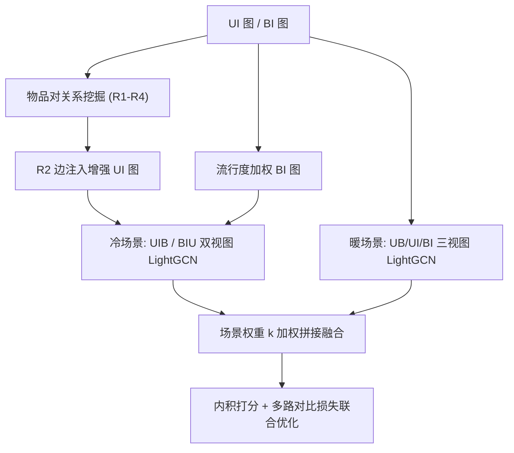
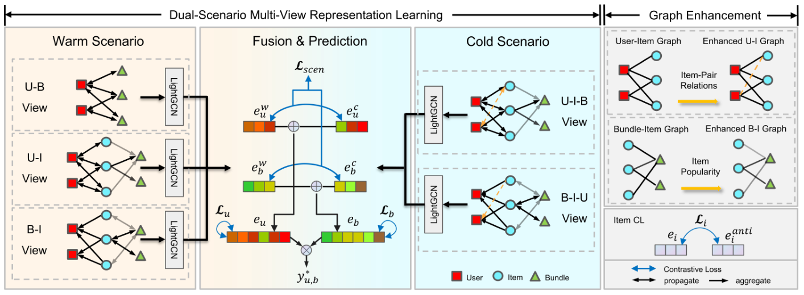

# EpicCBR: Item-Relation-Enhanced Dual-Scenario Contrastive Learning for Cold-Start Bundle Recommendation (物品关系增强的双场景对比学习冷启动捆绑推荐)

- **会议/期刊**: WSDM 2026
- **作者与机构**: Yihang Li, Zhuo Liu, Wei Wei (华中科技大学 计算机学院 / CCIIP 实验室)
- **推荐链路定位**: 召回
- **研究方向**: 冷启动与长尾推荐 / 图神经网络推荐
- **论文原文**: [https://arxiv.org/abs/2602.11680v1](https://arxiv.org/abs/2602.11680v1)
- **开源代码**: [https://github.com/alexlovecoding/EpicCBR](https://github.com/alexlovecoding/EpicCBR)

## TL;DR (1分钟核心速览)

针对新创建捆绑包缺乏用户-捆绑包 (UB) 交互、现有方法将捆绑包视为独立实例而浪费 UI/BI 物品关系的问题，EpicCBR 提出物品对关系挖掘（四类关系）增强用户画像 + 流行度感知的捆绑包表示 + 冷/暖双场景多视图对比学习框架。在 Youshu/NetEase/iFashion 三数据集冷启动划分下，iFashion 的 Recall@20 相对 SOTA (CoHeat) 提升达 387%，且暖场景不退化。

## Background & Motivation (背景与核心矛盾)

- **主流范式**: 捆绑推荐以 GNN + 对比学习为主（BGCN、CrossCBR、MultiCBR），依赖观测到的 UB 交互建模用户偏好。
- **前人局限**: (1) 新捆绑包无任何 UB 交互，仅学 UB 关系无法推导偏好信号；(2) MultiCBR 等多视图方法混合不同视图关系，冷/暖场景判据相互干扰；CoHeat 用课程学习逐步迁移视图，但孤立学习捆绑表示、耗时难扩展。
- **核心洞察 (Key Insight)**: 物品层面存在丰富但被忽视的关系——用户自发共购 (UI 图) 与平台主动组合 (BI 图) 的交叉可划分出四类物品对关系，其中"跨域互补"关系 (R2) 恰是冷启动捆绑包触达潜在用户的关键线索。
- **本文切入点**: 用物品对关系增强 UI 视图 + 流行度加权聚合物品表示新捆绑包，并以双场景对比学习解耦冷/暖信号。

## Method (核心方法设计)

### 1. 整体框架 (Overall Architecture)

模型分三条路径：(1) **冷路径**：从 UI/BI 图挖掘物品对关系，将 R2 边注入 UI 图得增强邻接 $\hat{G}_{UI}$，同时构建流行度加权的 BI 图 $\hat{G}_{BI}$，经 LightGCN 传播后做视图级早融合；(2) **暖路径**：用历史 UB/UI/BI 交互以相同 LightGCN 算子学习用户与捆绑嵌入，保证架构对齐；(3) **双场景对齐与打分**：多视图对比学习对齐两路径表示，最终以统一内积 $y^*_{u,b}=\langle e_u,e_b\rangle$ 做 Top-K 排序。重关系挖掘离线完成，在线仅需缓存嵌入检索与内积。

<figure class="paper-figure" markdown="span">
  <figcaption>图1：EpicCBR的整体框架。(1) 多视图表示学习包括用于历史交互建模的暖场景模块（用户-捆绑包视图、用户-物品视图、捆绑包-物品视图）和用于推断潜在交互的冷场景模块（用户-物品-捆绑包视图、捆绑包-物品-用户视图）。(2) 融合与预测通过对比损失整合两个场景的表示以生成推荐分数。</figcaption>
</figure>

### 2. 关键设计拆解 (Key Designs)

1. **物品对四类关系挖掘与视图增强**：痛点是用 UB 历史无法刻画新捆绑包的目标用户。以 Jaccard 相似度 $J_{i,j}=\frac{|E_{i,j}|}{C_i+C_j-|E_{i,j}|}$ 在 UI 与 BI 图上双重筛选（$\theta_{high}$ 取 95 分位、$\theta_{low}$ 取 20 分位、$\theta_{anti}$ 取 5 分位），划分 R1 同类、R2 跨域互补、R3 设计驱动、R4 反类。仅将 R2 边注入 UI 图：$A'_{UI}=A_{UI}+\alpha(A_{UI}\cdot A^{enh}_{II})$。直觉：R2 是"用户自发买、平台未组合"的信号，最能补充冷启动捆绑包的潜在受众；R4 则作为对比损失的强负样本。

2. **流行度感知的捆绑包表示**：新捆绑包无独立嵌入，需由组成物品聚合。物品流行度双源量化 $pop_i=pop^{UI}_i+pop^{BI}_i$，其中 BI 侧用 90 分位截断归一化 $w_b=\min(N^{UB}_b/P_{90},1)$ 抑制热门捆绑包主导；再经分段线性长尾自适应缩放得 $pop^{adj}_i$，作为 BI 图边权 $w^{pop}_{bi}$，按度归一化聚合：$e^{UI,cold}_b=\sum_{i\in N_b}\frac{w^{pop}_{bi}\cdot e^{UI,cold}_i}{\sqrt{D_b(b)D_i(i)}}$。直觉：把冷启动捆绑包"翻译"为热门物品表示，绕开对 UB 交互的强依赖。

3. **训练目标、负采样与推理效率**：总损失 $\mathcal{L}=\mathcal{L}_{BPR}+\beta_1(\mathcal{L}^C_u+\mathcal{L}^C_b)+\beta_2\mathcal{L}_{scen}+\beta_3\mathcal{L}^C_i+\beta_4\|\Theta\|^2_2$。其中 $\mathcal{L}_{scen}$ 为冷/暖场景同一用户/捆绑嵌入的 InfoNCE 对齐；$\mathcal{L}^C_i$ 以 R4 反类物品为负样本、仅自身为正样本，显式拉开互补与无关物品的语义边界；UB 对比损失沿用噪声注入增广 + in-batch 负采样。冷启动下调大 $\beta_1$ 以降低对 UB 历史的依赖。

## Experimental Setup & Evaluation Protocol (实验设置与评估协议)

- **数据集与预处理**: 三数据集均来自 CrossCBR 公开版本，未额外过滤：

| 数据集 | #Users | #Items | #Bundles | #UB 交互 (密度) | 平均捆绑大小 |
| :--- | :---: | :---: | :---: | :---: | :---: |
| Youshu | 8,039 | 32,770 | 4,771 | 51,377 (0.13%) | 37.03 |
| NetEase | 18,528 | 123,628 | 22,864 | 302,303 (0.07%) | 77.80 |
| iFashion | 53,897 | 42,563 | 27,694 | 1,679,708 (0.11%) | 3.86 |

- **数据划分与防穿越 (Splitting Strategy)**: 按 7:1:2 比例划分训练/验证/测试；冷启动设定下测试集捆绑包在训练集中完全未出现（严格零样本捆绑包），但允许其 BI 关联出现在训练集。
- **排名评测协议 (Ranking Protocol)**: 报告 Recall@20 与 nDCG@20，分 Cold / Warm / All 三种子集分别评估；未明确说明是否为 Full-Ranking，按 CoHeat 框架校准基线结果。
- **对比基线与超参设置**: 冷启动基线 DropoutNet、CVAR、CLCRec、CCFCRec、CoHeat、MultiCBR；暖启动基线 MFBPR、LightGCN、SGL、SimGCL、LightGCL、BGCN、CrossCBR、CoHeat。网格搜索 $\alpha\in\{0,0.1,\dots,1.0\}$、$k\in\{0.1,\dots,1.0\}$、$\tau\in\{0.1,\dots,1.0\}$、$\beta_{1\text{-}4}\in[0,1]$。

## Key Experimental Results (实验关键数据)

### 1. 主实验对比 (Main Results)

冷启动场景（Recall@20 / nDCG@20，Cold 子集）：

| Model | Youshu R@20 | Youshu nDCG | NetEase R@20 | NetEase nDCG | iFashion R@20 | iFashion nDCG |
| :--- | :---: | :---: | :---: | :---: | :---: | :---: |
| DropoutNet | .0022 | .0007 | .0028 | .0015 | .0009 | .0008 |
| CVAR | .0008 | .0002 | .0002 | .0001 | .0007 | .0004 |
| CLCRec | .0137 | .0087 | .0136 | .0075 | .0053 | .0043 |
| CCFCRec | .0044 | .0022 | .0007 | .0004 | .0005 | .0003 |
| CoHeat (SOTA) | .0183 | .0105 | .0191 | .0093 | .0170 | .0096 |
| MultiCBR | .0003 | .0001 | .0000 | .0000 | .0006 | .0003 |
| **EpicCBR** | **.0393** | **.0288** | **.0399** | **.0224** | **.0828** | **.0711** |
| Improv. vs CoHeat | +114.8% | +174.3% | +108.9% | +140.9% | **+387.1%** | +640.6% |

暖启动场景（Recall@20）：EpicCBR 在 Youshu (.2896 vs CoHeat .2804)、NetEase (.0931 vs .0847)、iFashion (.1474 vs .1156) 全面领先，较 CrossCBR 分别 +4.3% / +17.7% / +30.1%。

### 2. 消融实验 (Ablation Study)

冷启动场景 Recall@20：

| 变体 | Youshu | NetEase | iFashion |
| :--- | :---: | :---: | :---: |
| EpicCBR-enh (用 MultiCBR 原图) | .0370 | .0340 | .0441 |
| EpicCBR-UI-enh (去掉 R2 注入) | .0381 | .0372 | .0741 |
| EpicCBR-pop (去掉流行度加权) | .0321 | .0355 | .0471 |
| EpicCBR-iiloss (去掉物品对对比损失) | .0385 | .0381 | .0764 |
| **EpicCBR (full)** | **.0393** | **.0399** | **.0828** |

### 3. 关键实验发现 (Key Findings)

1. **流行度加权是冷启动最大贡献项**：去掉后 iFashion 从 .0828 骤降至 .0471（-43%），Youshu 从 .0393 降至 .0321，说明新捆绑包表示几乎完全依赖物品流行度聚合，而非 UB 信号。
2. **iFashion 的 387% 提升源于极端 BI 稀疏**：其平均捆绑大小仅 3.86，单物品表示质量被放大；R2 关系让"高交互但低共现"的物品对互补信息，恰好弥补稀疏损失，故该数据集上 UI 增强与物品对比损失增益也最大。
3. **物品对对比损失在小捆绑数据集上可能反噬**：EpicCBR-iiloss 在 iFashion 上反而略高（.0764 vs .0828 的差距小于其他数据集），作者归因于小捆绑下物品级负样本引入噪声；同时场景权重 $k$ 在混合 All 集上呈明显峰值，证明冷/暖双路径需精细平衡而非简单相加。

## Highlights, Limitations & Rating (亮点、对比与审稿评价)

- **与代表作对比 (vs. Prior Work)**: 相比 CoHeat 的课程式视图迁移，EpicCBR 用双场景并行 + 对比对齐解耦冷/暖信号，避免视图干扰；相比 MultiCBR 仅用历史交互构图，本文显式挖掘 R1–R4 物品关系并注入 R2 边，使冷启动捆绑包可借物品语义触达用户；相比 CrossCBR 的单一暖场景图对比，本文新增流行度感知 BI 图作为冷启动表示的唯一来源。
- **可迁移亮点**: (1) 双 Jaccard 阈值 + 分位数筛选的四类物品关系框架可直接迁移到跨域推荐与捆绑生成；(2) 用 90 分位截断归一化 + 分段线性缩放处理长尾流行度，是轻量且通用的边权设计。
- **审稿级局限批判**: (1) 未明确 Full-Ranking 协议，冷启动基线数值极低（如 MultiCBR 近 0），可能受采样排序影响，绝对提升幅度需谨慎解读；(2) 关系挖掘依赖多组分位数阈值与 $\alpha,k,\tau,\beta_{1\text{-}4}$ 大量超参，跨数据集迁移成本高，且物品对对比损失在小捆绑场景存在负迁移风险。
- **四维评分**: 创新性 ⭐⭐⭐⭐ | 实验扎实度 ⭐⭐⭐⭐ | 方法清晰度 ⭐⭐⭐⭐ | 落地价值 ⭐⭐⭐⭐

