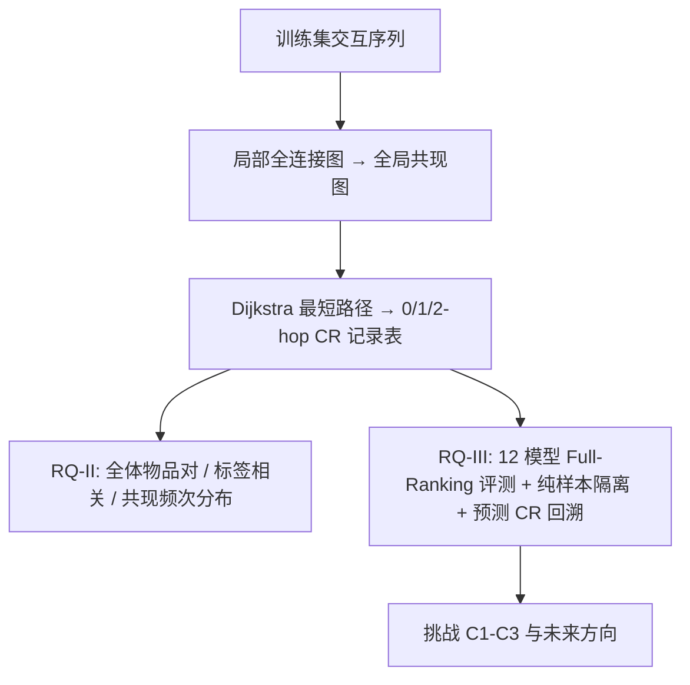

# Have We Really Understood Collaborative Information? An Empirical Investigation (我们真的理解协作信息了吗？一项实证研究)

- **会议/期刊**: WSDM 2026
- **作者与机构**: Xiaokun Zhang, Bowei He, Ziqiang Cui, Chen Ma (香港城市大学)；Zhaochun Ren (莱顿大学)
- **推荐链路定位**: 召回（序列推荐 next-item 预测）
- **研究方向**: 协同过滤与双塔召回 / 序列与会话推荐
- **论文原文**: [论文原文链接](https://arxiv.org/abs/2511.06905v2)
- **开源代码**: [开源代码仓库链接](https://github.com/Zhang-xiaokun/CI_Investigation)

## TL;DR (1分钟核心速览)

协作信息（CI）是推荐系统的基石，但社区长期缺乏其**定量定义**，也不清楚它在交互数据中如何分布、对模型性能究竟贡献几何。本文把 CI 具体化为物品共现模式，依据全局共现图上的最短路径长度提出 **0/1/2-hop 协作关系 (CR)** 的量化定义，并在 6 个基准、12 种方法（传统 KNN、神经序列模型、LLM-based P5）上做系统实证。核心发现：0-hop CR 仅占全部物品对的 <1% 却在测试标签中高频出现；神经模型相对传统方法的优势几乎全部来自**复杂 CR** 的处理能力；所有模型预测均 100% 依赖 CR，但绝大多数只用到简单 CR。该工作不含新模型，价值在于为后续"如何更好利用复杂协作关系"提供实证坐标系。

## Background & Motivation (背景与核心矛盾)

- **主流范式**: 从 Matrix Factorization、Item-KNN 到 GRU4Rec/BERT4Rec/SR-GNN/MSGIFSR，再到 LLM-based P5，所有仅依赖 item ID 序列的方法本质上都在挖掘用户-物品交互中的物品共现模式。
- **前人局限**: 其一，CI 只有"Beer and Diapers"式的定性描述，**没有可计算、可分层的定量定义**，导致无法细粒度考察模型到底学到了哪一类协作关系；其二，现有方法只用 Prec@k/MRR@k 的整体提升来"宣称"捕获了 CI，**无法归因**性能增益来自简单共现还是复杂传递关系。
- **核心洞察 (Key Insight)**: 把每条交互序列视为全连接局部图、聚合为全局共现图后，物品对之间的最短路径长度天然编码了 CI 的三大特性——**传递性**（1-hop 由两条 0-hop 传递而来）、**层次性**（按路径复杂度分层）、**冗余性**（同一对物品存在多条路径，仅保留最近者）。由此可用"跳数"给 CI 分层。
- **本文切入点**: 不做新模型，而是建立"定义—分布—影响"三段式实证框架，回答 RQ-I/II/III，把 CI 从模糊概念变成可测量对象。

## Method (核心方法设计)

### 1. 整体框架 (Overall Architecture)

论文以序列推荐为统一实验载体：输入用户历史序列 $\mathcal{S}=[x_1,\dots,x_m]$，目标是预测 $x_{m+1}$。在此设定下，先把训练集每条序列构造成全连接局部图，合并节点与边得到全局共现图；再用 Dijkstra 计算任意物品对最短路径长度，据此为每个物品对打上 CR 类型标签，形成"CR 记录表"。该表同时服务于三条分析线：(a) 统计训练集全体物品对的 CR 分布（模型学习阶段会遇到什么）；(b) 对测试样本检索标签物品与序列内各物品的 CR（模型推理阶段需要预测什么）；(c) 对模型 top-10 推荐列表逐项回溯其与历史物品的 CR（模型实际依赖什么）。最后在"纯样本"（标签物品与序列内所有物品仅存在单一类型 CR）上隔离单一 CR 的影响。

### 2. 关键设计拆解 (Key Designs)

1. **基于最短路径的 CR 分层量化定义**：痛点是 CI 无定量刻画。定义：若两物品在至少一条序列中共现（全局图邻居）则为 **0-hop CR**；不共现但为全局图一跳邻居为 **1-hop CR**；既不共现也无 1-hop 关系但为二跳邻居为 **2-hop CR**，可自然推广到高阶。形式化地，物品对 $(i,j)$ 的 CR 类型为
$$\text{CR}(i,j)=\min_{p\in\mathcal{P}_{ij}} |p| - 1,$$
其中 $\mathcal{P}_{ij}$ 为全局共现图上 $i,j$ 间所有路径集合，$|p|$ 为路径边数；仅保留最短路径即落实"冗余性"去冗余。直觉：跳数越少，共现证据越直接、越易被统计式方法捕获；跳数越多，越依赖模型的表示与传递推理能力。

2. **纯样本隔离实验设计**：痛点是真实测试样本中标签物品往往同时具备多种 CR，无法判断模型究竟用了哪一种。作者筛出"标签物品与序列内**所有**物品仅存在同一类型 CR"的纯样本（如 Grocery 上 0-hop 纯样本 1,256 条、1-hop 905 条、2-hop 543 条），从而把不同 CR 类型对性能的边际贡献解耦。这是全文因果归因的关键实验装置。

3. **预测结果 CR 回溯分析**：对每个测试样本的 top-10 推荐项，逐一查询其与历史序列各物品的 CR 类型并统计占比，直接度量模型"实际使用"的协作关系谱。发现所有数据集中**不存在**推荐项与历史完全无 CR 的情况，即现有 RS 的个性化输出 100% 建立在 CR 之上；且简单 CR 占比普遍远高于复杂 CR，说明模型名义上能编码复杂关系，实际预测仍偏向简单共现。

4. **训练目标与评测协议**：本文不提出新损失函数，所有基线沿用原论文实现与损失（BPR、CE 等），统一采用 **Full-Ranking 全库排序**训练范式，embedding 维度在 $\{64,128,256,512,1024\}$ 网格搜索，仅输入 item ID 序列以排除文本/图像语义干扰。

## Experimental Setup & Evaluation Protocol (实验设置与评估协议)

- **数据集与预处理**: 统一过滤长度 1 的序列与出现次数 <5 的物品（5-core），序列末位为标签：

| 数据集 | #Items | #Interactions | #Sequences | 平均长度 | 场景说明 |
| :--- | :---: | :---: | :---: | :---: | :--- |
| Grocery | 7,910 | 152,102 | 40,534 | 3.75 | Amazon，单日行为构序列 |
| Cellphones | 10,737 | 150,568 | 46,315 | 3.25 | Amazon，单日行为构序列 |
| Cosmetics | 24,100 | 406,214 | 45,893 | 8.85 | 中型美妆电商，add_to_cart/purchase |
| Diginetica | 22,507 | 349,959 | 67,350 | 5.20 | CIKM Cup 2016 电商搜索日志 |
| Yoochoose | 11,642 | 868,812 | 194,992 | 4.46 | RecSys Challenge 2015，1/64 采样 |
| Tmall | 17,360 | 172,028 | 21,811 | 7.89 | 天猫单日点击构序列 |

- **数据划分与防穿越 (Splitting Strategy)**: 按时间顺序 **7:2:1 比例划分**训练/验证/测试；验证与测试中剔除未在训练集出现的物品，保证 CR 记录表（仅由训练集构建）对测试样本可查，避免信息穿越。
- **排名评测协议 (Ranking Protocol)**: 无偏 **Full-Ranking（全库未交互物品排序）**，指标 Prec@10 与 MRR@10，$k=10$。
- **对比基线与超参设置**: 12 种方法覆盖三类——传统（BPR-MF、Item-KNN、SKNN）、神经（GRU4Rec、NARM、BERT4Rec、SR-GNN、LESSR、DHCN、MSGIFSR、Atten-Mixer）、LLM-based（P5-base，编解码各 12 层 Transformer）。所有方法仅用 item ID 输入，超参在验证集网格搜索。

## Key Experimental Results (实验关键数据)

### 1. 主实验对比 (Main Results)

六个基准上的 Prec@10 / MRR@10（节选代表性基线，加粗为列内最优）：

| Method | Grocery P@10 | Grocery MRR | Cellphones P@10 | Cellphones MRR | Diginetica P@10 | Diginetica MRR | Yoochoose P@10 | Yoochoose MRR | Tmall P@10 | Tmall MRR |
| :--- | :---: | :---: | :---: | :---: | :---: | :---: | :---: | :---: | :---: | :---: |
| BPR-MF | 12.60 | 3.36 | 1.04 | 0.21 | 3.37 | 1.21 | 13.36 | 5.03 | 6.23 | 2.33 |
| Item-KNN | 29.62 | 19.50 | 8.04 | 5.70 | 32.20 | 12.35 | 45.99 | 21.74 | 20.67 | 10.43 |
| SKNN | 39.21 | 16.33 | 14.64 | 6.28 | 33.95 | 13.06 | 50.35 | 23.21 | 23.37 | 14.87 |
| GRU4Rec | 33.61 | 29.46 | 8.95 | 6.79 | 17.50 | 8.27 | 38.35 | 20.66 | 12.30 | 8.36 |
| BERT4Rec | 43.72 | 36.05 | 17.76 | 10.84 | 34.05 | 12.99 | 59.85 | 30.11 | 24.00 | 12.79 |
| SR-GNN | 35.81 | 30.56 | 14.34 | 10.02 | 19.77 | 9.60 | 54.58 | 27.97 | 17.97 | 10.47 |
| DHCN | 40.98 | 30.29 | 18.53 | 10.32 | 35.74 | 14.25 | 57.18 | 28.15 | 37.14 | 22.52 |
| **MSGIFSR** | **44.77** | **36.13** | **20.64** | **12.98** | **41.70** | **16.89** | **62.68** | **33.30** | **39.83** | **24.90** |
| P5 (LLM) | 38.43 | 32.15 | 11.16 | 9.19 | 26.56 | 12.70 | 46.66 | 27.41 | 38.62 | 24.81 |

MSGIFSR 在 6 个数据集上几乎全面最优（相对次优 DHCN 在 Tmall P@10 上 +2.69，相对 BERT4Rec 在 Diginetica P@10 上 +7.65）；P5 在多数数据集被神经模型超越，仅在 Tmall 上接近 MSGIFSR。

### 2. 消融/隔离实验 (Isolated CR Analysis)

由于本文无模型组件可消融，以"纯样本隔离"与"直接 vs 间接 CR 分组"作为等价分析表（Prec@10 定性趋势，数值取自图 5/图 6）：

| 分析维度 | 0-hop (直接) | 1-hop | 2-hop | 结论 |
| :--- | :---: | :---: | :---: | :--- |
| SKNN（传统） | 高 | 中 | 低 | 仅擅长直接共现 |
| NARM（神经） | 中 | 中高 | 中 | 复杂 CR 上反超 SKNN |
| BERT4Rec | 高 | 中高 | 中 | 复杂 CR 优势明显 |
| MSGIFSR | 最高 | 高 | 中高 | 多子图捕获细粒度共现 |
| P5（LLM） | 中 | 中 | 中 | 跨 CR 类型波动最小 |
| 直接 vs 间接分组 | 显著更高 | — | 显著更低 | 全体模型在间接 CR 上明显掉点 |

### 3. 关键实验发现 (Key Findings)

1. **简单 CR 稀缺但决定性**：0-hop CR 仅占全体物品对的 0.19%–0.99%，却在测试标签相关 CR 中高频出现（Yoochoose 达 67.04%，Cellphones 仅 18.31%），且数据集整体性能与该比例正相关——Yoochoose 上多数神经模型 P@10 >50%，Cellphones 上不足 20%，说明"简单 CR 占比"是跨数据集性能差异的重要解释变量。
2. **神经模型的增益几乎全部来自复杂 CR**：在 Tmall 的 0-hop 纯样本上 NARM 反而输给 SKNN，但在 1-hop/2-hop 纯样本上大幅反超；预测回溯也显示传统方法的简单 CR 占比远高于神经模型，而复杂 CR 占比相反——技术演进（KNN→神经→LLM）的本质是"利用复杂 CR 的能力在提升"。
3. **LLM 的独特价值在复杂 CR 的稳定性**：P5 整体精度不及 MSGIFSR，但其在不同 CR 类型间的性能落差最小（Cosmetics 上尤为明显），且预测中复杂 CR 占比高于其他方法，暗示 LLM 的世界知识可部分补偿其对 item ID 协作知识的缺失——这为"向 LLM 注入协作知识"（挑战 C3）提供了实证依据。

## Highlights, Limitations & Rating (亮点、对比与审稿评价)

- **与代表作对比 (vs. Prior Work)**: 与 MSGIFSR/Atten-Mixer 等"提出更强共现建模网络"的工作不同，本文不追求 SOTA，而是提供度量工具；与 Item-KNN 的共现频次相似度相比，本文用最短路径跳数把"直接共现"与"传递共现"解耦；与既有 LLM4Rec 评测相比，本文首次量化揭示 LLM 在协作知识上的结构性短板与复杂 CR 稳定性优势。
- **可迁移亮点**: (1) "纯样本隔离"思路可迁移到任何需要归因数据难度来源的评测设计（如长尾、冷启动分桶）；(2) CR 记录表可作为轻量辅助特征或课程学习的分层采样信号，用于难样本挖掘与复杂关系增广。
- **审稿级局限批判**: 其一，CR 定义依赖训练集全局图与最短路径，稠密图上 Dijkstra 全对计算为 $O(|V|^2\log|V|)$ 级，大规模工业场景需近似最短路或采样，且定义对序列切分粒度（单日/单次会话）高度敏感；其二，实验仅覆盖 item ID 序列推荐与 6 个中小规模基准，未验证特征丰富场景与工业级数据，且"纯样本"在部分数据集上样本量偏小（如 Cosmetics 2-hop 仅 77 条），统计显著性有限。
- **四维评分**: 创新性 ⭐⭐⭐⭐ | 实验扎实度 ⭐⭐⭐⭐ | 方法清晰度 ⭐⭐⭐⭐⭐ | 落地价值 ⭐⭐⭐⭐

