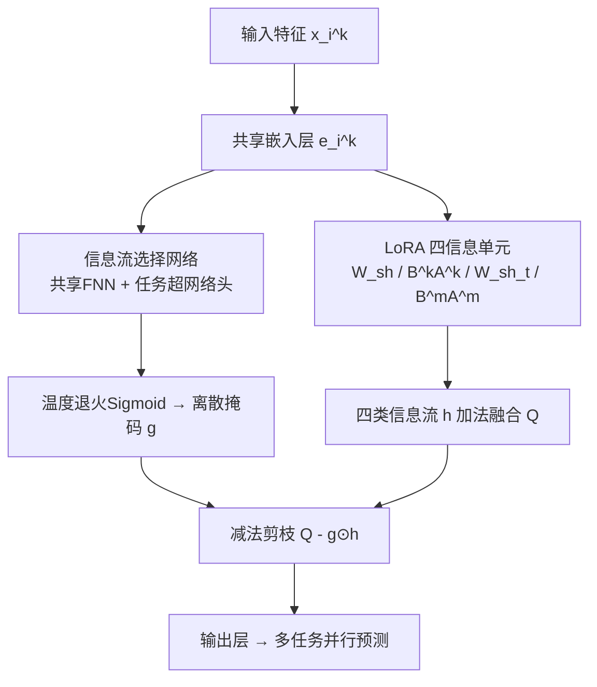
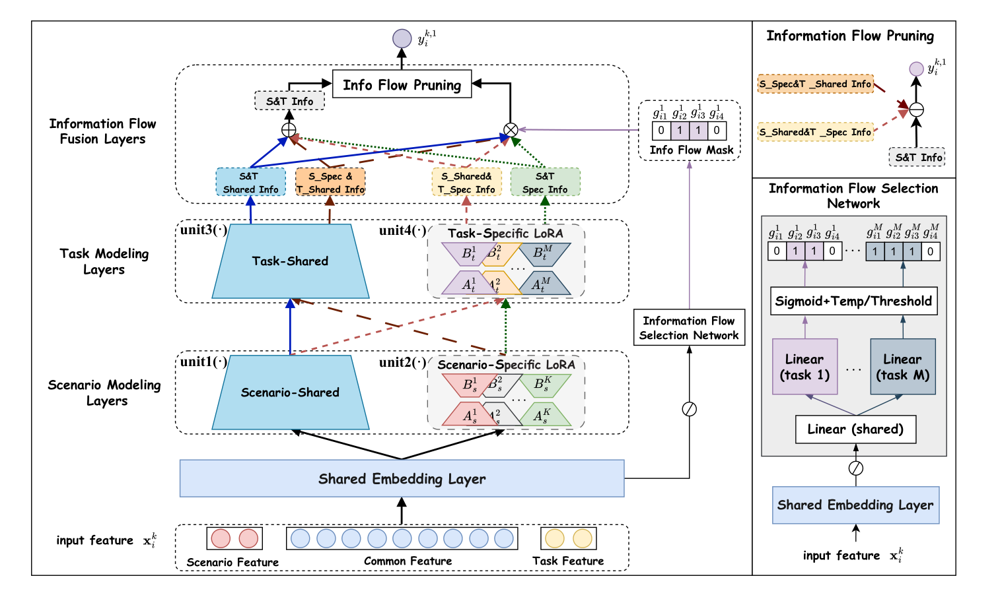

# Automated Information Flow Selection for Multi-scenario Multi-task Recommendation (多场景多任务推荐中的自动化信息流选择)

- **会议/期刊**: WSDM 2026
- **作者与机构**: Chaohua Yang, Dugang Liu, Zhong Ming (深圳大学)；Shiwei Li (华中科技大学)；Xing Tang, Xiuqiang He (深圳技术大学)；Weihong Luo (腾讯金融科技 FIT)；Xiangyu Zhao (香港城市大学)
- **推荐链路定位**: 精排（多场景多任务统一排序）
- **研究方向**: 跨域与多场景推荐 / 多任务学习与列表级重排
- **论文原文**: [https://arxiv.org/abs/2512.13396v1](https://arxiv.org/abs/2512.13396v1)
- **开源代码**: [https://github.com/ChaohuaYang/AutoIFS](https://github.com/ChaohuaYang/AutoIFS)

## TL;DR (1分钟核心速览)

多场景多任务推荐（MSMTR）现有模型依赖 MoE/MLP 堆叠四类信息单元（场景共享/独有 × 任务共享/独有），既参数膨胀又把四类"场景→任务"信息流不加区分地全量融合，引入噪声甚至负迁移。本文提出 AutoIFS：用 LoRA 低秩适配器解耦四类信息单元（共享用全秩 $W$、独有用低秩$BA$，加法即天然融合），再用超网络式信息流选择网络为每个实例、每个任务生成 4 维软掩码，经温度退火离散化后以**减法剪枝**剔除无效信息流。在 MovieLens-1M / KuaiRand-Pure 上按 8:1:1 比例划分、AUC 全场景全任务最优（整体 AUC 0.8253 / 0.7471），参数量仅略高于 MLoRA、远低于 HiNet，腾讯 FiT 线上两周 A/B 平均 CVR +2.46%、订阅金额 +8.32%。

## Background & Motivation (背景与核心矛盾)

- **主流范式**: MSMTR 采用分层范式——嵌入层 → 场景建模层（场景共享 $f_s^{sh}$+ 场景独有$f_s^k$）→ 任务建模层（任务共享$f_t^{sh}$+ 任务独有$f_t^m$），四单元交叉产生四类有向信息流$h^{sh,sh}, h^{sh,m}, h^{k,sh}, h^{k,m}$，最终融合为$Q_i^{k,m}$。代表作为 HiNet（层次蒸馏）、M3oE（三路 MoE）、M2M/3MN（元网络动态权重）。
- **前人局限**: ① 依赖 MoE/MLP 显式建模四类关系，参数量随场景数×任务数线性膨胀，融合逻辑复杂、训练困难（M2M 单 epoch 训练 30.3s，HiNet 18.5s）；② 按 Eq.(3) 将四类信息流**无差别全量相加**，无法区分其贡献差异——在主场景子任务中 $h^{k,m}$ 才是关键，其余信息流可能纯属噪声，造成负迁移。
- **核心洞察 (Key Insight)**: 四类信息流是复杂场景-任务依赖的**可分解局部成分**，其重要性随实例（场景属性）与任务而变；因此"选哪些流"应是一个**实例级、任务级可学习**的决策，而非固定架构。
- **本文切入点**: 用 LoRA 让四类单元天然解耦且加法即融合（保持轻量），再用一个可微掩码网络自动剪掉无用信息流。

## Method (核心方法设计)

### 1. 整体框架 (Overall Architecture)

输入实例 $x_i^k$经共享嵌入层得$e_i^k$；四类信息单元由 LoRA 实现——场景/任务共享单元为全秩线性层$W^{sh}x+b^{sh}$，场景/任务独有单元为低秩$B^kA^kx+b^k$（$A$高斯初始化、$B$零初始化），四类信息流$h_i^{\cdot,\cdot}$由单元组合直接算出并以"+"融合（此时恰为原 Eq.(2) 的分解形式）。并行地，选择网络以共享 FNN 提取实例表征、再经任务专属超网络头输出 4 维权重，温度退火 sigmoid 得软门控、训练末离散化为 0/1 掩码，最后用**减法**从融合表征中剔除被掩码的信息流，直接接输出层（不设预测塔）。训练分两阶段：联合训练（含$l_1$ 稀疏正则）→ 固定掩码重训（reuse）。

<figure class="paper-figure" markdown="span">
  <figcaption>图2：自动化信息流选择（AutoIFS）框架的架构，以任务1作为具体任务示例，而模型实际上并行输出多个任务的预测。</figcaption>
</figure>

### 2. 关键设计拆解 (Key Designs)

1. **LoRA 解耦四信息单元（轻量化的关键）**：痛点是用 MoE/MLP 建模四单元参数爆炸且融合算子复杂。本文令共享信息走全秩 $W$、独有信息走低秩$BA$，则四类流可独立计算后**直接相加**即完成融合，且仅在独有单元上付出$r(d_{in}+d_{out})$ 的极小参数代价：
$$h_i^{sh,sh}=f_t^{sh}(f_s^{sh}(e_i^k)),\quad h_i^{k,m}=f_t^{m}(f_s^{k}(e_i^k)),\quad Q_i^{k,m}=\sum h_i^{\cdot,\cdot}$$
直觉：低秩瓶颈天然抑制独有信息的过拟合（MovieLens 上最优 $r=2$ 即印证），加法融合则保证可解释的流级分解。

2. **任务感知信息流选择网络 + 减法剪枝**：痛点是四类流重要性因实例/任务而异，简单 FNN 无法刻画场景差异。本文先共享 FNN 提表征 $h_i^L$，再由任务专属头$w_i^m=W^mh_i^L+b^m$生成权重，经温度退火$\tau=\gamma^{p/P}$的 sigmoid 得连续门控$g_i^m=\phi(w_i^m\times\tau)$，训练$P$轮后按$w_i^m\le 0$ 硬离散化。剪枝采用**减法**而非乘法置零：
$$\delta(Q_i^{k,m},\hat I_i^{k,m})=Q_i^{k,m}-\sum_{j=1}^{4}g_{ij}^m\odot h_i^{j}$$
直觉：减法保留未被选中流的原始幅值，避免乘法掩码对保留流的缩放失真；实验还发现额外预测塔反而削弱场景-任务关系刻画，故直接去掉。

3. **训练目标、正则与两阶段优化**：总损失 $\mathcal{L}_{AutoIFS}=\mathcal{L}_{CE}+\lambda\|\mathbf{g}\|_1$，$l_1$近似$l_0$促稀疏并防止过度剪枝；**免负采样**（CTR 式二分类交叉熵，非对比学习）。Reuse 阶段固定最优掩码$\{G_i\}$仅以$\mathcal{L}_{CE}$重训$\Theta$共$P_c$ 轮，消除"选择网络与主干联合优化"的相互干扰。推理时选择网络仅为一个轻量 MLP，额外开销可忽略（线上延迟 2.74ms → 2.98ms）。

## Experimental Setup & Evaluation Protocol (实验设置与评估协议)

- **数据集与预处理**: MovieLens-1M 按 `age` 切 3 场景、以 rating≥4 / ≥5 构造 click / like 两任务，**不做低频过滤**；KuaiRand-Pure 按 `tab` 切 3 场景、click / long-view 两任务，低频特征阈值 2。

| 数据集 | 场景 | #Users | #Items | #Instances | 占比 | 说明 |
| :--- | :---: | :---: | :---: | :---: | :---: | :--- |
| MovieLens-1M | S1/S2/S3 | 1,325 / 2,096 / 2,619 | 3,429 / 3,508 / 3,595 | 210,747 / 395,556 / 393,906 | 21.1% / 39.6% / 39.4% | 电影评分，age 分场景 |
| KuaiRand-Pure | S1/S2/S3 | 15,398 / 27,049 / 11,809 | 6,233 / 7,580 / 4,633 | 178,087 / 2,236,414 / 93,165 | 7.1% / 89.2% / 3.7% | 短视频，tab 分场景，S2 极度主导 |

- **数据划分与防穿越 (Splitting Strategy)**: 每场景内**比例划分** 8:1:1（train/valid/test），非 Leave-One-Out、非全局时间戳切分。
- **排名评测协议 (Ranking Protocol)**: 本质为 CTR 式二分类打分评估，报告 **AUC↑ 与 LogLoss↓**（非 Full-Ranking 排序指标）；AUC 提升 >0.1% 视为显著，双样本 t 检验 $p\le0.05$。
- **对比基线与超参设置**: 基线含多任务（DNN-T/MMoE-T/MLoRA-T）、多场景（-S）、MSMTR（-ST 改造版、M3oE、M2M、HiNet）共 12 个；嵌入维度 $d=16$、batch 4096、Adam + Xavier、MLP 三层 [1024,512,256]；AutoIFS 搜索$r\in\{2..64\}$、$\gamma\in\{50..10000\}$、$\lambda\in\{0..0.5\}$、$P\in\{5,10,15,20\}$，最终 MovieLens 取$r=2$、KuaiRand 取$r=16$。

## Key Experimental Results (实验关键数据)

### 1. 主实验对比 (Main Results)

整体性能（各场景各任务明细见原文 Table 2，此处取 Overall 两列）：

| 模型 | ML-1M AUC↑ | ML-1M LogLoss↓ | KuaiRand AUC↑ | KuaiRand LogLoss↓ |
| :--- | :---: | :---: | :---: | :---: |
| DNN-ST | 0.8202 | 0.4662 | 0.7432 | 0.4339 |
| MMoE-ST | 0.8225 | 0.4614 | 0.7413 | 0.4373 |
| MLoRA-ST | 0.8218 | 0.4624 | 0.7441 | 0.4329 |
| M3oE | 0.8212 | 0.4651 | 0.7423 | 0.4360 |
| M2M | 0.8221 | 0.4675 | 0.7424 | 0.4354 |
| HiNet | 0.8221 | 0.4614 | 0.7447 | 0.4347 |
| **AutoIFS** | **0.8253\*** | **0.4575\*** | **0.7471\*** | **0.4319\*** |
| Improv.% (vs 最优基线) | +0.39% | −0.85% | +0.32% | −0.23% |

效率对比（MovieLens-1M）：AutoIFS 单 epoch 训练 10.66s、推理 0.0039s，与 DNN-ST（10.55s / 0.0038s）、MLoRA-ST（10.23s / 0.0033s）持平，远优于 M2M（30.30s / 0.1978s）与 HiNet（18.47s / 0.0774s）；模型规模仅略高于 MLoRA 系列，显著低于 M3oE/M2M/HiNet（图 3）。

### 2. 消融实验 (Ablation Study)

| 变体 | ML-1M S1T1 | ML-1M S3T2 | KuaiRand S1T1 | KuaiRand S3T2 |
| :--- | :---: | :---: | :---: | :---: |
| n.re.（去 reuse） | 0.8171 | 0.8180 | 0.7000 | 0.7309 |
| n.sn.（去选择网络） | 0.8167 | 0.8179 | 0.7035 | 0.7312 |
| n.di.（去离散化） | 0.8168 | 0.8187 | 0.7013 | 0.7328 |
| n.rp.（去 $l_1$ 正则） | 0.8191 | 0.8196 | 0.7016 | 0.7346 |
| w.rs.（随机选择） | 0.8177 | 0.8173 | 0.6963 | 0.7301 |
| w.fn.（单 FNN 选择） | 0.8167 | 0.8180 | 0.6976 | 0.7306 |
| w.me.（LoRA→MoE） | 0.8169 | 0.8177 | 0.6929 | 0.7332 |
| w.pt.（加预测塔） | 0.8169 | 0.8191 | 0.7007 | 0.7345 |
| **AutoIFS** | **0.8191** | **0.8196** | **0.7020** | **0.7357** |

### 3. 关键实验发现 (Key Findings)

1. **选择网络与 reuse 是两大主增益源**：去掉选择网络（n.sn.）或改随机选择（w.rs.）在 KuaiRand S1T1 上分别掉至 0.7035 / 0.6963（全表最低），说明"学出来的流级掩码"而非"任意剪枝"才是收益来源；去掉 reuse 在 ML-1M S1T1 掉 0.0020，印证联合优化会污染主干。
2. **LoRA 优于 MoE 且更省参**：w.me. 在 KuaiRand S1T1 跌至 0.6929（较 AutoIFS 掉 0.0091），而 AutoIFS 参数量却远低于 M3oE/HiNet——低秩瓶颈既控参又起正则作用；$r$的最优值随数据规模分化（ML-1M$r=2$防过拟合，KuaiRand$r=16$需更大容量），$\gamma,\lambda$ 则表现稳健。
3. **掩码具备可解释性且线上兑现**：图 5 显示 ML-1M 上 Task1 倾向剪掉 $h^{sh,sh}$与$h^{k,m}$、Task2 倾向剪掉$h^{sh,m}$与$h^{k,sh}$，KuaiRand Task1 则四流全保留——不同场景-任务对信息流偏好确实异质；腾讯 FiT 四周场景两周 A/B 中 CTR 均 +0.87%、CVR 均 +2.46%、订阅金额均 +8.32%，延迟仅 +0.24ms。

## Highlights & Limitations (亮点、对比与审稿批判)

- **与代表作对比 (vs. Prior Work)**: 相比 HiNet 的层次蒸馏与 M3oE 的三路 MoE——二者均"全量建模关系空间"，AutoIFS 首次把问题重述为**流级掩码选择**；相比 MLoRA 仅用 LoRA 做域解耦，本文进一步把 LoRA 与可微剪枝耦合，实现"解耦 + 筛选"一体化。
- **可迁移亮点**: ① "共享走全秩、独有走低秩 + 加法融合"可作为任意多域/多任务骨干的轻量替换件；② 温度退火 sigmoid → 硬离散化的软掩码训练范式，可直接迁移到特征选择、专家路由等离散决策场景。
- **审稿级局限批判**: ① 评估仅用 AUC/LogLoss，缺少 GAUC 与 Full-Ranking 排序指标，且两数据集场景数仅 3、任务数仅 2，场景/任务规模化后的掩码搜索空间（$4^{KM}$）与稳定性未验证；② 掩码为实例级硬 0/1，离散化阈值固定为 0，对$\gamma$退火日程与$P$ 较敏感，且 reuse 阶段需额外重训，整体调参链路偏长。

## Rating (四维评分)

- **方法创新性 (Novelty)**: ⭐⭐⭐⭐ （核心机制与方法设计具备明确创新性，理论与实验动机支撑充分）
- **评估协议与实验扎实度 (Protocol & Experiments)**: ⭐⭐⭐⭐ （主流公开数据集评测完整，包含多基线对比与消融实验验证）
- **写作与数学规范度 (Clarity & Rigor)**: ⭐⭐⭐⭐⭐ （问题形式化定义清晰，核心模块数学推导与架构阐述严谨易读）
- **工业落地与复现价值 (Industrial & Practical Value)**: ⭐⭐⭐⭐⭐ （兼顾推荐效果增益与训练/推理效率，具备实际场景迁移参考价值）
